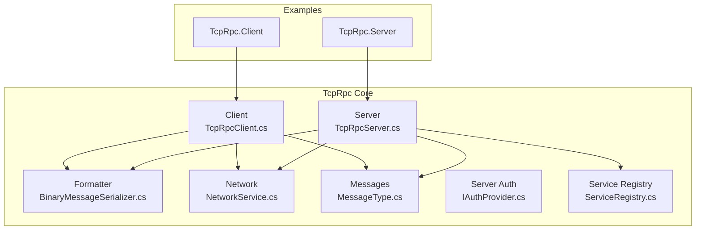
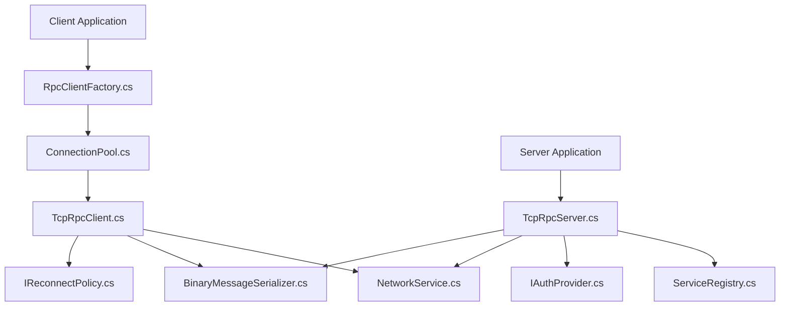
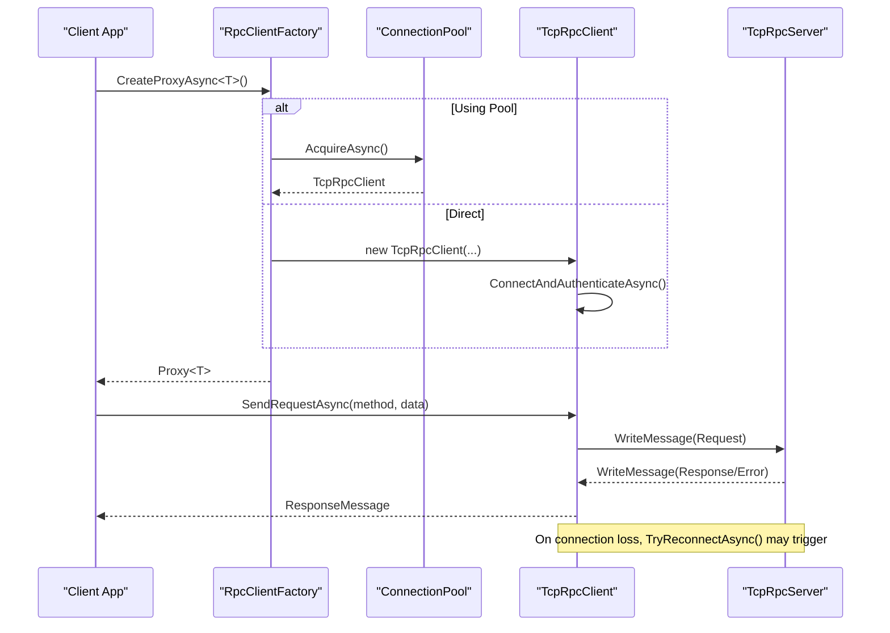
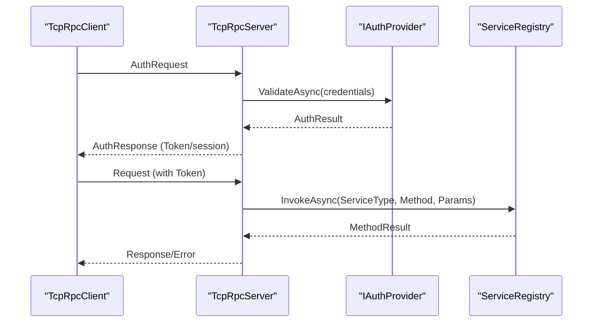
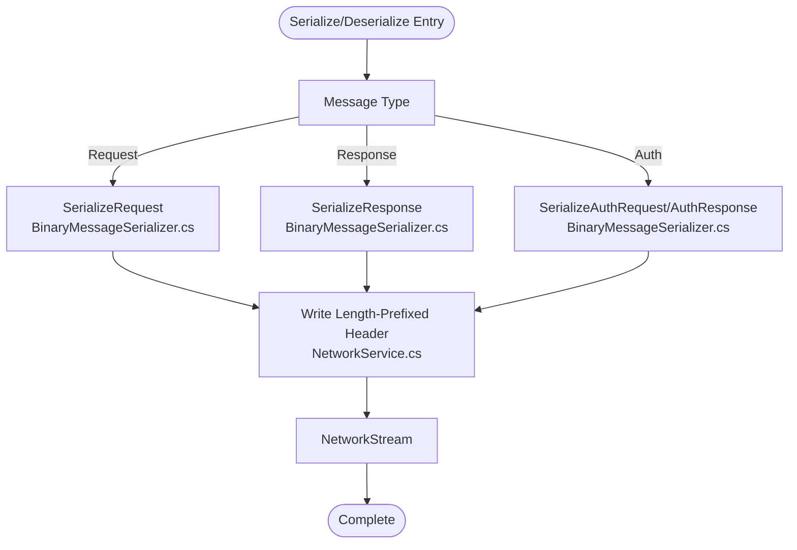
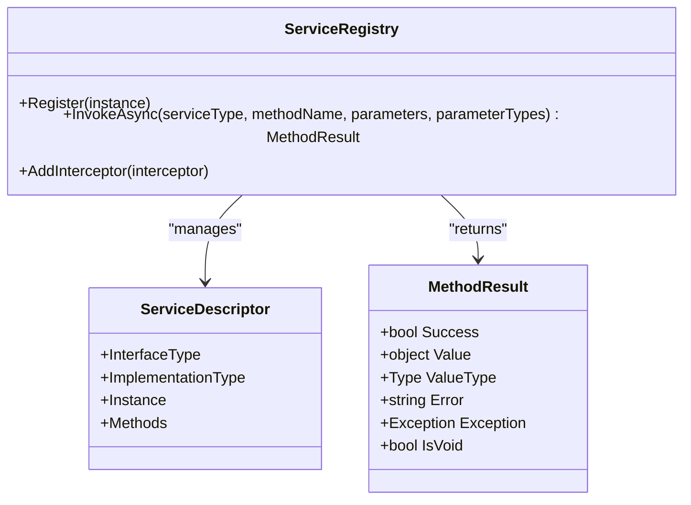
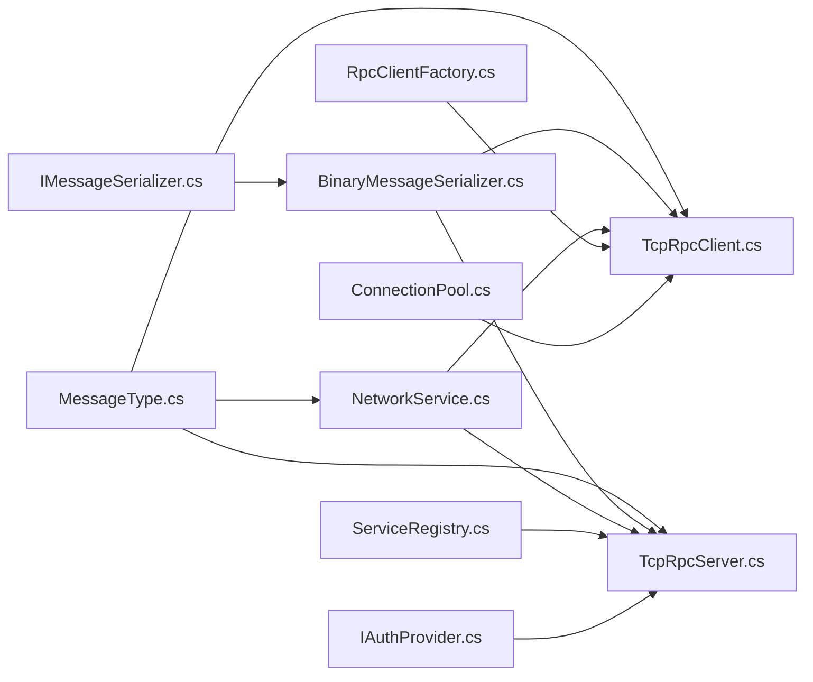

# Project Overview

<cite>
**Referenced Files in This Document**
- [TcpRpc.csproj](file://TcpRpc/TcpRpc.csproj)
- [TcpRpcClient.cs](file://TcpRpc/Client/TcpRpcClient.cs)
- [ConnectionPool.cs](file://TcpRpc/Client/ConnectionPool.cs)
- [RpcClientFactory.cs](file://TcpRpc/Client/RpcClientFactory.cs)
- [IReconnectPolicy.cs](file://TcpRpc/Client/IReconnectPolicy.cs)
- [TcpRpcServer.cs](file://TcpRpc/Server/TcpRpcServer.cs)
- [ServiceRegistry.cs](file://TcpRpc/Server/ServiceRegistry.cs)
- [RequestHandler.cs](file://TcpRpc/Server/RequestHandler.cs)
- [BinaryMessageSerializer.cs](file://TcpRpc/Formatter/BinaryMessageSerializer.cs)
- [IMessageSerializer.cs](file://TcpRpc/Formatter/IMessageSerializer.cs)
- [NetworkService.cs](file://TcpRpc/Network/NetworkService.cs)
- [MessageType.cs](file://TcpRpc/Message/MessageType.cs)
- [IAuthProvider.cs](file://TcpRpc/Server/Auth/IAuthProvider.cs)
</cite>

## Table of Contents
1. [Introduction](#introduction)
2. [Project Structure](#project-structure)
3. [Core Components](#core-components)
4. [Architecture Overview](#architecture-overview)
5. [Detailed Component Analysis](#detailed-component-analysis)
6. [Dependency Analysis](#dependency-analysis)
7. [Performance Considerations](#performance-considerations)
8. [Troubleshooting Guide](#troubleshooting-guide)
9. [Conclusion](#conclusion)

## Introduction
TcpRpc is a high-performance TCP-based Remote Procedure Call (RPC) framework designed for .NET 10.0. It enables efficient, low-latency inter-process communication over TCP with a compact binary protocol, pluggable authentication, connection pooling, automatic reconnection, and service registration. The framework targets scenarios requiring reliable, high-throughput RPC messaging where HTTP overhead and latency are undesirable, such as microservices, real-time systems, and high-frequency trading platforms.

Key benefits of TCP-based RPC in this context:
- Lower protocol overhead compared to HTTP-based RPC frameworks
- Persistent connections reduce handshake costs
- Binary serialization minimizes payload sizes
- Built-in connection lifecycle management and resilience via automatic reconnection policies
- Pluggable authentication and session management for secure deployments

## Project Structure
The solution is organized into modular packages:
- TcpRpc: Core framework (client, server, formatter, network, messages, server auth)
- TcpRpc.Contract: Shared contract definitions used by both client and server
- TcpRpc.Client: Example client application
- TcpRpc.Server: Example server application

**Diagram sources**
- [TcpRpcClient.cs:10-684](file://TcpRpc/Client/TcpRpcClient.cs#L10-L684)
- [TcpRpcServer.cs:15-707](file://TcpRpc/Server/TcpRpcServer.cs#L15-L707)
- [BinaryMessageSerializer.cs:11-444](file://TcpRpc/Formatter/BinaryMessageSerializer.cs#L11-L444)
- [NetworkService.cs:7-99](file://TcpRpc/Network/NetworkService.cs#L7-L99)
- [MessageType.cs:3-13](file://TcpRpc/Message/MessageType.cs#L3-L13)
- [IAuthProvider.cs:32-41](file://TcpRpc/Server/Auth/IAuthProvider.cs#L32-L41)
- [ServiceRegistry.cs:10-272](file://TcpRpc/Server/ServiceRegistry.cs#L10-L272)

**Section sources**
- [TcpRpc.csproj:1-17](file://TcpRpc/TcpRpc.csproj#L1-L17)

## Core Components
- Client-side RPC: TcpRpcClient manages connection, authentication, request/response handling, ping/pong, and automatic reconnection. It supports pluggable reconnect policies and integrates with a connection pool for reuse.
- Server-side RPC: TcpRpcServer accepts TCP connections, authenticates clients, routes requests to registered services, and sends responses. It includes session management and optional authentication.
- Serialization: BinaryMessageSerializer implements a compact binary protocol for requests, responses, and authentication messages, enabling fast serialization/deserialization.
- Network transport: NetworkService provides standardized framing and streaming helpers for message headers and payloads.
- Service registration: ServiceRegistry enables registering service implementations and invoking methods with interception support.
- Authentication: Pluggable IAuthProvider interface allows custom credential validation; SimpleTokenGenerator and ClientSessionManager handle token generation and session lifecycle.

Practical scenarios:
- Microservices communicating over internal networks with strict latency budgets
- Real-time analytics pipelines exchanging structured payloads
- Trading engines requiring low-latency order routing and execution confirmations

**Section sources**
- [TcpRpcClient.cs:10-684](file://TcpRpc/Client/TcpRpcClient.cs#L10-L684)
- [TcpRpcServer.cs:15-707](file://TcpRpc/Server/TcpRpcServer.cs#L15-L707)
- [BinaryMessageSerializer.cs:11-444](file://TcpRpc/Formatter/BinaryMessageSerializer.cs#L11-L444)
- [NetworkService.cs:7-99](file://TcpRpc/Network/NetworkService.cs#L7-L99)
- [ServiceRegistry.cs:10-272](file://TcpRpc/Server/ServiceRegistry.cs#L10-L272)
- [IAuthProvider.cs:32-41](file://TcpRpc/Server/Auth/IAuthProvider.cs#L32-L41)

## Architecture Overview
The framework separates concerns across client, server, and contract layers, with a shared binary protocol and pluggable components for authentication and serialization.

**Diagram sources**
- [RpcClientFactory.cs:9-110](file://TcpRpc/Client/RpcClientFactory.cs#L9-L110)
- [ConnectionPool.cs:10-189](file://TcpRpc/Client/ConnectionPool.cs#L10-L189)
- [TcpRpcClient.cs:10-684](file://TcpRpc/Client/TcpRpcClient.cs#L10-L684)
- [NetworkService.cs:7-99](file://TcpRpc/Network/NetworkService.cs#L7-L99)
- [BinaryMessageSerializer.cs:11-444](file://TcpRpc/Formatter/BinaryMessageSerializer.cs#L11-L444)
- [IReconnectPolicy.cs:6-100](file://TcpRpc/Client/IReconnectPolicy.cs#L6-L100)
- [TcpRpcServer.cs:15-707](file://TcpRpc/Server/TcpRpcServer.cs#L15-L707)
- [ServiceRegistry.cs:10-272](file://TcpRpc/Server/ServiceRegistry.cs#L10-L272)
- [IAuthProvider.cs:32-41](file://TcpRpc/Server/Auth/IAuthProvider.cs#L32-L41)

## Detailed Component Analysis

### Client Lifecycle and Automatic Reconnection

**Diagram sources**
- [RpcClientFactory.cs:36-61](file://TcpRpc/Client/RpcClientFactory.cs#L36-L61)
- [ConnectionPool.cs:43-89](file://TcpRpc/Client/ConnectionPool.cs#L43-L89)
- [TcpRpcClient.cs:135-227](file://TcpRpc/Client/TcpRpcClient.cs#L135-L227)
- [TcpRpcClient.cs:324-407](file://TcpRpc/Client/TcpRpcClient.cs#L324-L407)
- [TcpRpcClient.cs:232-269](file://TcpRpc/Client/TcpRpcClient.cs#L232-L269)

**Section sources**
- [RpcClientFactory.cs:36-61](file://TcpRpc/Client/RpcClientFactory.cs#L36-L61)
- [ConnectionPool.cs:43-89](file://TcpRpc/Client/ConnectionPool.cs#L43-L89)
- [TcpRpcClient.cs:135-227](file://TcpRpc/Client/TcpRpcClient.cs#L135-L227)
- [TcpRpcClient.cs:324-407](file://TcpRpc/Client/TcpRpcClient.cs#L324-L407)
- [TcpRpcClient.cs:232-269](file://TcpRpc/Client/TcpRpcClient.cs#L232-L269)

### Server Request Processing and Authentication Flow

**Diagram sources**
- [TcpRpcServer.cs:386-451](file://TcpRpc/Server/TcpRpcServer.cs#L386-L451)
- [TcpRpcServer.cs:453-547](file://TcpRpc/Server/TcpRpcServer.cs#L453-L547)
- [ServiceRegistry.cs:72-138](file://TcpRpc/Server/ServiceRegistry.cs#L72-L138)
- [IAuthProvider.cs:32-41](file://TcpRpc/Server/Auth/IAuthProvider.cs#L32-L41)

**Section sources**
- [TcpRpcServer.cs:386-451](file://TcpRpc/Server/TcpRpcServer.cs#L386-L451)
- [TcpRpcServer.cs:453-547](file://TcpRpc/Server/TcpRpcServer.cs#L453-L547)
- [ServiceRegistry.cs:72-138](file://TcpRpc/Server/ServiceRegistry.cs#L72-L138)
- [IAuthProvider.cs:32-41](file://TcpRpc/Server/Auth/IAuthProvider.cs#L32-L41)

### Binary Serialization Protocol

**Diagram sources**
- [BinaryMessageSerializer.cs:30-112](file://TcpRpc/Formatter/BinaryMessageSerializer.cs#L30-L112)
- [BinaryMessageSerializer.cs:325-440](file://TcpRpc/Formatter/BinaryMessageSerializer.cs#L325-L440)
- [NetworkService.cs:10-28](file://TcpRpc/Network/NetworkService.cs#L10-L28)

**Section sources**
- [BinaryMessageSerializer.cs:30-112](file://TcpRpc/Formatter/BinaryMessageSerializer.cs#L30-L112)
- [BinaryMessageSerializer.cs:325-440](file://TcpRpc/Formatter/BinaryMessageSerializer.cs#L325-L440)
- [NetworkService.cs:10-28](file://TcpRpc/Network/NetworkService.cs#L10-L28)

### Service Registration and Invocation

**Diagram sources**
- [ServiceRegistry.cs:10-272](file://TcpRpc/Server/ServiceRegistry.cs#L10-L272)

**Section sources**
- [ServiceRegistry.cs:10-272](file://TcpRpc/Server/ServiceRegistry.cs#L10-L272)
- [RequestHandler.cs:5-5](file://TcpRpc/Server/RequestHandler.cs#L5-L5)

## Dependency Analysis
- Client depends on NetworkService and BinaryMessageSerializer for transport and serialization.
- Server depends on ServiceRegistry for method dispatch and IAuthProvider for authentication.
- Both sides share Message types and MessageType enums for protocol compatibility.
- RpcClientFactory orchestrates connection creation and optionally delegates to ConnectionPool.

**Diagram sources**
- [IMessageSerializer.cs:8-35](file://TcpRpc/Formatter/IMessageSerializer.cs#L8-L35)
- [BinaryMessageSerializer.cs:11-444](file://TcpRpc/Formatter/BinaryMessageSerializer.cs#L11-L444)
- [MessageType.cs:3-13](file://TcpRpc/Message/MessageType.cs#L3-L13)
- [NetworkService.cs:7-99](file://TcpRpc/Network/NetworkService.cs#L7-L99)
- [TcpRpcClient.cs:10-684](file://TcpRpc/Client/TcpRpcClient.cs#L10-L684)
- [TcpRpcServer.cs:15-707](file://TcpRpc/Server/TcpRpcServer.cs#L15-L707)
- [ServiceRegistry.cs:10-272](file://TcpRpc/Server/ServiceRegistry.cs#L10-L272)
- [IAuthProvider.cs:32-41](file://TcpRpc/Server/Auth/IAuthProvider.cs#L32-L41)
- [RpcClientFactory.cs:9-110](file://TcpRpc/Client/RpcClientFactory.cs#L9-L110)
- [ConnectionPool.cs:10-189](file://TcpRpc/Client/ConnectionPool.cs#L10-L189)

**Section sources**
- [IMessageSerializer.cs:8-35](file://TcpRpc/Formatter/IMessageSerializer.cs#L8-L35)
- [BinaryMessageSerializer.cs:11-444](file://TcpRpc/Formatter/BinaryMessageSerializer.cs#L11-L444)
- [MessageType.cs:3-13](file://TcpRpc/Message/MessageType.cs#L3-L13)
- [NetworkService.cs:7-99](file://TcpRpc/Network/NetworkService.cs#L7-L99)
- [TcpRpcClient.cs:10-684](file://TcpRpc/Client/TcpRpcClient.cs#L10-L684)
- [TcpRpcServer.cs:15-707](file://TcpRpc/Server/TcpRpcServer.cs#L15-L707)
- [ServiceRegistry.cs:10-272](file://TcpRpc/Server/ServiceRegistry.cs#L10-L272)
- [IAuthProvider.cs:32-41](file://TcpRpc/Server/Auth/IAuthProvider.cs#L32-L41)
- [RpcClientFactory.cs:9-110](file://TcpRpc/Client/RpcClientFactory.cs#L9-L110)
- [ConnectionPool.cs:10-189](file://TcpRpc/Client/ConnectionPool.cs#L10-L189)

## Performance Considerations
- Binary serialization reduces CPU and bandwidth overhead compared to text-based protocols.
- Persistent connections and connection pooling minimize handshake costs and improve throughput under load.
- Asynchronous I/O and concurrent request handling enable high concurrency with minimal thread contention.
- Configurable reconnect policies balance resilience and resource usage during transient failures.

## Troubleshooting Guide
Common issues and remedies:
- Authentication failures: Verify credentials and IAuthProvider implementation; check token generation and expiration.
- Connection drops: Enable automatic reconnection and configure appropriate IReconnectPolicy; monitor ping/pong health.
- Request timeouts: Increase timeout values or investigate server-side processing delays; review ServiceRegistry invocation paths.
- Serialization errors: Ensure consistent types between client and server; validate parameter type arrays and object shapes.

**Section sources**
- [TcpRpcClient.cs:144-227](file://TcpRpc/Client/TcpRpcClient.cs#L144-L227)
- [TcpRpcServer.cs:396-451](file://TcpRpc/Server/TcpRpcServer.cs#L396-L451)
- [ServiceRegistry.cs:72-138](file://TcpRpc/Server/ServiceRegistry.cs#L72-L138)
- [IReconnectPolicy.cs:6-100](file://TcpRpc/Client/IReconnectPolicy.cs#L6-L100)

## Conclusion
TcpRpc delivers a focused, high-performance TCP RPC stack for .NET 10.0 with a clear separation of concerns, robust authentication, and operational resiliency. Its binary protocol, connection pooling, and service registration make it well-suited for demanding environments where latency and throughput are critical. By leveraging pluggable components and a straightforward client/server model, developers can build scalable distributed systems with predictable performance characteristics.