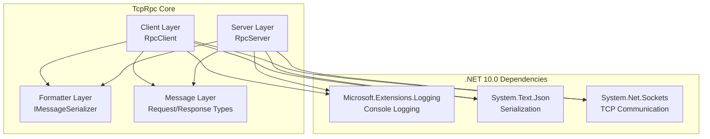
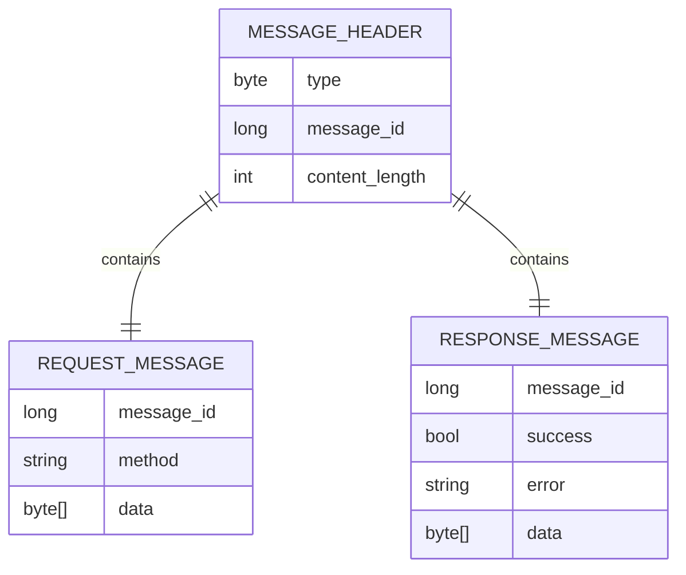
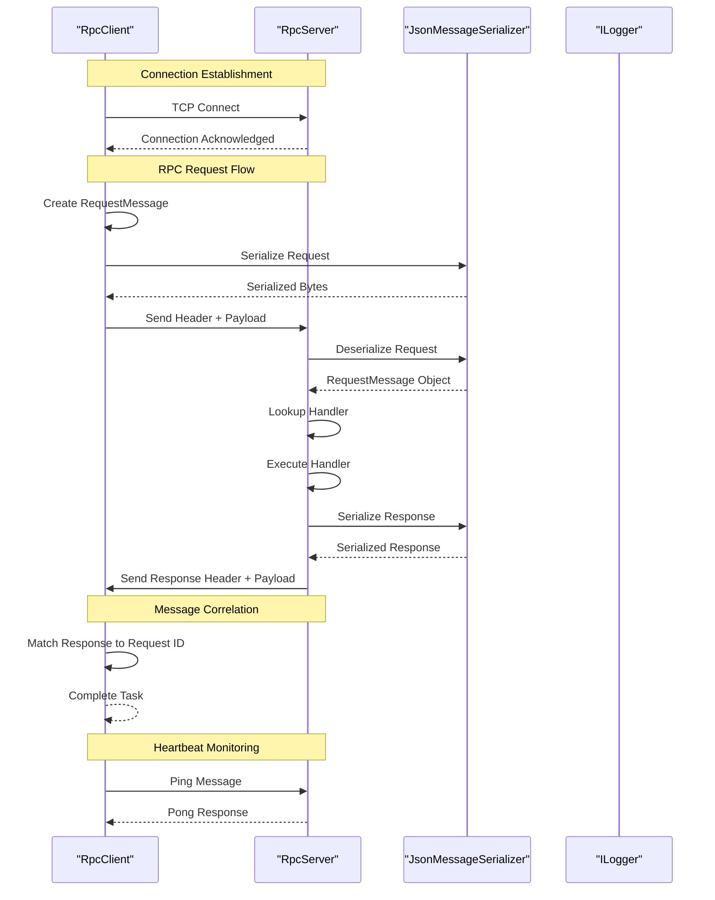
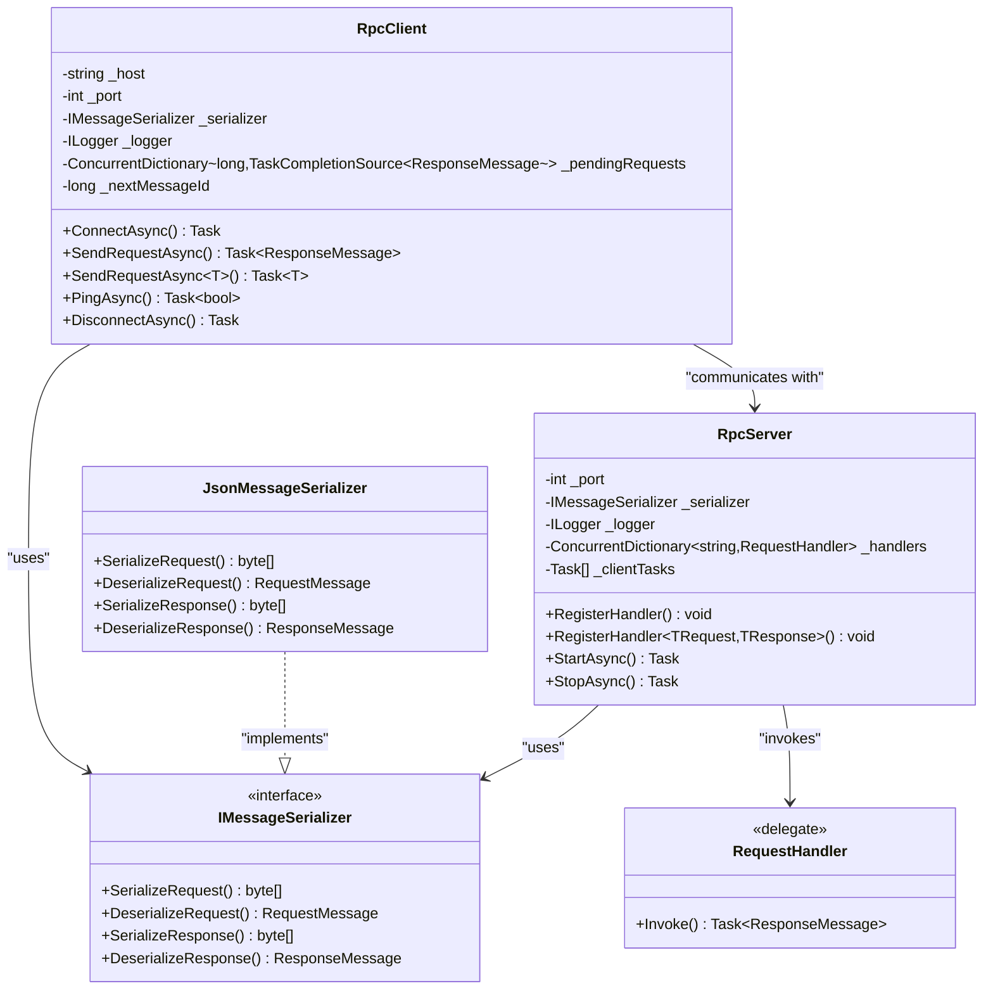
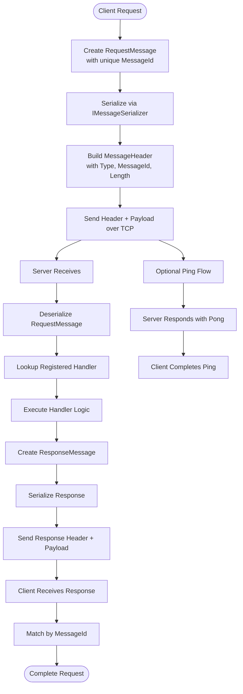
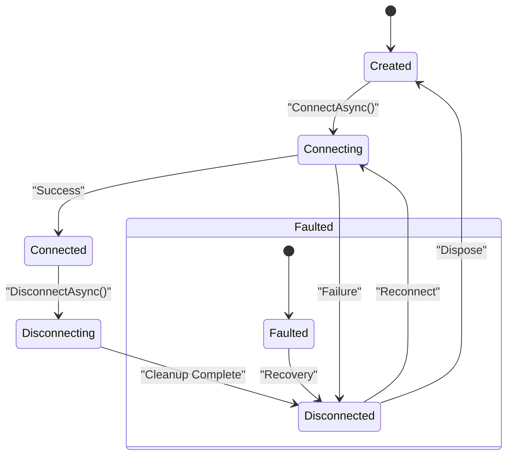
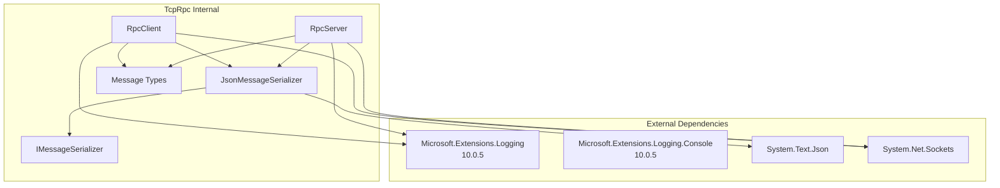

# Project Overview

<cite>
**Referenced Files in This Document**
- [TcpRpc.csproj](file://TcpRpc/TcpRpc.csproj)
- [RpcClient.cs](file://TcpRpc/Client/TcpRpcClient.cs)
- [RpcServer.cs](file://TcpRpc/Server/TcpRpcServer.cs)
- [IMessageSerializer.cs](file://TcpRpc/Formatter/IMessageSerializer.cs)
- [JsonMessageSerializer.cs](file://TcpRpc/Formatter/JsonMessageSerializer.cs)
- [MessageHeader.cs](file://TcpRpc/Message/MessageHeader.cs)
- [MessageType.cs](file://TcpRpc/Message/MessageType.cs)
- [RequestMessage.cs](file://TcpRpc/Message/RequestMessage.cs)
- [ResponseMessage.cs](file://TcpRpc/Message/ResponseMessage.cs)
- [RpcClientState.cs](file://TcpRpc/Client/RpcClientState.cs)
- [RpcServerState.cs](file://TcpRpc/Server/RpcServerState.cs)
- [RequestHandler.cs](file://TcpRpc/Server/RequestHandler.cs)
</cite>

## Table of Contents
1. [Introduction](#introduction)
2. [Project Structure](#project-structure)
3. [Core Components](#core-components)
4. [Architecture Overview](#architecture-overview)
5. [Detailed Component Analysis](#detailed-component-analysis)
6. [Dependency Analysis](#dependency-analysis)
7. [Performance Considerations](#performance-considerations)
8. [Troubleshooting Guide](#troubleshooting-guide)
9. [Conclusion](#conclusion)

## Introduction

TcpRpc is a lightweight, TCP-based Remote Procedure Call (RPC) framework designed for efficient distributed system communication. Built with .NET 10.0, it provides a minimal yet robust foundation for building microservices and real-time applications that require reliable inter-process communication over TCP networks.

### Purpose and Design Philosophy

The framework embodies a minimalist approach to RPC communication, focusing on:
- **Simplicity**: Clean, straightforward APIs that minimize boilerplate code
- **Performance**: Efficient binary serialization and low overhead communication
- **Reliability**: Robust error handling, connection management, and message correlation
- **Flexibility**: Pluggable serialization and extensible architecture

### Key Benefits for Distributed Systems

- **Lightweight Footprint**: Minimal dependencies and resource consumption
- **High Performance**: Optimized for throughput and low latency communication
- **Built-in Observability**: Comprehensive logging integration with Microsoft.Extensions.Logging
- **Type Safety**: Strong typing with automatic JSON serialization/deserialization
- **Bidirectional Messaging**: Supports both request-response patterns and real-time ping/pong keepalive
- **Graceful Degradation**: Automatic reconnection and error recovery mechanisms

### Target Use Cases

- **Microservices Communication**: Lightweight service-to-service RPC calls
- **Real-time Applications**: Live dashboards, monitoring systems, and streaming data
- **Internal APIs**: Cross-process communication within applications
- **IoT Device Communication**: Lightweight protocols for device-to-server communication
- **High-frequency Trading Systems**: Low-latency market data distribution

## Project Structure

The TcpRpc project follows a clean, layered architecture organized by functional domains:

**Diagram sources**
- [TcpRpc.csproj:1-17](file://TcpRpc/TcpRpc.csproj#L1-L17)
- [RpcClient.cs:1-405](file://TcpRpc/Client/TcpRpcClient.cs#L1-L405)
- [RpcServer.cs:1-432](file://TcpRpc/Server/TcpRpcServer.cs#L1-L432)

**Section sources**
- [TcpRpc.csproj:1-17](file://TcpRpc/TcpRpc.csproj#L1-L17)

## Core Components

### RpcClient - Client-Side RPC Implementation

The RpcClient serves as the primary interface for initiating RPC calls from client applications. It manages connection lifecycle, message correlation, and provides both typed and raw data APIs.

Key capabilities include:
- **Connection Management**: Thread-safe connection establishment and teardown
- **Message Correlation**: Unique message ID tracking for request-response pairing
- **Timeout Handling**: Configurable operation timeouts with cancellation support
- **Heartbeat Monitoring**: Built-in ping/pong mechanism for connection health
- **Concurrent Operations**: Thread-safe handling of multiple simultaneous requests

### RpcServer - Server-Side RPC Handler

The RpcServer provides a scalable foundation for accepting and processing RPC requests from multiple clients concurrently.

Core features:
- **Multi-client Support**: Handles concurrent connections from multiple RpcClient instances
- **Handler Registration**: Flexible method registration with type-safe delegates
- **Automatic Serialization**: Seamless JSON serialization for request/response data
- **Resource Management**: Proper cleanup and graceful shutdown procedures
- **Monitoring**: Real-time connection tracking and logging

### IMessageSerializer - Serialization Abstraction

The IMessageSerializer interface defines the contract for message serialization, enabling pluggable serialization strategies beyond the default JSON implementation.

Responsibilities:
- **Request Serialization**: Converting RequestMessage objects to byte arrays
- **Response Deserialization**: Transforming byte arrays back to ResponseMessage objects
- **Validation**: Ensuring message integrity and required field presence
- **Extensibility**: Supporting custom serialization implementations

### Message Types - Protocol Definition

The framework defines a compact binary protocol with standardized message types and headers:

**Diagram sources**
- [MessageHeader.cs:5-34](file://TcpRpc/Message/MessageHeader.cs#L5-L34)
- [RequestMessage.cs:3-8](file://TcpRpc/Message/RequestMessage.cs#L3-L8)
- [ResponseMessage.cs:3-9](file://TcpRpc/Message/ResponseMessage.cs#L3-L9)

**Section sources**
- [RpcClient.cs:11-405](file://TcpRpc/Client/TcpRpcClient.cs#L11-L405)
- [RpcServer.cs:12-432](file://TcpRpc/Server/TcpRpcServer.cs#L12-L432)
- [IMessageSerializer.cs:5-13](file://TcpRpc/Formatter/IMessageSerializer.cs#L5-L13)
- [MessageHeader.cs:5-34](file://TcpRpc/Message/MessageHeader.cs#L5-L34)

## Architecture Overview

The TcpRpc architecture implements a classic client-server RPC pattern with built-in reliability features:

**Diagram sources**
- [RpcClient.cs:132-189](file://TcpRpc/Client/TcpRpcClient.cs#L132-L189)
- [RpcServer.cs:318-333](file://TcpRpc/Server/TcpRpcServer.cs#L318-L333)
- [JsonMessageSerializer.cs:6-85](file://TcpRpc/Formatter/JsonMessageSerializer.cs#L6-L85)

### Technology Stack

The framework leverages modern .NET 10.0 technologies:

- **Core Runtime**: .NET 10.0 SDK with latest language features
- **Logging**: Microsoft.Extensions.Logging integration with console provider
- **Serialization**: System.Text.Json for high-performance JSON operations
- **Networking**: System.Net.Sockets for reliable TCP communication
- **Concurrency**: Async/await patterns with thread-safe collections

### Design Principles

1. **Separation of Concerns**: Clear boundaries between client, server, and utility components
2. **Interface Segregation**: Pluggable serializers and handlers promote extensibility
3. **Fail Fast**: Immediate validation and error reporting
4. **Resource Management**: Proper disposal patterns and connection cleanup
5. **Observability**: Comprehensive logging throughout the communication pipeline

## Detailed Component Analysis

### Client-Server Relationship

The RpcClient and RpcServer maintain a symmetrical relationship with clear responsibilities:

**Diagram sources**
- [RpcClient.cs:11-405](file://TcpRpc/Client/TcpRpcClient.cs#L11-L405)
- [RpcServer.cs:12-432](file://TcpRpc/Server/TcpRpcServer.cs#L12-L432)
- [IMessageSerializer.cs:5-13](file://TcpRpc/Formatter/IMessageSerializer.cs#L5-L13)
- [JsonMessageSerializer.cs:6-85](file://TcpRpc/Formatter/JsonMessageSerializer.cs#L6-L85)
- [RequestHandler.cs:5](file://TcpRpc/Server/RequestHandler.cs#L5)

### Message Flow Architecture

The framework implements a structured message flow with explicit correlation:

**Diagram sources**
- [RpcClient.cs:132-189](file://TcpRpc/Client/TcpRpcClient.cs#L132-L189)
- [RpcServer.cs:318-333](file://TcpRpc/Server/TcpRpcServer.cs#L318-L333)
- [JsonMessageSerializer.cs:14-49](file://TcpRpc/Formatter/JsonMessageSerializer.cs#L14-L49)

### State Management

Both client and server implement comprehensive state management:

**Diagram sources**
- [RpcClientState.cs:3-11](file://TcpRpc/Client/RpcClientState.cs#L3-L11)
- [RpcServerState.cs:3-10](file://TcpRpc/Server/RpcServerState.cs#L3-L10)

**Section sources**
- [RpcClient.cs:28-130](file://TcpRpc/Client/TcpRpcClient.cs#L28-L130)
- [RpcServer.cs:23-226](file://TcpRpc/Server/TcpRpcServer.cs#L23-L226)
- [RpcClientState.cs:3-11](file://TcpRpc/Client/RpcClientState.cs#L3-L11)
- [RpcServerState.cs:3-10](file://TcpRpc/Server/RpcServerState.cs#L3-L10)

## Dependency Analysis

The framework maintains loose coupling through well-defined interfaces and clear dependency injection patterns:

**Diagram sources**
- [TcpRpc.csproj:11-14](file://TcpRpc/TcpRpc.csproj#L11-L14)
- [RpcClient.cs:1-8](file://TcpRpc/Client/TcpRpcClient.cs#L1-L8)
- [RpcServer.cs:1-8](file://TcpRpc/Server/TcpRpcServer.cs#L1-L8)

### Integration Points

The framework integrates seamlessly with the .NET ecosystem:

- **Microsoft.Extensions.Logging**: Provides structured logging throughout client and server operations
- **System.Text.Json**: Offers high-performance JSON serialization with camelCase naming policy
- **System.Net.Sockets**: Leverages native TCP capabilities for reliable network communication
- **Async/Await Pattern**: Full asynchronous support for non-blocking operations

**Section sources**
- [TcpRpc.csproj:11-14](file://TcpRpc/TcpRpc.csproj#L11-L14)
- [RpcClient.cs:1-8](file://TcpRpc/Client/TcpRpcClient.cs#L1-L8)
- [RpcServer.cs:1-8](file://TcpRpc/Server/TcpRpcServer.cs#L1-L8)

## Performance Considerations

### Serialization Efficiency

The JsonMessageSerializer uses System.Text.Json with optimized settings:
- **Camel Case Naming**: Consistent property naming for cross-platform compatibility
- **Minimal Indentation**: Compact JSON output reduces bandwidth usage
- **Direct Byte Array Handling**: Efficient conversion between objects and byte arrays

### Connection Management

- **Connection Pooling**: Reuse of established connections for multiple requests
- **Graceful Shutdown**: Proper cleanup of resources during disconnection
- **Timeout Handling**: Configurable timeouts prevent resource leaks
- **Heartbeat Mechanism**: Periodic ping/pong messages maintain connection health

### Memory Management

- **Array Reuse**: Minimized allocations through careful buffer management
- **Async Patterns**: Non-blocking operations improve throughput
- **Concurrent Collections**: Thread-safe operations without excessive locking

## Troubleshooting Guide

### Common Issues and Solutions

**Connection Problems**
- Verify server is running and listening on the correct port
- Check firewall settings and network connectivity
- Monitor connection state transitions using logging

**Serialization Errors**
- Ensure RequestMessage and ResponseMessage contain valid data
- Validate JSON serialization settings match client/server expectations
- Check for null or empty data fields

**Timeout Issues**
- Adjust timeout values based on network conditions
- Monitor pending request queues for stuck operations
- Implement retry logic for transient failures

**Performance Bottlenecks**
- Monitor active connection counts on the server
- Profile serialization performance for large payloads
- Optimize handler execution time

### Diagnostic Information

Enable detailed logging to capture:
- Connection establishment and termination events
- Message correlation traces for request-response pairs
- Error conditions and exception details
- Performance metrics for throughput and latency

**Section sources**
- [RpcClient.cs:289-306](file://TcpRpc/Client/TcpRpcClient.cs#L289-L306)
- [RpcServer.cs:308-315](file://TcpRpc/Server/TcpRpcServer.cs#L308-L315)

## Conclusion

TcpRpc provides a robust, lightweight foundation for distributed system communication using proven .NET technologies. Its minimalist design, combined with comprehensive logging and serialization capabilities, makes it suitable for a wide range of applications from simple microservices to complex real-time systems.

The framework's strength lies in its balance between simplicity and functionality, offering developers the flexibility to build reliable, high-performance distributed applications without the complexity of heavyweight frameworks. Its clean architecture and strong typing ensure maintainability while its performance characteristics support demanding production environments.

By leveraging modern .NET 10.0 features and following established design patterns, TcpRpc delivers a mature solution for TCP-based RPC communication that scales from small applications to enterprise-grade distributed systems.