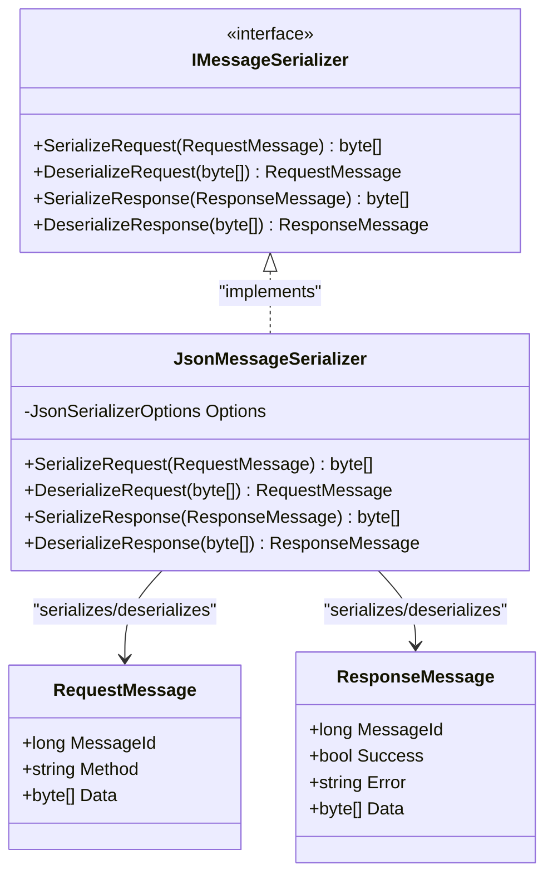
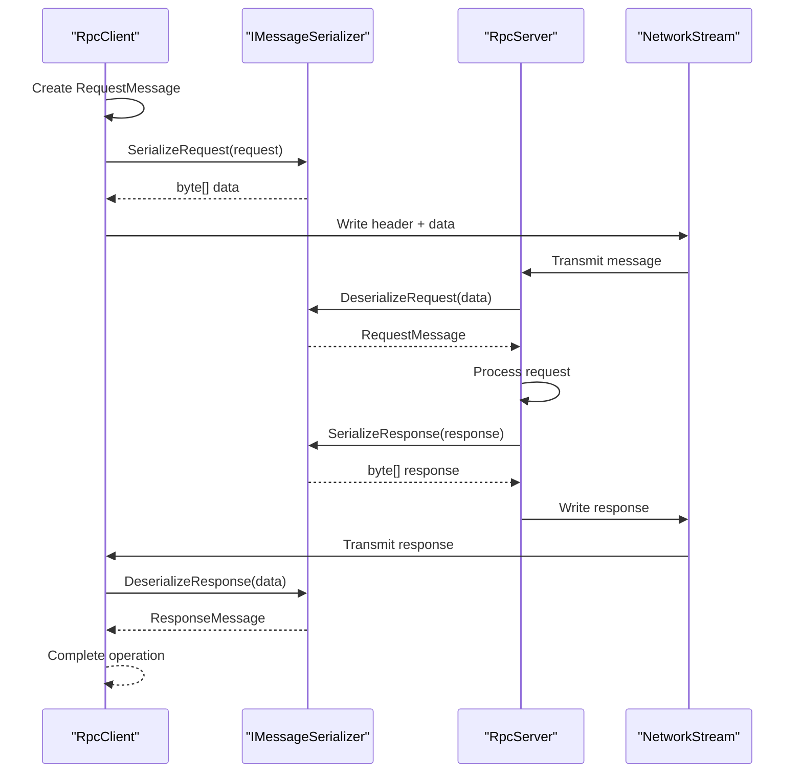
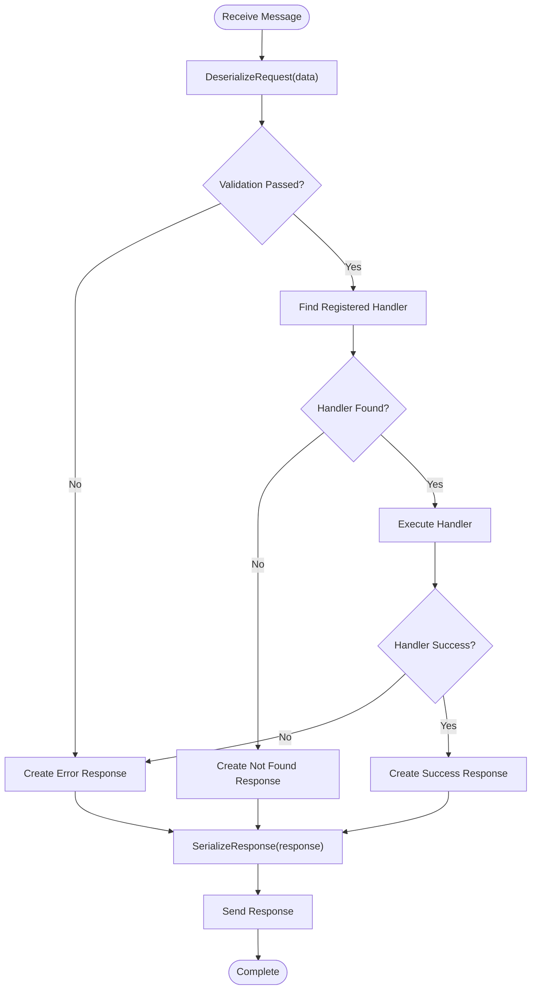

# IMessageSerializer Interface

<cite>
**Referenced Files in This Document**
- [IMessageSerializer.cs](file://TcpRpc/Formatter/IMessageSerializer.cs)
- [JsonMessageSerializer.cs](file://TcpRpc/Formatter/JsonMessageSerializer.cs)
- [RequestMessage.cs](file://TcpRpc/Message/RequestMessage.cs)
- [ResponseMessage.cs](file://TcpRpc/Message/ResponseMessage.cs)
- [MessageHeader.cs](file://TcpRpc/Message/MessageHeader.cs)
- [MessageType.cs](file://TcpRpc/Message/MessageType.cs)
- [TcpRpcClient.cs](file://TcpRpc/Client/TcpRpcClient.cs)
- [TcpRpcServer.cs](file://TcpRpc/Server/TcpRpcServer.cs)
- [RequestHandler.cs](file://TcpRpc/Server/RequestHandler.cs)
</cite>

## Table of Contents
1. [Introduction](#introduction)
2. [Interface Contract Definition](#interface-contract-definition)
3. [Method Signatures and Behavior](#method-signatures-and-behavior)
4. [Serialization Implementation Details](#serialization-implementation-details)
5. [Integration with RpcClient and RpcServer](#integration-with-rpcclient-and-rpcserver)
6. [Thread Safety and Concurrency](#thread-safety-and-concurrency)
7. [Performance Considerations](#performance-considerations)
8. [Custom Serializer Implementation Guide](#custom-serializer-implementation-guide)
9. [Error Handling and Validation](#error-handing-and-validation)
10. [Memory Allocation Patterns](#memory-allocation-patterns)
11. [Framework Integration](#framework-integration)
12. [Conclusion](#conclusion)

## Introduction

The IMessageSerializer interface serves as a pluggable serialization strategy within the TcpRpc framework, enabling flexible message serialization and deserialization for TCP-based RPC communication. This interface defines the contract that all message serializers must implement, allowing the framework to support various serialization formats while maintaining consistent behavior across the client-server communication pipeline.

The interface enables extensibility by allowing developers to implement custom serialization strategies tailored to specific performance, security, or compatibility requirements. The default implementation uses JSON serialization, but the interface design supports binary protocols, protocol buffers, or any other serialization format.

## Interface Contract Definition

The IMessageSerializer interface is defined in the TcpRpc/Formatter namespace and consists of four core methods that handle the complete message serialization lifecycle:



**Diagram sources**
- [IMessageSerializer.cs:5-13](file://TcpRpc/Formatter/IMessageSerializer.cs#L5-L13)
- [JsonMessageSerializer.cs:6-85](file://TcpRpc/Formatter/JsonMessageSerializer.cs#L6-L85)
- [RequestMessage.cs:3-8](file://TcpRpc/Message/RequestMessage.cs#L3-L8)
- [ResponseMessage.cs:3-9](file://TcpRpc/Message/ResponseMessage.cs#L3-L9)

**Section sources**
- [IMessageSerializer.cs:1-13](file://TcpRpc/Formatter/IMessageSerializer.cs#L1-L13)

## Method Signatures and Behavior

### SerializeRequest Method
- **Signature**: `byte[] SerializeRequest(RequestMessage request)`
- **Parameters**: 
  - `request`: RequestMessage object containing the RPC call metadata and payload
- **Return Value**: Byte array representing the serialized request
- **Expected Behavior**: Convert RequestMessage object to a byte array suitable for network transmission

### DeserializeRequest Method
- **Signature**: `RequestMessage DeserializeRequest(byte[] data)`
- **Parameters**:
  - `data`: Byte array containing the serialized request
- **Return Value**: RequestMessage object reconstructed from the byte array
- **Expected Behavior**: Parse the byte array and return a valid RequestMessage with proper validation

### SerializeResponse Method
- **Signature**: `byte[] SerializeResponse(ResponseMessage response)`
- **Parameters**:
  - `response`: ResponseMessage object containing the RPC response data
- **Return Value**: Byte array representing the serialized response
- **Expected Behavior**: Convert ResponseMessage object to a byte array suitable for network transmission

### DeserializeResponse Method
- **Signature**: `ResponseMessage DeserializeResponse(byte[] data)`
- **Parameters**:
  - `data`: Byte array containing the serialized response
- **Return Value**: ResponseMessage object reconstructed from the byte array
- **Expected Behavior**: Parse the byte array and return a valid ResponseMessage with proper validation

**Section sources**
- [IMessageSerializer.cs:7-12](file://TcpRpc/Formatter/IMessageSerializer.cs#L7-L12)

## Serialization Implementation Details

The default JsonMessageSerializer implementation demonstrates the interface contract requirements and provides insights into expected behavior:

### JSON Serialization Configuration
The implementation uses System.Text.Json with specific configuration options:
- Property naming policy: camelCase for consistent cross-platform compatibility
- WriteIndented: false for compact serialization
- UTF-8 encoding for efficient byte representation

### Validation Requirements
Both request and response deserialization include comprehensive validation:
- Null checks for input parameters and deserialized objects
- Empty data validation with specific error messages
- Structural validation for required fields (MessageId, Method)
- Type-specific validation for numeric identifiers

### Error Handling Patterns
The implementation follows consistent error handling patterns:
- Throws ArgumentNullException for null parameters
- Throws ArgumentException for empty data arrays
- Wraps JSON parsing exceptions in InvalidOperationException
- Provides meaningful error messages for debugging

**Section sources**
- [JsonMessageSerializer.cs:8-12](file://TcpRpc/Formatter/JsonMessageSerializer.cs#L8-L12)
- [JsonMessageSerializer.cs:16-18](file://TcpRpc/Formatter/JsonMessageSerializer.cs#L16-L18)
- [JsonMessageSerializer.cs:24-27](file://TcpRpc/Formatter/JsonMessageSerializer.cs#L24-L27)
- [JsonMessageSerializer.cs:37-41](file://TcpRpc/Formatter/JsonMessageSerializer.cs#L37-L41)
- [JsonMessageSerializer.cs:61-65](file://TcpRpc/Formatter/JsonMessageSerializer.cs#L61-L65)
- [JsonMessageSerializer.cs:75-76](file://TcpRpc/Formatter/JsonMessageSerializer.cs#L75-L76)

## Integration with RpcClient and RpcServer

The IMessageSerializer interface integrates seamlessly with both RpcClient and RpcServer components, providing a unified serialization strategy across the entire communication pipeline.

### Client-Side Integration
The RpcClient uses the serializer for outbound requests and inbound responses:



**Diagram sources**
- [TcpRpcClient.cs:152](file://TcpRpc/Client/TcpRpcClient.cs#L152)
- [TcpRpcClient.cs:263](file://TcpRpc/Client/TcpRpcClient.cs#L263)
- [TcpRpcServer.cs:324](file://TcpRpc/Server/TcpRpcServer.cs#L324)
- [TcpRpcServer.cs:365](file://TcpRpc/Server/TcpRpcServer.cs#L365)

### Server-Side Integration
The RpcServer employs the serializer for request processing and response generation:

The server maintains a dictionary of registered handlers and processes incoming requests through the serializer:



**Diagram sources**
- [TcpRpcServer.cs:318](file://TcpRpc/Server/TcpRpcServer.cs#L318)
- [TcpRpcServer.cs:335](file://TcpRpc/Server/TcpRpcServer.cs#L335)
- [TcpRpcServer.cs:362](file://TcpRpc/Server/TcpRpcServer.cs#L362)

**Section sources**
- [TcpRpcClient.cs:35-41](file://TcpRpc/Client/TcpRpcClient.cs#L35-L41)
- [TcpRpcServer.cs:43-48](file://TcpRpc/Server/TcpRpcServer.cs#L43-L48)

## Thread Safety and Concurrency

The IMessageSerializer interface itself is stateless and therefore inherently thread-safe. However, the broader TcpRpc framework implements several concurrency controls:

### Client-Specific Concurrency Controls
- **Send Lock**: SemaphoreSlim ensures serialized access to the network stream during message sending
- **Pending Requests Dictionary**: ConcurrentDictionary manages outstanding requests with thread-safe operations
- **State Management**: Lock-based state transitions prevent concurrent state modifications

### Server-Specific Concurrency Controls
- **Client Task Management**: ConcurrentDictionary tracks active client connections
- **Handler Registration**: Thread-safe handler registration and lookup
- **Message Processing**: Individual client connections process messages sequentially

### Serializer Implementation Considerations
While the interface is thread-safe, custom implementations should consider:
- Immutable configuration objects (as demonstrated by JsonMessageSerializer)
- Thread-safe caching mechanisms if needed
- Proper disposal of external resources

**Section sources**
- [TcpRpcClient.cs:20](file://TcpRpc/Client/TcpRpcClient.cs#L20)
- [TcpRpcClient.cs:18](file://TcpRpc/Client/TcpRpcClient.cs#L18)
- [TcpRpcServer.cs:17](file://TcpRpc/Server/TcpRpcServer.cs#L17)
- [JsonMessageSerializer.cs:8](file://TcpRpc/Formatter/JsonMessageSerializer.cs#L8)

## Performance Considerations

### Memory Allocation Patterns
The current JsonMessageSerializer implementation demonstrates efficient memory usage patterns:

**Allocation Efficiency**:
- Reuses JsonSerializerOptions instance to avoid repeated allocations
- Uses UTF-8 encoding for direct byte conversion
- Minimizes intermediate allocations through careful buffer management

**Client-Side Optimizations**:
- ConcurrentDictionary for pending requests avoids synchronization overhead
- SemaphoreSlim prevents unnecessary thread contention during sends
- Proper cancellation token usage prevents resource leaks

**Server-Side Optimizations**:
- Buffered reading reduces system call overhead
- Message size limits prevent memory exhaustion attacks
- Efficient handler lookup through dictionary operations

### Serialization Performance Guidelines
For custom implementations, consider:
- Object pooling for frequently allocated objects
- Zero-copy operations where possible
- Efficient buffer reuse patterns
- Asynchronous I/O operations for high throughput

**Section sources**
- [JsonMessageSerializer.cs:8](file://TcpRpc/Formatter/JsonMessageSerializer.cs#L8)
- [TcpRpcClient.cs:18](file://TcpRpc/Client/TcpRpcClient.cs#L18)
- [TcpRpcServer.cs:265](file://TcpRpc/Server/TcpRpcServer.cs#L265)

## Custom Serializer Implementation Guide

Creating a custom IMessageSerializer implementation requires careful attention to the interface contract and framework integration requirements.

### Implementation Requirements

#### Basic Structure
```csharp
public class CustomMessageSerializer : IMessageSerializer
{
    public byte[] SerializeRequest(RequestMessage request)
    {
        // Validate input
        if (request == null)
            throw new ArgumentNullException(nameof(request));
        
        // Serialize to byte array
        // ... implementation details
        
        return serializedData;
    }
    
    public RequestMessage DeserializeRequest(byte[] data)
    {
        // Validate input
        if (data == null)
            throw new ArgumentNullException(nameof(data));
            
        if (data.Length == 0)
            throw new ArgumentException("Data cannot be empty", nameof(data));
        
        // Deserialize and validate
        // ... implementation details
        
        return validatedRequest;
    }
    
    public byte[] SerializeResponse(ResponseMessage response)
    {
        // Validate input
        if (response == null)
            throw new ArgumentNullException(nameof(response));
        
        // Serialize to byte array
        // ... implementation details
        
        return serializedData;
    }
    
    public ResponseMessage DeserializeResponse(byte[] data)
    {
        // Validate input
        if (data == null)
            throw new ArgumentNullException(nameof(data));
            
        if (data.Length == 0)
            throw new ArgumentException("Data cannot be empty", nameof(data));
        
        // Deserialize and validate
        // ... implementation details
        
        return validatedResponse;
    }
}
```

#### Validation Requirements
Custom serializers must implement the same validation patterns as JsonMessageSerializer:
- Null parameter validation with ArgumentNullException
- Empty data validation with ArgumentException
- Structural validation for required fields
- Type-specific validation for identifiers

#### Error Handling Standards
Follow the established error handling patterns:
- Wrap parsing errors in InvalidOperationException
- Provide meaningful error messages for debugging
- Maintain consistent exception types across methods

### Integration with Framework Components

#### Client Integration
When integrating with RpcClient, ensure:
- Proper serializer initialization in constructor
- Thread-safe serializer instances
- Efficient memory allocation patterns

#### Server Integration
When integrating with RpcServer, ensure:
- Consistent serialization format across client and server
- Proper error handling for malformed messages
- Efficient processing of high-volume traffic

**Section sources**
- [IMessageSerializer.cs:5-13](file://TcpRpc/Formatter/IMessageSerializer.cs#L5-L13)
- [JsonMessageSerializer.cs:16-18](file://TcpRpc/Formatter/JsonMessageSerializer.cs#L16-L18)
- [JsonMessageSerializer.cs:24-27](file://TcpRpc/Formatter/JsonMessageSerializer.cs#L24-L27)
- [JsonMessageSerializer.cs:61-65](file://TcpRpc/Formatter/JsonMessageSerializer.cs#L61-L65)

## Error Handling and Validation

The IMessageSerializer interface establishes strict error handling requirements that ensure robust communication:

### Parameter Validation
All implementations must validate input parameters:
- RequestMessage and ResponseMessage parameters cannot be null
- Byte array parameters cannot be null
- Empty byte arrays must be rejected with ArgumentException

### Structural Validation
Deserialization must include structural validation:
- Required fields must be present and valid
- Numeric identifiers must be positive
- String fields must not be null or empty
- Message format must match expected structure

### Exception Handling Patterns
Consistent exception handling ensures predictable behavior:
- ArgumentNullException for null parameters
- ArgumentException for invalid data
- InvalidOperationException for parsing failures
- Proper exception chaining for debugging

### Error Propagation
Errors encountered during serialization are propagated to calling components:
- Client receives meaningful error messages for failed requests
- Server responds appropriately to malformed messages
- Connection state remains consistent despite serialization errors

**Section sources**
- [JsonMessageSerializer.cs:16-18](file://TcpRpc/Formatter/JsonMessageSerializer.cs#L16-L18)
- [JsonMessageSerializer.cs:24-27](file://TcpRpc/Formatter/JsonMessageSerializer.cs#L24-L27)
- [JsonMessageSerializer.cs:33-34](file://TcpRpc/Formatter/JsonMessageSerializer.cs#L33-L34)
- [JsonMessageSerializer.cs:61-65](file://TcpRpc/Formatter/JsonMessageSerializer.cs#L61-L65)
- [JsonMessageSerializer.cs:71-72](file://TcpRpc/Formatter/JsonMessageSerializer.cs#L71-L72)

## Memory Allocation Patterns

The TcpRpc framework implements several memory-efficient patterns that custom serializers should follow:

### Efficient Buffer Management
- Reuse byte arrays when possible
- Minimize intermediate allocations
- Use Span<T> and Memory<T> for zero-copy operations
- Implement proper disposal patterns

### Object Pooling Considerations
- Consider pooling frequently allocated objects
- Implement weak references for cache entries
- Monitor memory pressure and adjust pooling strategy

### Serialization Optimization
- Use streaming APIs for large payloads
- Implement compression where appropriate
- Consider binary formats for performance-critical scenarios

### Resource Management
- Dispose of external resources promptly
- Implement proper finalizer patterns
- Monitor for memory leaks in long-running applications

**Section sources**
- [JsonMessageSerializer.cs:8](file://TcpRpc/Formatter/JsonMessageSerializer.cs#L8)
- [TcpRpcClient.cs:244](file://TcpRpc/Client/TcpRpcClient.cs#L244)

## Framework Integration

The IMessageSerializer interface integrates deeply with the broader TcpRpc framework ecosystem:

### Message Format Compatibility
The interface works with the standardized message format:
- RequestMessage and ResponseMessage structures
- MessageHeader for transport metadata
- MessageType enumeration for message classification

### Transport Layer Integration
The serializer operates at the application layer while the transport is handled separately:
- Network stream handles raw byte transmission
- MessageHeader provides framing information
- Serializer focuses on content serialization

### Extension Points
The framework provides multiple extension points:
- Custom IMessageSerializer implementations
- Custom RequestHandler delegates
- Pluggable logging and monitoring
- Configurable timeouts and retry policies

### Backward Compatibility
The interface design ensures backward compatibility:
- Stable method signatures across versions
- Consistent error handling patterns
- Standardized message formats
- Extensible architecture for future enhancements

**Section sources**
- [MessageHeader.cs:5-34](file://TcpRpc/Message/MessageHeader.cs#L5-L34)
- [MessageType.cs:3-10](file://TcpRpc/Message/MessageType.cs#L3-L10)
- [RequestHandler.cs:5](file://TcpRpc/Server/RequestHandler.cs#L5)

## Conclusion

The IMessageSerializer interface provides a robust foundation for pluggable serialization within the TcpRpc framework. Its design emphasizes flexibility, performance, and reliability while maintaining consistent behavior across the client-server communication pipeline.

Key benefits of this interface design include:
- **Flexibility**: Support for multiple serialization formats
- **Performance**: Optimized memory allocation and processing
- **Reliability**: Comprehensive error handling and validation
- **Extensibility**: Clean integration with framework components
- **Thread Safety**: Stateless design enabling concurrent usage

The interface successfully abstracts the serialization concerns while providing clear contracts that enable both the default JSON implementation and custom implementations to coexist seamlessly within the TcpRpc ecosystem.

For developers implementing custom serializers, the established patterns in JsonMessageSerializer provide a solid foundation for creating high-performance, reliable serialization solutions that integrate cleanly with the TcpRpc framework.