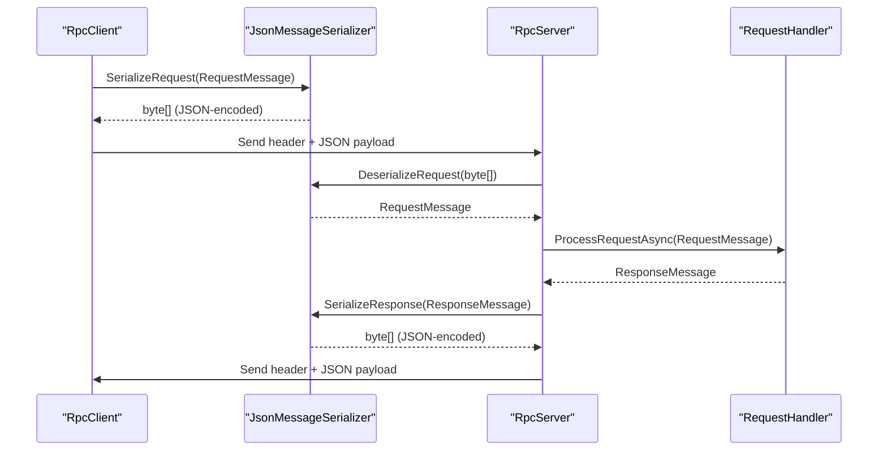
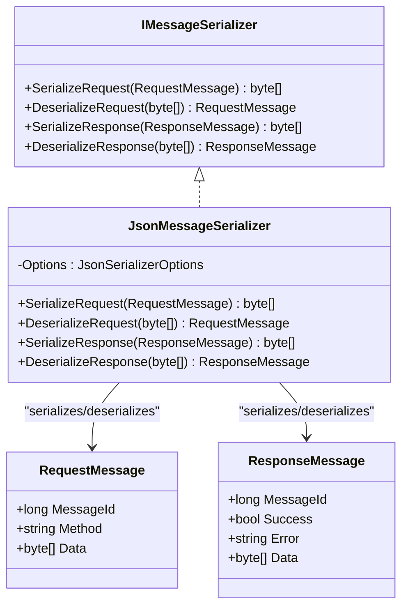
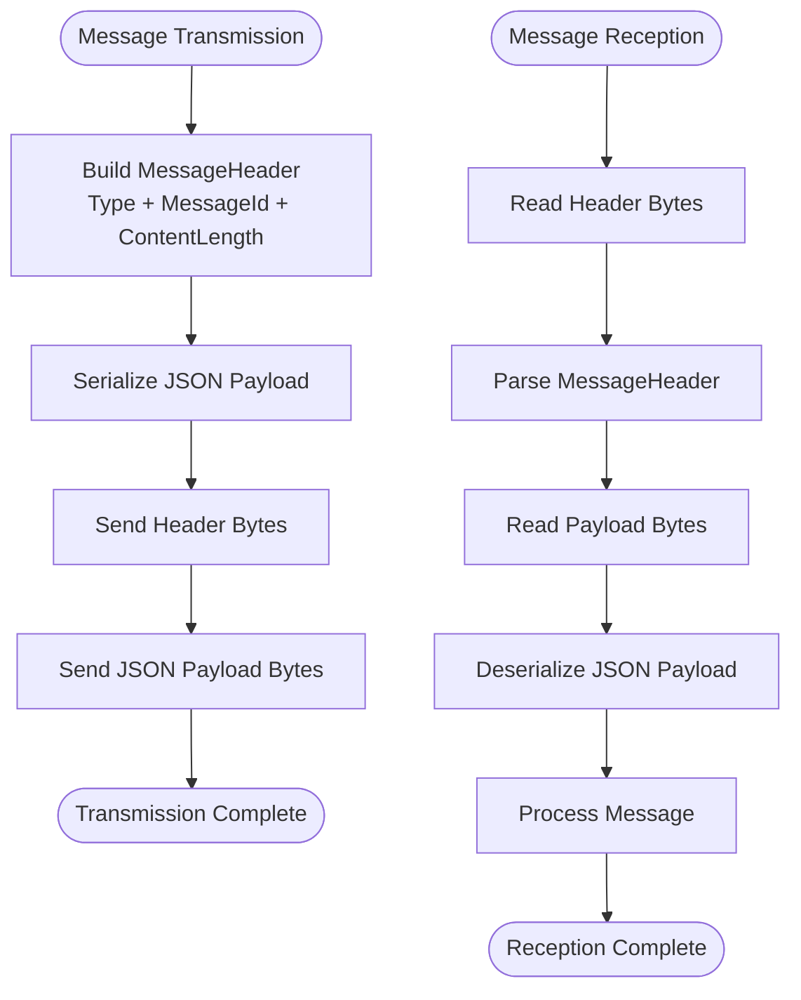
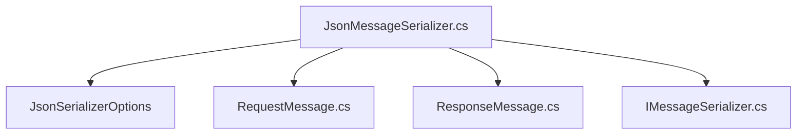

# JsonMessageSerializer Implementation

<cite>
**Referenced Files in This Document**
- [JsonMessageSerializer.cs](file://TcpRpc/Formatter/JsonMessageSerializer.cs)
- [IMessageSerializer.cs](file://TcpRpc/Formatter/IMessageSerializer.cs)
- [RequestMessage.cs](file://TcpRpc/Message/RequestMessage.cs)
- [ResponseMessage.cs](file://TcpRpc/Message/ResponseMessage.cs)
- [MessageHeader.cs](file://TcpRpc/Message/MessageHeader.cs)
- [MessageType.cs](file://TcpRpc/Message/MessageType.cs)
- [TcpRpcClient.cs](file://TcpRpc/Client/TcpRpcClient.cs)
- [TcpRpcServer.cs](file://TcpRpc/Server/TcpRpcServer.cs)
- [TcpRpc.csproj](file://TcpRpc/TcpRpc.csproj)
</cite>

## Table of Contents
1. [Introduction](#introduction)
2. [Project Structure](#project-structure)
3. [Core Components](#core-components)
4. [Architecture Overview](#architecture-overview)
5. [Detailed Component Analysis](#detailed-component-analysis)
6. [Dependency Analysis](#dependency-analysis)
7. [Performance Considerations](#performance-considerations)
8. [Troubleshooting Guide](#troubleshooting-guide)
9. [Conclusion](#conclusion)
10. [Appendices](#appendices)

## Introduction
This document provides comprehensive documentation for the JsonMessageSerializer class, focusing on the JSON-based serialization protocol, System.Text.Json integration, and binary encoding strategies used for message transmission. It explains the serialization format for RequestMessage and ResponseMessage objects, including field mapping, data type handling, and null value processing. It also covers performance characteristics, memory allocation patterns, throughput considerations, configuration options, error handling mechanisms, validation rules, exception propagation strategies, backward compatibility, versioning considerations, and troubleshooting guidance.

## Project Structure
The project is organized around a TCP-based RPC framework with clear separation of concerns:
- Formatter: Serialization interfaces and implementations
- Message: Data transfer objects and transport headers
- Client and Server: RPC client and server implementations
- TcpRpc.csproj: Project configuration with .NET 10 and logging dependencies

```mermaid
graph TB
subgraph "Formatter"
ISerializer["IMessageSerializer.cs"]
Serializer["JsonMessageSerializer.cs"]
end
subgraph "Message"
ReqMsg["RequestMessage.cs"]
ResMsg["ResponseMessage.cs"]
MsgHdr["MessageHeader.cs"]
MsgType["MessageType.cs"]
end
subgraph "Client"
Client["TcpRpcClient.cs"]
end
subgraph "Server"
Server["TcpRpcServer.cs"]
end
Client --> Serializer
Server --> Serializer
Client --> ReqMsg
Client --> ResMsg
Client --> MsgHdr
Server --> ReqMsg
Server --> ResMsg
Server --> MsgHdr
Serializer --> ReqMsg
Serializer --> ResMsg
```

**Diagram sources**
- [JsonMessageSerializer.cs:1-85](file://TcpRpc/Formatter/JsonMessageSerializer.cs#L1-L85)
- [IMessageSerializer.cs:1-13](file://TcpRpc/Formatter/IMessageSerializer.cs#L1-L13)
- [RequestMessage.cs:1-8](file://TcpRpc/Message/RequestMessage.cs#L1-L8)
- [ResponseMessage.cs:1-9](file://TcpRpc/Message/ResponseMessage.cs#L1-L9)
- [MessageHeader.cs:1-34](file://TcpRpc/Message/MessageHeader.cs#L1-L34)
- [MessageType.cs:1-10](file://TcpRpc/Message/MessageType.cs#L1-L10)
- [TcpRpcClient.cs:1-405](file://TcpRpc/Client/TcpRpcClient.cs#L1-L405)
- [TcpRpcServer.cs:1-432](file://TcpRpc/Server/TcpRpcServer.cs#L1-L432)

**Section sources**
- [TcpRpc.csproj:1-17](file://TcpRpc/TcpRpc.csproj#L1-L17)

## Core Components
This section documents the JsonMessageSerializer implementation and its role in the RPC framework.

- JsonMessageSerializer: Implements IMessageSerializer using System.Text.Json for serializing/deserializing RequestMessage and ResponseMessage objects.
- IMessageSerializer: Defines the contract for message serialization/deserialization.
- RequestMessage: Represents client requests with MessageId, Method, and Data fields.
- ResponseMessage: Represents server responses with MessageId, Success, Error, and Data fields.
- MessageHeader: Encodes message type, MessageId, and content length in a compact binary format.
- MessageType: Enumerates supported message types (Request, Response, Ping, Pong, Error).

Key responsibilities:
- JSON serialization/deserialization with camelCase property naming and indented=false
- Validation of serialized objects and required fields
- Exception propagation with meaningful error messages
- Integration with binary transport headers for efficient network transmission

**Section sources**
- [JsonMessageSerializer.cs:6-85](file://TcpRpc/Formatter/JsonMessageSerializer.cs#L6-L85)
- [IMessageSerializer.cs:5-13](file://TcpRpc/Formatter/IMessageSerializer.cs#L5-L13)
- [RequestMessage.cs:3-8](file://TcpRpc/Message/RequestMessage.cs#L3-L8)
- [ResponseMessage.cs:3-9](file://TcpRpc/Message/ResponseMessage.cs#L3-L9)
- [MessageHeader.cs:5-34](file://TcpRpc/Message/MessageHeader.cs#L5-L34)
- [MessageType.cs:3-10](file://TcpRpc/Message/MessageType.cs#L3-L10)

## Architecture Overview
The JsonMessageSerializer sits at the boundary between the RPC framework and the underlying transport layer. It handles JSON serialization for application-level messages while the transport layer manages binary headers and network I/O.



**Diagram sources**
- [JsonMessageSerializer.cs:14-49](file://TcpRpc/Formatter/JsonMessageSerializer.cs#L14-L49)
- [JsonMessageSerializer.cs:51-84](file://TcpRpc/Formatter/JsonMessageSerializer.cs#L51-L84)
- [TcpRpcClient.cs:132-189](file://TcpRpc/Client/TcpRpcClient.cs#L132-L189)
- [TcpRpcServer.cs:318-376](file://TcpRpc/Server/TcpRpcServer.cs#L318-L376)

## Detailed Component Analysis

### JsonMessageSerializer Implementation
The JsonMessageSerializer class implements the IMessageSerializer interface using System.Text.Json for all serialization operations.

#### Serialization Protocol
- JSON encoding: UTF-8 encoded JSON strings
- Property naming: camelCase (PropertyNamingPolicy.CamelCase)
- Formatting: Compact (WriteIndented = false)
- Binary transport: Combined with MessageHeader for network transmission

#### RequestMessage Serialization
- Fields: MessageId (long), Method (string), Data (byte[])
- Validation: Ensures MessageId > 0 and Method is not null/empty
- Error handling: Throws ArgumentNullException for null input, ArgumentException for empty data, and wraps JsonException in InvalidOperationException

#### ResponseMessage Serialization
- Fields: MessageId (long), Success (bool), Error (string?), Data (byte?[])
- Validation: Ensures MessageId > 0
- Error handling: Similar validation and exception patterns as RequestMessage



**Diagram sources**
- [IMessageSerializer.cs:5-13](file://TcpRpc/Formatter/IMessageSerializer.cs#L5-L13)
- [JsonMessageSerializer.cs:6-85](file://TcpRpc/Formatter/JsonMessageSerializer.cs#L6-L85)
- [RequestMessage.cs:3-8](file://TcpRpc/Message/RequestMessage.cs#L3-L8)
- [ResponseMessage.cs:3-9](file://TcpRpc/Message/ResponseMessage.cs#L3-L9)

#### Validation and Error Handling
The serializer implements robust validation and error handling:
- Null checks for all inputs
- Empty data validation
- Field validation for MessageId and Method
- JsonException wrapping with meaningful error messages
- Null object detection after deserialization

**Section sources**
- [JsonMessageSerializer.cs:8-12](file://TcpRpc/Formatter/JsonMessageSerializer.cs#L8-L12)
- [JsonMessageSerializer.cs:14-49](file://TcpRpc/Formatter/JsonMessageSerializer.cs#L14-L49)
- [JsonMessageSerializer.cs:51-84](file://TcpRpc/Formatter/JsonMessageSerializer.cs#L51-L84)

### Transport Layer Integration
The JsonMessageSerializer integrates with the binary transport layer through MessageHeader, which provides:
- Fixed-size header (17 bytes): Type (1 byte), MessageId (8 bytes), ContentLength (4 bytes)
- Little-endian binary encoding for numeric fields
- Efficient header serialization/deserialization



**Diagram sources**
- [MessageHeader.cs:13-33](file://TcpRpc/Message/MessageHeader.cs#L13-L33)
- [TcpRpcClient.cs:152-175](file://TcpRpc/Client/TcpRpcClient.cs#L152-L175)
- [TcpRpcServer.cs:362-376](file://TcpRpc/Server/TcpRpcServer.cs#L362-L376)

**Section sources**
- [MessageHeader.cs:5-34](file://TcpRpc/Message/MessageHeader.cs#L5-L34)
- [MessageType.cs:3-10](file://TcpRpc/Message/MessageType.cs#L3-L10)
- [TcpRpcClient.cs:132-189](file://TcpRpc/Client/TcpRpcClient.cs#L132-L189)
- [TcpRpcServer.cs:318-376](file://TcpRpc/Server/TcpRpcServer.cs#L318-L376)

### Client and Server Usage Patterns
Both RpcClient and RpcServer demonstrate the serializer's usage:
- Client: Serializes RequestMessage, sends header + payload, deserializes ResponseMessage
- Server: Deserializes RequestMessage, processes through handlers, serializes ResponseMessage

**Section sources**
- [TcpRpcClient.cs:132-203](file://TcpRpc/Client/TcpRpcClient.cs#L132-L203)
- [TcpRpcServer.cs:318-376](file://TcpRpc/Server/TcpRpcServer.cs#L318-L376)

## Dependency Analysis
The JsonMessageSerializer has minimal external dependencies and clear internal relationships.



**Diagram sources**
- [JsonMessageSerializer.cs:1-2](file://TcpRpc/Formatter/JsonMessageSerializer.cs#L1-L2)
- [JsonMessageSerializer.cs:8-12](file://TcpRpc/Formatter/JsonMessageSerializer.cs#L8-L12)
- [RequestMessage.cs:1-1](file://TcpRpc/Message/RequestMessage.cs#L1-L1)
- [ResponseMessage.cs:1-1](file://TcpRpc/Message/ResponseMessage.cs#L1-L1)
- [IMessageSerializer.cs:1-2](file://TcpRpc/Formatter/IMessageSerializer.cs#L1-L2)

**Section sources**
- [JsonMessageSerializer.cs:1-2](file://TcpRpc/Formatter/JsonMessageSerializer.cs#L1-L2)
- [IMessageSerializer.cs:1-2](file://TcpRpc/Formatter/IMessageSerializer.cs#L1-L2)

## Performance Considerations
The JsonMessageSerializer is designed for efficiency while maintaining readability and correctness.

### Memory Allocation Patterns
- Uses JsonSerializer.SerializeToUtf8Bytes for direct UTF-8 encoding without intermediate string allocations
- Reuses JsonSerializerOptions instance for thread-safe operation
- Minimal temporary allocations during validation and error handling

### Throughput Characteristics
- JSON serialization/deserialization overhead is offset by compact binary headers
- No reflection-based serialization (System.Text.Json) provides predictable performance
- Validation occurs after deserialization to ensure data integrity

### Comparison with Other Approaches
- System.Text.Json vs. Newtonsoft.Json: Better performance and lower memory footprint
- Binary protocols vs. JSON: JSON offers better interoperability and debugging capabilities
- Custom serializers: May offer micro-optimizations but increase complexity and maintenance burden

## Troubleshooting Guide
Common issues and their resolutions:

### Serialization Issues
- Empty data arrays: Ensure data.Length > 0 before calling serializer methods
- Null objects: Verify that serialized objects are not null
- Invalid JSON: Check for malformed JSON strings or unsupported data types

### Validation Failures
- MessageId <= 0: Ensure MessageId is generated using Interlocked.Increment
- Empty Method strings: Validate Method is not null or empty
- JsonException: Review JSON structure and data types

### Network Transmission Problems
- Header/content mismatch: Verify MessageId consistency between header and payload
- Message size limits: Check for content length exceeding configured limits
- Connection drops: Implement retry logic and connection health monitoring

**Section sources**
- [JsonMessageSerializer.cs:26-27](file://TcpRpc/Formatter/JsonMessageSerializer.cs#L26-L27)
- [JsonMessageSerializer.cs:37-41](file://TcpRpc/Formatter/JsonMessageSerializer.cs#L37-L41)
- [JsonMessageSerializer.cs:64-65](file://TcpRpc/Formatter/JsonMessageSerializer.cs#L64-L65)
- [JsonMessageSerializer.cs:75-76](file://TcpRpc/Formatter/JsonMessageSerializer.cs#L75-L76)

## Conclusion
The JsonMessageSerializer provides a robust, efficient, and maintainable solution for JSON-based RPC message serialization. Its integration with System.Text.Json ensures high performance while maintaining compatibility and ease of debugging. The combination of JSON payloads with compact binary headers creates an optimal balance between human-readable logs and efficient network transmission. The implementation demonstrates strong validation, comprehensive error handling, and clear separation of concerns that facilitate future enhancements and maintenance.

## Appendices

### Configuration Options
- PropertyNamingPolicy: CamelCase for consistent JSON field naming
- WriteIndented: False for compact JSON output
- Thread safety: Static JsonSerializerOptions instance for shared usage

### Data Type Handling
- Primitive types: Direct JSON serialization
- Byte arrays: Base64 encoding in JSON (handled by System.Text.Json)
- Nullable types: Proper null handling in JSON output

### Backward Compatibility and Versioning
- JSON schema stability: Maintain field names and types
- Version fields: Consider adding protocol version markers
- Migration strategies: Gradual rollout with dual support for old/new formats

### Example Usage Scenarios
- Request serialization: Client builds RequestMessage, serializer produces JSON payload
- Response deserialization: Server receives JSON, validates, processes, and serializes ResponseMessage
- Error propagation: Exceptions are wrapped with meaningful messages for client consumption