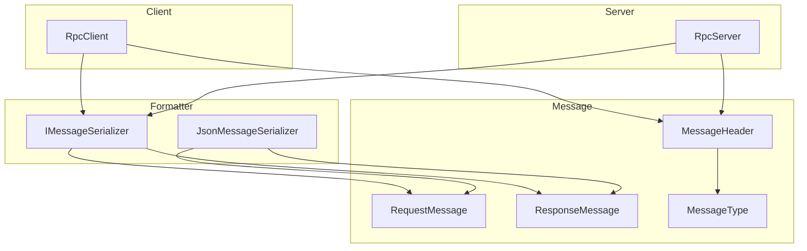
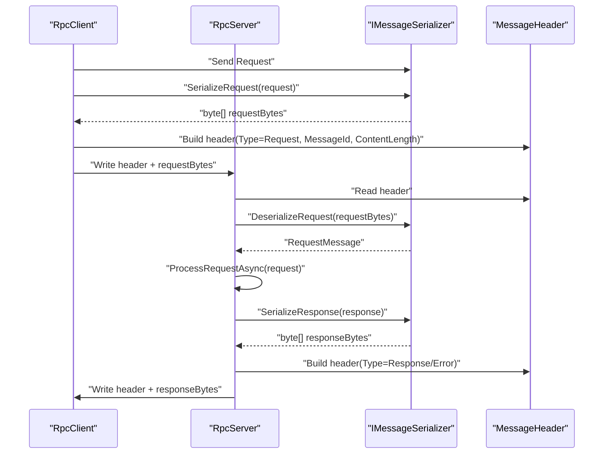
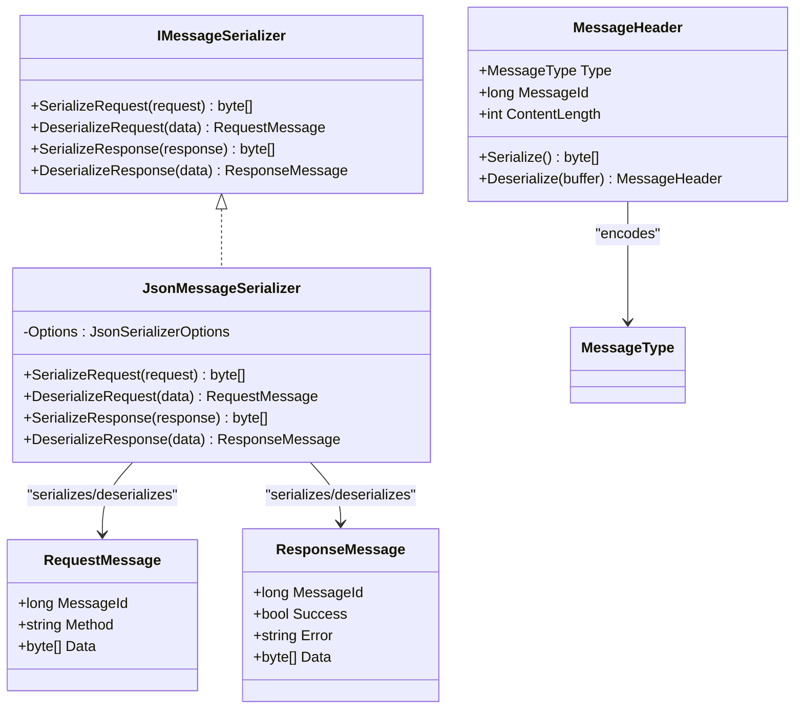
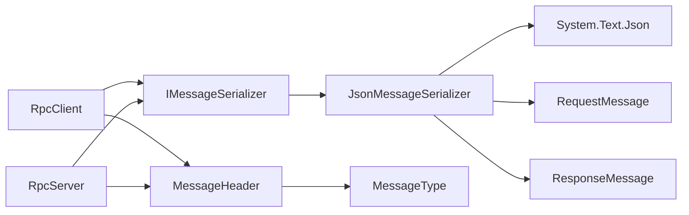

# Serialization System

<cite>
**Referenced Files in This Document**
- [IMessageSerializer.cs](file://TcpRpc/Formatter/IMessageSerializer.cs)
- [JsonMessageSerializer.cs](file://TcpRpc/Formatter/JsonMessageSerializer.cs)
- [RequestMessage.cs](file://TcpRpc/Message/RequestMessage.cs)
- [ResponseMessage.cs](file://TcpRpc/Message/ResponseMessage.cs)
- [MessageHeader.cs](file://TcpRpc/Message/MessageHeader.cs)
- [MessageType.cs](file://TcpRpc/Message/MessageType.cs)
- [TcpRpcClient.cs](file://TcpRpc/Client/TcpRpcClient.cs)
- [TcpRpcServer.cs](file://TcpRpc/Server/TcpRpcServer.cs)
- [RpcClientState.cs](file://TcpRpc/Client/RpcClientState.cs)
- [RpcServerState.cs](file://TcpRpc/Server/RpcServerState.cs)
- [TcpRpc.csproj](file://TcpRpc/TcpRpc.csproj)
</cite>

## Table of Contents
1. [Introduction](#introduction)
2. [Project Structure](#project-structure)
3. [Core Components](#core-components)
4. [Architecture Overview](#architecture-overview)
5. [Detailed Component Analysis](#detailed-component-analysis)
6. [Dependency Analysis](#dependency-analysis)
7. [Performance Considerations](#performance-considerations)
8. [Troubleshooting Guide](#troubleshooting-guide)
9. [Conclusion](#conclusion)
10. [Appendices](#appendices)

## Introduction
This document describes the TcpRpc serialization system, focusing on the IMessageSerializer interface contract and the default JsonMessageSerializer implementation. It explains how messages are serialized and deserialized, how errors are handled and propagated, and how to implement custom serializers. It also covers configuration, performance characteristics, memory allocation patterns, compatibility and versioning considerations, and troubleshooting techniques.

## Project Structure
The serialization system resides in the Formatter namespace and integrates with the Message model and the client/server transport layers. The key files are:
- IMessageSerializer defines the serialization contract used by both client and server.
- JsonMessageSerializer provides a System.Text.Json-based implementation.
- Message models define the shape of requests and responses.
- MessageHeader and MessageType define the wire protocol framing.
- TcpRpcClient and TcpRpcServer orchestrate sending and receiving messages using the configured serializer.

**Diagram sources**
- [IMessageSerializer.cs:5-13](file://TcpRpc/Formatter/IMessageSerializer.cs#L5-L13)
- [JsonMessageSerializer.cs:6-85](file://TcpRpc/Formatter/JsonMessageSerializer.cs#L6-L85)
- [RequestMessage.cs:3-8](file://TcpRpc/Message/RequestMessage.cs#L3-L8)
- [ResponseMessage.cs:3-9](file://TcpRpc/Message/ResponseMessage.cs#L3-L9)
- [MessageHeader.cs:5-34](file://TcpRpc/Message/MessageHeader.cs#L5-L34)
- [MessageType.cs:3-10](file://TcpRpc/Message/MessageType.cs#L3-L10)
- [TcpRpcClient.cs:11-41](file://TcpRpc/Client/TcpRpcClient.cs#L11-L41)
- [TcpRpcServer.cs:12-48](file://TcpRpc/Server/TcpRpcServer.cs#L12-L48)

**Section sources**
- [IMessageSerializer.cs:5-13](file://TcpRpc/Formatter/IMessageSerializer.cs#L5-L13)
- [JsonMessageSerializer.cs:6-85](file://TcpRpc/Formatter/JsonMessageSerializer.cs#L6-L85)
- [RequestMessage.cs:3-8](file://TcpRpc/Message/RequestMessage.cs#L3-L8)
- [ResponseMessage.cs:3-9](file://TcpRpc/Message/ResponseMessage.cs#L3-L9)
- [MessageHeader.cs:5-34](file://TcpRpc/Message/MessageHeader.cs#L5-L34)
- [MessageType.cs:3-10](file://TcpRpc/Message/MessageType.cs#L3-L10)
- [TcpRpcClient.cs:11-41](file://TcpRpc/Client/TcpRpcClient.cs#L11-L41)
- [TcpRpcServer.cs:12-48](file://TcpRpc/Server/TcpRpcServer.cs#L12-L48)

## Core Components
- IMessageSerializer: Defines four methods for serializing/deserializing requests and responses.
- JsonMessageSerializer: Implements IMessageSerializer using System.Text.Json with specific options and validation.
- Message models: RequestMessage and ResponseMessage carry the payload and metadata.
- MessageHeader: Encodes message type, message ID, and content length in a fixed-size binary header.
- MessageType: Enumerates message categories (Request, Response, Ping, Pong, Error).

Key responsibilities:
- IMessageSerializer enforces a consistent contract for serialization across client and server.
- JsonMessageSerializer centralizes JSON serialization options and validation logic.
- MessageHeader ensures efficient framing and bounds checking for content length.
- Client and server use the serializer to convert strongly typed messages to/from bytes.

**Section sources**
- [IMessageSerializer.cs:5-13](file://TcpRpc/Formatter/IMessageSerializer.cs#L5-L13)
- [JsonMessageSerializer.cs:6-85](file://TcpRpc/Formatter/JsonMessageSerializer.cs#L6-L85)
- [RequestMessage.cs:3-8](file://TcpRpc/Message/RequestMessage.cs#L3-L8)
- [ResponseMessage.cs:3-9](file://TcpRpc/Message/ResponseMessage.cs#L3-L9)
- [MessageHeader.cs:5-34](file://TcpRpc/Message/MessageHeader.cs#L5-L34)
- [MessageType.cs:3-10](file://TcpRpc/Message/MessageType.cs#L3-L10)

## Architecture Overview
The serialization pipeline is invoked during send/receive operations:
- Client sends a RequestMessage by serializing it with the configured IMessageSerializer, then writing the MessageHeader followed by the serialized content.
- Server reads the header, validates content length, deserializes the content into a RequestMessage, processes it, and writes a ResponseMessage back using the serializer.

**Diagram sources**
- [TcpRpcClient.cs:132-189](file://TcpRpc/Client/TcpRpcClient.cs#L132-L189)
- [TcpRpcServer.cs:318-376](file://TcpRpc/Server/TcpRpcServer.cs#L318-L376)
- [IMessageSerializer.cs:7-12](file://TcpRpc/Formatter/IMessageSerializer.cs#L7-L12)
- [JsonMessageSerializer.cs:14-49](file://TcpRpc/Formatter/JsonMessageSerializer.cs#L14-L49)
- [MessageHeader.cs:13-33](file://TcpRpc/Message/MessageHeader.cs#L13-L33)

## Detailed Component Analysis

### IMessageSerializer Interface Contract
Responsibilities:
- SerializeRequest: Converts a RequestMessage to a byte array suitable for transmission.
- DeserializeRequest: Parses a byte array into a RequestMessage, validating required fields.
- SerializeResponse: Converts a ResponseMessage to a byte array suitable for transmission.
- DeserializeResponse: Parses a byte array into a ResponseMessage, validating required fields.

Parameter and return value specifications:
- SerializeRequest(RequestMessage): returns byte[]
- DeserializeRequest(byte[]): returns RequestMessage
- SerializeResponse(ResponseMessage): returns byte[]
- DeserializeResponse(byte[]): returns ResponseMessage

Validation expectations:
- Both deserializers validate non-null inputs and non-empty payloads.
- Additional field-level validations ensure MessageId is positive and Method is non-empty for requests; MessageId is positive for responses.

Exception propagation:
- Validation failures throw InvalidOperationException with descriptive messages.
- Deserialization exceptions originating from System.Text.Json are wrapped in InvalidOperationException.

**Section sources**
- [IMessageSerializer.cs:5-13](file://TcpRpc/Formatter/IMessageSerializer.cs#L5-L13)
- [JsonMessageSerializer.cs:16-19](file://TcpRpc/Formatter/JsonMessageSerializer.cs#L16-L19)
- [JsonMessageSerializer.cs:24-48](file://TcpRpc/Formatter/JsonMessageSerializer.cs#L24-L48)
- [JsonMessageSerializer.cs:53-56](file://TcpRpc/Formatter/JsonMessageSerializer.cs#L53-L56)
- [JsonMessageSerializer.cs:61-83](file://TcpRpc/Formatter/JsonMessageSerializer.cs#L61-L83)

### JsonMessageSerializer Implementation
System.Text.Json integration:
- Uses a shared JsonSerializerOptions instance configured with camelCase property naming and compact output.
- Serializes to UTF-8 bytes and deserializes from byte arrays.

Validation and error handling:
- Null checks for inputs; throws ArgumentNullException for null arguments.
- Empty data check; throws ArgumentException for empty byte arrays.
- Validates RequestMessage fields (MessageId and Method) and ResponseMessage fields (MessageId).
- Wraps JsonException into InvalidOperationException with a contextual message.

Performance characteristics:
- Single static JsonSerializerOptions instance reduces allocations and improves throughput.
- Direct UTF-8 serialization avoids intermediate string conversions.
- Minimal branching and straightforward validation minimize overhead.

Memory allocation patterns:
- Serialization allocates a single byte array sized to the serialized content.
- Deserialization allocates temporary buffers for parsing; System.Text.Json manages internal buffers efficiently.

Compatibility and versioning:
- The current implementation does not include explicit version fields in RequestMessage or ResponseMessage.
- Backward compatibility relies on System.Text.Json’s default behavior and the fixed MessageHeader framing.

**Section sources**
- [JsonMessageSerializer.cs:8-12](file://TcpRpc/Formatter/JsonMessageSerializer.cs#L8-L12)
- [JsonMessageSerializer.cs:14-49](file://TcpRpc/Formatter/JsonMessageSerializer.cs#L14-L49)
- [JsonMessageSerializer.cs:51-84](file://TcpRpc/Formatter/JsonMessageSerializer.cs#L51-L84)

### Message Models and Protocol Framing
RequestMessage and ResponseMessage:
- RequestMessage carries MessageId, Method, and Data (byte[]).
- ResponseMessage carries MessageId, Success, optional Error, and optional Data.

MessageHeader and MessageType:
- Fixed-size header encodes Type, MessageId, and ContentLength.
- MessageType enumerates supported message categories.

Client and server integration:
- Client composes MessageHeader with serialized content and writes to the network stream.
- Server validates header and content length limits, then deserializes content using the serializer.

**Section sources**
- [RequestMessage.cs:3-8](file://TcpRpc/Message/RequestMessage.cs#L3-L8)
- [ResponseMessage.cs:3-9](file://TcpRpc/Message/ResponseMessage.cs#L3-L9)
- [MessageHeader.cs:7-33](file://TcpRpc/Message/MessageHeader.cs#L7-L33)
- [MessageType.cs:3-10](file://TcpRpc/Message/MessageType.cs#L3-L10)
- [TcpRpcClient.cs:152-175](file://TcpRpc/Client/TcpRpcClient.cs#L152-L175)
- [TcpRpcServer.cs:324-326](file://TcpRpc/Server/TcpRpcServer.cs#L324-L326)

### Client and Server Serialization Workflows
Client-side:
- Builds RequestMessage, serializes via IMessageSerializer, constructs MessageHeader, writes header and content, and awaits response completion via TaskCompletionSource.

Server-side:
- Reads header, validates content length, deserializes content to RequestMessage, processes via registered handlers, serializes ResponseMessage, and writes header and content.

Error handling:
- Client handles timeouts and connection loss by completing pending requests with exceptions.
- Server handles malformed content by sending an Error message and continues processing.

**Section sources**
- [TcpRpcClient.cs:132-189](file://TcpRpc/Client/TcpRpcClient.cs#L132-L189)
- [TcpRpcClient.cs:205-287](file://TcpRpc/Client/TcpRpcClient.cs#L205-L287)
- [TcpRpcServer.cs:228-333](file://TcpRpc/Server/TcpRpcServer.cs#L228-L333)
- [TcpRpcServer.cs:362-392](file://TcpRpc/Server/TcpRpcServer.cs#L362-L392)

### Class Model of Serialization Components

**Diagram sources**
- [IMessageSerializer.cs:5-13](file://TcpRpc/Formatter/IMessageSerializer.cs#L5-L13)
- [JsonMessageSerializer.cs:6-85](file://TcpRpc/Formatter/JsonMessageSerializer.cs#L6-L85)
- [RequestMessage.cs:3-8](file://TcpRpc/Message/RequestMessage.cs#L3-L8)
- [ResponseMessage.cs:3-9](file://TcpRpc/Message/ResponseMessage.cs#L3-L9)
- [MessageHeader.cs:5-34](file://TcpRpc/Message/MessageHeader.cs#L5-L34)
- [MessageType.cs:3-10](file://TcpRpc/Message/MessageType.cs#L3-L10)

## Dependency Analysis
- Client and Server depend on IMessageSerializer for serialization/deserialization.
- JsonMessageSerializer depends on System.Text.Json and the Message models.
- MessageHeader and MessageType define the framing contract used by both sides.

**Diagram sources**
- [TcpRpcClient.cs:11-41](file://TcpRpc/Client/TcpRpcClient.cs#L11-L41)
- [TcpRpcServer.cs:12-48](file://TcpRpc/Server/TcpRpcServer.cs#L12-L48)
- [IMessageSerializer.cs:5-13](file://TcpRpc/Formatter/IMessageSerializer.cs#L5-L13)
- [JsonMessageSerializer.cs:6-85](file://TcpRpc/Formatter/JsonMessageSerializer.cs#L6-L85)
- [MessageHeader.cs:5-34](file://TcpRpc/Message/MessageHeader.cs#L5-L34)
- [MessageType.cs:3-10](file://TcpRpc/Message/MessageType.cs#L3-L10)

**Section sources**
- [TcpRpcClient.cs:11-41](file://TcpRpc/Client/TcpRpcClient.cs#L11-L41)
- [TcpRpcServer.cs:12-48](file://TcpRpc/Server/TcpRpcServer.cs#L12-L48)
- [IMessageSerializer.cs:5-13](file://TcpRpc/Formatter/IMessageSerializer.cs#L5-L13)
- [JsonMessageSerializer.cs:6-85](file://TcpRpc/Formatter/JsonMessageSerializer.cs#L6-L85)
- [MessageHeader.cs:5-34](file://TcpRpc/Message/MessageHeader.cs#L5-L34)
- [MessageType.cs:3-10](file://TcpRpc/Message/MessageType.cs#L3-L10)

## Performance Considerations
- JsonSerializerOptions reuse: The JsonMessageSerializer uses a single static options instance to reduce allocations and improve throughput.
- UTF-8 serialization: Direct serialization to UTF-8 avoids intermediate string conversions.
- Minimal allocations: Serialization allocates only the resulting byte array; deserialization leverages System.Text.Json’s internal buffering.
- Header framing: Fixed-size header enables efficient preallocation and bounds checking for content length.
- Concurrency: Client and server use locks and thread-safe collections to manage concurrent requests and connections.

[No sources needed since this section provides general guidance]

## Troubleshooting Guide
Common serialization errors and diagnostics:
- Empty or null data: Both SerializeRequest/SerializeResponse reject null inputs; DeserializeRequest/DeserializeResponse reject empty arrays and null results. Ensure the serializer is configured and invoked correctly.
- Invalid MessageId: Deserializers validate MessageId > 0; ensure clients increment message IDs and servers echo them.
- Missing Method: RequestMessage requires a non-empty Method; ensure the client sets Method appropriately.
- JSON deserialization failures: JsonException is wrapped as InvalidOperationException with a contextual message; inspect the raw bytes and ensure protocol alignment.
- Transport-level issues: Clients handle timeouts and connection loss by completing pending requests with exceptions; servers send Error messages for oversized content and continue processing.

Debugging techniques:
- Enable logging in RpcClient and RpcServer to capture state transitions and errors.
- Verify MessageHeader.ContentLength matches the serialized payload length.
- Validate that the serializer options match across client and server for JSON compatibility.

**Section sources**
- [JsonMessageSerializer.cs:16-19](file://TcpRpc/Formatter/JsonMessageSerializer.cs#L16-L19)
- [JsonMessageSerializer.cs:24-48](file://TcpRpc/Formatter/JsonMessageSerializer.cs#L24-L48)
- [JsonMessageSerializer.cs:53-56](file://TcpRpc/Formatter/JsonMessageSerializer.cs#L53-L56)
- [JsonMessageSerializer.cs:61-83](file://TcpRpc/Formatter/JsonMessageSerializer.cs#L61-L83)
- [TcpRpcClient.cs:179-188](file://TcpRpc/Client/TcpRpcClient.cs#L179-L188)
- [TcpRpcServer.cs:264-270](file://TcpRpc/Server/TcpRpcServer.cs#L264-L270)

## Conclusion
The TcpRpc serialization system provides a clean, extensible contract via IMessageSerializer and a robust JSON-based implementation using System.Text.Json. The MessageHeader framing ensures efficient and safe transport of messages. The client and server integrate the serializer seamlessly, with clear validation and error handling. Custom serializers can be implemented by adhering to the interface contract and following the JsonMessageSerializer’s validation and exception patterns.

[No sources needed since this section summarizes without analyzing specific files]

## Appendices

### Configuration Options and Tuning
- Serializer selection: Both client and server constructors accept an optional IMessageSerializer; defaults to JsonMessageSerializer.
- Logging: Both client and server accept optional loggers for diagnostics.
- Target framework: The project targets net10.0 with nullable enabled.

**Section sources**
- [TcpRpcClient.cs:35-41](file://TcpRpc/Client/TcpRpcClient.cs#L35-L41)
- [TcpRpcServer.cs:43-48](file://TcpRpc/Server/TcpRpcServer.cs#L43-L48)
- [TcpRpc.csproj:3-9](file://TcpRpc/TcpRpc.csproj#L3-L9)

### Creating a Custom Serializer
Steps to implement a custom IMessageSerializer:
- Define a class implementing IMessageSerializer.
- Implement SerializeRequest/DeserializeRequest and SerializeResponse/DeserializeResponse.
- Add validation logic mirroring JsonMessageSerializer’s checks (non-null inputs, non-empty payloads, required fields).
- Wrap deserialization exceptions in InvalidOperationException with clear messages.
- Integrate the custom serializer into RpcClient and RpcServer constructors.

Example references:
- Interface contract: [IMessageSerializer.cs:5-13](file://TcpRpc/Formatter/IMessageSerializer.cs#L5-L13)
- Default implementation: [JsonMessageSerializer.cs:6-85](file://TcpRpc/Formatter/JsonMessageSerializer.cs#L6-L85)

**Section sources**
- [IMessageSerializer.cs:5-13](file://TcpRpc/Formatter/IMessageSerializer.cs#L5-L13)
- [JsonMessageSerializer.cs:6-85](file://TcpRpc/Formatter/JsonMessageSerializer.cs#L6-L85)

### Compatibility, Versioning, and Migration
- Current models do not include explicit version fields; compatibility relies on System.Text.Json defaults and fixed header framing.
- Migration strategies:
  - Add optional fields with default values to preserve backward compatibility.
  - Introduce a protocol version in MessageHeader or a dedicated header field and gate behavior accordingly.
  - Maintain MessageHeader size and layout to avoid breaking existing framing.

[No sources needed since this section provides general guidance]