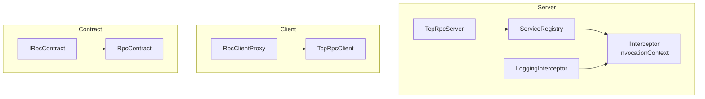
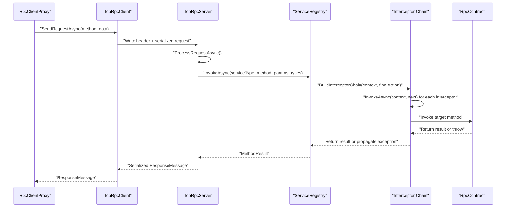
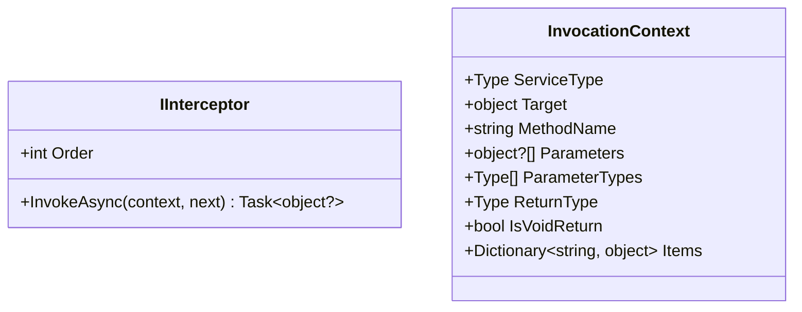
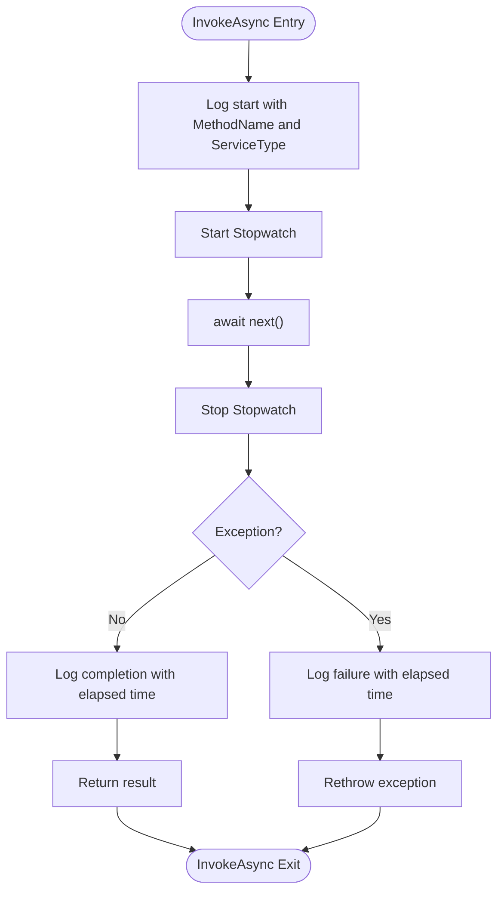
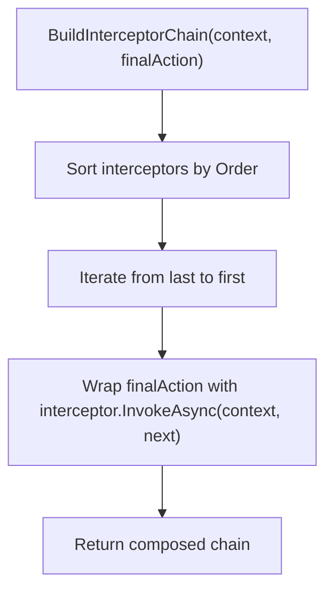
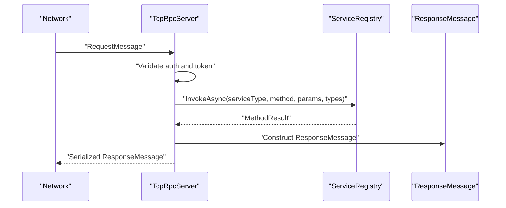
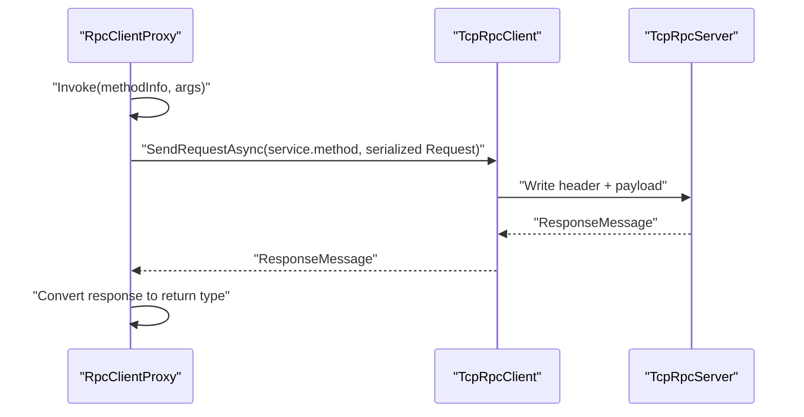
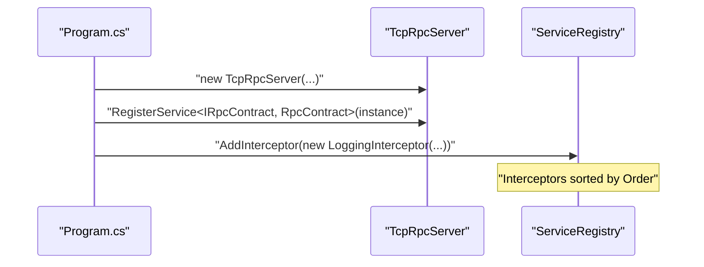
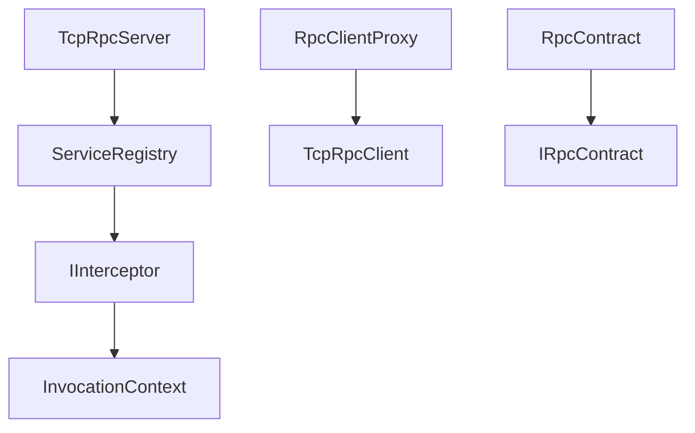

# Interceptor System

<cite>
**Referenced Files in This Document**
- [IInterceptor.cs](file://TcpRpc/TcpRpc/Server/IInterceptor.cs)
- [LoggingInterceptor.cs](file://TcpRpc/TcpRpc.Server/LoggingInterceptor.cs)
- [ServiceRegistry.cs](file://TcpRpc/TcpRpc/Server/ServiceRegistry.cs)
- [TcpRpcServer.cs](file://TcpRpc/TcpRpc/Server/TcpRpcServer.cs)
- [RpcClientProxy.cs](file://TcpRpc/TcpRpc/Client/RpcClientProxy.cs)
- [TcpRpcClient.cs](file://TcpRpc/TcpRpc/Client/TcpRpcClient.cs)
- [Program.cs](file://TcpRpc/TcpRpc.Server/Program.cs)
- [IRpcContract.cs](file://TcpRpc/TcpRpc.Contract/IRpcContract.cs)
- [RpcContract.cs](file://TcpRpc/TcpRpc.Server/RpcContract.cs)
- [RequestMessage.cs](file://TcpRpc/TcpRpc/Message/RequestMessage.cs)
- [ResponseMessage.cs](file://TcpRpc/TcpRpc/Message/ResponseMessage.cs)
</cite>

## Table of Contents
1. [Introduction](#introduction)
2. [Project Structure](#project-structure)
3. [Core Components](#core-components)
4. [Architecture Overview](#architecture-overview)
5. [Detailed Component Analysis](#detailed-component-analysis)
6. [Dependency Analysis](#dependency-analysis)
7. [Performance Considerations](#performance-considerations)
8. [Troubleshooting Guide](#troubleshooting-guide)
9. [Conclusion](#conclusion)
10. [Appendices](#appendices)

## Introduction
This document explains the interceptor system architecture used by the server-side RPC runtime. It covers the IInterceptor interface design, how interceptors enable cross-cutting concerns such as logging, metrics collection, and request/response transformation, and how they integrate into the service invocation pipeline. Practical examples demonstrate registration, execution order, chaining, exception handling, and asynchronous interception. Guidance is also provided for implementing custom interceptors for authentication, authorization, caching, and performance monitoring.

## Project Structure
The interceptor system spans several assemblies:
- Server core: interceptor interfaces, service registry, and server pipeline
- Client: proxy and client transport
- Contract: service contracts and DTOs
- Server app: example interceptor registration and usage

**Diagram sources**
- [TcpRpcServer.cs:15-74](file://TcpRpc/TcpRpc/Server/TcpRpcServer.cs#L15-L74)
- [ServiceRegistry.cs:10-221](file://TcpRpc/TcpRpc/Server/ServiceRegistry.cs#L10-L221)
- [IInterceptor.cs:6-63](file://TcpRpc/TcpRpc/Server/IInterceptor.cs#L6-L63)
- [LoggingInterceptor.cs:8-41](file://TcpRpc/TcpRpc.Server/LoggingInterceptor.cs#L8-L41)
- [RpcClientProxy.cs:11-160](file://TcpRpc/TcpRpc/Client/RpcClientProxy.cs#L11-L160)
- [TcpRpcClient.cs:10-684](file://TcpRpc/TcpRpc/Client/TcpRpcClient.cs#L10-L684)
- [IRpcContract.cs:6-44](file://TcpRpc/TcpRpc.Contract/IRpcContract.cs#L6-L44)
- [RpcContract.cs:10-83](file://TcpRpc/TcpRpc.Server/RpcContract.cs#L10-L83)

**Section sources**
- [TcpRpcServer.cs:15-74](file://TcpRpc/TcpRpc/Server/TcpRpcServer.cs#L15-L74)
- [ServiceRegistry.cs:10-221](file://TcpRpc/TcpRpc/Server/ServiceRegistry.cs#L10-L221)
- [IInterceptor.cs:6-63](file://TcpRpc/TcpRpc/Server/IInterceptor.cs#L6-L63)
- [LoggingInterceptor.cs:8-41](file://TcpRpc/TcpRpc.Server/LoggingInterceptor.cs#L8-L41)
- [RpcClientProxy.cs:11-160](file://TcpRpc/TcpRpc/Client/RpcClientProxy.cs#L11-L160)
- [TcpRpcClient.cs:10-684](file://TcpRpc/TcpRpc/Client/TcpRpcClient.cs#L10-L684)
- [IRpcContract.cs:6-44](file://TcpRpc/TcpRpc.Contract/IRpcContract.cs#L6-L44)
- [RpcContract.cs:10-83](file://TcpRpc/TcpRpc.Server/RpcContract.cs#L10-L83)

## Core Components
- IInterceptor: Defines the interceptor contract with Order and InvokeAsync(context, next).
- InvocationContext: Carries metadata about the target service, method, parameters, and return type.
- ServiceRegistry: Manages service descriptors and builds the interceptor chain around the final method invocation.
- TcpRpcServer: Orchestrates network handling and delegates service invocation to ServiceRegistry.
- RpcClientProxy and TcpRpcClient: Client-side proxy and transport that serialize requests/responses and forward them to the server.

Key responsibilities:
- Interceptor ordering via Order (lower number executes earlier).
- Asynchronous interception with Task<object?> return type.
- Chaining via the next delegate passed to InvokeAsync.
- Support for synchronous and asynchronous service methods, including Task and Task<T>.

**Section sources**
- [IInterceptor.cs:6-63](file://TcpRpc/TcpRpc/Server/IInterceptor.cs#L6-L63)
- [ServiceRegistry.cs:10-221](file://TcpRpc/TcpRpc/Server/ServiceRegistry.cs#L10-L221)
- [TcpRpcServer.cs:549-614](file://TcpRpc/TcpRpc/Server/TcpRpcServer.cs#L549-L614)
- [RpcClientProxy.cs:38-113](file://TcpRpc/TcpRpc/Client/RpcClientProxy.cs#L38-L113)
- [TcpRpcClient.cs:324-407](file://TcpRpc/TcpRpc/Client/TcpRpcClient.cs#L324-L407)

## Architecture Overview
The interceptor system sits between the server’s network pipeline and the actual service method invocation. Requests are deserialized, routed to ServiceRegistry, and executed through a composed chain of interceptors around the target method.

**Diagram sources**
- [RpcClientProxy.cs:115-126](file://TcpRpc/TcpRpc/Client/RpcClientProxy.cs#L115-L126)
- [TcpRpcClient.cs:324-407](file://TcpRpc/TcpRpc/Client/TcpRpcClient.cs#L324-L407)
- [TcpRpcServer.cs:549-614](file://TcpRpc/TcpRpc/Server/TcpRpcServer.cs#L549-L614)
- [ServiceRegistry.cs:72-138](file://TcpRpc/TcpRpc/Server/ServiceRegistry.cs#L72-L138)
- [IInterceptor.cs:16-16](file://TcpRpc/TcpRpc/Server/IInterceptor.cs#L16-L16)

**Section sources**
- [TcpRpcServer.cs:549-614](file://TcpRpc/TcpRpc/Server/TcpRpcServer.cs#L549-L614)
- [ServiceRegistry.cs:72-138](file://TcpRpc/TcpRpc/Server/ServiceRegistry.cs#L72-L138)
- [RpcClientProxy.cs:115-126](file://TcpRpc/TcpRpc/Client/RpcClientProxy.cs#L115-L126)
- [TcpRpcClient.cs:324-407](file://TcpRpc/TcpRpc/Client/TcpRpcClient.cs#L324-L407)

## Detailed Component Analysis

### IInterceptor and InvocationContext
- IInterceptor.Order controls execution precedence; lower values run earlier.
- IInterceptor.InvokeAsync receives InvocationContext and a next delegate representing the remainder of the chain.
- InvocationContext provides ServiceType, Target, MethodName, Parameters, ParameterTypes, ReturnType, and a dictionary for carrying cross-cutting data.

**Diagram sources**
- [IInterceptor.cs:6-63](file://TcpRpc/TcpRpc/Server/IInterceptor.cs#L6-L63)

**Section sources**
- [IInterceptor.cs:6-63](file://TcpRpc/TcpRpc/Server/IInterceptor.cs#L6-L63)

### LoggingInterceptor
- Demonstrates a practical logging interceptor that measures execution time and logs successes and failures.
- Uses InvocationContext to capture method name and service type.
- Wraps the next delegate in try/catch to log timing and rethrow exceptions.

**Diagram sources**
- [LoggingInterceptor.cs:19-40](file://TcpRpc/TcpRpc.Server/LoggingInterceptor.cs#L19-L40)

**Section sources**
- [LoggingInterceptor.cs:8-41](file://TcpRpc/TcpRpc.Server/LoggingInterceptor.cs#L8-L41)

### ServiceRegistry Interceptor Chain
- Maintains a list of IInterceptor instances and sorts them by Order.
- Builds a chain by wrapping the final action (actual method invocation) with each interceptor in reverse order to preserve logical order.
- Supports synchronous and asynchronous method invocation, including Task and Task<T>.
- Converts parameters and infers actual return types (unpacking Task<T>).

**Diagram sources**
- [ServiceRegistry.cs:158-171](file://TcpRpc/TcpRpc/Server/ServiceRegistry.cs#L158-L171)
- [ServiceRegistry.cs:52-59](file://TcpRpc/TcpRpc/Server/ServiceRegistry.cs#L52-L59)

**Section sources**
- [ServiceRegistry.cs:52-59](file://TcpRpc/TcpRpc/Server/ServiceRegistry.cs#L52-L59)
- [ServiceRegistry.cs:158-171](file://TcpRpc/TcpRpc/Server/ServiceRegistry.cs#L158-L171)
- [ServiceRegistry.cs:173-208](file://TcpRpc/TcpRpc/Server/ServiceRegistry.cs#L173-L208)
- [ServiceRegistry.cs:143-156](file://TcpRpc/TcpRpc/Server/ServiceRegistry.cs#L143-L156)

### TcpRpcServer Integration
- Processes incoming messages, authenticates if required, and routes requests to ServiceRegistry.
- Delegates service invocation to ServiceRegistry.InvokeAsync, which applies the interceptor chain.
- Translates MethodResult into ResponseMessage for transport.

**Diagram sources**
- [TcpRpcServer.cs:380-451](file://TcpRpc/TcpRpc/Server/TcpRpcServer.cs#L380-L451)
- [TcpRpcServer.cs:549-614](file://TcpRpc/TcpRpc/Server/TcpRpcServer.cs#L549-L614)
- [ServiceRegistry.cs:72-138](file://TcpRpc/TcpRpc/Server/ServiceRegistry.cs#L72-L138)

**Section sources**
- [TcpRpcServer.cs:380-451](file://TcpRpc/TcpRpc/Server/TcpRpcServer.cs#L380-L451)
- [TcpRpcServer.cs:549-614](file://TcpRpc/TcpRpc/Server/TcpRpcServer.cs#L549-L614)
- [ServiceRegistry.cs:72-138](file://TcpRpc/TcpRpc/Server/ServiceRegistry.cs#L72-L138)

### Client-Side Proxy and Transport
- RpcClientProxy constructs RequestMessage and sends it via TcpRpcClient.
- Handles response conversion, including Void returns and Task<T> unwrapping.
- TcpRpcClient manages connection, authentication, retries, timeouts, and message routing.

**Diagram sources**
- [RpcClientProxy.cs:38-113](file://TcpRpc/TcpRpc/Client/RpcClientProxy.cs#L38-L113)
- [TcpRpcClient.cs:324-407](file://TcpRpc/TcpRpc/Client/TcpRpcClient.cs#L324-L407)

**Section sources**
- [RpcClientProxy.cs:38-113](file://TcpRpc/TcpRpc/Client/RpcClientProxy.cs#L38-L113)
- [TcpRpcClient.cs:324-407](file://TcpRpc/TcpRpc/Client/TcpRpcClient.cs#L324-L407)

### Example: LoggingInterceptor Registration
- The server application registers a LoggingInterceptor with the ServiceRegistry during startup.

**Diagram sources**
- [Program.cs:41-48](file://TcpRpc/TcpRpc.Server/Program.cs#L41-L48)
- [ServiceRegistry.cs:52-59](file://TcpRpc/TcpRpc/Server/ServiceRegistry.cs#L52-L59)

**Section sources**
- [Program.cs:41-48](file://TcpRpc/TcpRpc.Server/Program.cs#L41-L48)
- [ServiceRegistry.cs:52-59](file://TcpRpc/TcpRpc/Server/ServiceRegistry.cs#L52-L59)

## Dependency Analysis
- TcpRpcServer depends on ServiceRegistry for method dispatch and interceptor composition.
- ServiceRegistry depends on IInterceptor implementations and InvocationContext.
- RpcClientProxy depends on TcpRpcClient and serialization to send/receive messages.
- RpcContract implements IRpcContract and serves as the target for intercepted invocations.

**Diagram sources**
- [TcpRpcServer.cs:40-72](file://TcpRpc/TcpRpc/Server/TcpRpcServer.cs#L40-L72)
- [ServiceRegistry.cs:10-221](file://TcpRpc/TcpRpc/Server/ServiceRegistry.cs#L10-L221)
- [IInterceptor.cs:6-63](file://TcpRpc/TcpRpc/Server/IInterceptor.cs#L6-L63)
- [RpcClientProxy.cs:11-160](file://TcpRpc/TcpRpc/Client/RpcClientProxy.cs#L11-L160)
- [TcpRpcClient.cs:10-684](file://TcpRpc/TcpRpc/Client/TcpRpcClient.cs#L10-L684)
- [RpcContract.cs:10-83](file://TcpRpc/TcpRpc.Server/RpcContract.cs#L10-L83)
- [IRpcContract.cs:6-44](file://TcpRpc/TcpRpc.Contract/IRpcContract.cs#L6-L44)

**Section sources**
- [TcpRpcServer.cs:40-72](file://TcpRpc/TcpRpc/Server/TcpRpcServer.cs#L40-L72)
- [ServiceRegistry.cs:10-221](file://TcpRpc/TcpRpc/Server/ServiceRegistry.cs#L10-L221)
- [IInterceptor.cs:6-63](file://TcpRpc/TcpRpc/Server/IInterceptor.cs#L6-L63)
- [RpcClientProxy.cs:11-160](file://TcpRpc/TcpRpc/Client/RpcClientProxy.cs#L11-L160)
- [TcpRpcClient.cs:10-684](file://TcpRpc/TcpRpc/Client/TcpRpcClient.cs#L10-L684)
- [RpcContract.cs:10-83](file://TcpRpc/TcpRpc.Server/RpcContract.cs#L10-L83)
- [IRpcContract.cs:6-44](file://TcpRpc/TcpRpc.Contract/IRpcContract.cs#L6-L44)

## Performance Considerations
- Interceptor overhead: Each interceptor adds a delegate call and potential logging or computation. Keep interceptors lightweight and avoid heavy work in hot paths.
- Asynchronous handling: Interceptors must await next and preserve Task semantics to avoid blocking or incorrect return types.
- Logging cost: Prefer structured logging and conditional logging to minimize overhead in high-throughput scenarios.
- Parameter conversion: ServiceRegistry performs parameter conversions; avoid unnecessary conversions by aligning client types with server signatures.
- Chaining order: Place frequently failing or expensive interceptors later to short-circuit early when possible.

[No sources needed since this section provides general guidance]

## Troubleshooting Guide
Common issues and resolutions:
- Interceptor not invoked: Verify the interceptor is added to ServiceRegistry and Order is set appropriately.
- Wrong execution order: Ensure interceptors are added in ascending Order values; lower runs earlier.
- Exceptions swallowed: Interceptors should rethrow exceptions after logging to maintain error visibility.
- Asynchronous method mismatches: Confirm the final action handles Task and Task<T> properly; ServiceRegistry already unpacks Task<T> and Task.
- Parameter type mismatches: Ensure RequestMessage includes accurate ParameterTypes so ServiceRegistry can convert parameters.

**Section sources**
- [ServiceRegistry.cs:72-138](file://TcpRpc/TcpRpc/Server/ServiceRegistry.cs#L72-L138)
- [LoggingInterceptor.cs:19-40](file://TcpRpc/TcpRpc.Server/LoggingInterceptor.cs#L19-L40)

## Conclusion
The interceptor system provides a flexible, composable mechanism for adding cross-cutting concerns to the RPC service invocation pipeline. By implementing IInterceptor and registering interceptors through ServiceRegistry, developers can implement logging, metrics, authentication, authorization, caching, and performance monitoring. The design supports synchronous and asynchronous methods, preserves return types, and maintains clear execution order via Order.

[No sources needed since this section summarizes without analyzing specific files]

## Appendices

### Implementing Custom Interceptors
Below are examples of what custom interceptors can achieve. Replace the placeholder comments with your implementation details.

- Authentication/Authorization:
  - Inspect InvocationContext.Items for claims or tokens.
  - Validate permissions before calling next.
  - Propagate exceptions on failure.

- Caching:
  - Compute cache keys from InvocationContext.
  - Check cache before calling next.
  - Store results after receiving them.

- Metrics and Observability:
  - Record timings around next.
  - Emit counters/gauges with method/service labels.

- Request/Response Transformation:
  - Modify Parameters in InvocationContext before calling next.
  - Transform returned object after next completes.

[No sources needed since this section provides general guidance]

### Interceptor Execution Order and Chaining
- Order determines precedence; lower Order executes earlier.
- Chain is built by wrapping the final action with each interceptor in reverse order.
- next represents the remainder of the chain; call it to proceed.

**Section sources**
- [ServiceRegistry.cs:52-59](file://TcpRpc/TcpRpc/Server/ServiceRegistry.cs#L52-L59)
- [ServiceRegistry.cs:158-171](file://TcpRpc/TcpRpc/Server/ServiceRegistry.cs#L158-L171)

### Asynchronous Interception Scenarios
- Wrap Task-returning services by awaiting next and preserving Task semantics.
- Handle Task.Result extraction for legacy Task<T> scenarios inside ServiceRegistry.
- Ensure logging and timing capture account for asynchronous execution.

**Section sources**
- [ServiceRegistry.cs:103-122](file://TcpRpc/TcpRpc/Server/ServiceRegistry.cs#L103-L122)
- [LoggingInterceptor.cs:19-40](file://TcpRpc/TcpRpc.Server/LoggingInterceptor.cs#L19-L40)