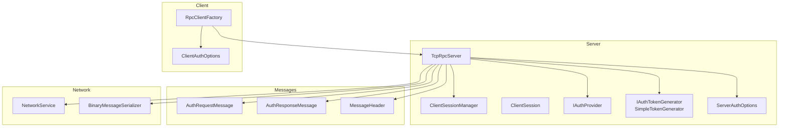
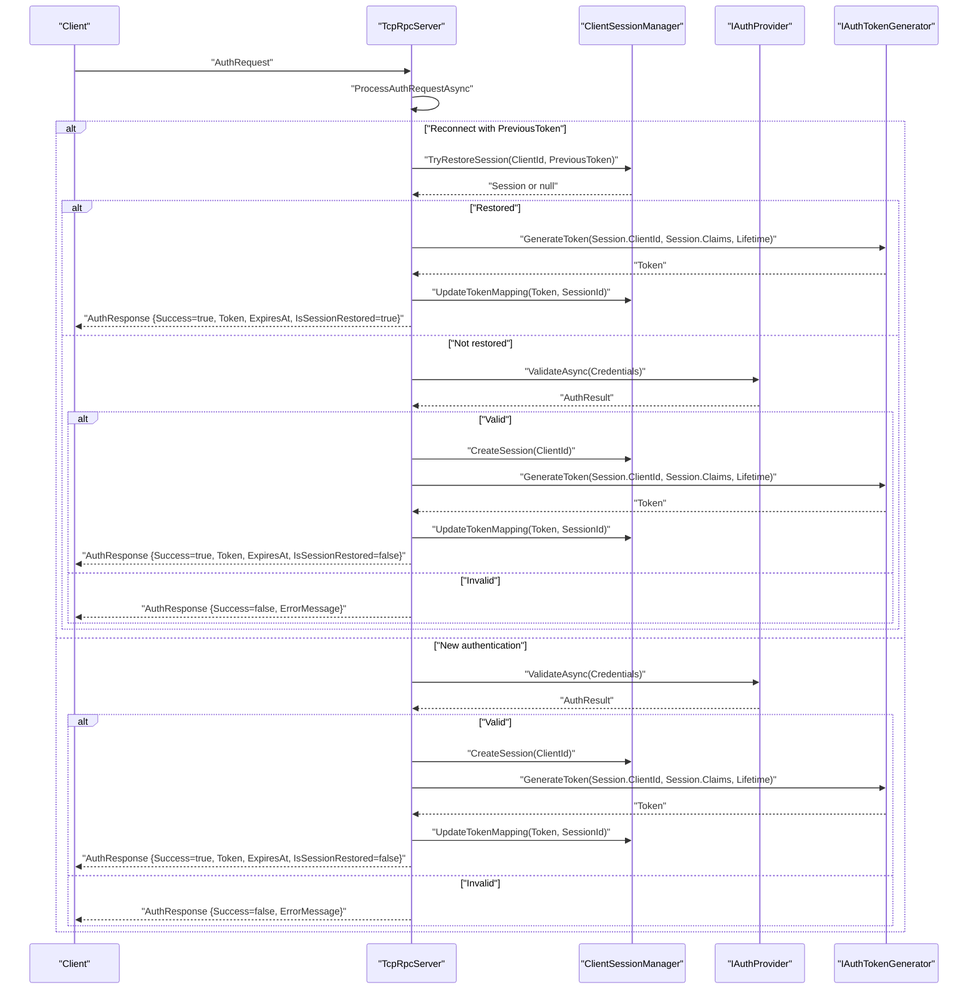
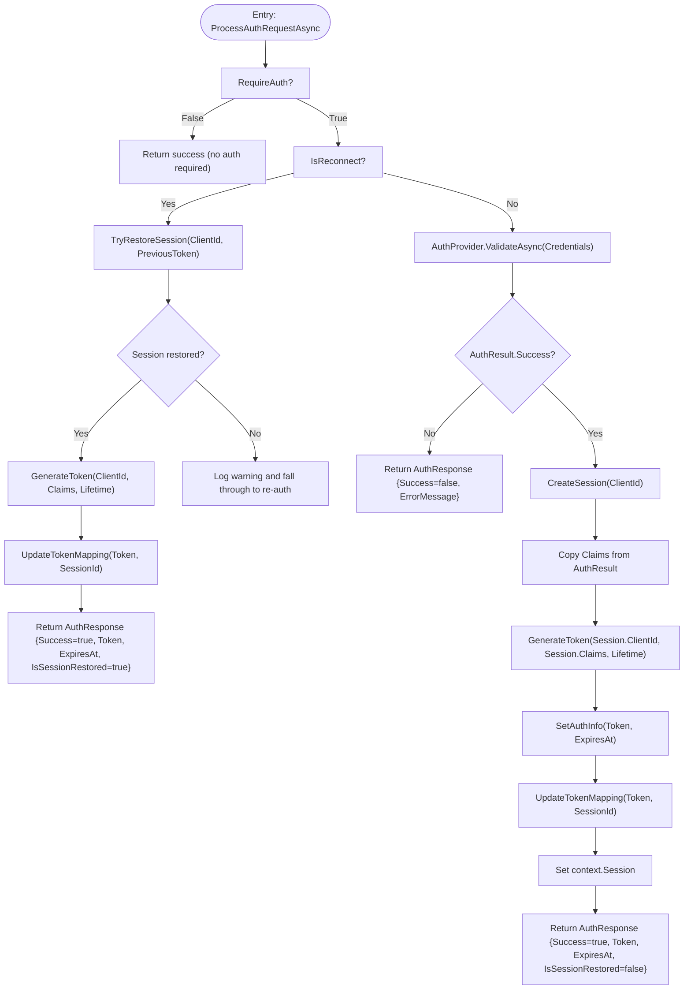
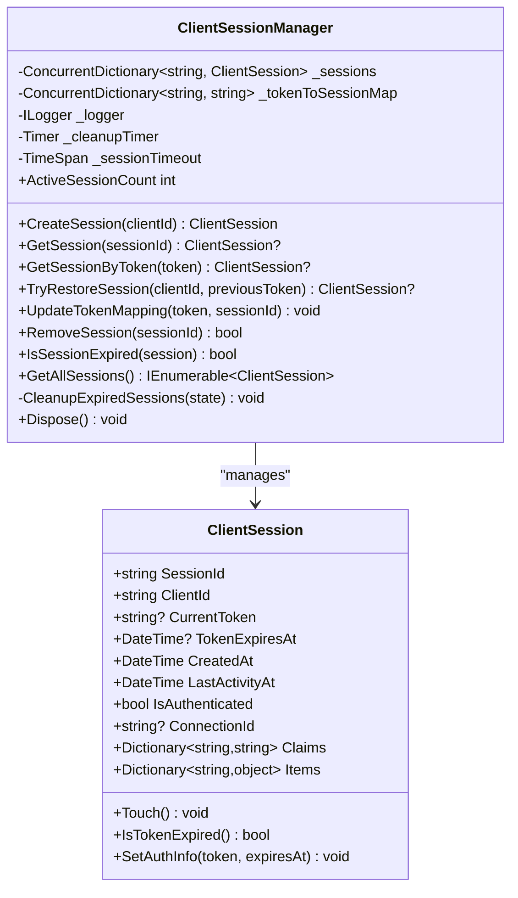
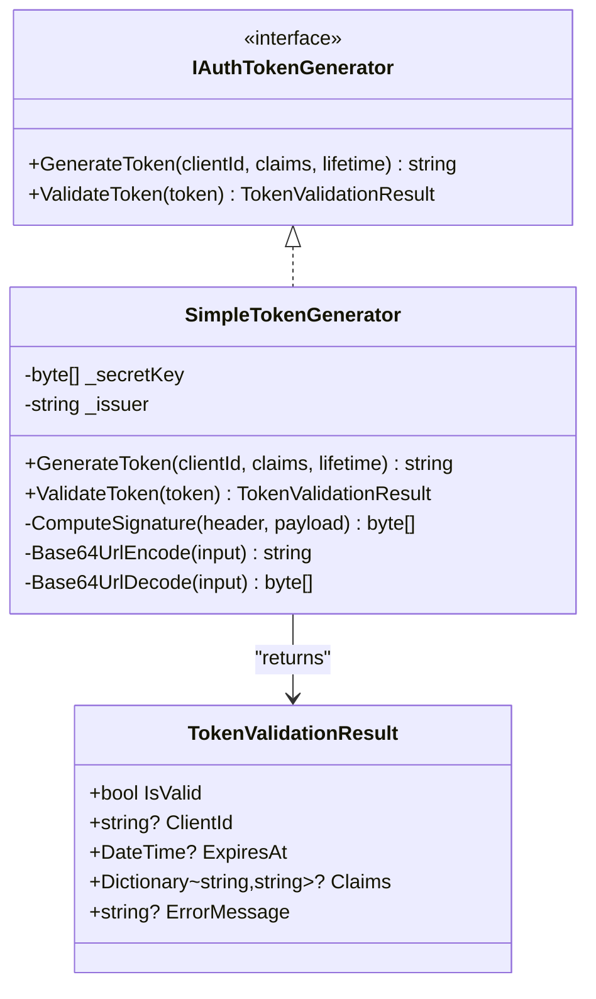
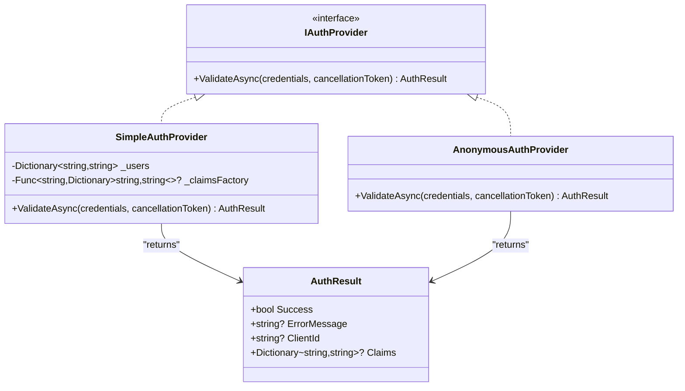
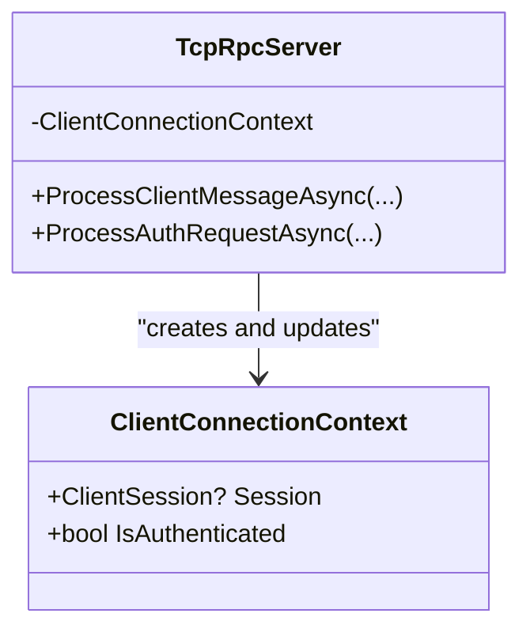
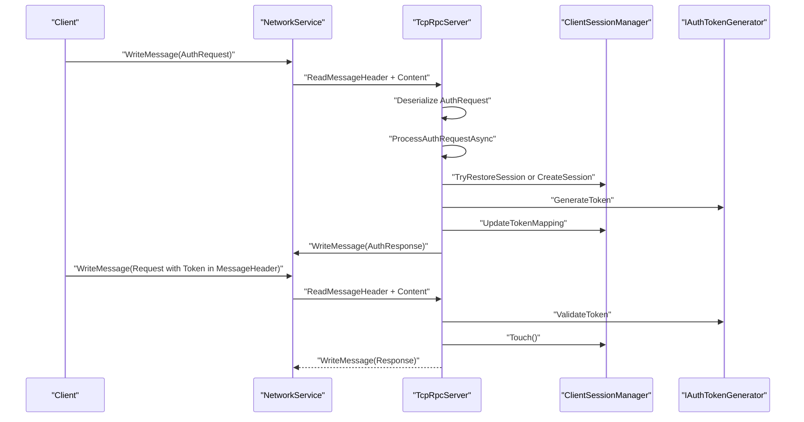
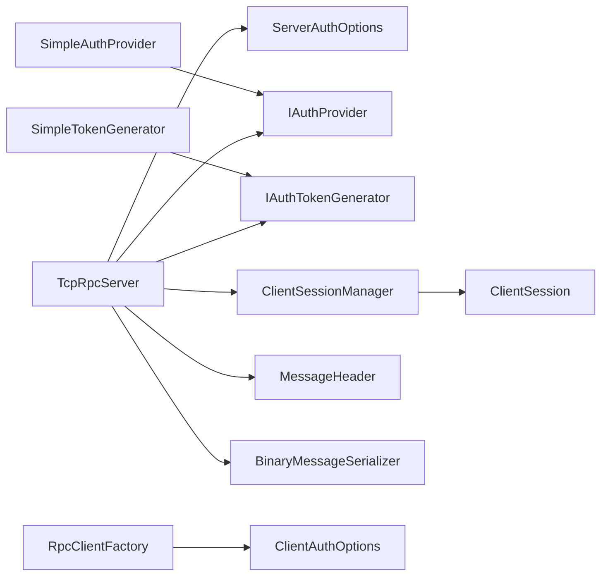

# Authentication Processing

<cite>
**Referenced Files in This Document**
- [TcpRpcServer.cs](file://TcpRpc/Server/TcpRpcServer.cs)
- [ClientSessionManager.cs](file://TcpRpc/Server/Auth/ClientSessionManager.cs)
- [ClientSession.cs](file://TcpRpc/Server/Auth/ClientSession.cs)
- [IAuthProvider.cs](file://TcpRpc/Server/Auth/IAuthProvider.cs)
- [IAuthTokenGenerator.cs](file://TcpRpc/Server/Auth/IAuthTokenGenerator.cs)
- [SimpleTokenGenerator.cs](file://TcpRpc/Server/Auth/SimpleTokenGenerator.cs)
- [AuthRequestMessage.cs](file://TcpRpc/Message/AuthRequestMessage.cs)
- [AuthResponseMessage.cs](file://TcpRpc/Message/AuthResponseMessage.cs)
- [MessageHeader.cs](file://TcpRpc/Message/MessageHeader.cs)
- [ServerAuthOptions.cs](file://TcpRpc/Server/ServerAuthOptions.cs)
- [SimpleAuthProvider.cs](file://TcpRpc.Server/SimpleAuthProvider.cs)
- [NetworkService.cs](file://TcpRpc/Network/NetworkService.cs)
- [BinaryMessageSerializer.cs](file://TcpRpc/Formatter/BinaryMessageSerializer.cs)
- [RpcClientFactory.cs](file://TcpRpc/Client/RpcClientFactory.cs)
- [ClientAuthOptions.cs](file://TcpRpc/Client/ClientAuthOptions.cs)
</cite>

## Table of Contents
1. [Introduction](#introduction)
2. [Project Structure](#project-structure)
3. [Core Components](#core-components)
4. [Architecture Overview](#architecture-overview)
5. [Detailed Component Analysis](#detailed-component-analysis)
6. [Dependency Analysis](#dependency-analysis)
7. [Performance Considerations](#performance-considerations)
8. [Security Considerations](#security-considerations)
9. [Troubleshooting Guide](#troubleshooting-guide)
10. [Conclusion](#conclusion)

## Introduction
This document explains the authentication processing phase within the message processing pipeline. It focuses on the ProcessAuthRequestAsync method, covering credential validation, session restoration for reconnect scenarios, and new session creation. It also documents the ClientSessionManager integration for session lifecycle management, token generation and validation, and session cleanup processes. The authentication flow is traced from the initial AuthRequest through token issuance to session establishment. Examples of authentication provider integration, custom credential validation, and session restoration logic are included. The ClientConnectionContext usage for maintaining authentication state across asynchronous operations is explained. Security considerations such as token expiration handling, session hijacking prevention, and secure credential storage are addressed, along with fallback mechanisms when session restoration fails and graceful handling of authentication failures.

## Project Structure
The authentication subsystem spans several modules:
- Server-side authentication and session management
- Message types for authentication handshake
- Token generation and validation
- Network and serialization infrastructure
- Client-side authentication options and factory

**Diagram sources**
- [TcpRpcServer.cs:33-46](file://TcpRpc/Server/TcpRpcServer.cs#L33-L46)
- [ClientSessionManager.cs:9-25](file://TcpRpc/Server/Auth/ClientSessionManager.cs#L9-L25)
- [ClientSession.cs:6-66](file://TcpRpc/Server/Auth/ClientSession.cs#L6-L66)
- [IAuthProvider.cs:32-40](file://TcpRpc/Server/Auth/IAuthProvider.cs#L32-L40)
- [IAuthTokenGenerator.cs:37-54](file://TcpRpc/Server/Auth/IAuthTokenGenerator.cs#L37-L54)
- [SimpleTokenGenerator.cs:11-36](file://TcpRpc/Server/Auth/SimpleTokenGenerator.cs#L11-L36)
- [ServerAuthOptions.cs:8-39](file://TcpRpc/Server/ServerAuthOptions.cs#L8-L39)
- [AuthRequestMessage.cs:6-27](file://TcpRpc/Message/AuthRequestMessage.cs#L6-L27)
- [AuthResponseMessage.cs:6-42](file://TcpRpc/Message/AuthResponseMessage.cs#L6-L42)
- [MessageHeader.cs:9-72](file://TcpRpc/Message/MessageHeader.cs#L9-L72)
- [NetworkService.cs:7-28](file://TcpRpc/Network/NetworkService.cs#L7-L28)
- [BinaryMessageSerializer.cs:11-444](file://TcpRpc/Formatter/BinaryMessageSerializer.cs#L11-L444)
- [RpcClientFactory.cs:9-31](file://TcpRpc/Client/RpcClientFactory.cs#L9-L31)
- [ClientAuthOptions.cs:6-37](file://TcpRpc/Client/ClientAuthOptions.cs#L6-L37)

**Section sources**
- [TcpRpcServer.cs:33-46](file://TcpRpc/Server/TcpRpcServer.cs#L33-L46)
- [ServerAuthOptions.cs:8-39](file://TcpRpc/Server/ServerAuthOptions.cs#L8-L39)

## Core Components
- ProcessAuthRequestAsync orchestrates authentication decisions: session restoration for reconnects, credential validation via IAuthProvider, and new session creation with token issuance.
- ClientSessionManager manages session lifecycle: creation, lookup, restoration, token mapping updates, expiration checks, and periodic cleanup.
- ClientSession stores per-client identity, tokens, claims, activity timestamps, and connection association.
- IAuthProvider defines credential validation contract; SimpleAuthProvider demonstrates username/password validation with optional claims factory.
- IAuthTokenGenerator and SimpleTokenGenerator define token generation and validation contracts and implement JWT-like tokens with HMAC signature verification.
- AuthRequestMessage and AuthResponseMessage represent the wire protocol for authentication handshake.
- MessageHeader carries optional token for subsequent requests.
- ServerAuthOptions configures authentication behavior, token lifetime, session timeouts, and injects providers.
- NetworkService and BinaryMessageSerializer handle message framing and serialization/deserialization.

**Section sources**
- [TcpRpcServer.cs:453-547](file://TcpRpc/Server/TcpRpcServer.cs#L453-L547)
- [ClientSessionManager.cs:27-116](file://TcpRpc/Server/Auth/ClientSessionManager.cs#L27-L116)
- [ClientSession.cs:6-94](file://TcpRpc/Server/Auth/ClientSession.cs#L6-L94)
- [IAuthProvider.cs:32-40](file://TcpRpc/Server/Auth/IAuthProvider.cs#L32-L40)
- [SimpleAuthProvider.cs:8-54](file://TcpRpc.Server/SimpleAuthProvider.cs#L8-L54)
- [IAuthTokenGenerator.cs:37-54](file://TcpRpc/Server/Auth/IAuthTokenGenerator.cs#L37-L54)
- [SimpleTokenGenerator.cs:11-163](file://TcpRpc/Server/Auth/SimpleTokenGenerator.cs#L11-L163)
- [AuthRequestMessage.cs:6-27](file://TcpRpc/Message/AuthRequestMessage.cs#L6-L27)
- [AuthResponseMessage.cs:6-42](file://TcpRpc/Message/AuthResponseMessage.cs#L6-L42)
- [MessageHeader.cs:23-72](file://TcpRpc/Message/MessageHeader.cs#L23-L72)
- [ServerAuthOptions.cs:8-39](file://TcpRpc/Server/ServerAuthOptions.cs#L8-L39)
- [NetworkService.cs:10-52](file://TcpRpc/Network/NetworkService.cs#L10-L52)
- [BinaryMessageSerializer.cs:325-440](file://TcpRpc/Formatter/BinaryMessageSerializer.cs#L325-L440)

## Architecture Overview
The authentication flow begins when the server receives an AuthRequest. The server decides whether to restore an existing session (reconnect) or validate credentials. On success, it creates or restores a session, generates a token, updates token-to-session mapping, and returns an AuthResponse. Subsequent requests carry the token in MessageHeader, validated by the server before processing RPC requests.

**Diagram sources**
- [TcpRpcServer.cs:453-547](file://TcpRpc/Server/TcpRpcServer.cs#L453-L547)
- [ClientSessionManager.cs:85-116](file://TcpRpc/Server/Auth/ClientSessionManager.cs#L85-L116)
- [IAuthProvider.cs:32-40](file://TcpRpc/Server/Auth/IAuthProvider.cs#L32-L40)
- [IAuthTokenGenerator.cs:37-54](file://TcpRpc/Server/Auth/IAuthTokenGenerator.cs#L37-L54)
- [AuthRequestMessage.cs:6-27](file://TcpRpc/Message/AuthRequestMessage.cs#L6-L27)
- [AuthResponseMessage.cs:6-42](file://TcpRpc/Message/AuthResponseMessage.cs#L6-L42)

## Detailed Component Analysis

### ProcessAuthRequestAsync Method
ProcessAuthRequestAsync handles the authentication request:
- If authentication is disabled, it returns a success response with optional ClientId.
- If reconnect is indicated (PreviousToken present), it attempts session restoration:
  - Validates token-to-session mapping and ClientId match.
  - Checks session expiration.
  - On success, regenerates a token, updates mapping, and marks IsSessionRestored.
- If restoration fails or not reconnect, it validates credentials via IAuthProvider:
  - On success, creates a new session, copies claims, generates a token, updates mapping, and sets context.Session.
- Returns an AuthResponseMessage indicating success/failure, ClientId, Token, ExpiresAt, and IsSessionRestored.

**Diagram sources**
- [TcpRpcServer.cs:453-547](file://TcpRpc/Server/TcpRpcServer.cs#L453-L547)
- [ClientSessionManager.cs:27-116](file://TcpRpc/Server/Auth/ClientSessionManager.cs#L27-L116)
- [IAuthProvider.cs:32-40](file://TcpRpc/Server/Auth/IAuthProvider.cs#L32-L40)
- [IAuthTokenGenerator.cs:37-54](file://TcpRpc/Server/Auth/IAuthTokenGenerator.cs#L37-L54)
- [ClientSession.cs:86-94](file://TcpRpc/Server/Auth/ClientSession.cs#L86-L94)

**Section sources**
- [TcpRpcServer.cs:453-547](file://TcpRpc/Server/TcpRpcServer.cs#L453-L547)

### ClientSessionManager Integration
ClientSessionManager provides:
- CreateSession: Generates a new session ID and initializes ClientSession.
- GetSession/GetSessionByToken: Retrieves sessions and updates last activity via Touch.
- TryRestoreSession: Validates token mapping, ClientId, and expiration before restoring.
- UpdateTokenMapping: Maintains token-to-session index and removes old mappings.
- RemoveSession: Removes session and cleans token mapping.
- IsSessionExpired: Compares LastActivityAt against configured timeout.
- Periodic cleanup: Scans expired sessions and removes them.

**Diagram sources**
- [ClientSessionManager.cs:9-187](file://TcpRpc/Server/Auth/ClientSessionManager.cs#L9-L187)
- [ClientSession.cs:6-94](file://TcpRpc/Server/Auth/ClientSession.cs#L6-L94)

**Section sources**
- [ClientSessionManager.cs:27-187](file://TcpRpc/Server/Auth/ClientSessionManager.cs#L27-L187)
- [ClientSession.cs:6-94](file://TcpRpc/Server/Auth/ClientSession.cs#L6-L94)

### Token Generation and Validation
IAuthTokenGenerator defines:
- GenerateToken: Produces a signed token with subject, issuer, issued-at, expiration, and optional custom claims.
- ValidateToken: Verifies signature, parses payload, checks expiration, and extracts claims.

SimpleTokenGenerator implements:
- Header: alg HS256, typ JWT.
- Payload: sub, iss, iat, exp, plus custom claims.
- Signature: HMAC-SHA256 over header.payload using a shared secret key.
- Validation: Fixed-time signature comparison, expiration check, and claim extraction.

**Diagram sources**
- [IAuthTokenGenerator.cs:37-54](file://TcpRpc/Server/Auth/IAuthTokenGenerator.cs#L37-L54)
- [SimpleTokenGenerator.cs:11-163](file://TcpRpc/Server/Auth/SimpleTokenGenerator.cs#L11-L163)

**Section sources**
- [IAuthTokenGenerator.cs:6-54](file://TcpRpc/Server/Auth/IAuthTokenGenerator.cs#L6-L54)
- [SimpleTokenGenerator.cs:38-137](file://TcpRpc/Server/Auth/SimpleTokenGenerator.cs#L38-L137)

### Authentication Provider Integration
IAuthProvider defines ValidateAsync(credentials) returning AuthResult with Success, ErrorMessage, ClientId, and Claims. SimpleAuthProvider demonstrates:
- Username/password validation against an in-memory dictionary.
- Optional claims factory to attach role or tenant metadata.
AnonymousAuthProvider allows development/test scenarios by accepting arbitrary credentials or generating a clientId.

**Diagram sources**
- [IAuthProvider.cs:32-40](file://TcpRpc/Server/Auth/IAuthProvider.cs#L32-L40)
- [SimpleAuthProvider.cs:8-75](file://TcpRpc.Server/SimpleAuthProvider.cs#L8-L75)

**Section sources**
- [IAuthProvider.cs:6-40](file://TcpRpc/Server/Auth/IAuthProvider.cs#L6-L40)
- [SimpleAuthProvider.cs:24-75](file://TcpRpc.Server/SimpleAuthProvider.cs#L24-L75)

### ClientConnectionContext and State Propagation
ClientConnectionContext holds per-connection state:
- Session: bound ClientSession after successful authentication.
- IsAuthenticated: toggled upon receiving a successful AuthResponse.

TcpRpcServer maintains this context per client task and uses it to gate subsequent requests and update session activity.

**Diagram sources**
- [TcpRpcServer.cs:374-378](file://TcpRpc/Server/TcpRpcServer.cs#L374-L378)
- [TcpRpcServer.cs:380-451](file://TcpRpc/Server/TcpRpcServer.cs#L380-L451)

**Section sources**
- [TcpRpcServer.cs:374-378](file://TcpRpc/Server/TcpRpcServer.cs#L374-L378)
- [TcpRpcServer.cs:380-451](file://TcpRpc/Server/TcpRpcServer.cs#L380-L451)

### Authentication Flow End-to-End
- Client sends AuthRequest with ClientId, PreviousToken (optional), and Credentials (optional).
- Server deserializes AuthRequest and invokes ProcessAuthRequestAsync.
- On success, server serializes AuthResponse with Token and ExpiresAt.
- Client stores Token and uses it in MessageHeader for subsequent requests.
- Server validates Token on Request messages and updates session activity.

**Diagram sources**
- [NetworkService.cs:10-52](file://TcpRpc/Network/NetworkService.cs#L10-L52)
- [BinaryMessageSerializer.cs:325-440](file://TcpRpc/Formatter/BinaryMessageSerializer.cs#L325-L440)
- [TcpRpcServer.cs:380-451](file://TcpRpc/Server/TcpRpcServer.cs#L380-L451)
- [ClientSessionManager.cs:69-83](file://TcpRpc/Server/Auth/ClientSessionManager.cs#L69-L83)
- [IAuthTokenGenerator.cs:37-54](file://TcpRpc/Server/Auth/IAuthTokenGenerator.cs#L37-L54)

**Section sources**
- [NetworkService.cs:10-52](file://TcpRpc/Network/NetworkService.cs#L10-L52)
- [BinaryMessageSerializer.cs:325-440](file://TcpRpc/Formatter/BinaryMessageSerializer.cs#L325-L440)
- [TcpRpcServer.cs:380-451](file://TcpRpc/Server/TcpRpcServer.cs#L380-L451)

## Dependency Analysis
- TcpRpcServer depends on ServerAuthOptions for configuration, IAuthProvider for validation, IAuthTokenGenerator for token operations, and ClientSessionManager for session lifecycle.
- ClientSessionManager depends on timers and concurrent collections for concurrency-safe operations.
- SimpleTokenGenerator depends on cryptographic primitives for signing and Base64Url encoding.
- MessageHeader carries the token for downstream request validation.
- RpcClientFactory and ClientAuthOptions coordinate client-side authentication and reconnection.

**Diagram sources**
- [TcpRpcServer.cs:33-46](file://TcpRpc/Server/TcpRpcServer.cs#L33-L46)
- [ServerAuthOptions.cs:8-39](file://TcpRpc/Server/ServerAuthOptions.cs#L8-L39)
- [ClientSessionManager.cs:9-25](file://TcpRpc/Server/Auth/ClientSessionManager.cs#L9-L25)
- [ClientSession.cs:6-66](file://TcpRpc/Server/Auth/ClientSession.cs#L6-L66)
- [IAuthProvider.cs:32-40](file://TcpRpc/Server/Auth/IAuthProvider.cs#L32-L40)
- [IAuthTokenGenerator.cs:37-54](file://TcpRpc/Server/Auth/IAuthTokenGenerator.cs#L37-L54)
- [SimpleTokenGenerator.cs:11-36](file://TcpRpc/Server/Auth/SimpleTokenGenerator.cs#L11-L36)
- [SimpleAuthProvider.cs:8-22](file://TcpRpc.Server/SimpleAuthProvider.cs#L8-L22)
- [MessageHeader.cs:23-72](file://TcpRpc/Message/MessageHeader.cs#L23-L72)
- [BinaryMessageSerializer.cs:325-440](file://TcpRpc/Formatter/BinaryMessageSerializer.cs#L325-L440)
- [RpcClientFactory.cs:9-31](file://TcpRpc/Client/RpcClientFactory.cs#L9-L31)
- [ClientAuthOptions.cs:6-37](file://TcpRpc/Client/ClientAuthOptions.cs#L6-L37)

**Section sources**
- [TcpRpcServer.cs:33-46](file://TcpRpc/Server/TcpRpcServer.cs#L33-L46)
- [ClientSessionManager.cs:9-25](file://TcpRpc/Server/Auth/ClientSessionManager.cs#L9-L25)
- [SimpleTokenGenerator.cs:11-36](file://TcpRpc/Server/Auth/SimpleTokenGenerator.cs#L11-L36)
- [SimpleAuthProvider.cs:8-22](file://TcpRpc.Server/SimpleAuthProvider.cs#L8-L22)
- [MessageHeader.cs:23-72](file://TcpRpc/Message/MessageHeader.cs#L23-L72)
- [BinaryMessageSerializer.cs:325-440](file://TcpRpc/Formatter/BinaryMessageSerializer.cs#L325-L440)
- [RpcClientFactory.cs:9-31](file://TcpRpc/Client/RpcClientFactory.cs#L9-L31)
- [ClientAuthOptions.cs:6-37](file://TcpRpc/Client/ClientAuthOptions.cs#L6-L37)

## Performance Considerations
- Session cleanup runs periodically; tune SessionCleanupInterval to balance memory usage and CPU overhead.
- Token validation is O(1) with fixed-time signature comparison and JSON parsing; keep claims minimal to reduce payload size.
- Use connection pooling on the client to reduce repeated authentication overhead.
- Avoid excessive claims in tokens to minimize serialization/deserialization costs.

## Security Considerations
- Token expiration: Ensure TokenLifetime is appropriate; SimpleTokenGenerator embeds exp in payload and SimpleTokenValidator enforces expiration.
- Session hijacking prevention: Validate ClientId during restoration and reject mismatches; maintain strict token-to-session mapping; remove stale mappings on session removal.
- Secure credential storage: Do not persist raw passwords; use IAuthProvider to validate without storing secrets; rotate shared secret keys periodically.
- Fallback on restoration failure: The server logs warnings and falls back to credential validation, preventing silent failures.
- Graceful failure handling: On invalid tokens or missing authentication, the server responds with an AuthResponse carrying an error message and does not process the request.

**Section sources**
- [ClientSessionManager.cs:85-116](file://TcpRpc/Server/Auth/ClientSessionManager.cs#L85-L116)
- [SimpleTokenGenerator.cs:79-137](file://TcpRpc/Server/Auth/SimpleTokenGenerator.cs#L79-L137)
- [TcpRpcServer.cs:396-415](file://TcpRpc/Server/TcpRpcServer.cs#L396-L415)
- [TcpRpcServer.cs:497-500](file://TcpRpc/Server/TcpRpcServer.cs#L497-L500)

## Troubleshooting Guide
Common issues and diagnostics:
- Session restore fails: Verify PreviousToken validity, ClientId match, and session not expired; check logs for warnings.
- Authentication failure: Confirm credentials correctness and IAuthProvider configuration; review AuthResult.ErrorMessage.
- Invalid token errors: Ensure token was generated by the same secret and issuer; check expiration and signature verification.
- No authentication required: If RequireAuth is false, the server skips authentication checks; confirm configuration intent.
- Cleanup anomalies: Review cleanup timer intervals and logging for expired session removal.

Operational tips:
- Monitor ActiveSessionCount and cleanup logs to detect leaks or aggressive churn.
- Validate token generation and validation paths in isolation using unit tests around IAuthTokenGenerator.
- Instrument IAuthProvider to capture detailed failure reasons.

**Section sources**
- [ClientSessionManager.cs:159-179](file://TcpRpc/Server/Auth/ClientSessionManager.cs#L159-L179)
- [TcpRpcServer.cs:497-500](file://TcpRpc/Server/TcpRpcServer.cs#L497-L500)
- [TcpRpcServer.cs:396-415](file://TcpRpc/Server/TcpRpcServer.cs#L396-L415)
- [ServerAuthOptions.cs:10-39](file://TcpRpc/Server/ServerAuthOptions.cs#L10-L39)

## Conclusion
The authentication processing pipeline integrates cleanly with the message processing loop. ProcessAuthRequestAsync centralizes decision logic for session restoration versus credential validation, while ClientSessionManager and SimpleTokenGenerator provide robust session and token management. The design supports reconnect scenarios, secure token validation, and graceful fallbacks. Proper configuration of ServerAuthOptions, strong credential providers, and secure token generation ensures a resilient and secure authentication flow.