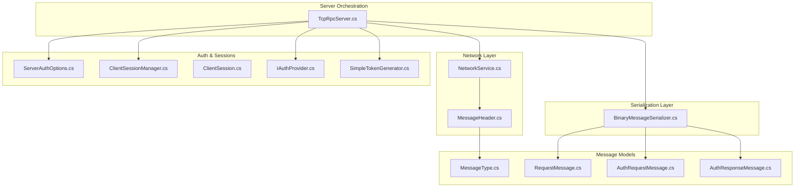
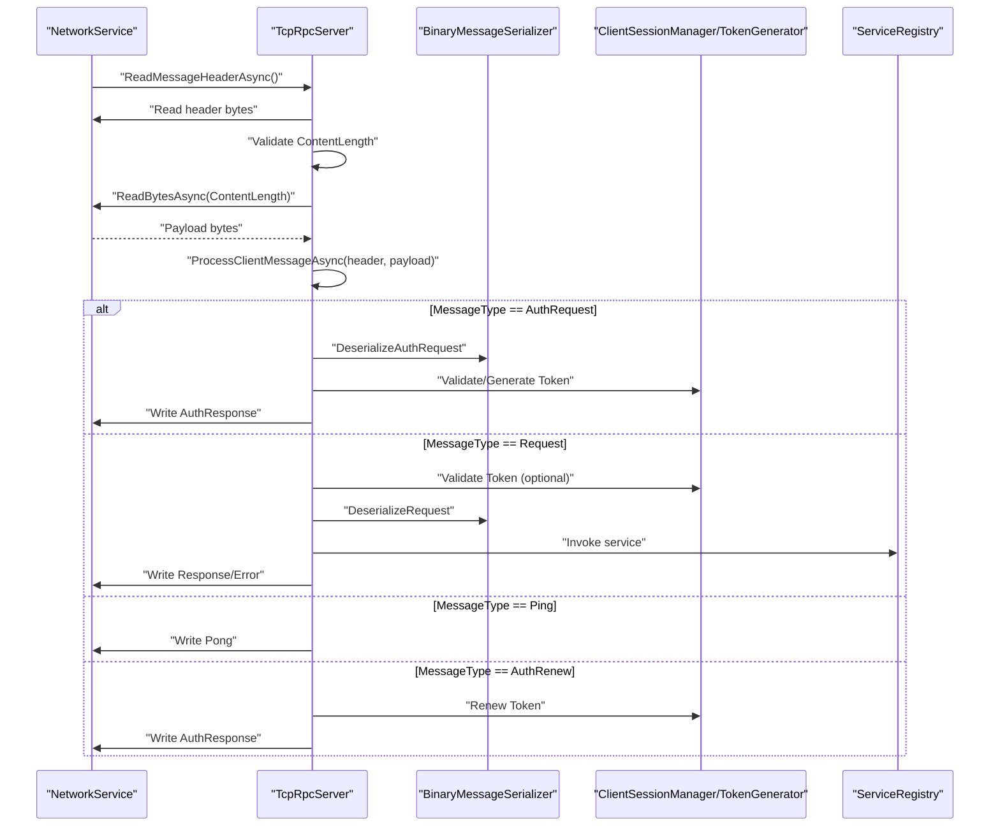
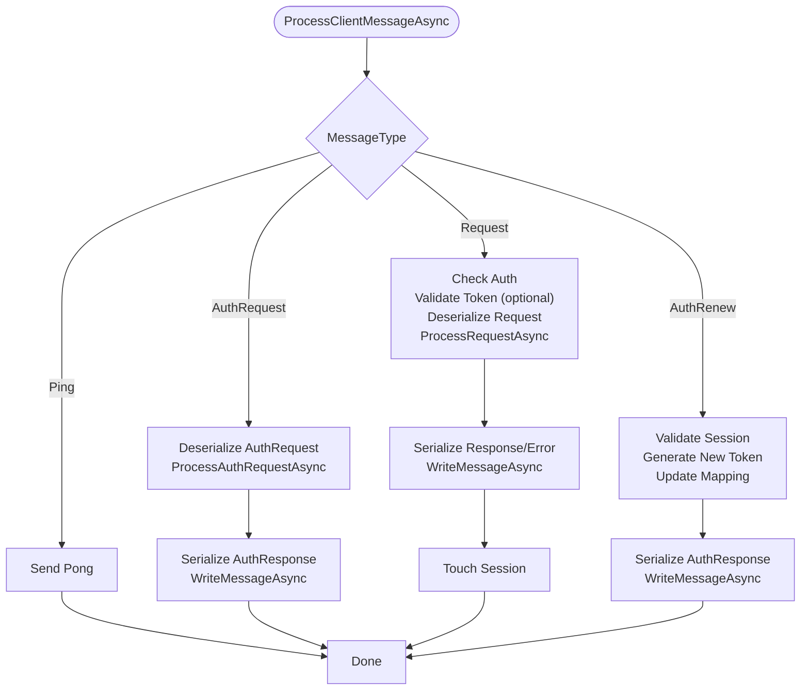
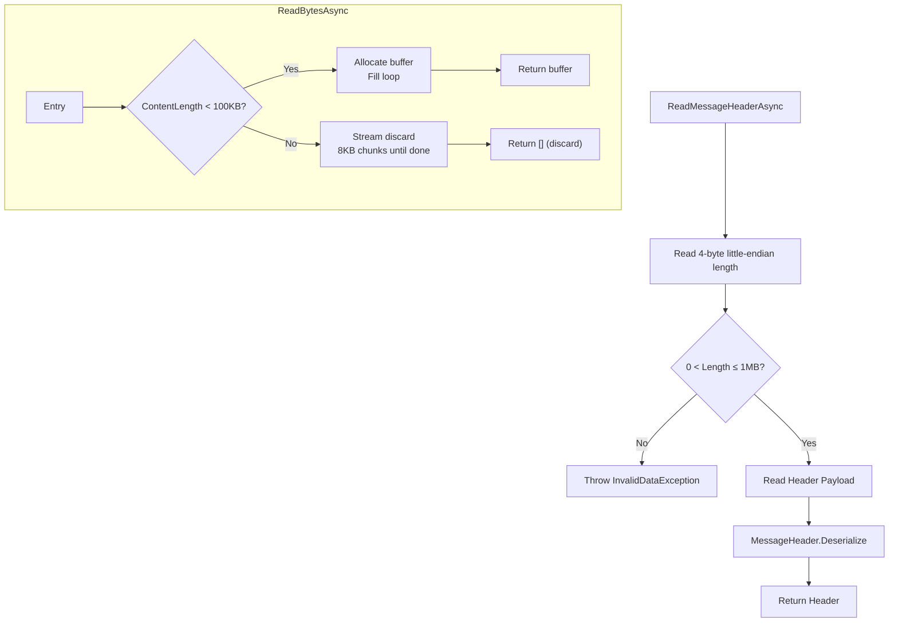
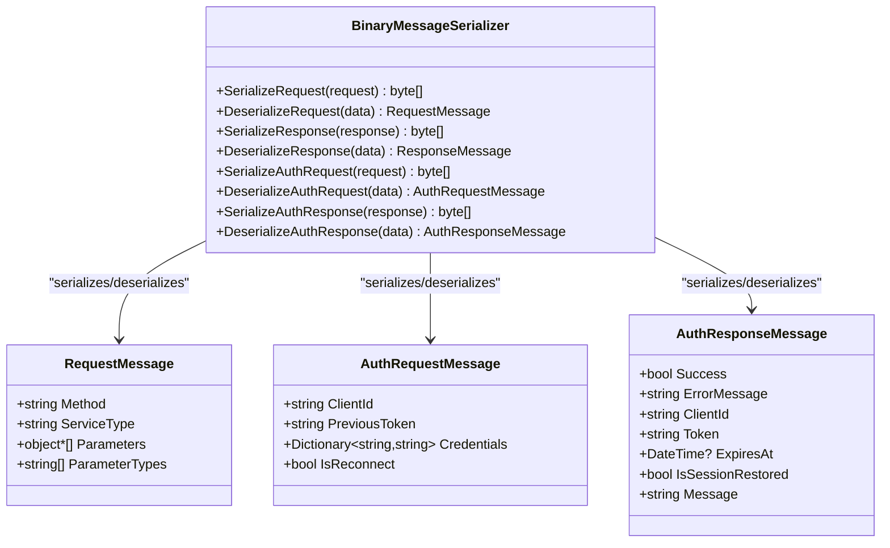
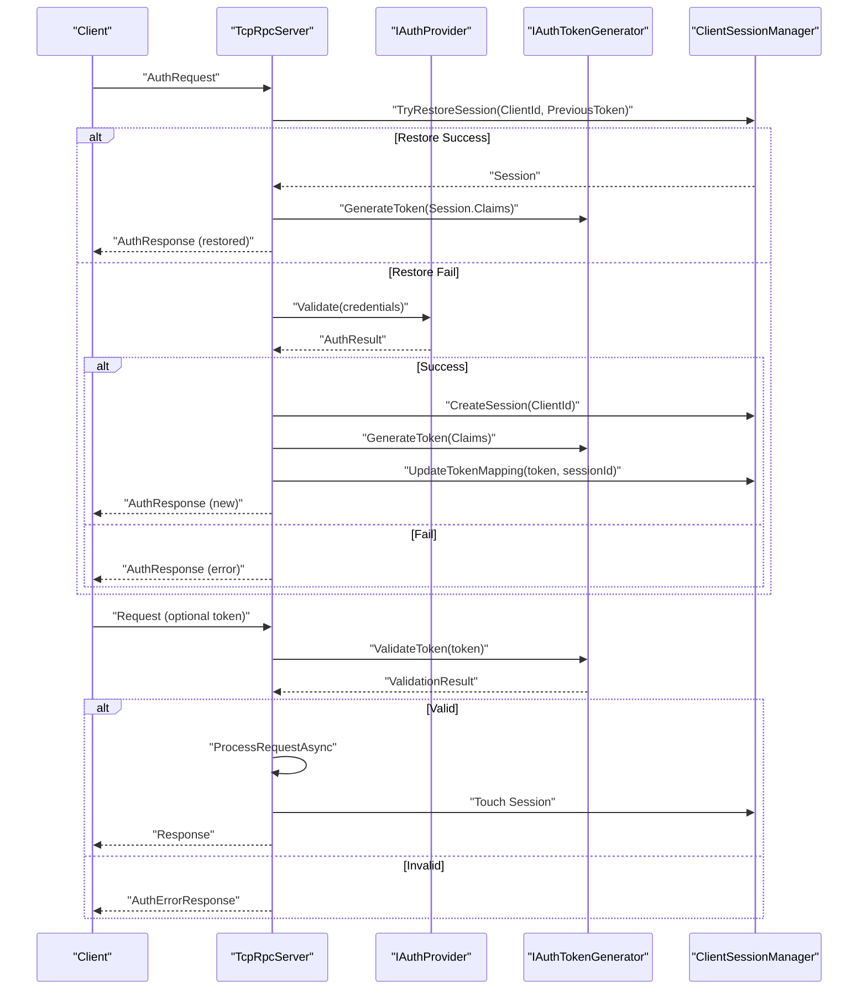
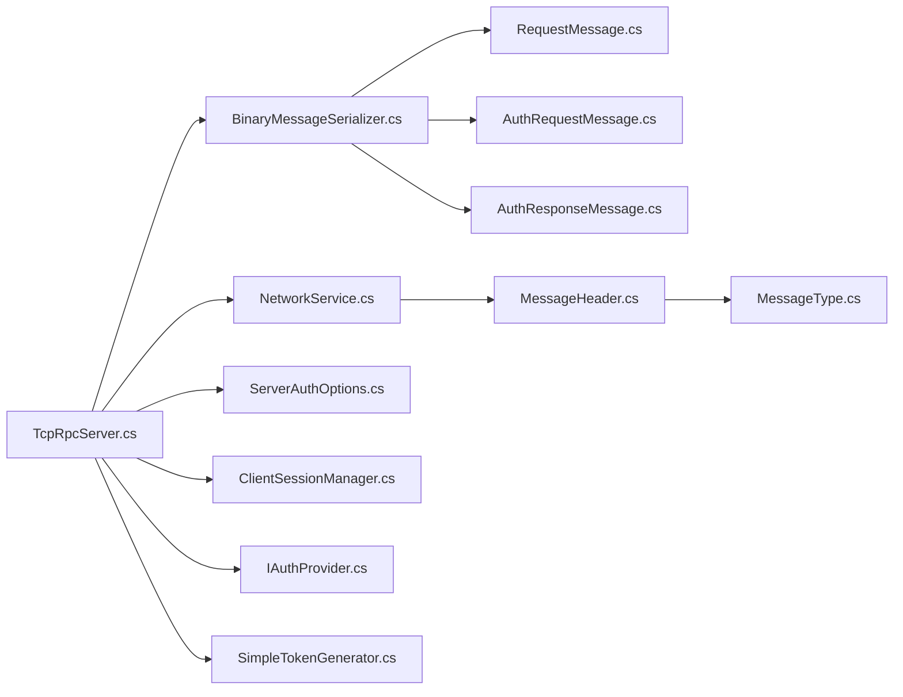

# Message Processing Pipeline

<cite>
**Referenced Files in This Document**
- [TcpRpcServer.cs](file://TcpRpc/Server/TcpRpcServer.cs)
- [NetworkService.cs](file://TcpRpc/Network/NetworkService.cs)
- [BinaryMessageSerializer.cs](file://TcpRpc/Formatter/BinaryMessageSerializer.cs)
- [MessageHeader.cs](file://TcpRpc/Message/MessageHeader.cs)
- [MessageType.cs](file://TcpRpc/Message/MessageType.cs)
- [RequestMessage.cs](file://TcpRpc/Message/RequestMessage.cs)
- [AuthRequestMessage.cs](file://TcpRpc/Message/AuthRequestMessage.cs)
- [AuthResponseMessage.cs](file://TcpRpc/Message/AuthResponseMessage.cs)
- [ClientSessionManager.cs](file://TcpRpc/Server/Auth/ClientSessionManager.cs)
- [ClientSession.cs](file://TcpRpc/Server/Auth/ClientSession.cs)
- [IAuthProvider.cs](file://TcpRpc/Server/Auth/IAuthProvider.cs)
- [SimpleTokenGenerator.cs](file://TcpRpc/Server/Auth/SimpleTokenGenerator.cs)
- [ServerAuthOptions.cs](file://TcpRpc/Server/ServerAuthOptions.cs)
</cite>

## Table of Contents
1. [Introduction](#introduction)
2. [Project Structure](#project-structure)
3. [Core Components](#core-components)
4. [Architecture Overview](#architecture-overview)
5. [Detailed Component Analysis](#detailed-component-analysis)
6. [Dependency Analysis](#dependency-analysis)
7. [Performance Considerations](#performance-considerations)
8. [Troubleshooting Guide](#troubleshooting-guide)
9. [Conclusion](#conclusion)

## Introduction
This document explains the server’s message processing pipeline end-to-end: from network reception and header parsing, through deserialization and authentication checks, to request handling and response generation. It focuses on the ProcessClientMessageAsync method and its handling of AuthRequest, Request, Ping, and AuthRenew messages. It also covers message header processing, content length validation, buffer management for large messages, authentication flow integration, token validation, session management, error handling for malformed messages, timeout management, and security considerations.

## Project Structure
The message processing pipeline spans several layers:
- Network layer: reads/writes framed messages with headers
- Serialization layer: encodes/decodes binary payloads
- Message model layer: defines headers, request/response, and auth messages
- Authentication layer: manages sessions, tokens, and provider validation
- Server orchestration: routes messages, enforces auth, and invokes handlers

**Diagram sources**
- [TcpRpcServer.cs](file://TcpRpc/Server/TcpRpcServer.cs)
- [NetworkService.cs](file://TcpRpc/Network/NetworkService.cs)
- [BinaryMessageSerializer.cs](file://TcpRpc/Formatter/BinaryMessageSerializer.cs)
- [MessageHeader.cs](file://TcpRpc/Message/MessageHeader.cs)
- [MessageType.cs](file://TcpRpc/Message/MessageType.cs)
- [RequestMessage.cs](file://TcpRpc/Message/RequestMessage.cs)
- [AuthRequestMessage.cs](file://TcpRpc/Message/AuthRequestMessage.cs)
- [AuthResponseMessage.cs](file://TcpRpc/Message/AuthResponseMessage.cs)
- [ServerAuthOptions.cs](file://TcpRpc/Server/ServerAuthOptions.cs)
- [ClientSessionManager.cs](file://TcpRpc/Server/Auth/ClientSessionManager.cs)
- [ClientSession.cs](file://TcpRpc/Server/Auth/ClientSession.cs)
- [IAuthProvider.cs](file://TcpRpc/Server/Auth/IAuthProvider.cs)
- [SimpleTokenGenerator.cs](file://TcpRpc/Server/Auth/SimpleTokenGenerator.cs)

**Section sources**
- [TcpRpcServer.cs](file://TcpRpc/Server/TcpRpcServer.cs)
- [NetworkService.cs](file://TcpRpc/Network/NetworkService.cs)
- [BinaryMessageSerializer.cs](file://TcpRpc/Formatter/BinaryMessageSerializer.cs)
- [MessageHeader.cs](file://TcpRpc/Message/MessageHeader.cs)
- [MessageType.cs](file://TcpRpc/Message/MessageType.cs)
- [RequestMessage.cs](file://TcpRpc/Message/RequestMessage.cs)
- [AuthRequestMessage.cs](file://TcpRpc/Message/AuthRequestMessage.cs)
- [AuthResponseMessage.cs](file://TcpRpc/Message/AuthResponseMessage.cs)
- [ServerAuthOptions.cs](file://TcpRpc/Server/ServerAuthOptions.cs)
- [ClientSessionManager.cs](file://TcpRpc/Server/Auth/ClientSessionManager.cs)
- [ClientSession.cs](file://TcpRpc/Server/Auth/ClientSession.cs)
- [IAuthProvider.cs](file://TcpRpc/Server/Auth/IAuthProvider.cs)
- [SimpleTokenGenerator.cs](file://TcpRpc/Server/Auth/SimpleTokenGenerator.cs)

## Core Components
- TcpRpcServer: orchestrates client connections, reads headers, validates content length, reads payloads, dispatches to ProcessClientMessageAsync, and writes responses.
- NetworkService: handles framing, header read/write, and safe buffered reads with large-message handling.
- BinaryMessageSerializer: serializes/deserializes requests, responses, and auth messages using a compact binary format.
- MessageHeader: carries message type, correlation ID, content length, flags, optional token, and provides serialize/deserialize helpers.
- MessageType: enumerates supported message types including Request, Response, Ping, Pong, AuthRequest, AuthResponse, AuthRenew, and Error.
- RequestMessage/AuthRequestMessage/AuthResponseMessage: typed models for RPC and authentication payloads.
- ClientSessionManager/ClientSession: manage sessions, token-to-session mapping, expiration, and cleanup.
- IAuthProvider/SimpleTokenGenerator/ServerAuthOptions: authentication provider interface, token generation/validation, and server-side auth configuration.

**Section sources**
- [TcpRpcServer.cs](file://TcpRpc/Server/TcpRpcServer.cs)
- [NetworkService.cs](file://TcpRpc/Network/NetworkService.cs)
- [BinaryMessageSerializer.cs](file://TcpRpc/Formatter/BinaryMessageSerializer.cs)
- [MessageHeader.cs](file://TcpRpc/Message/MessageHeader.cs)
- [MessageType.cs](file://TcpRpc/Message/MessageType.cs)
- [RequestMessage.cs](file://TcpRpc/Message/RequestMessage.cs)
- [AuthRequestMessage.cs](file://TcpRpc/Message/AuthRequestMessage.cs)
- [AuthResponseMessage.cs](file://TcpRpc/Message/AuthResponseMessage.cs)
- [ClientSessionManager.cs](file://TcpRpc/Server/Auth/ClientSessionManager.cs)
- [ClientSession.cs](file://TcpRpc/Server/Auth/ClientSession.cs)
- [IAuthProvider.cs](file://TcpRpc/Server/Auth/IAuthProvider.cs)
- [SimpleTokenGenerator.cs](file://TcpRpc/Server/Auth/SimpleTokenGenerator.cs)
- [ServerAuthOptions.cs](file://TcpRpc/Server/ServerAuthOptions.cs)

## Architecture Overview
The pipeline is event-driven per client connection. The server loop:
1. Reads a 4-byte little-endian header length, validates it, then reads the header payload.
2. Validates header.ContentLength and enforces reasonable limits.
3. Reads the content payload (with special handling for large payloads).
4. Dispatches to ProcessClientMessageAsync based on MessageType.
5. Serializes and writes responses via NetworkService.

**Diagram sources**
- [TcpRpcServer.cs](file://TcpRpc/Server/TcpRpcServer.cs)
- [NetworkService.cs](file://TcpRpc/Network/NetworkService.cs)
- [BinaryMessageSerializer.cs](file://TcpRpc/Formatter/BinaryMessageSerializer.cs)
- [ClientSessionManager.cs](file://TcpRpc/Server/Auth/ClientSessionManager.cs)
- [SimpleTokenGenerator.cs](file://TcpRpc/Server/Auth/SimpleTokenGenerator.cs)

## Detailed Component Analysis

### ProcessClientMessageAsync: Message Dispatch and Handling
ProcessClientMessageAsync is the central dispatcher for inbound messages. It:
- Deserializes payloads using the configured serializer
- Enforces authentication for Request and AuthRenew
- Validates tokens when present
- Invokes specialized handlers for each message type
- Updates session activity on successful requests

Key behaviors:
- AuthRequest: Attempts session restoration on reconnect; otherwise authenticates via IAuthProvider, creates a session, generates a token, and returns AuthResponse.
- Request: Requires authentication if enabled; validates token if provided; deserializes and invokes service; updates session activity.
- Ping: Responds with Pong.
- AuthRenew: If authenticated, regenerates token and updates session mapping.

**Diagram sources**
- [TcpRpcServer.cs](file://TcpRpc/Server/TcpRpcServer.cs)
- [BinaryMessageSerializer.cs](file://TcpRpc/Formatter/BinaryMessageSerializer.cs)
- [ClientSessionManager.cs](file://TcpRpc/Server/Auth/ClientSessionManager.cs)
- [SimpleTokenGenerator.cs](file://TcpRpc/Server/Auth/SimpleTokenGenerator.cs)

**Section sources**
- [TcpRpcServer.cs](file://TcpRpc/Server/TcpRpcServer.cs)

### Network Reception and Header Processing
NetworkService provides:
- ReadMessageHeaderAsync: reads 4-byte header length, validates range, reads header payload, and deserializes MessageHeader.
- ReadBytesAsync: safely reads content with two strategies:
  - For small payloads (< 100KB): allocates a single buffer and fills it.
  - For large payloads (≥ 100KB): streams and discards to prevent memory pressure and keep protocol sync.
- WriteMessageAsync: writes header length, serialized header, and optional payload, then flushes.

MessageHeader supports:
- Type, MessageId, ContentLength, Flags, Token
- Serialize/Deserialize helpers for framing

**Diagram sources**
- [NetworkService.cs](file://TcpRpc/Network/NetworkService.cs)
- [MessageHeader.cs](file://TcpRpc/Message/MessageHeader.cs)

**Section sources**
- [NetworkService.cs](file://TcpRpc/Network/NetworkService.cs)
- [MessageHeader.cs](file://TcpRpc/Message/MessageHeader.cs)

### Serialization and Deserialization
BinaryMessageSerializer implements:
- RequestMessage: ServiceType, Method, Parameters, ParameterTypes
- ResponseMessage: Success, Error, ExceptionType, StackTrace, Data, DataType, IsVoid
- AuthRequestMessage: ClientId, PreviousToken, Credentials, IsReconnect
- AuthResponseMessage: Success, ErrorMessage, ClientId, Token, ExpiresAt, IsSessionRestored, Message

It uses a compact binary format with type markers and UTF-8 encoding. Complex objects are serialized to JSON with type metadata for robust deserialization.

**Diagram sources**
- [BinaryMessageSerializer.cs](file://TcpRpc/Formatter/BinaryMessageSerializer.cs)
- [RequestMessage.cs](file://TcpRpc/Message/RequestMessage.cs)
- [AuthRequestMessage.cs](file://TcpRpc/Message/AuthRequestMessage.cs)
- [AuthResponseMessage.cs](file://TcpRpc/Message/AuthResponseMessage.cs)

**Section sources**
- [BinaryMessageSerializer.cs](file://TcpRpc/Formatter/BinaryMessageSerializer.cs)
- [RequestMessage.cs](file://TcpRpc/Message/RequestMessage.cs)
- [AuthRequestMessage.cs](file://TcpRpc/Message/AuthRequestMessage.cs)
- [AuthResponseMessage.cs](file://TcpRpc/Message/AuthResponseMessage.cs)

### Authentication Flow and Session Management
Authentication integrates with:
- ServerAuthOptions: toggles RequireAuth, sets TokenLifetime, SessionTimeout, cleanup intervals, and injects IAuthProvider and IAuthTokenGenerator.
- ClientSessionManager: creates sessions, maps tokens to sessions, restores sessions on reconnect, cleans up expired sessions.
- SimpleTokenGenerator: generates and validates JWT-like tokens with HMAC signature, expiration, and claims.

ProcessClientMessageAsync coordinates:
- AuthRequest: optionally restores session by PreviousToken; otherwise validates credentials via IAuthProvider; creates session, generates token, updates token mapping, and returns AuthResponse.
- Request: if RequireAuth is true and no token provided, responds with auth error; if token provided, validates via IAuthTokenGenerator; on success, updates session activity.
- AuthRenew: if authenticated, regenerates token and updates mapping.

**Diagram sources**
- [TcpRpcServer.cs](file://TcpRpc/Server/TcpRpcServer.cs)
- [ServerAuthOptions.cs](file://TcpRpc/Server/ServerAuthOptions.cs)
- [ClientSessionManager.cs](file://TcpRpc/Server/Auth/ClientSessionManager.cs)
- [ClientSession.cs](file://TcpRpc/Server/Auth/ClientSession.cs)
- [IAuthProvider.cs](file://TcpRpc/Server/Auth/IAuthProvider.cs)
- [SimpleTokenGenerator.cs](file://TcpRpc/Server/Auth/SimpleTokenGenerator.cs)

**Section sources**
- [TcpRpcServer.cs](file://TcpRpc/Server/TcpRpcServer.cs)
- [ServerAuthOptions.cs](file://TcpRpc/Server/ServerAuthOptions.cs)
- [ClientSessionManager.cs](file://TcpRpc/Server/Auth/ClientSessionManager.cs)
- [ClientSession.cs](file://TcpRpc/Server/Auth/ClientSession.cs)
- [IAuthProvider.cs](file://TcpRpc/Server/Auth/IAuthProvider.cs)
- [SimpleTokenGenerator.cs](file://TcpRpc/Server/Auth/SimpleTokenGenerator.cs)

### Buffer Management for Large Messages
Large payload handling prevents memory exhaustion and keeps the protocol synchronized:
- If ContentLength ≥ 100KB, ReadBytesAsync streams and discards the remainder in fixed-size chunks.
- On completion, it returns an empty buffer to signal “too large” so the caller can send an appropriate error response.
- NetworkService.ReadMessageHeaderAsync enforces a maximum header size (≤ 1MB) to avoid oversized headers.

**Section sources**
- [NetworkService.cs](file://TcpRpc/Network/NetworkService.cs)
- [TcpRpcServer.cs](file://TcpRpc/Server/TcpRpcServer.cs)

### Error Handling for Malformed Messages
The server applies defensive checks:
- Header length validation and range enforcement
- Negative ContentLength rejection
- Zero-length content signaling closed connection
- Too-large content signaled by empty buffer
- Per-message-type error responses (e.g., auth errors) sent via dedicated writers
- Exceptions caught and logged; connection continues to process subsequent messages

**Section sources**
- [TcpRpcServer.cs](file://TcpRpc/Server/TcpRpcServer.cs)
- [NetworkService.cs](file://TcpRpc/Network/NetworkService.cs)

### Timeout Management
- The server loop catches OperationCanceledException to detect shutdown and continue processing timeouts gracefully.
- StopAsync cancels all operations and waits with a bounded timeout for clients to disconnect.
- Session cleanup runs periodically to remove expired sessions.

**Section sources**
- [TcpRpcServer.cs](file://TcpRpc/Server/TcpRpcServer.cs)

### Security Considerations
- Header size limit prevents resource exhaustion during header parsing.
- Content length validation and large-content discard protect against memory pressure and protocol desync.
- Token validation uses constant-time comparison for signatures and checks expiration.
- Token lifetime and session timeouts reduce exposure windows.
- Session mapping ensures tokens are bound to sessions and cleaned up on expiry.

**Section sources**
- [NetworkService.cs](file://TcpRpc/Network/NetworkService.cs)
- [TcpRpcServer.cs](file://TcpRpc/Server/TcpRpcServer.cs)
- [SimpleTokenGenerator.cs](file://TcpRpc/Server/Auth/SimpleTokenGenerator.cs)
- [ClientSessionManager.cs](file://TcpRpc/Server/Auth/ClientSessionManager.cs)

## Dependency Analysis

**Diagram sources**
- [TcpRpcServer.cs](file://TcpRpc/Server/TcpRpcServer.cs)
- [NetworkService.cs](file://TcpRpc/Network/NetworkService.cs)
- [BinaryMessageSerializer.cs](file://TcpRpc/Formatter/BinaryMessageSerializer.cs)
- [MessageHeader.cs](file://TcpRpc/Message/MessageHeader.cs)
- [MessageType.cs](file://TcpRpc/Message/MessageType.cs)
- [RequestMessage.cs](file://TcpRpc/Message/RequestMessage.cs)
- [AuthRequestMessage.cs](file://TcpRpc/Message/AuthRequestMessage.cs)
- [AuthResponseMessage.cs](file://TcpRpc/Message/AuthResponseMessage.cs)
- [ServerAuthOptions.cs](file://TcpRpc/Server/ServerAuthOptions.cs)
- [ClientSessionManager.cs](file://TcpRpc/Server/Auth/ClientSessionManager.cs)
- [IAuthProvider.cs](file://TcpRpc/Server/Auth/IAuthProvider.cs)
- [SimpleTokenGenerator.cs](file://TcpRpc/Server/Auth/SimpleTokenGenerator.cs)

**Section sources**
- [TcpRpcServer.cs](file://TcpRpc/Server/TcpRpcServer.cs)
- [NetworkService.cs](file://TcpRpc/Network/NetworkService.cs)
- [BinaryMessageSerializer.cs](file://TcpRpc/Formatter/BinaryMessageSerializer.cs)
- [MessageHeader.cs](file://TcpRpc/Message/MessageHeader.cs)
- [MessageType.cs](file://TcpRpc/Message/MessageType.cs)
- [RequestMessage.cs](file://TcpRpc/Message/RequestMessage.cs)
- [AuthRequestMessage.cs](file://TcpRpc/Message/AuthRequestMessage.cs)
- [AuthResponseMessage.cs](file://TcpRpc/Message/AuthResponseMessage.cs)
- [ServerAuthOptions.cs](file://TcpRpc/Server/ServerAuthOptions.cs)
- [ClientSessionManager.cs](file://TcpRpc/Server/Auth/ClientSessionManager.cs)
- [IAuthProvider.cs](file://TcpRpc/Server/Auth/IAuthProvider.cs)
- [SimpleTokenGenerator.cs](file://TcpRpc/Server/Auth/SimpleTokenGenerator.cs)

## Performance Considerations
- Framing overhead is minimal: 4-byte header length plus fixed header payload.
- Large payload streaming avoids large allocations; consider compression flags in MessageHeader for future enhancements.
- Session cleanup runs on a timer; tune cleanup intervals and timeouts for expected load.
- Serializer uses UTF-8 and compact type markers; avoid excessively large parameter payloads.

## Troubleshooting Guide
Common issues and diagnostics:
- Invalid header size or malformed header: thrown by header reader; indicates protocol mismatch or tampering.
- Negative or excessive ContentLength: rejected early; check client framing and payload sizes.
- Too-large content: server discards and sends an auth error; adjust client payload size or compression.
- Authentication failures: inspect IAuthProvider result and token validity; verify token lifetime and claims.
- Session restore failures: verify PreviousToken correctness and ClientId match; ensure session not expired.
- Timeout during shutdown: StopAsync uses a bounded wait; increase timeout window if needed.

**Section sources**
- [TcpRpcServer.cs](file://TcpRpc/Server/TcpRpcServer.cs)
- [NetworkService.cs](file://TcpRpc/Network/NetworkService.cs)
- [ClientSessionManager.cs](file://TcpRpc/Server/Auth/ClientSessionManager.cs)
- [SimpleTokenGenerator.cs](file://TcpRpc/Server/Auth/SimpleTokenGenerator.cs)

## Conclusion
The server’s message processing pipeline is robust, secure, and efficient. It enforces strict header and content validation, handles large payloads safely, integrates authentication and session management, and provides clear error handling and logging. The modular design separates concerns across networking, serialization, authentication, and orchestration, enabling maintainability and extensibility.