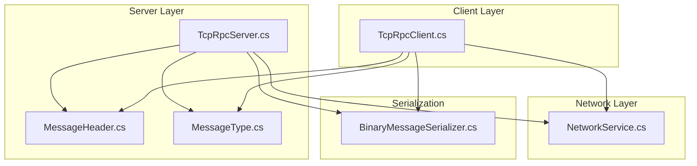
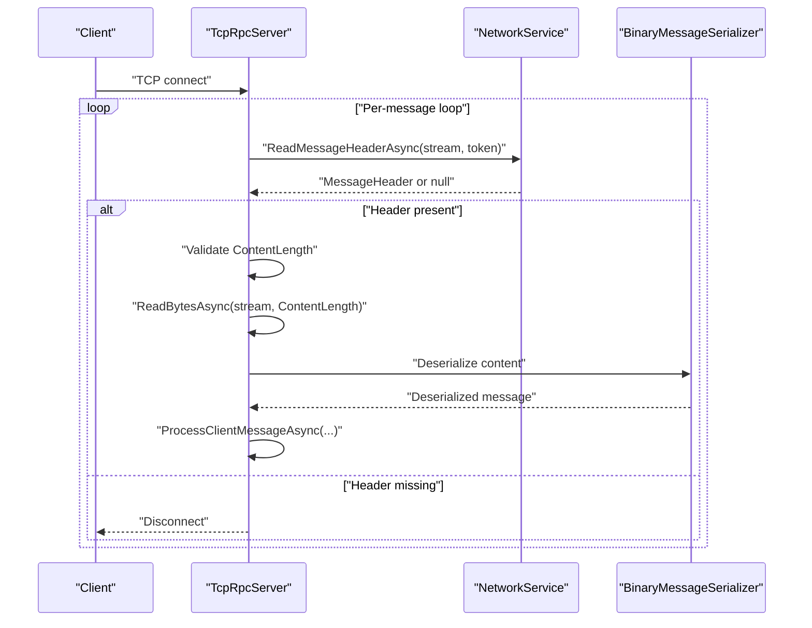
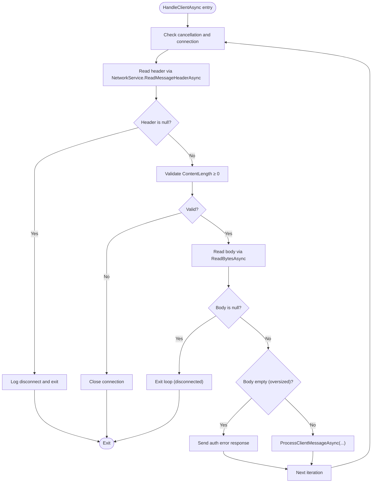
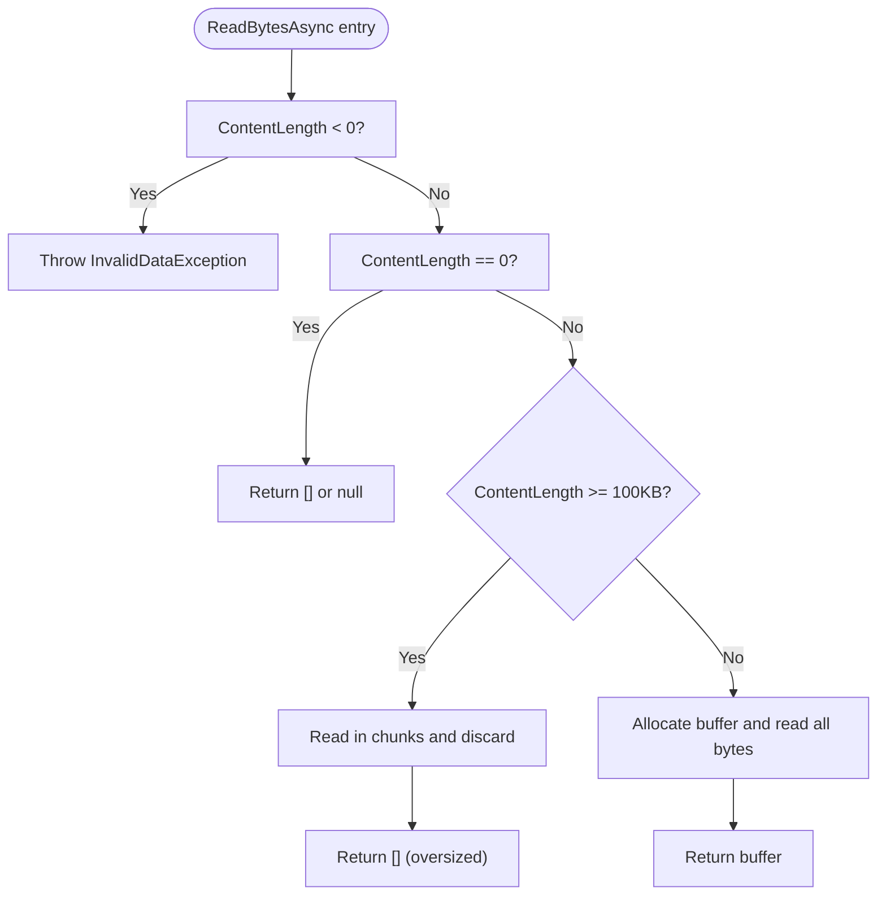
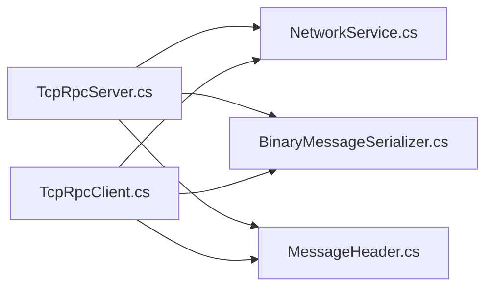

# Message Reception and Validation

<cite>
**Referenced Files in This Document**
- [NetworkService.cs](file://TcpRpc/Network/NetworkService.cs)
- [TcpRpcServer.cs](file://TcpRpc/Server/TcpRpcServer.cs)
- [MessageHeader.cs](file://TcpRpc/Message/MessageHeader.cs)
- [MessageType.cs](file://TcpRpc/Message/MessageType.cs)
- [TcpRpcClient.cs](file://TcpRpc/Client/TcpRpcClient.cs)
- [BinaryMessageSerializer.cs](file://TcpRpc/Formatter/BinaryMessageSerializer.cs)
- [AuthRequestMessage.cs](file://TcpRpc/Message/AuthRequestMessage.cs)
- [AuthResponseMessage.cs](file://TcpRpc/Message/AuthResponseMessage.cs)
</cite>

## Table of Contents
1. [Introduction](#introduction)
2. [Project Structure](#project-structure)
3. [Core Components](#core-components)
4. [Architecture Overview](#architecture-overview)
5. [Detailed Component Analysis](#detailed-component-analysis)
6. [Dependency Analysis](#dependency-analysis)
7. [Performance Considerations](#performance-considerations)
8. [Troubleshooting Guide](#troubleshooting-guide)
9. [Conclusion](#conclusion)

## Introduction
This document explains the message reception and validation phase of the server’s message processing pipeline. It focuses on:
- How the server manages client connections and continuously reads messages via the HandleClientAsync method.
- How NetworkService.ReadMessageHeaderAsync reads extended message headers that carry authentication tokens.
- Defensive validation checks for ContentLength, null headers, and connection state.
- Buffer management strategies for different message sizes, including special handling for large messages (≥100 KB) to prevent protocol corruption.
- Proper error handling for malformed headers, connection closure detection, and timeout scenarios.
- Security considerations to protect against malicious input and buffer overflow attacks.

## Project Structure
The relevant components for message reception and validation are organized as follows:
- Network layer: NetworkService provides header and body read/write utilities.
- Server layer: TcpRpcServer orchestrates client handling, message loops, and validation.
- Message model: MessageHeader encapsulates type, message ID, content length, flags, and optional token.
- Serialization: BinaryMessageSerializer handles request/response serialization/deserialization.
- Client counterpart: TcpRpcClient mirrors the receive loop and validation logic for completeness.

**Diagram sources**
- [NetworkService.cs:1-99](file://TcpRpc/Network/NetworkService.cs#L1-L99)
- [TcpRpcServer.cs:1-707](file://TcpRpc/Server/TcpRpcServer.cs#L1-L707)
- [MessageHeader.cs:1-73](file://TcpRpc/Message/MessageHeader.cs#L1-L73)
- [MessageType.cs:1-13](file://TcpRpc/Message/MessageType.cs#L1-L13)
- [BinaryMessageSerializer.cs:1-444](file://TcpRpc/Formatter/BinaryMessageSerializer.cs#L1-L444)
- [TcpRpcClient.cs:414-613](file://TcpRpc/Client/TcpRpcClient.cs#L414-L613)

**Section sources**
- [NetworkService.cs:1-99](file://TcpRpc/Network/NetworkService.cs#L1-L99)
- [TcpRpcServer.cs:1-707](file://TcpRpc/Server/TcpRpcServer.cs#L1-L707)
- [MessageHeader.cs:1-73](file://TcpRpc/Message/MessageHeader.cs#L1-L73)
- [MessageType.cs:1-13](file://TcpRpc/Message/MessageType.cs#L1-L13)
- [BinaryMessageSerializer.cs:1-444](file://TcpRpc/Formatter/BinaryMessageSerializer.cs#L1-L444)
- [TcpRpcClient.cs:414-613](file://TcpRpc/Client/TcpRpcClient.cs#L414-L613)

## Core Components
- NetworkService.ReadMessageHeaderAsync: Reads the header size prefix, validates it, and deserializes the header payload. It also supports authentication tokens embedded in the header.
- TcpRpcServer.HandleClientAsync: Manages a single client connection, runs the continuous message reading loop, performs validation, and delegates message processing.
- TcpRpcServer.ReadBytesAsync: Implements buffer management for message bodies, including special handling for large messages to prevent protocol corruption.
- MessageHeader: Encapsulates message metadata including ContentLength and optional Token for authentication.

Key responsibilities:
- Header validation: Ensures header size is positive and within reasonable bounds.
- Body validation: Rejects negative ContentLength and handles zero-length bodies.
- Large-body protection: Discards oversized content to avoid corrupting subsequent messages.
- Authentication token embedding: Supports token passing via MessageHeader.Token.

**Section sources**
- [NetworkService.cs:30-52](file://TcpRpc/Network/NetworkService.cs#L30-L52)
- [TcpRpcServer.cs:226-313](file://TcpRpc/Server/TcpRpcServer.cs#L226-L313)
- [TcpRpcServer.cs:316-368](file://TcpRpc/Server/TcpRpcServer.cs#L316-L368)
- [MessageHeader.cs:1-73](file://TcpRpc/Message/MessageHeader.cs#L1-L73)

## Architecture Overview
The server establishes a persistent connection per client and maintains a continuous loop that:
1. Reads the header via NetworkService.ReadMessageHeaderAsync.
2. Validates the header and ContentLength.
3. Reads the body using TcpRpcServer.ReadBytesAsync (or NetworkService.ReadBytesAsync on the client).
4. Processes the message based on type and authentication state.
5. Handles errors and timeouts gracefully.

**Diagram sources**
- [TcpRpcServer.cs:226-313](file://TcpRpc/Server/TcpRpcServer.cs#L226-L313)
- [NetworkService.cs:30-52](file://TcpRpc/Network/NetworkService.cs#L30-L52)
- [BinaryMessageSerializer.cs:50-62](file://TcpRpc/Formatter/BinaryMessageSerializer.cs#L50-L62)

## Detailed Component Analysis

### HandleClientAsync: Managing Client Connections and Continuous Message Loop
- Purpose: Orchestrates a single client session, maintaining a loop that reads headers, validates them, reads bodies, and processes messages.
- Connection state monitoring: Continues while cancellation is not requested and the client remains connected.
- Header reading: Uses NetworkService.ReadMessageHeaderAsync to obtain the extended header, which includes the optional authentication token.
- Validation: Enforces ContentLength ≥ 0 and handles null headers to detect disconnections.
- Large-body handling: Uses TcpRpcServer.ReadBytesAsync to discard oversized content and send an error response to prevent protocol corruption.
- Error handling: Catches operation cancellation (shutdown vs. timeout), logs exceptions, and continues to the next iteration.

**Diagram sources**
- [TcpRpcServer.cs:226-313](file://TcpRpc/Server/TcpRpcServer.cs#L226-L313)
- [TcpRpcServer.cs:316-368](file://TcpRpc/Server/TcpRpcServer.cs#L316-L368)

**Section sources**
- [TcpRpcServer.cs:226-313](file://TcpRpc/Server/TcpRpcServer.cs#L226-L313)
- [TcpRpcServer.cs:316-368](file://TcpRpc/Server/TcpRpcServer.cs#L316-L368)

### NetworkService.ReadMessageHeaderAsync: Extended Header Reading with Authentication Token Support
- Reads a 4-byte little-endian header size prefix.
- Validates header size to be positive and within a maximum bound (e.g., 1 MB).
- Reads the header payload and deserializes it into MessageHeader.
- Supports authentication tokens via MessageHeader.Token embedded in the serialized header.

Security and correctness:
- Enforces header size bounds to prevent memory exhaustion and malformed packets.
- Returns null when the connection closes during header read, signaling the caller to terminate the loop.

**Section sources**
- [NetworkService.cs:30-52](file://TcpRpc/Network/NetworkService.cs#L30-L52)
- [MessageHeader.cs:41-72](file://TcpRpc/Message/MessageHeader.cs#L41-L72)

### Defensive Validation Checks
- ContentLength validation: Both server and client reject negative ContentLength values and log errors.
- Null header handling: If header read returns null, the loop treats it as a disconnection and exits.
- Connection state monitoring: The server loop checks cancellation and connection state to avoid busy loops.

Examples of validation outcomes:
- Negative ContentLength: Server logs an error and closes the connection.
- Null header: Server logs a disconnection and exits the loop.
- Oversized content: Server discards the body and sends an error response to prevent protocol corruption.

**Section sources**
- [TcpRpcServer.cs:254-259](file://TcpRpc/Server/TcpRpcServer.cs#L254-L259)
- [TcpRpcServer.cs:248-252](file://TcpRpc/Server/TcpRpcServer.cs#L248-L252)
- [TcpRpcServer.cs:274-280](file://TcpRpc/Server/TcpRpcServer.cs#L274-L280)
- [TcpRpcClient.cs:431-435](file://TcpRpc/Client/TcpRpcClient.cs#L431-L435)
- [TcpRpcClient.cs:425-429](file://TcpRpc/Client/TcpRpcClient.cs#L425-L429)

### Buffer Management Strategy for Different Message Sizes
- Small messages (< 100 KB): Allocate a single buffer and read the entire content synchronously until completion.
- Large messages (≥ 100 KB): Read in fixed-size chunks and discard the content to prevent protocol corruption caused by leftover bytes interfering with the next message.
- Zero-length messages: Return an empty buffer or null depending on the caller’s context.
- Negative-length messages: Throw an invalid data exception.

Large-body protection:
- On the server, TcpRpcServer.ReadBytesAsync reads and discards oversized content and returns an empty buffer to signal the caller to skip processing.
- On the client, TcpRpcClient uses NetworkService.ReadBytesAsync for parity.

**Diagram sources**
- [TcpRpcServer.cs:323-368](file://TcpRpc/Server/TcpRpcServer.cs#L323-L368)
- [NetworkService.cs:55-98](file://TcpRpc/Network/NetworkService.cs#L55-L98)

**Section sources**
- [TcpRpcServer.cs:323-368](file://TcpRpc/Server/TcpRpcServer.cs#L323-L368)
- [NetworkService.cs:55-98](file://TcpRpc/Network/NetworkService.cs#L55-L98)

### Authentication Token Embedding in Headers
- MessageHeader.Token is part of the serialized header and is used by the server to validate tokens for protected requests.
- The server extracts the token from the header and validates it when authentication is required.
- This enables seamless token transport without requiring separate message framing.

**Section sources**
- [MessageHeader.cs:23-23](file://TcpRpc/Message/MessageHeader.cs#L23-L23)
- [TcpRpcServer.cs:406-415](file://TcpRpc/Server/TcpRpcServer.cs#L406-L415)

### Error Handling Examples
- Malformed headers:
  - Server: Throws an invalid data exception when header size is invalid and logs errors for negative ContentLength.
  - Client: Throws an invalid data exception on negative ContentLength and handles connection loss gracefully.
- Connection closure detection:
  - Server: Treats null header/body as disconnection and exits the loop.
  - Client: Logs debug messages and invokes connection loss handling.
- Timeout scenarios:
  - Server: OperationCanceledException indicates either shutdown or timeout; the loop continues for timeouts and exits for shutdown.
  - Client: OperationCanceledException is handled as normal shutdown.

**Section sources**
- [NetworkService.cs:39-43](file://TcpRpc/Network/NetworkService.cs#L39-L43)
- [TcpRpcServer.cs:255-259](file://TcpRpc/Server/TcpRpcServer.cs#L255-L259)
- [TcpRpcServer.cs:287-296](file://TcpRpc/Server/TcpRpcServer.cs#L287-L296)
- [TcpRpcClient.cs:431-435](file://TcpRpc/Client/TcpRpcClient.cs#L431-L435)
- [TcpRpcClient.cs:459-473](file://TcpRpc/Client/TcpRpcClient.cs#L459-L473)

### Security Considerations
- Header size limits: Enforced via NetworkService.ReadMessageHeaderAsync to prevent excessive allocations and malformed packets.
- ContentLength validation: Prevents negative lengths and protects against buffer overflows.
- Oversized content discard: Prevents protocol corruption and ensures subsequent messages are parsed correctly.
- Authentication token validation: Validates tokens when required to prevent unauthorized access.
- Defensive logging: Errors are logged with context (e.g., ContentLength) to aid in diagnostics.

**Section sources**
- [NetworkService.cs:39-43](file://TcpRpc/Network/NetworkService.cs#L39-L43)
- [TcpRpcServer.cs:255-259](file://TcpRpc/Server/TcpRpcServer.cs#L255-L259)
- [TcpRpcServer.cs:335-351](file://TcpRpc/Server/TcpRpcServer.cs#L335-L351)

## Dependency Analysis
- TcpRpcServer depends on NetworkService for header and body reads.
- TcpRpcServer uses BinaryMessageSerializer to deserialize request/response payloads.
- MessageHeader defines the contract for message metadata, including ContentLength and Token.
- TcpRpcClient mirrors the server’s receive loop and validation logic for symmetry.

**Diagram sources**
- [TcpRpcServer.cs:1-707](file://TcpRpc/Server/TcpRpcServer.cs#L1-L707)
- [NetworkService.cs:1-99](file://TcpRpc/Network/NetworkService.cs#L1-L99)
- [BinaryMessageSerializer.cs:1-444](file://TcpRpc/Formatter/BinaryMessageSerializer.cs#L1-L444)
- [MessageHeader.cs:1-73](file://TcpRpc/Message/MessageHeader.cs#L1-L73)
- [TcpRpcClient.cs:414-613](file://TcpRpc/Client/TcpRpcClient.cs#L414-L613)

**Section sources**
- [TcpRpcServer.cs:1-707](file://TcpRpc/Server/TcpRpcServer.cs#L1-L707)
- [NetworkService.cs:1-99](file://TcpRpc/Network/NetworkService.cs#L1-L99)
- [BinaryMessageSerializer.cs:1-444](file://TcpRpc/Formatter/BinaryMessageSerializer.cs#L1-L444)
- [MessageHeader.cs:1-73](file://TcpRpc/Message/MessageHeader.cs#L1-L73)
- [TcpRpcClient.cs:414-613](file://TcpRpc/Client/TcpRpcClient.cs#L414-L613)

## Performance Considerations
- Chunked read for large messages reduces peak memory usage and avoids blocking the thread for extended periods.
- Early termination on oversized content prevents wasted CPU and memory on corrupted or malicious streams.
- Minimal allocations: For small messages, a single buffer is allocated; for large messages, data is discarded without storing it.
- Efficient header parsing: Fixed-size header size prefix and bounded header size limit reduce overhead.

[No sources needed since this section provides general guidance]

## Troubleshooting Guide
Common symptoms and resolutions:
- Frequent disconnects during header read:
  - Cause: Connection closed or malformed header.
  - Resolution: Verify client connectivity and ensure the client sends valid headers.
- Repeated oversized content errors:
  - Cause: Client sent large messages without chunking or the server discarded them intentionally.
  - Resolution: Reduce message size or implement chunked transfer; confirm server discard policy.
- Authentication failures:
  - Cause: Invalid or expired token.
  - Resolution: Regenerate token or renew session; ensure token validation logic is configured.
- Timeouts:
  - Cause: OperationCanceledException indicating shutdown or timeout.
  - Resolution: Adjust timeout settings; handle cancellation gracefully in the caller.

**Section sources**
- [TcpRpcServer.cs:248-252](file://TcpRpc/Server/TcpRpcServer.cs#L248-L252)
- [TcpRpcServer.cs:274-280](file://TcpRpc/Server/TcpRpcServer.cs#L274-L280)
- [TcpRpcServer.cs:287-296](file://TcpRpc/Server/TcpRpcServer.cs#L287-L296)
- [TcpRpcClient.cs:425-429](file://TcpRpc/Client/TcpRpcClient.cs#L425-L429)
- [TcpRpcClient.cs:459-473](file://TcpRpc/Client/TcpRpcClient.cs#L459-L473)

## Conclusion
The message reception and validation pipeline is designed for robustness and security:
- Header and body reads are validated and bounded to prevent resource exhaustion and protocol corruption.
- Large messages are safely discarded to preserve protocol integrity.
- Authentication tokens are embedded in headers for seamless validation.
- Error handling is comprehensive, covering malformed headers, connection closures, and timeouts.
This design ensures reliable operation under adversarial conditions while maintaining efficient throughput.