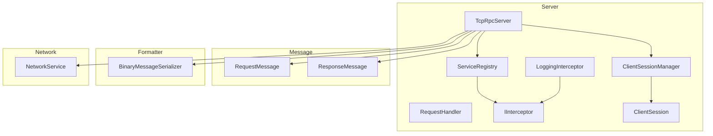
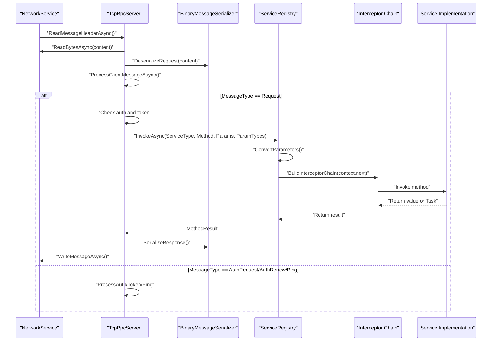
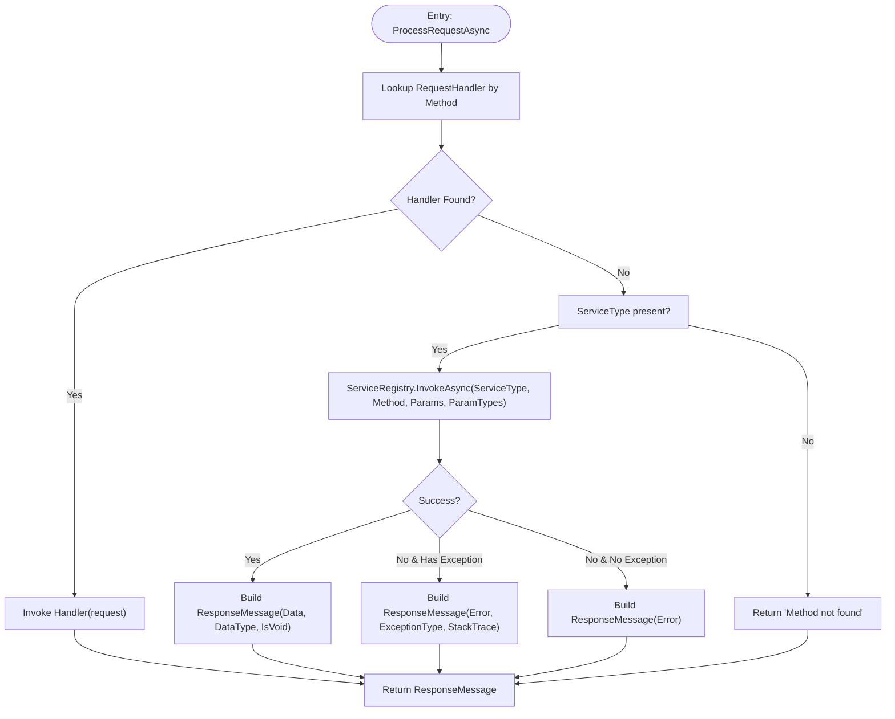
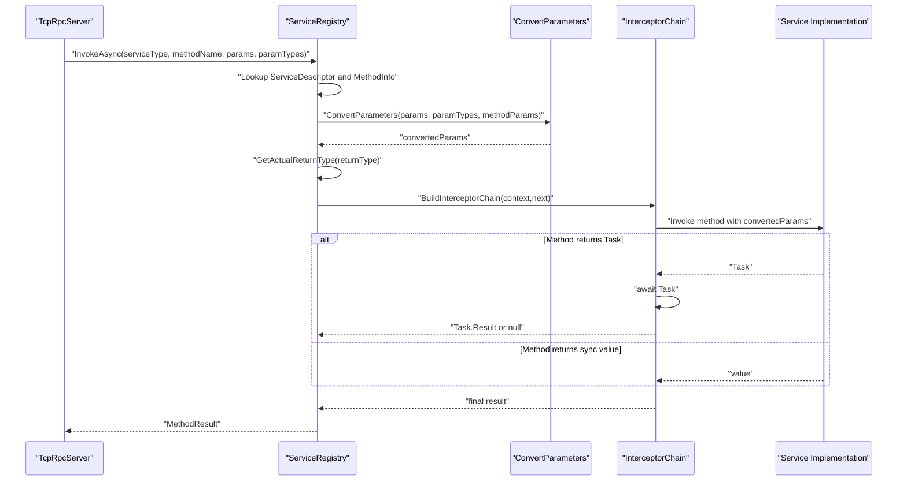
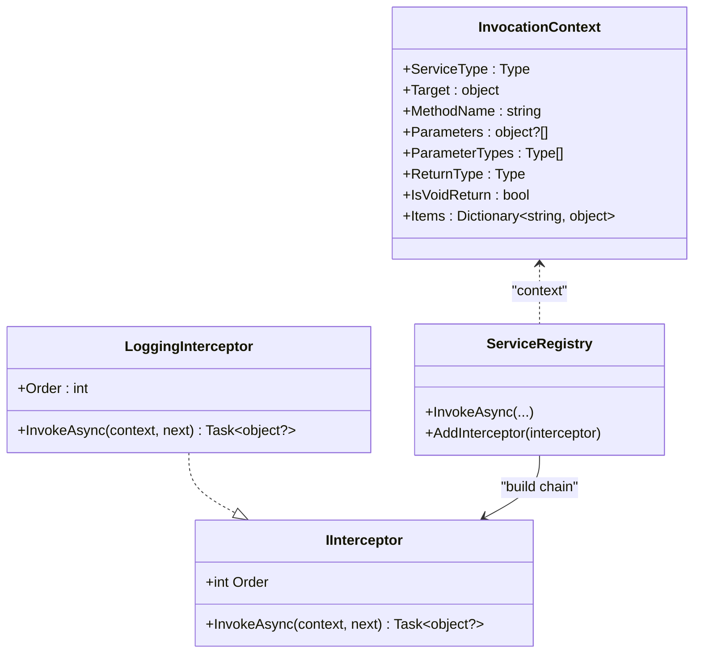
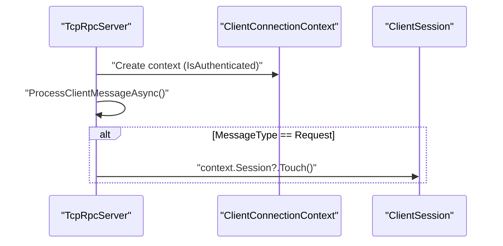
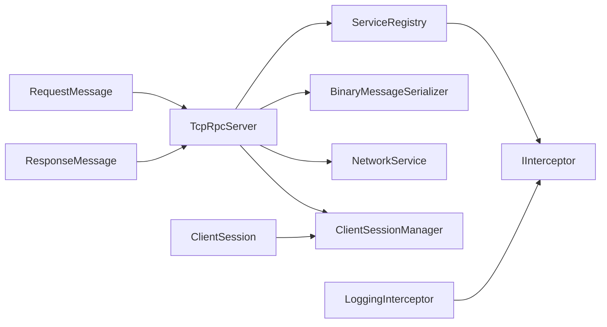

# Request Processing and Execution

<cite>
**Referenced Files in This Document**
- [TcpRpcServer.cs](file://TcpRpc/Server/TcpRpcServer.cs)
- [ServiceRegistry.cs](file://TcpRpc/Server/ServiceRegistry.cs)
- [RequestHandler.cs](file://TcpRpc/Server/RequestHandler.cs)
- [IInterceptor.cs](file://TcpRpc/Server/IInterceptor.cs)
- [RequestMessage.cs](file://TcpRpc/Message/RequestMessage.cs)
- [ResponseMessage.cs](file://TcpRpc/Message/ResponseMessage.cs)
- [BinaryMessageSerializer.cs](file://TcpRpc/Formatter/BinaryMessageSerializer.cs)
- [NetworkService.cs](file://TcpRpc/Network/NetworkService.cs)
- [ClientSession.cs](file://TcpRpc/Server/Auth/ClientSession.cs)
- [ClientSessionManager.cs](file://TcpRpc/Server/Auth/ClientSessionManager.cs)
- [RpcServerState.cs](file://TcpRpc/Server/RpcServerState.cs)
- [LoggingInterceptor.cs](file://TcpRpc.Server/LoggingInterceptor.cs)
- [RpcException.cs](file://TcpRpc/RpcException.cs)
</cite>

## Table of Contents
1. [Introduction](#introduction)
2. [Project Structure](#project-structure)
3. [Core Components](#core-components)
4. [Architecture Overview](#architecture-overview)
5. [Detailed Component Analysis](#detailed-component-analysis)
6. [Dependency Analysis](#dependency-analysis)
7. [Performance Considerations](#performance-considerations)
8. [Troubleshooting Guide](#troubleshooting-guide)
9. [Conclusion](#conclusion)

## Introduction
This document explains the request processing and execution phase of the message pipeline in the TCP RPC server. It focuses on how incoming requests are resolved and executed, covering:
- The dual-path resolution strategy supporting legacy RequestHandler registrations and modern ServiceRegistry-based invocation
- Method resolution, service type validation, and parameter binding
- Dynamic service invocation via ServiceRegistry.InvokeAsync, including support for generic and asynchronous methods
- Interceptor chain integration for cross-cutting concerns such as logging, metrics, and security
- Examples of synchronous and asynchronous invocation, exception handling and propagation, and response serialization
- ClientConnectionContext integration for session updates and activity tracking
- Performance considerations, graceful degradation, and runtime exception handling

## Project Structure
The request processing pipeline spans several modules:
- Server: request routing, authentication, and execution orchestration
- Server.Auth: session management and token lifecycle
- Server.Interceptors: cross-cutting concerns via IInterceptor
- Message: request/response DTOs
- Formatter: binary serialization/deserialization
- Network: low-level message framing and transport helpers

**Diagram sources**
- [TcpRpcServer.cs:380-451](file://TcpRpc/Server/TcpRpcServer.cs#L380-L451)
- [ServiceRegistry.cs:10-60](file://TcpRpc/Server/ServiceRegistry.cs#L10-L60)
- [IInterceptor.cs:6-17](file://TcpRpc/Server/IInterceptor.cs#L6-L17)
- [LoggingInterceptor.cs:8-41](file://TcpRpc.Server/LoggingInterceptor.cs#L8-L41)
- [ClientSessionManager.cs:9-25](file://TcpRpc/Server/Auth/ClientSessionManager.cs#L9-L25)
- [ClientSession.cs:6-26](file://TcpRpc/Server/Auth/ClientSession.cs#L6-L26)
- [RequestMessage.cs:6-18](file://TcpRpc/Message/RequestMessage.cs#L6-L18)
- [ResponseMessage.cs:6-30](file://TcpRpc/Message/ResponseMessage.cs#L6-L30)
- [BinaryMessageSerializer.cs:11-48](file://TcpRpc/Formatter/BinaryMessageSerializer.cs#L11-L48)
- [NetworkService.cs:7-28](file://TcpRpc/Network/NetworkService.cs#L7-L28)

**Section sources**
- [TcpRpcServer.cs:15-74](file://TcpRpc/Server/TcpRpcServer.cs#L15-L74)
- [ServiceRegistry.cs:10-60](file://TcpRpc/Server/ServiceRegistry.cs#L10-L60)
- [RequestMessage.cs:6-18](file://TcpRpc/Message/RequestMessage.cs#L6-L18)
- [ResponseMessage.cs:6-30](file://TcpRpc/Message/ResponseMessage.cs#L6-L30)
- [BinaryMessageSerializer.cs:11-48](file://TcpRpc/Formatter/BinaryMessageSerializer.cs#L11-L48)
- [NetworkService.cs:7-28](file://TcpRpc/Network/NetworkService.cs#L7-L28)
- [ClientSessionManager.cs:9-25](file://TcpRpc/Server/Auth/ClientSessionManager.cs#L9-L25)
- [ClientSession.cs:6-26](file://TcpRpc/Server/Auth/ClientSession.cs#L6-L26)

## Core Components
- TcpRpcServer: central orchestrator for connection handling, authentication, and request dispatch. It routes requests to either legacy RequestHandler delegates or the modern ServiceRegistry.
- ServiceRegistry: manages service descriptors and method maps, performs parameter conversion, builds interceptor chains, and executes methods (sync and async).
- IInterceptor and LoggingInterceptor: define and demonstrate cross-cutting behavior around method invocation.
- RequestMessage and ResponseMessage: typed DTOs for request and response payloads.
- BinaryMessageSerializer: serializes/deserializes messages to/from binary format.
- NetworkService: reads/writes framed messages over the wire.
- ClientSessionManager and ClientSession: manage sessions, tokens, and activity touch semantics.

**Section sources**
- [TcpRpcServer.cs:380-451](file://TcpRpc/Server/TcpRpcServer.cs#L380-L451)
- [ServiceRegistry.cs:72-138](file://TcpRpc/Server/ServiceRegistry.cs#L72-L138)
- [IInterceptor.cs:6-17](file://TcpRpc/Server/IInterceptor.cs#L6-L17)
- [LoggingInterceptor.cs:8-41](file://TcpRpc.Server/LoggingInterceptor.cs#L8-L41)
- [RequestMessage.cs:6-18](file://TcpRpc/Message/RequestMessage.cs#L6-L18)
- [ResponseMessage.cs:6-30](file://TcpRpc/Message/ResponseMessage.cs#L6-L30)
- [BinaryMessageSerializer.cs:30-62](file://TcpRpc/Formatter/BinaryMessageSerializer.cs#L30-L62)
- [NetworkService.cs:10-52](file://TcpRpc/Network/NetworkService.cs#L10-L52)
- [ClientSessionManager.cs:27-42](file://TcpRpc/Server/Auth/ClientSessionManager.cs#L27-L42)
- [ClientSession.cs:68-74](file://TcpRpc/Server/Auth/ClientSession.cs#L68-L74)

## Architecture Overview
The request processing flow integrates network IO, authentication, deserialization, method resolution, interception, and response serialization.

**Diagram sources**
- [TcpRpcServer.cs:380-451](file://TcpRpc/Server/TcpRpcServer.cs#L380-L451)
- [ServiceRegistry.cs:72-138](file://TcpRpc/Server/ServiceRegistry.cs#L72-L138)
- [BinaryMessageSerializer.cs:30-62](file://TcpRpc/Formatter/BinaryMessageSerializer.cs#L30-L62)
- [NetworkService.cs:10-52](file://TcpRpc/Network/NetworkService.cs#L10-L52)

## Detailed Component Analysis

### ProcessRequestAsync Dual-Path Resolution
ProcessRequestAsync implements a two-tier method resolution:
- Legacy RequestHandler lookup by method name
- Modern ServiceRegistry-based invocation by service type and method name

Key behaviors:
- Graceful degradation: if no legacy handler and no service type, return a “not found” response.
- Exception safety: catch-all block wraps runtime errors into a failure response with exception metadata.

**Diagram sources**
- [TcpRpcServer.cs:549-614](file://TcpRpc/Server/TcpRpcServer.cs#L549-L614)

**Section sources**
- [TcpRpcServer.cs:549-614](file://TcpRpc/Server/TcpRpcServer.cs#L549-L614)

### ServiceRegistry.InvokeAsync: Dynamic Invocation with Interceptors
ServiceRegistry.InvokeAsync performs:
- Service and method lookup
- Parameter conversion using provided parameter types
- Return type normalization (unwrapping Task<T>)
- Interceptor chain construction and execution
- Asynchronous method handling (awaiting Task and extracting Result)

Important implementation details:
- Parameter conversion attempts exact match, assignment compatibility, and falls back to Convert.ChangeType when possible.
- Return type unwrapping supports Task<T> and Task (void).
- Interceptor chain order is reversed to preserve natural ordering.
- Exceptions are captured and returned as MethodResult.ThrowException.

**Diagram sources**
- [ServiceRegistry.cs:72-138](file://TcpRpc/Server/ServiceRegistry.cs#L72-L138)
- [ServiceRegistry.cs:158-171](file://TcpRpc/Server/ServiceRegistry.cs#L158-L171)
- [ServiceRegistry.cs:173-208](file://TcpRpc/Server/ServiceRegistry.cs#L173-L208)
- [ServiceRegistry.cs:143-156](file://TcpRpc/Server/ServiceRegistry.cs#L143-L156)

**Section sources**
- [ServiceRegistry.cs:72-138](file://TcpRpc/Server/ServiceRegistry.cs#L72-L138)
- [ServiceRegistry.cs:143-156](file://TcpRpc/Server/ServiceRegistry.cs#L143-L156)
- [ServiceRegistry.cs:158-171](file://TcpRpc/Server/ServiceRegistry.cs#L158-L171)
- [ServiceRegistry.cs:173-208](file://TcpRpc/Server/ServiceRegistry.cs#L173-L208)

### Interceptor Chain Integration
Interceptors wrap the final method invocation to implement cross-cutting concerns. The chain is built by iterating interceptors in reverse order, ensuring the first registered interceptor runs closest to the core method.

Typical usage:
- LoggingInterceptor logs method entry/exit, duration, and failures.
- Additional interceptors can implement metrics, tracing, or security checks.

**Diagram sources**
- [IInterceptor.cs:6-17](file://TcpRpc/Server/IInterceptor.cs#L6-L17)
- [LoggingInterceptor.cs:8-41](file://TcpRpc.Server/LoggingInterceptor.cs#L8-L41)
- [ServiceRegistry.cs:158-171](file://TcpRpc/Server/ServiceRegistry.cs#L158-L171)
- [ServiceRegistry.cs:55-59](file://TcpRpc/Server/ServiceRegistry.cs#L55-L59)

**Section sources**
- [IInterceptor.cs:6-17](file://TcpRpc/Server/IInterceptor.cs#L6-L17)
- [LoggingInterceptor.cs:8-41](file://TcpRpc.Server/LoggingInterceptor.cs#L8-L41)
- [ServiceRegistry.cs:55-59](file://TcpRpc/Server/ServiceRegistry.cs#L55-L59)
- [ServiceRegistry.cs:158-171](file://TcpRpc/Server/ServiceRegistry.cs#L158-L171)

### ClientConnectionContext and Session Activity Tracking
During request processing, TcpRpcServer maintains a ClientConnectionContext per client connection. On successful request processing, the session’s last activity timestamp is refreshed via Touch(), enabling idle detection and cleanup.

This ensures accurate activity tracking for session lifecycle management.

**Diagram sources**
- [TcpRpcServer.cs:232-378](file://TcpRpc/Server/TcpRpcServer.cs#L232-L378)
- [TcpRpcServer.cs:421-423](file://TcpRpc/Server/TcpRpcServer.cs#L421-L423)
- [ClientSession.cs:68-74](file://TcpRpc/Server/Auth/ClientSession.cs#L68-L74)

**Section sources**
- [TcpRpcServer.cs:232-378](file://TcpRpc/Server/TcpRpcServer.cs#L232-L378)
- [TcpRpcServer.cs:421-423](file://TcpRpc/Server/TcpRpcServer.cs#L421-L423)
- [ClientSession.cs:68-74](file://TcpRpc/Server/Auth/ClientSession.cs#L68-L74)

### Serialization and Response Handling
RequestMessage and ResponseMessage carry serialized payloads and metadata. BinaryMessageSerializer handles:
- RequestMessage: ServiceType, Method, Parameters, ParameterTypes
- ResponseMessage: Success/Error/ExceptionType/StackTrace/Data/DataType/IsVoid
- Auth messages: separate serializers for authentication handshake

TcpRpcServer uses the serializer to deserialize inbound requests and serialize outbound responses, then writes framed messages via NetworkService.

**Section sources**
- [RequestMessage.cs:6-18](file://TcpRpc/Message/RequestMessage.cs#L6-L18)
- [ResponseMessage.cs:6-30](file://TcpRpc/Message/ResponseMessage.cs#L6-L30)
- [BinaryMessageSerializer.cs:30-62](file://TcpRpc/Formatter/BinaryMessageSerializer.cs#L30-L62)
- [BinaryMessageSerializer.cs:68-112](file://TcpRpc/Formatter/BinaryMessageSerializer.cs#L68-L112)
- [BinaryMessageSerializer.cs:325-382](file://TcpRpc/Formatter/BinaryMessageSerializer.cs#L325-L382)
- [BinaryMessageSerializer.cs:384-440](file://TcpRpc/Formatter/BinaryMessageSerializer.cs#L384-L440)
- [NetworkService.cs:10-52](file://TcpRpc/Network/NetworkService.cs#L10-L52)
- [TcpRpcServer.cs:616-628](file://TcpRpc/Server/TcpRpcServer.cs#L616-L628)

### Authentication and Token Validation
TcpRpcServer enforces authentication when enabled:
- Validates tokens for subsequent requests
- Supports session restoration for reconnect scenarios
- Updates session tokens and expiry, and tracks session activity

**Section sources**
- [TcpRpcServer.cs:396-449](file://TcpRpc/Server/TcpRpcServer.cs#L396-L449)
- [ClientSessionManager.cs:88-116](file://TcpRpc/Server/Auth/ClientSessionManager.cs#L88-L116)
- [ClientSession.cs:88-93](file://TcpRpc/Server/Auth/ClientSession.cs#L88-L93)

## Dependency Analysis
The following diagram highlights key dependencies among components involved in request processing and execution.

**Diagram sources**
- [TcpRpcServer.cs:380-451](file://TcpRpc/Server/TcpRpcServer.cs#L380-L451)
- [ServiceRegistry.cs:10-60](file://TcpRpc/Server/ServiceRegistry.cs#L10-L60)
- [IInterceptor.cs:6-17](file://TcpRpc/Server/IInterceptor.cs#L6-L17)
- [LoggingInterceptor.cs:8-41](file://TcpRpc.Server/LoggingInterceptor.cs#L8-L41)
- [RequestMessage.cs:6-18](file://TcpRpc/Message/RequestMessage.cs#L6-L18)
- [ResponseMessage.cs:6-30](file://TcpRpc/Message/ResponseMessage.cs#L6-L30)
- [BinaryMessageSerializer.cs:11-48](file://TcpRpc/Formatter/BinaryMessageSerializer.cs#L11-L48)
- [NetworkService.cs:7-28](file://TcpRpc/Network/NetworkService.cs#L7-L28)
- [ClientSessionManager.cs:9-25](file://TcpRpc/Server/Auth/ClientSessionManager.cs#L9-L25)
- [ClientSession.cs:6-26](file://TcpRpc/Server/Auth/ClientSession.cs#L6-L26)

**Section sources**
- [TcpRpcServer.cs:380-451](file://TcpRpc/Server/TcpRpcServer.cs#L380-L451)
- [ServiceRegistry.cs:10-60](file://TcpRpc/Server/ServiceRegistry.cs#L10-L60)
- [IInterceptor.cs:6-17](file://TcpRpc/Server/IInterceptor.cs#L6-L17)
- [LoggingInterceptor.cs:8-41](file://TcpRpc.Server/LoggingInterceptor.cs#L8-L41)
- [RequestMessage.cs:6-18](file://TcpRpc/Message/RequestMessage.cs#L6-L18)
- [ResponseMessage.cs:6-30](file://TcpRpc/Message/ResponseMessage.cs#L6-L30)
- [BinaryMessageSerializer.cs:11-48](file://TcpRpc/Formatter/BinaryMessageSerializer.cs#L11-L48)
- [NetworkService.cs:7-28](file://TcpRpc/Network/NetworkService.cs#L7-L28)
- [ClientSessionManager.cs:9-25](file://TcpRpc/Server/Auth/ClientSessionManager.cs#L9-L25)
- [ClientSession.cs:6-26](file://TcpRpc/Server/Auth/ClientSession.cs#L6-L26)

## Performance Considerations
- Method caching and lookup:
  - ServiceRegistry caches method maps per interface type to avoid repeated reflection overhead.
  - Request handlers are stored in a concurrent dictionary keyed by method name for O(1) lookup.
- Parameter validation and conversion:
  - ConvertParameters validates and converts arguments with minimal allocations and fallback to passthrough when conversion fails.
- Asynchronous execution:
  - Task unwrapping avoids blocking threads; interceptor chain preserves async boundaries.
- Serialization efficiency:
  - BinaryMessageSerializer uses compact binary encoding with type markers and JSON fallback for complex objects.
- Network throughput:
  - NetworkService reads/writes in chunks and discards oversized content to prevent stalls.
- Session cleanup:
  - ClientSessionManager periodically removes expired sessions to bound memory usage.

[No sources needed since this section provides general guidance]

## Troubleshooting Guide
Common issues and diagnostics:
- Method not found:
  - Occurs when neither a legacy handler exists nor a matching service/method is registered. Verify service registration and method name casing.
- Parameter type mismatch:
  - ConvertParameters attempts conversions; if unsuccessful, pass-through may cause runtime exceptions. Ensure ParameterTypes matches actual argument types.
- Runtime exceptions during invocation:
  - ServiceRegistry wraps TargetInvocationException and returns MethodResult.ThrowException. TcpRpcServer propagates exception info into ResponseMessage.
- Authentication failures:
  - Invalid tokens or unauthenticated requests return error responses. Confirm token validity and session restoration logic.
- Client session activity:
  - If sessions appear stale, check ClientSessionManager cleanup intervals and session timeouts.

**Section sources**
- [ServiceRegistry.cs:128-137](file://TcpRpc/Server/ServiceRegistry.cs#L128-L137)
- [TcpRpcServer.cs:588-613](file://TcpRpc/Server/TcpRpcServer.cs#L588-L613)
- [ClientSessionManager.cs:159-168](file://TcpRpc/Server/Auth/ClientSessionManager.cs#L159-L168)

## Conclusion
The request processing pipeline combines a legacy RequestHandler path with a modern ServiceRegistry-based invocation model. ServiceRegistry centralizes method resolution, parameter binding, and interceptor-driven cross-cutting concerns, while TcpRpcServer orchestrates authentication, serialization, and response handling. The design emphasizes robustness, extensibility via interceptors, and efficient network IO, with clear error propagation and session lifecycle management.