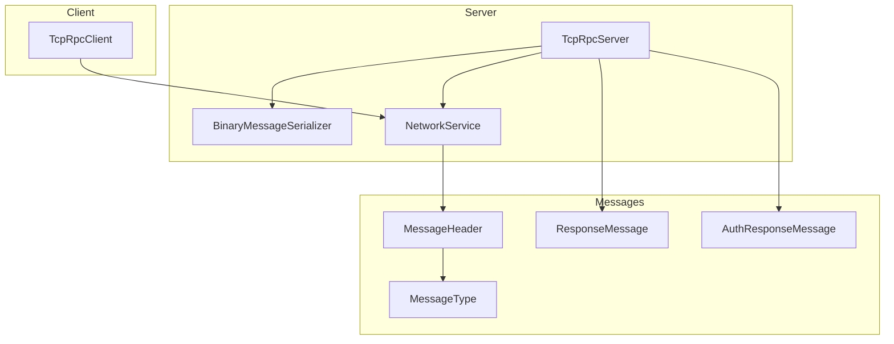
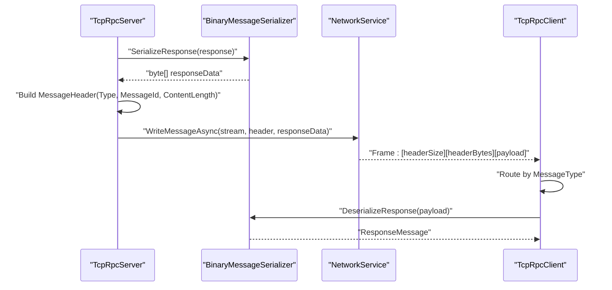
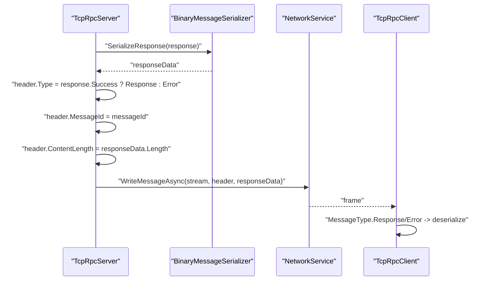
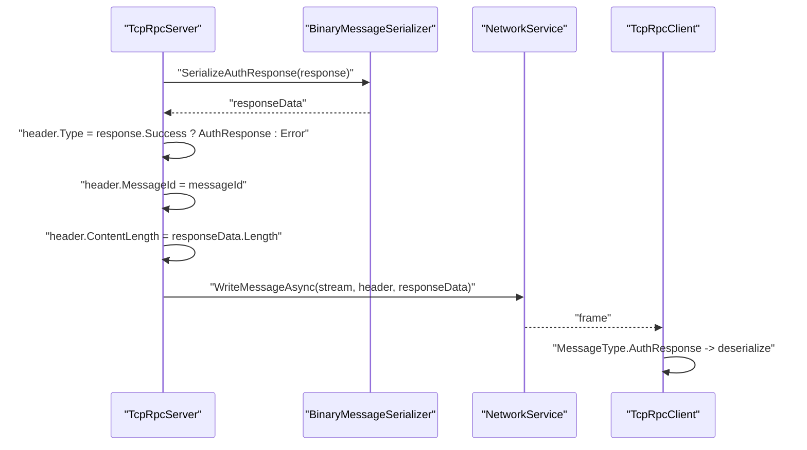
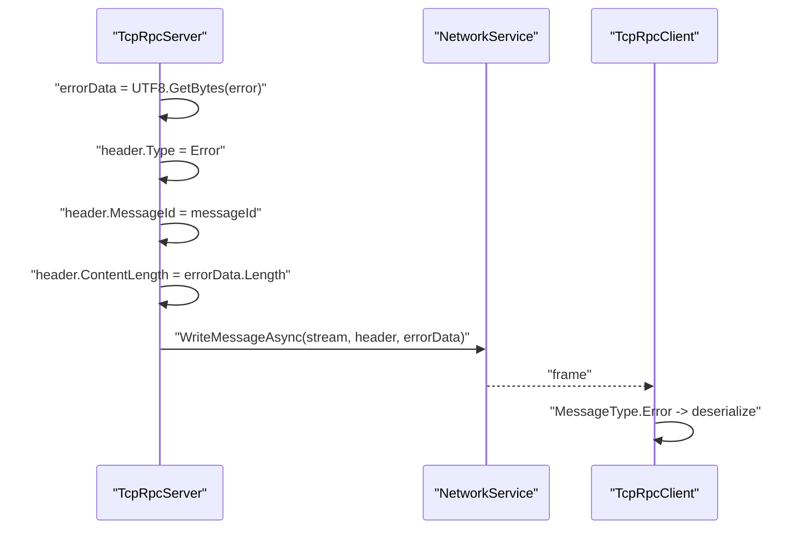
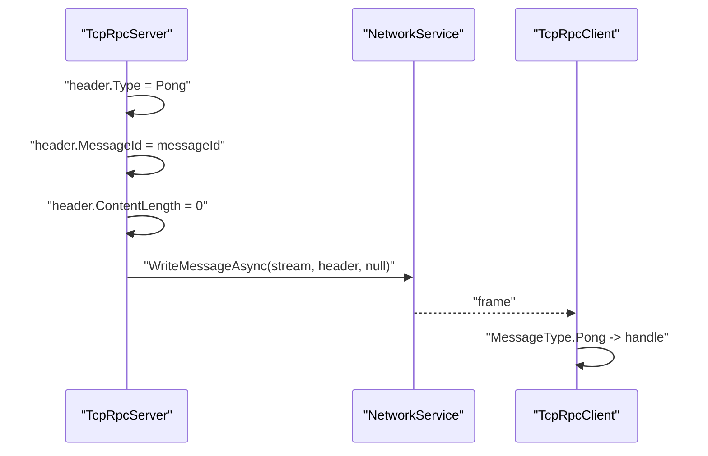
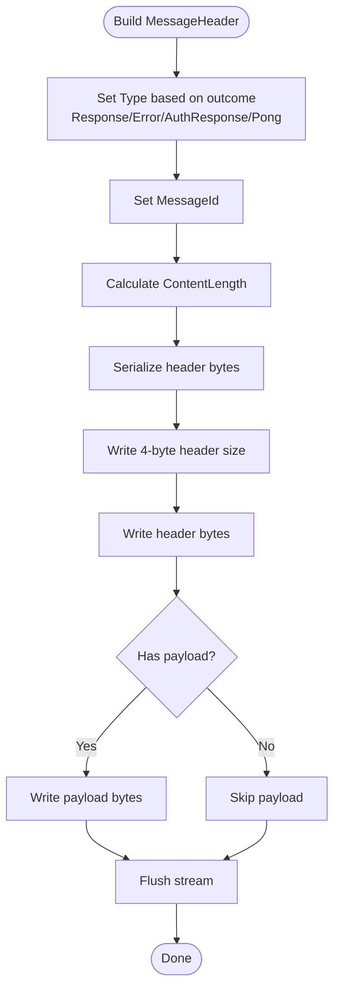
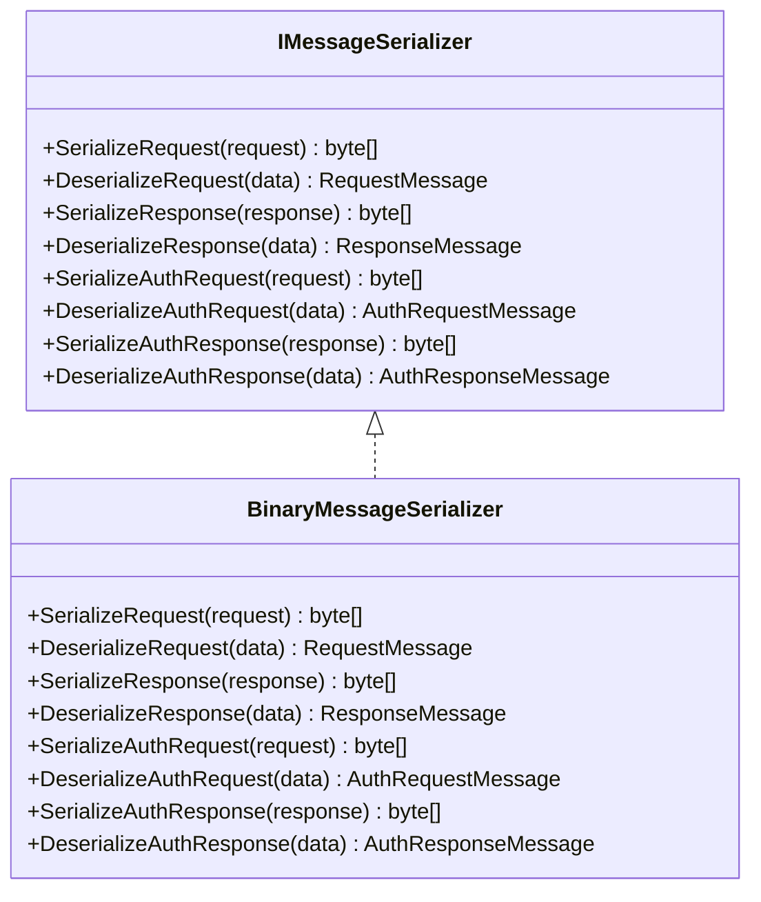
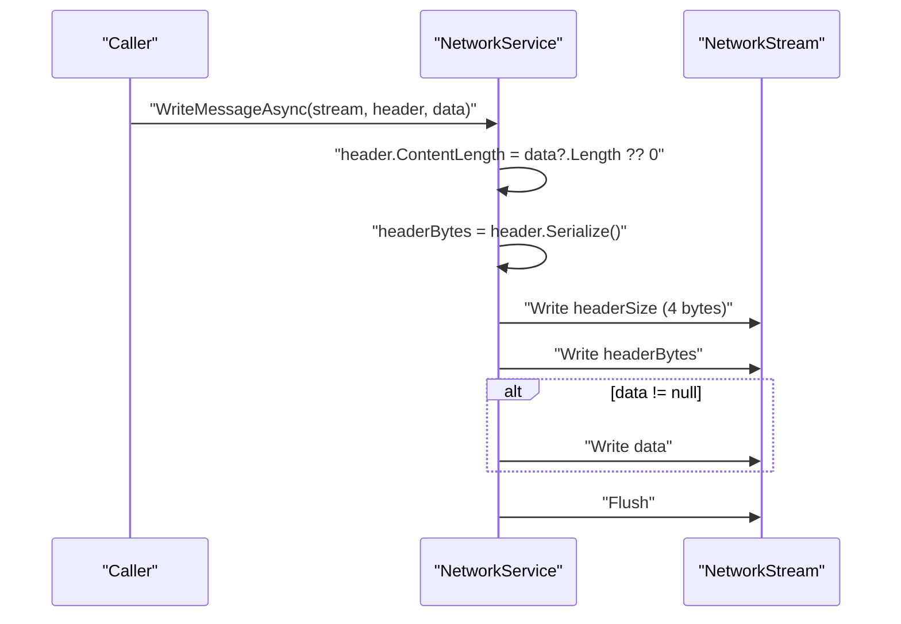
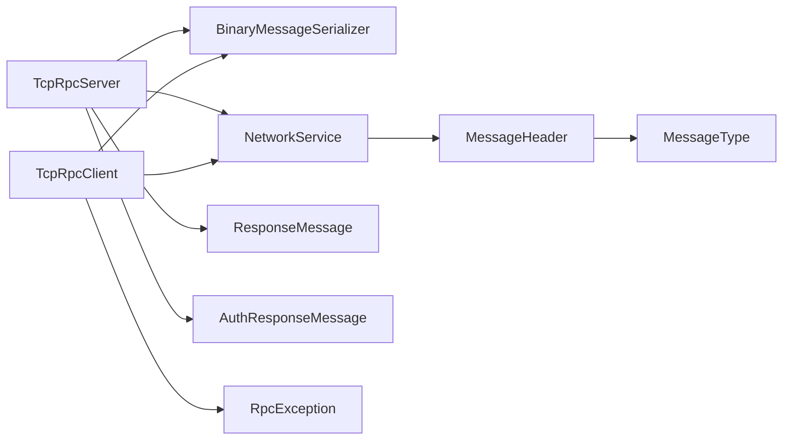

# Response Generation and Sending

<cite>
**Referenced Files in This Document**
- [TcpRpcServer.cs](file://TcpRpc/Server/TcpRpcServer.cs)
- [TcpRpcClient.cs](file://TcpRpc/Client/TcpRpcClient.cs)
- [NetworkService.cs](file://TcpRpc/Network/NetworkService.cs)
- [MessageHeader.cs](file://TcpRpc/Message/MessageHeader.cs)
- [MessageType.cs](file://TcpRpc/Message/MessageType.cs)
- [ResponseMessage.cs](file://TcpRpc/Message/ResponseMessage.cs)
- [AuthResponseMessage.cs](file://TcpRpc/Message/AuthResponseMessage.cs)
- [IMessageSerializer.cs](file://TcpRpc/Formatter/IMessageSerializer.cs)
- [BinaryMessageSerializer.cs](file://TcpRpc/Formatter/BinaryMessageSerializer.cs)
- [RpcException.cs](file://TcpRpc/RpcException.cs)
</cite>

## Table of Contents
1. [Introduction](#introduction)
2. [Project Structure](#project-structure)
3. [Core Components](#core-components)
4. [Architecture Overview](#architecture-overview)
5. [Detailed Component Analysis](#detailed-component-analysis)
6. [Dependency Analysis](#dependency-analysis)
7. [Performance Considerations](#performance-considerations)
8. [Troubleshooting Guide](#troubleshooting-guide)
9. [Conclusion](#conclusion)

## Introduction
This document focuses on the response generation and transmission phase of the message processing pipeline. It explains how the server constructs and sends responses for successful RPC calls, authentication flows, error conditions, and heartbeat pings. It covers message header construction, content length calculation, serialization using the IMessageSerializer, and the reliable transmission mechanism provided by NetworkService.WriteMessageAsync. It also documents the message type mapping (successful responses use MessageType.Response, errors use MessageType.Error), performance considerations, and error handling strategies to maintain protocol consistency.

## Project Structure
The response generation and sending logic spans several components:
- Server-side response generators: SendResponseAsync, SendAuthResponseAsync, SendErrorResponseAsync, SendPongAsync
- Client-side response handlers: deserialization and routing based on MessageType
- Serialization: IMessageSerializer and BinaryMessageSerializer implementations
- Network transport: NetworkService with header framing and streaming
- Message metadata: MessageHeader and MessageType enums

**Diagram sources**
- [TcpRpcServer.cs](file://TcpRpc/Server/TcpRpcServer.cs)
- [TcpRpcClient.cs](file://TcpRpc/Client/TcpRpcClient.cs)
- [NetworkService.cs](file://TcpRpc/Network/NetworkService.cs)
- [MessageHeader.cs](file://TcpRpc/Message/MessageHeader.cs)
- [MessageType.cs](file://TcpRpc/Message/MessageType.cs)
- [ResponseMessage.cs](file://TcpRpc/Message/ResponseMessage.cs)
- [AuthResponseMessage.cs](file://TcpRpc/Message/AuthResponseMessage.cs)
- [BinaryMessageSerializer.cs](file://TcpRpc/Formatter/BinaryMessageSerializer.cs)

**Section sources**
- [TcpRpcServer.cs](file://TcpRpc/Server/TcpRpcServer.cs)
- [TcpRpcClient.cs](file://TcpRpc/Client/TcpRpcClient.cs)
- [NetworkService.cs](file://TcpRpc/Network/NetworkService.cs)
- [MessageHeader.cs](file://TcpRpc/Message/MessageHeader.cs)
- [MessageType.cs](file://TcpRpc/Message/MessageType.cs)
- [ResponseMessage.cs](file://TcpRpc/Message/ResponseMessage.cs)
- [AuthResponseMessage.cs](file://TcpRpc/Message/AuthResponseMessage.cs)
- [BinaryMessageSerializer.cs](file://TcpRpc/Formatter/BinaryMessageSerializer.cs)

## Core Components
- ResponseMessage: encapsulates success/failure, error details, exception metadata, serialized data payload, and void-return semantics.
- AuthResponseMessage: encapsulates authentication outcome, optional error, client identity, token, expiration, session restoration flag, and message text.
- MessageHeader: carries MessageType, MessageId, ContentLength, flags (void/exception/compression), and optional token.
- MessageType: enumerates protocol message categories including Response, Error, AuthResponse, Pong.
- IMessageSerializer and BinaryMessageSerializer: define and implement serialization/deserialization for requests, responses, and auth messages.
- NetworkService: provides WriteMessageAsync to reliably frame and transmit headers and content over NetworkStream.

**Section sources**
- [ResponseMessage.cs](file://TcpRpc/Message/ResponseMessage.cs)
- [AuthResponseMessage.cs](file://TcpRpc/Message/AuthResponseMessage.cs)
- [MessageHeader.cs](file://TcpRpc/Message/MessageHeader.cs)
- [MessageType.cs](file://TcpRpc/Message/MessageType.cs)
- [IMessageSerializer.cs](file://TcpRpc/Formatter/IMessageSerializer.cs)
- [BinaryMessageSerializer.cs](file://TcpRpc/Formatter/BinaryMessageSerializer.cs)
- [NetworkService.cs](file://TcpRpc/Network/NetworkService.cs)

## Architecture Overview
The response pipeline follows a consistent pattern:
- Server constructs a ResponseMessage or AuthResponseMessage based on processing outcomes.
- Server serializes the message using BinaryMessageSerializer.
- Server builds a MessageHeader with appropriate MessageType and sets ContentLength to the serialized payload length.
- Server invokes NetworkService.WriteMessageAsync to send header size, header bytes, and payload.
- Client receives and routes messages by MessageType, deserializing payloads accordingly.

**Diagram sources**
- [TcpRpcServer.cs](file://TcpRpc/Server/TcpRpcServer.cs)
- [BinaryMessageSerializer.cs](file://TcpRpc/Formatter/BinaryMessageSerializer.cs)
- [NetworkService.cs](file://TcpRpc/Network/NetworkService.cs)
- [TcpRpcClient.cs](file://TcpRpc/Client/TcpRpcClient.cs)

## Detailed Component Analysis

### Response Sending Methods

#### SendResponseAsync
Purpose: Sends successful or error responses for RPC calls.
- Serializes ResponseMessage using BinaryMessageSerializer.
- Sets MessageHeader.Type to MessageType.Response if response.Success is true, otherwise MessageType.Error.
- Sets MessageHeader.MessageId to the incoming request’s message identifier.
- Sets MessageHeader.ContentLength to the serialized response length.
- Calls NetworkService.WriteMessageAsync to transmit framed message.

**Diagram sources**
- [TcpRpcServer.cs](file://TcpRpc/Server/TcpRpcServer.cs)
- [BinaryMessageSerializer.cs](file://TcpRpc/Formatter/BinaryMessageSerializer.cs)
- [NetworkService.cs](file://TcpRpc/Network/NetworkService.cs)
- [TcpRpcClient.cs](file://TcpRpc/Client/TcpRpcClient.cs)

**Section sources**
- [TcpRpcServer.cs](file://TcpRpc/Server/TcpRpcServer.cs)

#### SendAuthResponseAsync
Purpose: Sends authentication responses (success or failure).
- Serializes AuthResponseMessage using BinaryMessageSerializer.
- Sets MessageHeader.Type to MessageType.AuthResponse if response.Success is true, otherwise MessageType.Error.
- Sets MessageId and ContentLength similarly.
- Calls NetworkService.WriteMessageAsync.

**Diagram sources**
- [TcpRpcServer.cs](file://TcpRpc/Server/TcpRpcServer.cs)
- [BinaryMessageSerializer.cs](file://TcpRpc/Formatter/BinaryMessageSerializer.cs)
- [NetworkService.cs](file://TcpRpc/Network/NetworkService.cs)
- [TcpRpcClient.cs](file://TcpRpc/Client/TcpRpcClient.cs)

**Section sources**
- [TcpRpcServer.cs](file://TcpRpc/Server/TcpRpcServer.cs)

#### SendErrorResponseAsync
Purpose: Sends error responses for RPC calls when the server cannot serialize a ResponseMessage or when a protocol-level error occurs.
- Creates a UTF-8 byte array from the error string.
- Sets MessageHeader.Type to MessageType.Error.
- Sets MessageId and ContentLength to the error payload length.
- Calls NetworkService.WriteMessageAsync.

**Diagram sources**
- [TcpRpcServer.cs](file://TcpRpc/Server/TcpRpcServer.cs)
- [NetworkService.cs](file://TcpRpc/Network/NetworkService.cs)
- [TcpRpcClient.cs](file://TcpRpc/Client/TcpRpcClient.cs)

**Section sources**
- [TcpRpcServer.cs](file://TcpRpc/Server/TcpRpcServer.cs)

#### SendPongAsync
Purpose: Responds to client ping requests with a heartbeat acknowledgment.
- Builds MessageHeader with Type = MessageType.Pong, MessageId = incoming ping messageId, and ContentLength = 0.
- Calls NetworkService.WriteMessageAsync with null payload.

**Diagram sources**
- [TcpRpcServer.cs](file://TcpRpc/Server/TcpRpcServer.cs)
- [NetworkService.cs](file://TcpRpc/Network/NetworkService.cs)
- [TcpRpcClient.cs](file://TcpRpc/Client/TcpRpcClient.cs)

**Section sources**
- [TcpRpcServer.cs](file://TcpRpc/Server/TcpRpcServer.cs)

### Message Header Construction and Framing
- MessageHeader fields: Type, MessageId, ContentLength, Flags, Token.
- Flags support IsVoid, HasException, IsCompressed bit manipulation helpers.
- Serialize/Deserialize encode fixed-size fields followed by a token string.
- NetworkService.WriteMessageAsync:
  - Writes 4-byte little-endian header size.
  - Writes header bytes produced by MessageHeader.Serialize().
  - Writes payload bytes if present.
  - Flushes the stream to ensure delivery.

**Diagram sources**
- [MessageHeader.cs](file://TcpRpc/Message/MessageHeader.cs)
- [NetworkService.cs](file://TcpRpc/Network/NetworkService.cs)

**Section sources**
- [MessageHeader.cs](file://TcpRpc/Message/MessageHeader.cs)
- [NetworkService.cs](file://TcpRpc/Network/NetworkService.cs)

### Serialization Using IMessageSerializer and BinaryMessageSerializer
- IMessageSerializer defines SerializeResponse, DeserializeResponse, SerializeAuthResponse, DeserializeAuthResponse, and related methods for requests.
- BinaryMessageSerializer implements:
  - ResponseMessage: writes Success, Error, ExceptionType, StackTrace, Data, DataType, IsVoid.
  - AuthResponseMessage: writes Success, ErrorMessage, ClientId, Token, ExpiresAt, IsSessionRestored, Message.
  - Supports primitive types, arrays, and complex objects via JSON fallback with type metadata.

**Diagram sources**
- [IMessageSerializer.cs](file://TcpRpc/Formatter/IMessageSerializer.cs)
- [BinaryMessageSerializer.cs](file://TcpRpc/Formatter/BinaryMessageSerializer.cs)

**Section sources**
- [IMessageSerializer.cs](file://TcpRpc/Formatter/IMessageSerializer.cs)
- [BinaryMessageSerializer.cs](file://TcpRpc/Formatter/BinaryMessageSerializer.cs)

### Message Type Mapping
- Successful RPC responses: MessageType.Response
- Error responses: MessageType.Error
- Authentication responses: MessageType.AuthResponse
- Heartbeat responses: MessageType.Pong

These mappings are enforced when constructing MessageHeader.Type in each sending method.

**Section sources**
- [TcpRpcServer.cs](file://TcpRpc/Server/TcpRpcServer.cs)
- [MessageType.cs](file://TcpRpc/Message/MessageType.cs)

### Reliable Transmission with NetworkService.WriteMessageAsync
- Ensures ContentLength is set to the actual payload length before serialization.
- Writes header size (4 bytes), header bytes, and payload bytes in order.
- Flushes the stream to guarantee delivery.
- Provides ReadMessageHeaderAsync and ReadBytesAsync for receiving frames robustly.

**Diagram sources**
- [NetworkService.cs](file://TcpRpc/Network/NetworkService.cs)

**Section sources**
- [NetworkService.cs](file://TcpRpc/Network/NetworkService.cs)

### Response Formatting Examples
Below are scenario-based examples of response formatting without code content:

- Success response with data:
  - Build ResponseMessage with Success = true, Data containing the result, DataType indicating the serialized type, and IsVoid = false.
  - Serialize with BinaryMessageSerializer.
  - Header.Type = MessageType.Response, ContentLength = serialized length.
  - Transmit via NetworkService.WriteMessageAsync.

- Authentication response with token:
  - Build AuthResponseMessage with Success = true, Token populated, ExpiresAt set, ClientId assigned, IsSessionRestored = false.
  - Serialize with BinaryMessageSerializer.
  - Header.Type = MessageType.AuthResponse, ContentLength = serialized length.
  - Transmit via NetworkService.WriteMessageAsync.

- Error response with detailed error information:
  - For RPC errors, build ResponseMessage with Success = false, Error set, ExceptionType and StackTrace populated.
  - Serialize with BinaryMessageSerializer.
  - Header.Type = MessageType.Error, ContentLength = serialized length.
  - Alternatively, for protocol-level errors, construct errorData as UTF-8 bytes and set Header.Type = MessageType.Error.
  - Transmit via NetworkService.WriteMessageAsync.

- Heartbeat response:
  - Build MessageHeader with Type = MessageType.Pong, MessageId copied from ping, ContentLength = 0.
  - Transmit via NetworkService.WriteMessageAsync.

**Section sources**
- [TcpRpcServer.cs](file://TcpRpc/Server/TcpRpcServer.cs)
- [BinaryMessageSerializer.cs](file://TcpRpc/Formatter/BinaryMessageSerializer.cs)
- [NetworkService.cs](file://TcpRpc/Network/NetworkService.cs)

## Dependency Analysis
Key dependencies and relationships:
- TcpRpcServer depends on BinaryMessageSerializer for serialization and NetworkService for transmission.
- TcpRpcClient depends on BinaryMessageSerializer for deserialization and NetworkService for receiving frames.
- MessageHeader and MessageType define the framing contract used by both sides.
- RpcException is thrown on client-side error responses to propagate server-side exceptions.

**Diagram sources**
- [TcpRpcServer.cs](file://TcpRpc/Server/TcpRpcServer.cs)
- [TcpRpcClient.cs](file://TcpRpc/Client/TcpRpcClient.cs)
- [BinaryMessageSerializer.cs](file://TcpRpc/Formatter/BinaryMessageSerializer.cs)
- [NetworkService.cs](file://TcpRpc/Network/NetworkService.cs)
- [MessageHeader.cs](file://TcpRpc/Message/MessageHeader.cs)
- [MessageType.cs](file://TcpRpc/Message/MessageType.cs)
- [ResponseMessage.cs](file://TcpRpc/Message/ResponseMessage.cs)
- [AuthResponseMessage.cs](file://TcpRpc/Message/AuthResponseMessage.cs)
- [RpcException.cs](file://TcpRpc/RpcException.cs)

**Section sources**
- [TcpRpcServer.cs](file://TcpRpc/Server/TcpRpcServer.cs)
- [TcpRpcClient.cs](file://TcpRpc/Client/TcpRpcClient.cs)
- [BinaryMessageSerializer.cs](file://TcpRpc/Formatter/BinaryMessageSerializer.cs)
- [NetworkService.cs](file://TcpRpc/Network/NetworkService.cs)
- [MessageHeader.cs](file://TcpRpc/Message/MessageHeader.cs)
- [MessageType.cs](file://TcpRpc/Message/MessageType.cs)
- [ResponseMessage.cs](file://TcpRpc/Message/ResponseMessage.cs)
- [AuthResponseMessage.cs](file://TcpRpc/Message/AuthResponseMessage.cs)
- [RpcException.cs](file://TcpRpc/RpcException.cs)

## Performance Considerations
- Serialization efficiency:
  - BinaryMessageSerializer encodes primitives and arrays efficiently, falling back to JSON for complex objects with type metadata. This balances performance and flexibility.
  - For large payloads, consider compression flags in MessageHeader (IsCompressed) if enabled by the protocol.
- Network efficiency:
  - NetworkService.WriteMessageAsync flushes after writing header and payload, ensuring immediate delivery. For high-throughput scenarios, batching or connection pooling may reduce overhead.
  - ReadBytesAsync uses a buffered approach for larger reads to minimize allocations.
- Memory usage:
  - Avoid unnecessary copies by reusing buffers where possible.
  - Prefer streaming for large payloads to reduce peak memory consumption.
- Connection state maintenance:
  - Client tracks pending requests, auth requests, and pings to correlate responses and detect timeouts.
  - On connection loss, the client cancels pending tasks and triggers automatic reconnection policies.

[No sources needed since this section provides general guidance]

## Troubleshooting Guide
Common issues and strategies:
- Failed response transmission:
  - Verify that ContentLength is set before serialization and that the stream is still open.
  - Check for exceptions during WriteMessageAsync and ensure the caller handles cancellation tokens appropriately.
- Protocol inconsistency:
  - Ensure MessageHeader.Type matches the intended MessageType (Response, Error, AuthResponse, Pong).
  - Validate that the client deserializes the correct message type and payload shape.
- Error propagation:
  - On server error responses, RpcException on the client reconstructs the original exception type and stack trace for logging and diagnostics.
- Heartbeat failures:
  - If PingAsync times out, inspect pending ping tracking and connection health. Re-establish connections as configured by reconnect policies.

**Section sources**
- [TcpRpcServer.cs](file://TcpRpc/Server/TcpRpcServer.cs)
- [TcpRpcClient.cs](file://TcpRpc/Client/TcpRpcClient.cs)
- [RpcException.cs](file://TcpRpc/RpcException.cs)

## Conclusion
The response generation and transmission pipeline is designed for reliability and clarity. Servers construct appropriate ResponseMessage or AuthResponseMessage instances, serialize them, and frame them with MessageHeader.Type mapped to the correct MessageType. NetworkService.WriteMessageAsync ensures consistent framing and delivery. Clients deserialize and route responses by MessageType, propagating errors as RpcException for robust diagnostics. Following the outlined patterns guarantees protocol consistency and efficient operation across successful, error, authentication, and heartbeat scenarios.