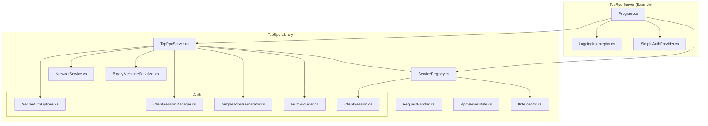
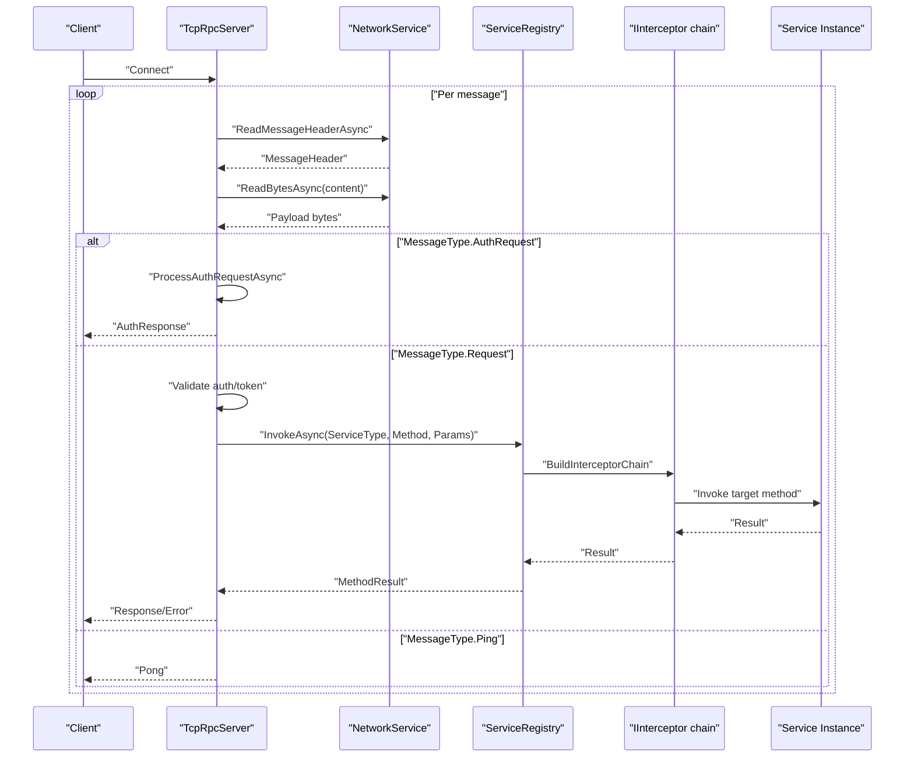
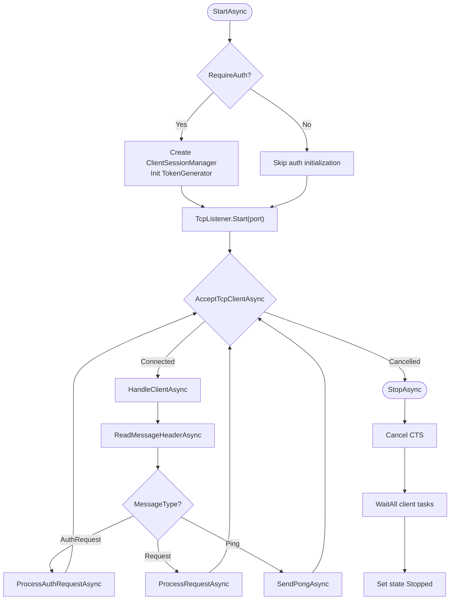
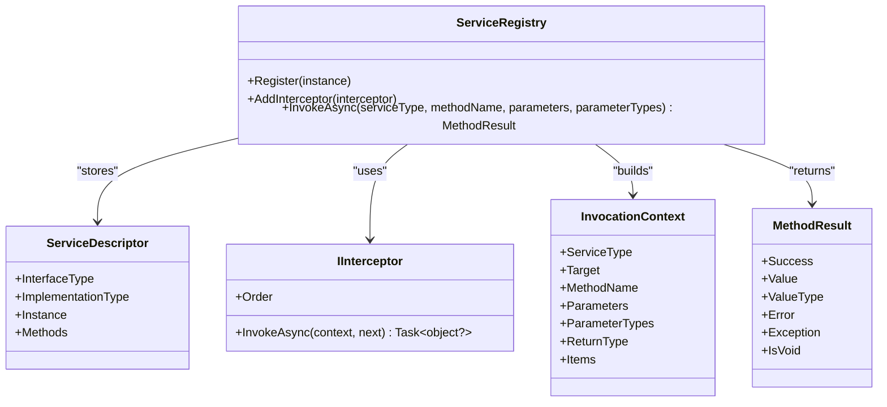
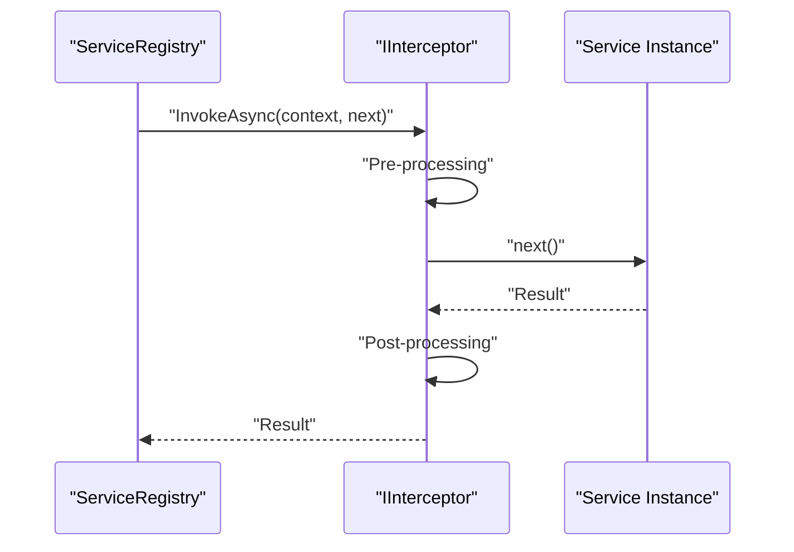
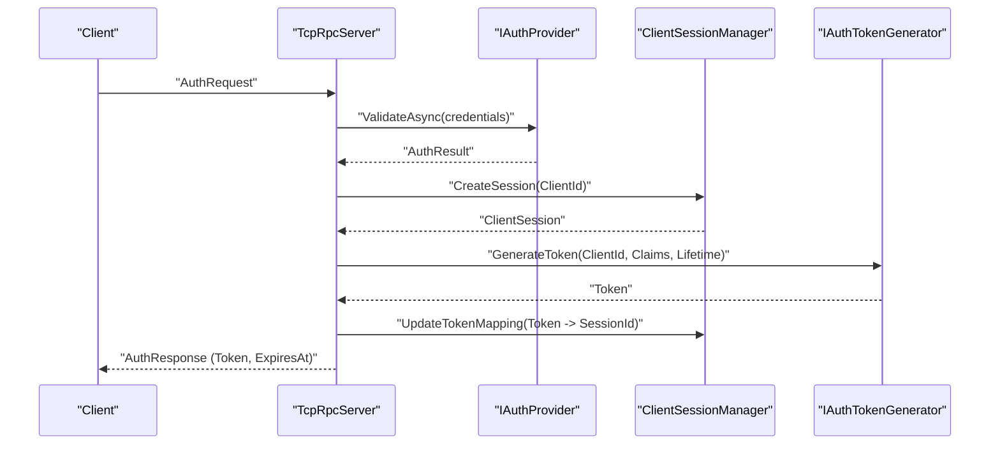
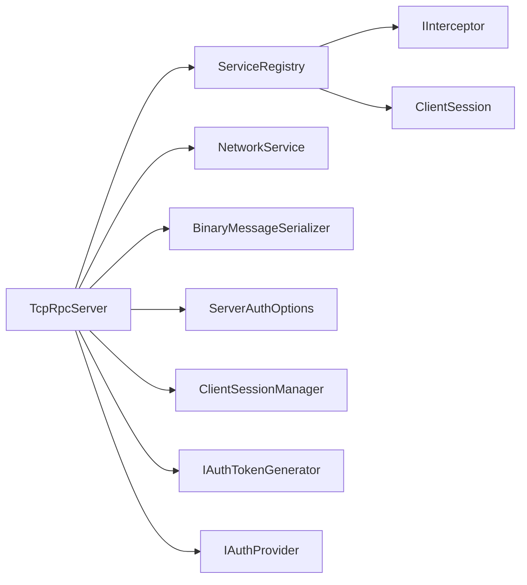

# Server Components

<cite>
**Referenced Files in This Document**
- [TcpRpcServer.cs](file://TcpRpc/Server/TcpRpcServer.cs)
- [ServiceRegistry.cs](file://TcpRpc/Server/ServiceRegistry.cs)
- [RequestHandler.cs](file://TcpRpc/Server/RequestHandler.cs)
- [RpcServerState.cs](file://TcpRpc/Server/RpcServerState.cs)
- [IInterceptor.cs](file://TcpRpc/Server/IInterceptor.cs)
- [ClientSessionManager.cs](file://TcpRpc/Server/Auth/ClientSessionManager.cs)
- [ServerAuthOptions.cs](file://TcpRpc/Server/ServerAuthOptions.cs)
- [SimpleTokenGenerator.cs](file://TcpRpc/Server/Auth/SimpleTokenGenerator.cs)
- [IAuthProvider.cs](file://TcpRpc/Server/Auth/IAuthProvider.cs)
- [ClientSession.cs](file://TcpRpc/Server/Auth/ClientSession.cs)
- [Program.cs](file://TcpRpc.Server/Program.cs)
- [LoggingInterceptor.cs](file://TcpRpc.Server/LoggingInterceptor.cs)
- [SimpleAuthProvider.cs](file://TcpRpc.Server/SimpleAuthProvider.cs)
- [NetworkService.cs](file://TcpRpc/Network/NetworkService.cs)
- [BinaryMessageSerializer.cs](file://TcpRpc/Formatter/BinaryMessageSerializer.cs)
</cite>

## Table of Contents
1. [Introduction](#introduction)
2. [Project Structure](#project-structure)
3. [Core Components](#core-components)
4. [Architecture Overview](#architecture-overview)
5. [Detailed Component Analysis](#detailed-component-analysis)
6. [Dependency Analysis](#dependency-analysis)
7. [Performance Considerations](#performance-considerations)
8. [Troubleshooting Guide](#troubleshooting-guide)
9. [Conclusion](#conclusion)
10. [Appendices](#appendices)

## Introduction
This document explains the TcpRpc server components with a focus on TcpRpcServer, ServiceRegistry, RequestHandler, and RpcServerState. It covers server startup, service registration, dynamic method invocation, interceptors for cross-cutting concerns, authentication integration via ClientSessionManager and token-based sessions, configuration options, performance characteristics, scaling strategies, error handling, exception propagation, and graceful shutdown. The content is designed to be accessible to beginners while providing sufficient technical depth for experienced developers.

## Project Structure
The TcpRpc server lives under TcpRpc/Server and integrates with authentication, serialization, and network utilities. The TcpRpc.Server project demonstrates a practical server setup with authentication, service registration, and logging interception.

**Diagram sources**
- [Program.cs](file://TcpRpc.Server/Program.cs)
- [TcpRpcServer.cs](file://TcpRpc/Server/TcpRpcServer.cs)
- [ServiceRegistry.cs](file://TcpRpc/Server/ServiceRegistry.cs)
- [RequestHandler.cs](file://TcpRpc/Server/RequestHandler.cs)
- [RpcServerState.cs](file://TcpRpc/Server/RpcServerState.cs)
- [IInterceptor.cs](file://TcpRpc/Server/IInterceptor.cs)
- [NetworkService.cs](file://TcpRpc/Network/NetworkService.cs)
- [BinaryMessageSerializer.cs](file://TcpRpc/Formatter/BinaryMessageSerializer.cs)
- [ServerAuthOptions.cs](file://TcpRpc/Server/ServerAuthOptions.cs)
- [ClientSessionManager.cs](file://TcpRpc/Server/Auth/ClientSessionManager.cs)
- [SimpleTokenGenerator.cs](file://TcpRpc/Server/Auth/SimpleTokenGenerator.cs)
- [IAuthProvider.cs](file://TcpRpc/Server/Auth/IAuthProvider.cs)
- [ClientSession.cs](file://TcpRpc/Server/Auth/ClientSession.cs)
- [LoggingInterceptor.cs](file://TcpRpc.Server/LoggingInterceptor.cs)
- [SimpleAuthProvider.cs](file://TcpRpc.Server/SimpleAuthProvider.cs)

**Section sources**
- [Program.cs](file://TcpRpc.Server/Program.cs)
- [TcpRpcServer.cs](file://TcpRpc/Server/TcpRpcServer.cs)
- [ServiceRegistry.cs](file://TcpRpc/Server/ServiceRegistry.cs)
- [NetworkService.cs](file://TcpRpc/Network/NetworkService.cs)
- [BinaryMessageSerializer.cs](file://TcpRpc/Formatter/BinaryMessageSerializer.cs)

## Core Components
- TcpRpcServer: Central TCP server hosting the RPC runtime, managing lifecycle, accepting connections, authenticating clients, routing messages, invoking services, and handling responses.
- ServiceRegistry: Registers service implementations and orchestrates dynamic invocation with optional interceptor chains.
- RequestHandler: Legacy delegate for handling RequestMessage instances.
- RpcServerState: Enumerates server lifecycle states.
- IInterceptor and InvocationContext: Enable cross-cutting concerns around method invocation.
- ClientSessionManager and related auth types: Manage sessions, tokens, and authentication lifecycle.

**Section sources**
- [TcpRpcServer.cs](file://TcpRpc/Server/TcpRpcServer.cs)
- [ServiceRegistry.cs](file://TcpRpc/Server/ServiceRegistry.cs)
- [RequestHandler.cs](file://TcpRpc/Server/RequestHandler.cs)
- [RpcServerState.cs](file://TcpRpc/Server/RpcServerState.cs)
- [IInterceptor.cs](file://TcpRpc/Server/IInterceptor.cs)
- [ClientSessionManager.cs](file://TcpRpc/Server/Auth/ClientSessionManager.cs)
- [ServerAuthOptions.cs](file://TcpRpc/Server/ServerAuthOptions.cs)
- [SimpleTokenGenerator.cs](file://TcpRpc/Server/Auth/SimpleTokenGenerator.cs)
- [IAuthProvider.cs](file://TcpRpc/Server/Auth/IAuthProvider.cs)
- [ClientSession.cs](file://TcpRpc/Server/Auth/ClientSession.cs)

## Architecture Overview
The server accepts TCP connections, reads typed message headers, deserializes payloads, authenticates when required, and dispatches to either legacy handlers or the modern ServiceRegistry. Responses are serialized and sent back to clients. Authentication integrates with ClientSessionManager and token generation/validation.

**Diagram sources**
- [TcpRpcServer.cs](file://TcpRpc/Server/TcpRpcServer.cs)
- [NetworkService.cs](file://TcpRpc/Network/NetworkService.cs)
- [ServiceRegistry.cs](file://TcpRpc/Server/ServiceRegistry.cs)
- [IInterceptor.cs](file://TcpRpc/Server/IInterceptor.cs)

## Detailed Component Analysis

### TcpRpcServer
Responsibilities:
- Lifecycle management: StartAsync, StopAsync, ActiveConnections, State.
- Connection handling: AcceptTcpClientAsync per client, HandleClientAsync, per-client loop.
- Message processing: ProcessClientMessageAsync routing by MessageType.
- Authentication: ProcessAuthRequestAsync, token validation/renewal, session updates.
- Invocation: ProcessRequestAsync delegating to legacy RequestHandler or ServiceRegistry.
- Serialization: Uses IMessageSerializer for request/response/auth messages.
- Networking: Uses NetworkService for header/content framing and streaming.

Key behaviors:
- Startup initializes authentication subsystem when enabled, sets state to Running, and spawns per-client tasks.
- Per-client loop reads headers, validates content length, deserializes content, and routes to appropriate handler.
- Authentication requires tokens for protected services; supports reconnect with previous token.
- Request processing resolves handlers first (legacy), then ServiceRegistry (modern).
- Graceful shutdown cancels pending work, stops accepting new connections, waits for active clients, and resets state.

**Diagram sources**
- [TcpRpcServer.cs](file://TcpRpc/Server/TcpRpcServer.cs)
- [NetworkService.cs](file://TcpRpc/Network/NetworkService.cs)

**Section sources**
- [TcpRpcServer.cs](file://TcpRpc/Server/TcpRpcServer.cs)
- [NetworkService.cs](file://TcpRpc/Network/NetworkService.cs)
- [BinaryMessageSerializer.cs](file://TcpRpc/Formatter/BinaryMessageSerializer.cs)

### ServiceRegistry
Responsibilities:
- Register<TInterface, TImplementation> stores descriptors keyed by interface FullName.
- InvokeAsync resolves method info by name, converts parameters, builds InvocationContext, and executes interceptor chain.
- Supports Task<T> unwrapping and proper void detection.
- Maintains ordered interceptor list and constructs chain in reverse order.

Dynamic invocation mechanics:
- Method lookup by name against registered interface methods.
- Parameter conversion using provided parameter types and method signatures.
- Interceptor chain composes around the final action (actual method invocation).
- Returns MethodResult with success/error/exception details.

**Diagram sources**
- [ServiceRegistry.cs](file://TcpRpc/Server/ServiceRegistry.cs)
- [IInterceptor.cs](file://TcpRpc/Server/IInterceptor.cs)

**Section sources**
- [ServiceRegistry.cs](file://TcpRpc/Server/ServiceRegistry.cs)
- [IInterceptor.cs](file://TcpRpc/Server/IInterceptor.cs)

### RequestHandler
Legacy delegate for handling RequestMessage and returning ResponseMessage asynchronously. TcpRpcServer maintains a dictionary of legacy handlers alongside the modern ServiceRegistry.

**Section sources**
- [RequestHandler.cs](file://TcpRpc/Server/RequestHandler.cs)
- [TcpRpcServer.cs](file://TcpRpc/Server/TcpRpcServer.cs)

### RpcServerState
Enumerated states: Stopped, Starting, Running, Stopping, Faulted. TcpRpcServer transitions through these states during lifecycle operations.

**Section sources**
- [RpcServerState.cs](file://TcpRpc/Server/RpcServerState.cs)
- [TcpRpcServer.cs](file://TcpRpc/Server/TcpRpcServer.cs)

### Interceptor System
Cross-cutting concerns like logging, metrics, tracing, and validation can be implemented via IInterceptor. InvocationContext carries metadata about the call site and parameters. Interceptors are sorted by Order and chained so that the first interceptor wraps the last, forming a pipeline.

**Diagram sources**
- [ServiceRegistry.cs](file://TcpRpc/Server/ServiceRegistry.cs)
- [IInterceptor.cs](file://TcpRpc/Server/IInterceptor.cs)

**Section sources**
- [IInterceptor.cs](file://TcpRpc/Server/IInterceptor.cs)
- [ServiceRegistry.cs](file://TcpRpc/Server/ServiceRegistry.cs)
- [LoggingInterceptor.cs](file://TcpRpc.Server/LoggingInterceptor.cs)

### Authentication and Session Management
Authentication flow:
- TcpRpcServer optionally enables authentication via ServerAuthOptions.
- On AuthRequest, ProcessAuthRequestAsync validates credentials via IAuthProvider, creates/updates ClientSession, generates/refreshes tokens, and responds with AuthResponse.
- Subsequent requests require a valid token; TcpRpcServer validates tokens and updates session activity.
- ClientSessionManager tracks sessions, supports restoration via previous token, and periodic cleanup.

**Diagram sources**
- [TcpRpcServer.cs](file://TcpRpc/Server/TcpRpcServer.cs)
- [IAuthProvider.cs](file://TcpRpc/Server/Auth/IAuthProvider.cs)
- [ClientSessionManager.cs](file://TcpRpc/Server/Auth/ClientSessionManager.cs)
- [SimpleTokenGenerator.cs](file://TcpRpc/Server/Auth/SimpleTokenGenerator.cs)

**Section sources**
- [ServerAuthOptions.cs](file://TcpRpc/Server/ServerAuthOptions.cs)
- [ClientSessionManager.cs](file://TcpRpc/Server/Auth/ClientSessionManager.cs)
- [SimpleTokenGenerator.cs](file://TcpRpc/Server/Auth/SimpleTokenGenerator.cs)
- [IAuthProvider.cs](file://TcpRpc/Server/Auth/IAuthProvider.cs)
- [ClientSession.cs](file://TcpRpc/Server/Auth/ClientSession.cs)
- [TcpRpcServer.cs](file://TcpRpc/Server/TcpRpcServer.cs)

### Example: Server Startup, Registration, and Interception
- Server creation with authentication options and serializer.
- Registering a service via RegisterService<TInterface, TImplementation>.
- Adding a logging interceptor to the ServiceRegistry.
- Starting and stopping the server.

References:
- [Program.cs](file://TcpRpc.Server/Program.cs)
- [TcpRpcServer.cs](file://TcpRpc/Server/TcpRpcServer.cs)
- [ServiceRegistry.cs](file://TcpRpc/Server/ServiceRegistry.cs)
- [LoggingInterceptor.cs](file://TcpRpc.Server/LoggingInterceptor.cs)
- [SimpleAuthProvider.cs](file://TcpRpc.Server/SimpleAuthProvider.cs)

**Section sources**
- [Program.cs](file://TcpRpc.Server/Program.cs)
- [TcpRpcServer.cs](file://TcpRpc/Server/TcpRpcServer.cs)
- [ServiceRegistry.cs](file://TcpRpc/Server/ServiceRegistry.cs)
- [LoggingInterceptor.cs](file://TcpRpc.Server/LoggingInterceptor.cs)
- [SimpleAuthProvider.cs](file://TcpRpc.Server/SimpleAuthProvider.cs)

## Dependency Analysis
High-level dependencies among server components:

**Diagram sources**
- [TcpRpcServer.cs](file://TcpRpc/Server/TcpRpcServer.cs)
- [ServiceRegistry.cs](file://TcpRpc/Server/ServiceRegistry.cs)
- [NetworkService.cs](file://TcpRpc/Network/NetworkService.cs)
- [BinaryMessageSerializer.cs](file://TcpRpc/Formatter/BinaryMessageSerializer.cs)
- [ServerAuthOptions.cs](file://TcpRpc/Server/ServerAuthOptions.cs)
- [ClientSessionManager.cs](file://TcpRpc/Server/Auth/ClientSessionManager.cs)
- [SimpleTokenGenerator.cs](file://TcpRpc/Server/Auth/SimpleTokenGenerator.cs)
- [IAuthProvider.cs](file://TcpRpc/Server/Auth/IAuthProvider.cs)
- [ClientSession.cs](file://TcpRpc/Server/Auth/ClientSession.cs)
- [IInterceptor.cs](file://TcpRpc/Server/IInterceptor.cs)

**Section sources**
- [TcpRpcServer.cs](file://TcpRpc/Server/TcpRpcServer.cs)
- [ServiceRegistry.cs](file://TcpRpc/Server/ServiceRegistry.cs)

## Performance Considerations
- Concurrency model: One Task per client connection; ActiveConnections tracks live tasks and prunes completed ones.
- Backpressure: Large content is read and discarded when exceeding thresholds to prevent malformed subsequent messages.
- Serialization overhead: BinaryMessageSerializer minimizes allocations and uses type markers; complex objects fall back to JSON with type metadata.
- Interceptor cost: Each interceptor adds a small overhead; keep chains short and efficient.
- Authentication: Token generation/validation and session lookups add latency; consider caching validated tokens at the edge if needed.
- Network I/O: NetworkService writes header size prefix, header bytes, and payload; ensure FlushAsync is called appropriately.

[No sources needed since this section provides general guidance]

## Troubleshooting Guide
Common scenarios and diagnostics:
- Authentication failures: Inspect AuthResponseMessage error messages and logs around ProcessAuthRequestAsync.
- Unauthenticated requests: Ensure clients send valid tokens for protected services; check token expiration and renewal flow.
- Method not found: Verify service registration and method names; confirm ServiceRegistry.TryGetService and method map correctness.
- Exceptions thrown by services: MethodResult.Exception and stack traces are returned; review logs and InvocationContext.
- Connection drops: ReadBytesAsync returns null on closed connections; server handles gracefully and logs disconnections.
- Shutdown hangs: StopAsync waits for clients with timeout; check for long-running operations blocking cancellation.

Operational tips:
- Enable debug logs for TcpRpcServer and ServiceRegistry to trace message flow and invocation.
- Monitor ActiveConnections to detect stuck tasks or resource leaks.
- Validate ServerAuthOptions timing parameters (TokenLifetime, SessionTimeout, SessionCleanupInterval) for expected behavior.

**Section sources**
- [TcpRpcServer.cs](file://TcpRpc/Server/TcpRpcServer.cs)
- [ServiceRegistry.cs](file://TcpRpc/Server/ServiceRegistry.cs)

## Conclusion
TcpRpcServer provides a robust, extensible RPC transport with modern service registration and interceptor support, integrated authentication, and resilient networking primitives. By combining TcpRpcServer, ServiceRegistry, and the authentication subsystem, applications can implement secure, scalable remote procedure call services with clear separation of concerns and straightforward extension points.

[No sources needed since this section summarizes without analyzing specific files]

## Appendices

### Server Startup Procedures
- Configure ServerAuthOptions (RequireAuth, TokenLifetime, SessionTimeout, SessionCleanupInterval, AuthProvider, TokenGenerator).
- Instantiate TcpRpcServer with port, IMessageSerializer, ILoggerFactory, and ServerAuthOptions.
- Register services using RegisterService<TInterface, TImplementation>.
- Optionally add interceptors to ServiceRegistry.
- Start server via StartAsync; stop via StopAsync.

References:
- [Program.cs](file://TcpRpc.Server/Program.cs)
- [TcpRpcServer.cs](file://TcpRpc/Server/TcpRpcServer.cs)
- [ServerAuthOptions.cs](file://TcpRpc/Server/ServerAuthOptions.cs)

**Section sources**
- [Program.cs](file://TcpRpc.Server/Program.cs)
- [TcpRpcServer.cs](file://TcpRpc/Server/TcpRpcServer.cs)
- [ServerAuthOptions.cs](file://TcpRpc/Server/ServerAuthOptions.cs)

### Service Registration Patterns
- New API: RegisterService<TInterface, TImplementation>(instance) registers by interface FullName.
- Legacy API: Maintain RequestHandler delegates for backward compatibility.
- Discovery: ServiceRegistry stores descriptors keyed by interface FullName; InvokeAsync resolves methods by name.

References:
- [TcpRpcServer.cs](file://TcpRpc/Server/TcpRpcServer.cs)
- [ServiceRegistry.cs](file://TcpRpc/Server/ServiceRegistry.cs)
- [RequestHandler.cs](file://TcpRpc/Server/RequestHandler.cs)

**Section sources**
- [TcpRpcServer.cs](file://TcpRpc/Server/TcpRpcServer.cs)
- [ServiceRegistry.cs](file://TcpRpc/Server/ServiceRegistry.cs)
- [RequestHandler.cs](file://TcpRpc/Server/RequestHandler.cs)

### Dynamic Method Invocation Mechanics
- Resolve handler by method name (legacy) or service type + method name (modern).
- Convert parameters using provided parameter types and method signatures.
- Build interceptor chain and invoke target method, unwrapping Task<T> and handling Task.
- Return structured ResponseMessage with success/error/exception details.

References:
- [ServiceRegistry.cs](file://TcpRpc/Server/ServiceRegistry.cs)
- [IInterceptor.cs](file://TcpRpc/Server/IInterceptor.cs)
- [TcpRpcServer.cs](file://TcpRpc/Server/TcpRpcServer.cs)

**Section sources**
- [ServiceRegistry.cs](file://TcpRpc/Server/ServiceRegistry.cs)
- [IInterceptor.cs](file://TcpRpc/Server/IInterceptor.cs)
- [TcpRpcServer.cs](file://TcpRpc/Server/TcpRpcServer.cs)

### Interceptor System Details
- Implement IInterceptor with Order and InvokeAsync(context, next).
- Use InvocationContext to access ServiceType, Target, MethodName, Parameters, ReturnType, and Items.
- Chain multiple interceptors; order determines execution precedence.

References:
- [IInterceptor.cs](file://TcpRpc/Server/IInterceptor.cs)
- [ServiceRegistry.cs](file://TcpRpc/Server/ServiceRegistry.cs)
- [LoggingInterceptor.cs](file://TcpRpc.Server/LoggingInterceptor.cs)

**Section sources**
- [IInterceptor.cs](file://TcpRpc/Server/IInterceptor.cs)
- [ServiceRegistry.cs](file://TcpRpc/Server/ServiceRegistry.cs)
- [LoggingInterceptor.cs](file://TcpRpc.Server/LoggingInterceptor.cs)

### Authentication Integration
- Configure IAuthProvider to validate credentials and produce AuthResult with ClientId and Claims.
- Use IAuthTokenGenerator to issue and validate tokens; SimpleTokenGenerator implements HS256 JWT-like tokens.
- ClientSessionManager manages sessions, token mappings, and cleanup timers.
- TcpRpcServer enforces authentication for protected services and handles token renewal.

References:
- [ServerAuthOptions.cs](file://TcpRpc/Server/ServerAuthOptions.cs)
- [IAuthProvider.cs](file://TcpRpc/Server/Auth/IAuthProvider.cs)
- [SimpleTokenGenerator.cs](file://TcpRpc/Server/Auth/SimpleTokenGenerator.cs)
- [ClientSessionManager.cs](file://TcpRpc/Server/Auth/ClientSessionManager.cs)
- [ClientSession.cs](file://TcpRpc/Server/Auth/ClientSession.cs)
- [TcpRpcServer.cs](file://TcpRpc/Server/TcpRpcServer.cs)

**Section sources**
- [ServerAuthOptions.cs](file://TcpRpc/Server/ServerAuthOptions.cs)
- [IAuthProvider.cs](file://TcpRpc/Server/Auth/IAuthProvider.cs)
- [SimpleTokenGenerator.cs](file://TcpRpc/Server/Auth/SimpleTokenGenerator.cs)
- [ClientSessionManager.cs](file://TcpRpc/Server/Auth/ClientSessionManager.cs)
- [ClientSession.cs](file://TcpRpc/Server/Auth/ClientSession.cs)
- [TcpRpcServer.cs](file://TcpRpc/Server/TcpRpcServer.cs)

### Server Configuration Options
- Port: TcpRpcServer constructor parameter.
- Serializer: IMessageSerializer (BinaryMessageSerializer included).
- Logger: ILoggerFactory passed to TcpRpcServer and components.
- Authentication:
  - RequireAuth: Enable/disable authentication.
  - TokenLifetime: Expiration for issued tokens.
  - SessionTimeout: Idle timeout for sessions.
  - SessionCleanupInterval: Periodic cleanup cadence.
  - AuthProvider: Validates credentials.
  - TokenGenerator: Generates/validates tokens.

References:
- [TcpRpcServer.cs](file://TcpRpc/Server/TcpRpcServer.cs)
- [ServerAuthOptions.cs](file://TcpRpc/Server/ServerAuthOptions.cs)
- [BinaryMessageSerializer.cs](file://TcpRpc/Formatter/BinaryMessageSerializer.cs)

**Section sources**
- [TcpRpcServer.cs](file://TcpRpc/Server/TcpRpcServer.cs)
- [ServerAuthOptions.cs](file://TcpRpc/Server/ServerAuthOptions.cs)
- [BinaryMessageSerializer.cs](file://TcpRpc/Formatter/BinaryMessageSerializer.cs)

### Scaling Strategies
- Horizontal scaling: Run multiple server instances behind a load balancer; coordinate shared state externally if needed.
- Connection handling: TcpRpcServer scales per client task; tune OS limits and monitor ActiveConnections.
- Authentication scalability: Offload token validation to shared caches or external identity providers if necessary.
- Serialization throughput: Keep payloads compact; avoid excessive binary JSON conversions for large objects.

[No sources needed since this section provides general guidance]

### Error Handling and Exception Propagation
- TcpRpcServer catches exceptions during message processing, logs them, and continues to the next message.
- ProcessRequestAsync wraps invocation errors into ResponseMessage with error details and exception type.
- ServiceRegistry propagates TargetInvocationException inner exception and logs errors.
- Graceful shutdown ensures listeners stop, CancellationTokens cancel outstanding work, and client tasks are awaited with timeout.

References:
- [TcpRpcServer.cs](file://TcpRpc/Server/TcpRpcServer.cs)
- [ServiceRegistry.cs](file://TcpRpc/Server/ServiceRegistry.cs)

**Section sources**
- [TcpRpcServer.cs](file://TcpRpc/Server/TcpRpcServer.cs)
- [ServiceRegistry.cs](file://TcpRpc/Server/ServiceRegistry.cs)