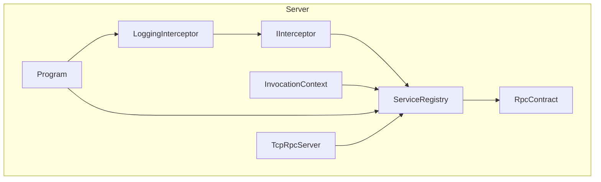
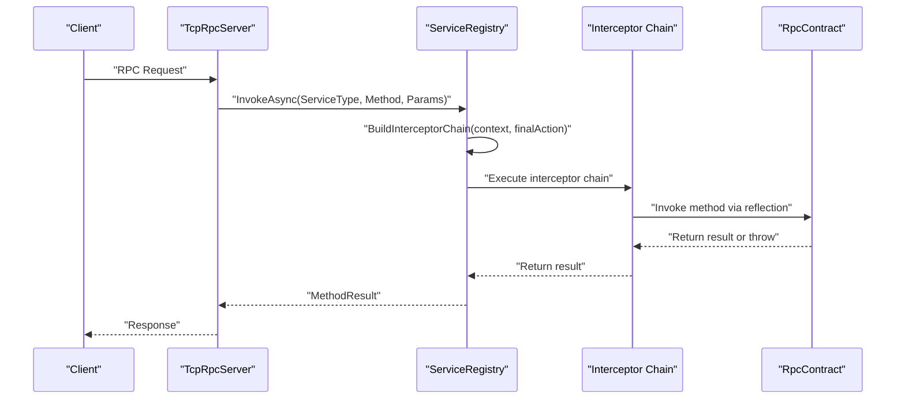
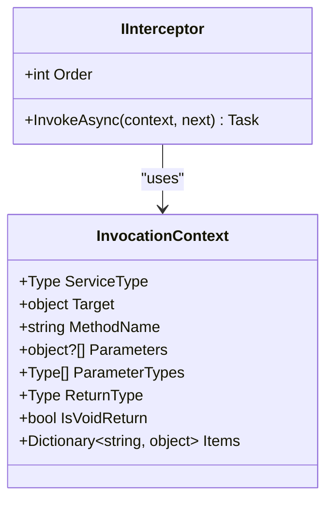
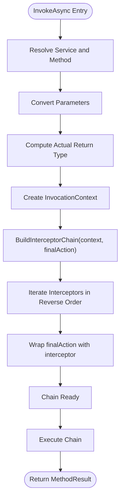
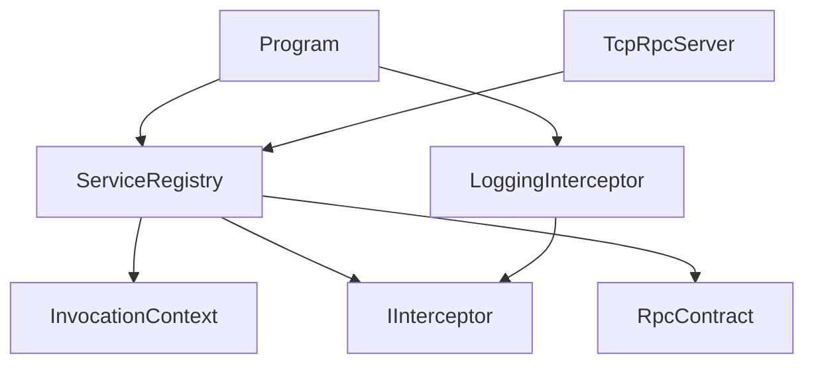

# Interceptor System

<cite>
**Referenced Files in This Document**
- [IInterceptor.cs](file://TcpRpc/Server/IInterceptor.cs)
- [ServiceRegistry.cs](file://TcpRpc/Server/ServiceRegistry.cs)
- [LoggingInterceptor.cs](file://TcpRpc.Server/LoggingInterceptor.cs)
- [Program.cs](file://TcpRpc.Server/Program.cs)
- [RpcContract.cs](file://TcpRpc.Server/RpcContract.cs)
- [TcpRpcServer.cs](file://TcpRpc/Server/TcpRpcServer.cs)
</cite>

## Table of Contents
1. [Introduction](#introduction)
2. [Project Structure](#project-structure)
3. [Core Components](#core-components)
4. [Architecture Overview](#architecture-overview)
5. [Detailed Component Analysis](#detailed-component-analysis)
6. [Dependency Analysis](#dependency-analysis)
7. [Performance Considerations](#performance-considerations)
8. [Troubleshooting Guide](#troubleshooting-guide)
9. [Conclusion](#conclusion)
10. [Appendices](#appendices)

## Introduction
This document explains the interceptor system integrated with the ServiceRegistry in the TcpRpc server. It covers how to register cross-cutting concerns using AddInterceptor, how interceptor ordering works, how the interceptor chain is built in reverse order, and the InvocationContext structure. It also provides practical examples for implementing custom interceptors for logging, metrics collection, and authorization, along with lifecycle, error handling, performance implications, and best practices.

## Project Structure
The interceptor system spans several components:
- Interceptor contract and invocation context
- Service registry that manages services and interceptors
- Example interceptor implementations
- Server integration that wires interceptors into the invocation pipeline
- Sample service implementation used for demonstration

**Diagram sources**
- [ServiceRegistry.cs:10-272](file://TcpRpc/Server/ServiceRegistry.cs#L10-L272)
- [IInterceptor.cs:6-63](file://TcpRpc/Server/IInterceptor.cs#L6-L63)
- [LoggingInterceptor.cs:8-41](file://TcpRpc.Server/LoggingInterceptor.cs#L8-L41)
- [Program.cs:47-48](file://TcpRpc.Server/Program.cs#L47-L48)
- [RpcContract.cs:10-83](file://TcpRpc.Server/RpcContract.cs#L10-L83)
- [TcpRpcServer.cs:549-614](file://TcpRpc/Server/TcpRpcServer.cs#L549-L614)

**Section sources**
- [ServiceRegistry.cs:10-272](file://TcpRpc/Server/ServiceRegistry.cs#L10-L272)
- [IInterceptor.cs:6-63](file://TcpRpc/Server/IInterceptor.cs#L6-L63)
- [LoggingInterceptor.cs:8-41](file://TcpRpc.Server/LoggingInterceptor.cs#L8-L41)
- [Program.cs:47-48](file://TcpRpc.Server/Program.cs#L47-L48)
- [RpcContract.cs:10-83](file://TcpRpc.Server/RpcContract.cs#L10-L83)
- [TcpRpcServer.cs:549-614](file://TcpRpc/Server/TcpRpcServer.cs#L549-L614)

## Core Components
- Interceptor contract: Defines the interception contract with Order and InvokeAsync.
- InvocationContext: Carries metadata about the service call (service type, target, method name, parameters, parameter types, return type, and items dictionary).
- ServiceRegistry: Manages registered services and interceptors, builds the interceptor chain, and executes method invocations.
- Example interceptor: LoggingInterceptor demonstrates timing and logging around method execution.
- Server integration: Program registers a service and adds a logging interceptor; TcpRpcServer delegates RPC requests to ServiceRegistry.

Key responsibilities:
- AddInterceptor: Registers interceptors and sorts them by Order ascending (lower number first).
- BuildInterceptorChain: Constructs the chain in reverse order to ensure correct execution sequence.
- InvocationContext: Provides all necessary metadata for interceptors to act on the call.
- Error handling: Catches exceptions during invocation and wraps them appropriately.

**Section sources**
- [IInterceptor.cs:6-63](file://TcpRpc/Server/IInterceptor.cs#L6-L63)
- [ServiceRegistry.cs:52-59](file://TcpRpc/Server/ServiceRegistry.cs#L52-L59)
- [ServiceRegistry.cs:158-171](file://TcpRpc/Server/ServiceRegistry.cs#L158-L171)
- [ServiceRegistry.cs:92-100](file://TcpRpc/Server/ServiceRegistry.cs#L92-L100)
- [ServiceRegistry.cs:128-137](file://TcpRpc/Server/ServiceRegistry.cs#L128-L137)

## Architecture Overview
The interceptor system sits between the server’s request processing and the actual service method invocation. It enables cross-cutting concerns such as logging, metrics, and authorization to be layered around service calls without modifying service code.

**Diagram sources**
- [TcpRpcServer.cs:549-614](file://TcpRpc/Server/TcpRpcServer.cs#L549-L614)
- [ServiceRegistry.cs:72-138](file://TcpRpc/Server/ServiceRegistry.cs#L72-L138)
- [ServiceRegistry.cs:158-171](file://TcpRpc/Server/ServiceRegistry.cs#L158-L171)
- [RpcContract.cs:19-82](file://TcpRpc.Server/RpcContract.cs#L19-L82)

## Detailed Component Analysis

### Interceptor Contract and InvocationContext
- IInterceptor defines:
  - Order: numeric priority where smaller values execute earlier.
  - InvokeAsync: receives InvocationContext and a delegate to the next interceptor/action.
- InvocationContext provides:
  - ServiceType, Target, MethodName, Parameters, ParameterTypes, ReturnType, IsVoidReturn, and Items.

These structures enable interceptors to inspect and modify the call metadata and to pass control to the next component in the chain.

**Diagram sources**
- [IInterceptor.cs:6-63](file://TcpRpc/Server/IInterceptor.cs#L6-L63)
- [ServiceRegistry.cs:92-100](file://TcpRpc/Server/ServiceRegistry.cs#L92-L100)

**Section sources**
- [IInterceptor.cs:6-63](file://TcpRpc/Server/IInterceptor.cs#L6-L63)
- [ServiceRegistry.cs:92-100](file://TcpRpc/Server/ServiceRegistry.cs#L92-L100)

### ServiceRegistry: Registration, Ordering, and Chain Building
- AddInterceptor:
  - Adds an interceptor to an internal list and sorts by Order ascending.
- BuildInterceptorChain:
  - Builds the chain by iterating interceptors in reverse order, wrapping the final action with each interceptor.
  - Ensures the first interceptor added becomes the outermost wrapper, while the last becomes the innermost.
- InvokeAsync:
  - Resolves the service and method, converts parameters, computes actual return type, creates InvocationContext, builds the chain, and executes it.
  - Handles exceptions and logs errors.

**Diagram sources**
- [ServiceRegistry.cs:72-138](file://TcpRpc/Server/ServiceRegistry.cs#L72-L138)
- [ServiceRegistry.cs:158-171](file://TcpRpc/Server/ServiceRegistry.cs#L158-L171)

**Section sources**
- [ServiceRegistry.cs:52-59](file://TcpRpc/Server/ServiceRegistry.cs#L52-L59)
- [ServiceRegistry.cs:158-171](file://TcpRpc/Server/ServiceRegistry.cs#L158-L171)
- [ServiceRegistry.cs:72-138](file://TcpRpc/Server/ServiceRegistry.cs#L72-L138)

### LoggingInterceptor Example
- Demonstrates:
  - Capturing method name and service type.
  - Timing execution with a stopwatch.
  - Logging before/after completion and on failure.
  - Preserving exception propagation by rethrowing.

This interceptor is registered via Program and executed as part of the chain.

**Section sources**
- [LoggingInterceptor.cs:8-41](file://TcpRpc.Server/LoggingInterceptor.cs#L8-L41)
- [Program.cs:47-48](file://TcpRpc.Server/Program.cs#L47-L48)

### Server Integration
- TcpRpcServer delegates RPC requests to ServiceRegistry.InvokeAsync.
- Program registers a service and adds a logging interceptor to the registry.

**Section sources**
- [TcpRpcServer.cs:549-614](file://TcpRpc/Server/TcpRpcServer.cs#L549-L614)
- [Program.cs:44-48](file://TcpRpc.Server/Program.cs#L44-L48)

## Dependency Analysis
The interceptor system is decoupled from the service implementations. Interceptors depend on the InvocationContext and the chain-building mechanism in ServiceRegistry. The server depends on ServiceRegistry to execute RPC calls.

**Diagram sources**
- [ServiceRegistry.cs:10-272](file://TcpRpc/Server/ServiceRegistry.cs#L10-L272)
- [IInterceptor.cs:6-63](file://TcpRpc/Server/IInterceptor.cs#L6-L63)
- [LoggingInterceptor.cs:8-41](file://TcpRpc.Server/LoggingInterceptor.cs#L8-L41)
- [Program.cs:44-48](file://TcpRpc.Server/Program.cs#L44-L48)
- [RpcContract.cs:10-83](file://TcpRpc.Server/RpcContract.cs#L10-L83)
- [TcpRpcServer.cs:549-614](file://TcpRpc/Server/TcpRpcServer.cs#L549-L614)

**Section sources**
- [ServiceRegistry.cs:10-272](file://TcpRpc/Server/ServiceRegistry.cs#L10-L272)
- [IInterceptor.cs:6-63](file://TcpRpc/Server/IInterceptor.cs#L6-L63)
- [LoggingInterceptor.cs:8-41](file://TcpRpc.Server/LoggingInterceptor.cs#L8-L41)
- [Program.cs:44-48](file://TcpRpc.Server/Program.cs#L44-L48)
- [RpcContract.cs:10-83](file://TcpRpc.Server/RpcContract.cs#L10-L83)
- [TcpRpcServer.cs:549-614](file://TcpRpc/Server/TcpRpcServer.cs#L549-L614)

## Performance Considerations
- Overhead: Each interceptor adds a delegate call and potential logging/metrics work. Keep interceptors efficient and avoid heavy synchronous operations inside the chain.
- Asynchronous handling: The system supports async methods and unwraps Task results. Ensure interceptors do not block threads unnecessarily.
- Sorting cost: AddInterceptor sorts the list by Order. For many interceptors, consider pre-sorting or minimizing dynamic additions.
- Logging volume: Excessive logging can impact throughput. Use appropriate log levels and sampling.

[No sources needed since this section provides general guidance]

## Troubleshooting Guide
Common issues and resolutions:
- Method not found: Ensure the service is registered and the method name matches the interface definition.
- Parameter conversion failures: Verify parameter types match the target method signature; the system attempts conversion but may fall back to original values.
- Exceptions thrown by interceptors: Exceptions propagate through the chain; ensure interceptors rethrow or handle appropriately to preserve error semantics.
- Authentication/authorization failures: While interceptors can enforce security, the server also validates authentication and tokens before invoking the registry.

**Section sources**
- [ServiceRegistry.cs:74-82](file://TcpRpc/Server/ServiceRegistry.cs#L74-L82)
- [ServiceRegistry.cs:173-208](file://TcpRpc/Server/ServiceRegistry.cs#L173-L208)
- [ServiceRegistry.cs:128-137](file://TcpRpc/Server/ServiceRegistry.cs#L128-L137)

## Conclusion
The interceptor system provides a clean, extensible way to add cross-cutting concerns to RPC calls. By leveraging InvocationContext and a deterministic chain built in reverse order, developers can compose logging, metrics, and security checks around service methods without modifying service code. Proper ordering, efficient implementations, and robust error handling ensure reliable and performant operation.

[No sources needed since this section summarizes without analyzing specific files]

## Appendices

### Interceptor Ordering Mechanism
- AddInterceptor appends and sorts by Order ascending.
- BuildInterceptorChain iterates from the highest index to the lowest, wrapping the final action with each interceptor.
- This ensures the interceptor with the smallest Order runs first, and the chain executes in the intended sequence.

**Section sources**
- [ServiceRegistry.cs:52-59](file://TcpRpc/Server/ServiceRegistry.cs#L52-L59)
- [ServiceRegistry.cs:158-171](file://TcpRpc/Server/ServiceRegistry.cs#L158-L171)

### InvocationContext Properties
- ServiceType: The interface type of the service.
- Target: The service instance.
- MethodName: The invoked method name.
- Parameters: The converted parameters array.
- ParameterTypes: Types of parameters.
- ReturnType: Actual return type (unwrapped Task<T>).
- IsVoidReturn: Indicates void or Task return.
- Items: A dictionary for passing contextual data across interceptors.

**Section sources**
- [ServiceRegistry.cs:92-100](file://TcpRpc/Server/ServiceRegistry.cs#L92-L100)
- [IInterceptor.cs:22-63](file://TcpRpc/Server/IInterceptor.cs#L22-L63)

### Implementing Custom Interceptors
Examples of common interceptors:
- Logging: Capture method name, service type, and elapsed time; log before/after and on exceptions.
- Metrics: Measure latency and counts; record success/failure rates.
- Authorization: Validate claims or permissions using InvocationContext.Items or external providers.

Registration example:
- Add interceptors to ServiceRegistry after service registration.

**Section sources**
- [LoggingInterceptor.cs:8-41](file://TcpRpc.Server/LoggingInterceptor.cs#L8-L41)
- [Program.cs:44-48](file://TcpRpc.Server/Program.cs#L44-L48)

### Best Practices
- Keep interceptors small and focused.
- Use Order to control precedence; group related concerns together.
- Avoid blocking operations inside interceptors.
- Use InvocationContext.Items to pass lightweight data between interceptors.
- Handle exceptions consistently; decide whether to swallow or rethrow based on policy.
- Prefer asynchronous patterns to avoid thread pool contention.

[No sources needed since this section provides general guidance]