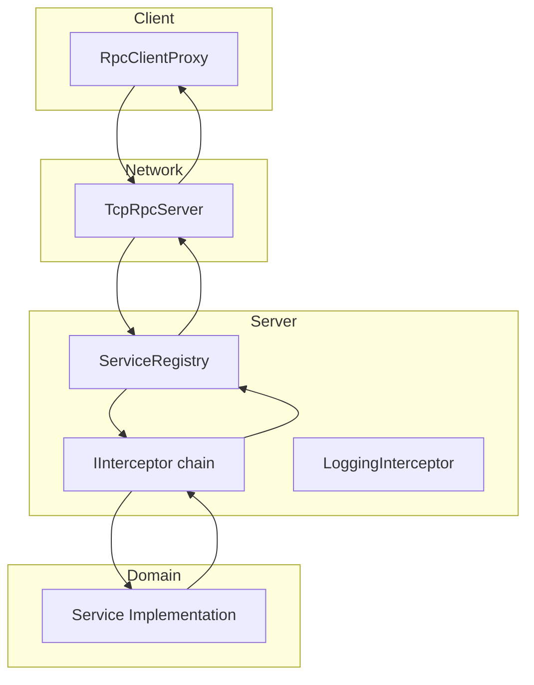
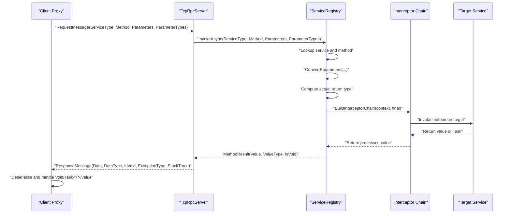
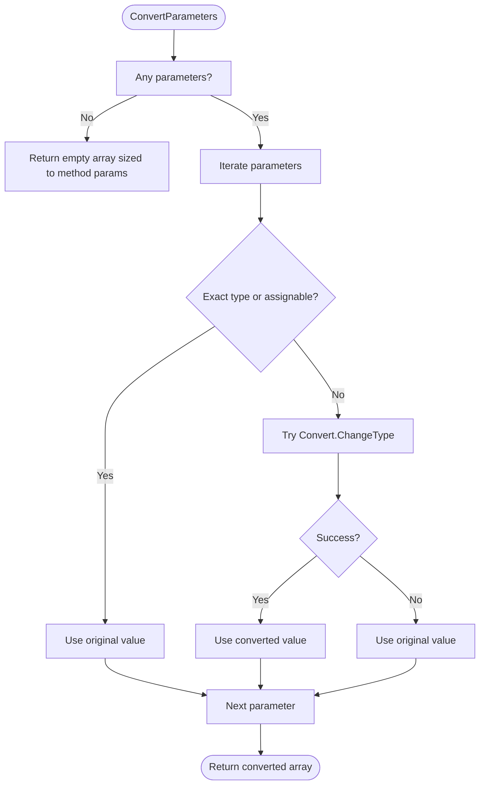
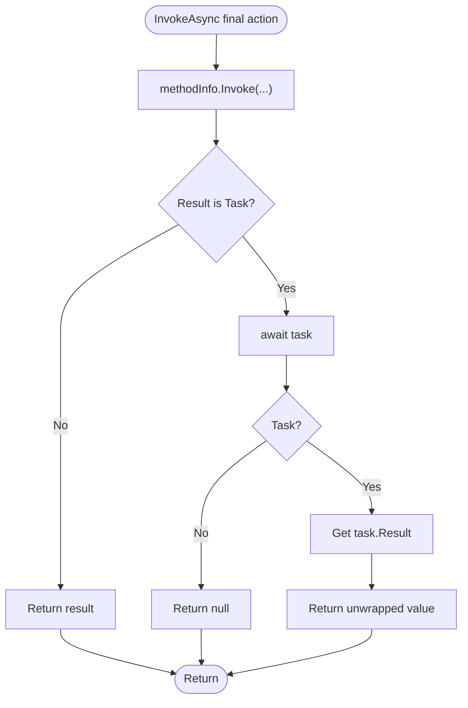
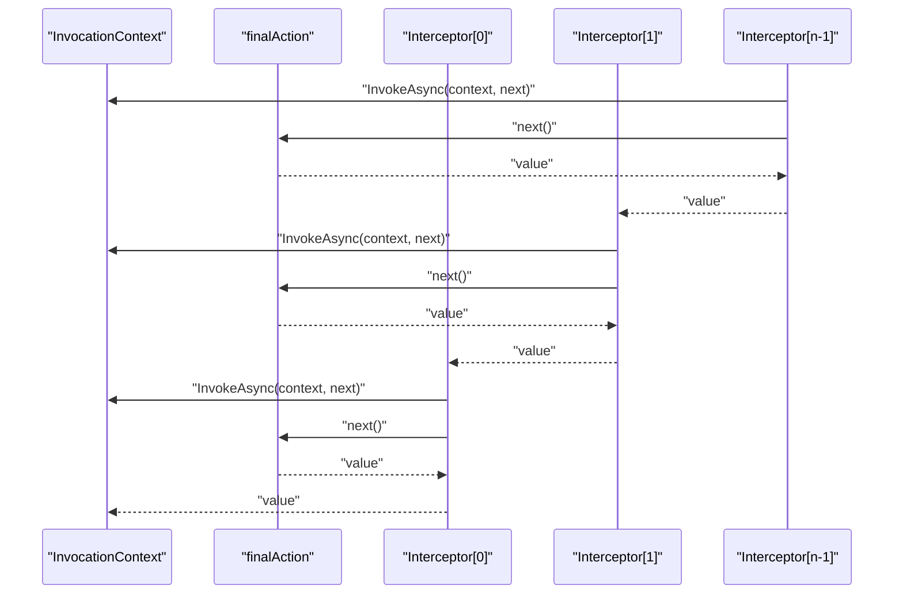
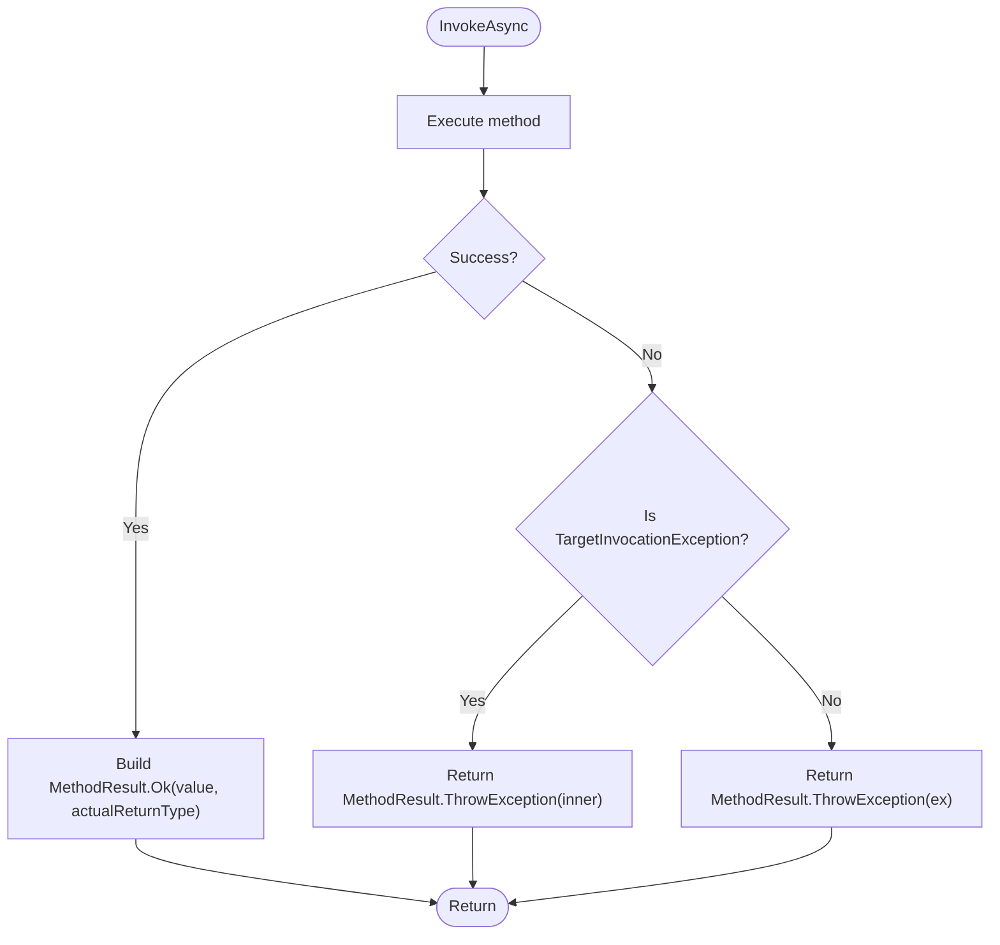
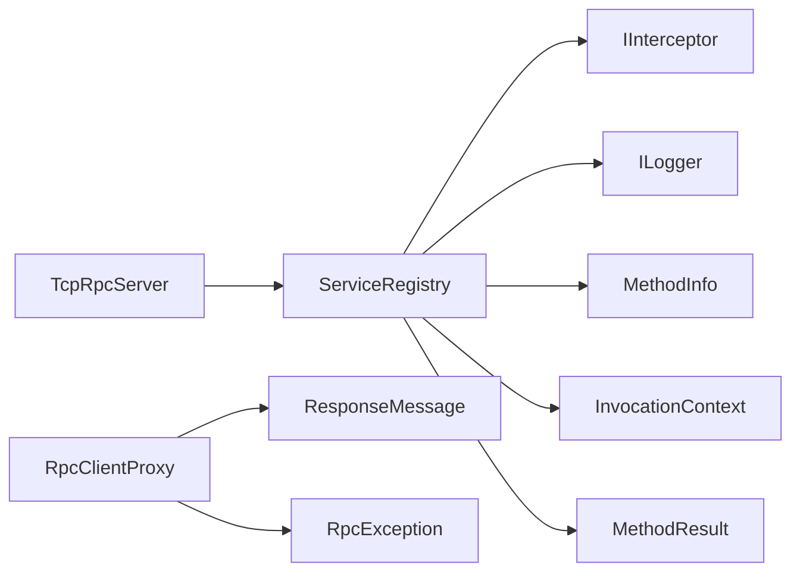

# Method Invocation Workflow

<cite>
**Referenced Files in This Document**
- [ServiceRegistry.cs](file://TcpRpc/Server/ServiceRegistry.cs)
- [IInterceptor.cs](file://TcpRpc/Server/IInterceptor.cs)
- [LoggingInterceptor.cs](file://TcpRpc.Server/LoggingInterceptor.cs)
- [TcpRpcServer.cs](file://TcpRpc/Server/TcpRpcServer.cs)
- [RpcClientProxy.cs](file://TcpRpc/Client/RpcClientProxy.cs)
- [RpcException.cs](file://TcpRpc/RpcException.cs)
- [ResponseMessage.cs](file://TcpRpc/Message/ResponseMessage.cs)
</cite>

## Table of Contents
1. [Introduction](#introduction)
2. [Project Structure](#project-structure)
3. [Core Components](#core-components)
4. [Architecture Overview](#architecture-overview)
5. [Detailed Component Analysis](#detailed-component-analysis)
6. [Dependency Analysis](#dependency-analysis)
7. [Performance Considerations](#performance-considerations)
8. [Troubleshooting Guide](#troubleshooting-guide)
9. [Conclusion](#conclusion)

## Introduction
This document explains the method invocation workflow within the ServiceRegistry, focusing on how a remote call is resolved, executed, and how results are returned. It covers service and method lookup, parameter conversion and type matching, asynchronous method handling, interceptor chain construction and execution order, return type handling for Task<T> unwrapping and void method detection, and error handling including TargetInvocationException propagation. It also provides practical examples of invocation scenarios and performance considerations for reflection-based method invocation.

## Project Structure
The method invocation pipeline spans several components:
- Client-side proxy constructs requests and deserializes responses.
- Server-side TCP server receives requests and delegates to ServiceRegistry.
- ServiceRegistry resolves services and methods, converts parameters, builds interceptor chains, invokes methods, and handles return types.
- Interceptors wrap the final invocation for cross-cutting concerns like logging.
- RpcException carries remote exceptions back to clients.

**Diagram sources**
- [RpcClientProxy.cs:38-113](file://TcpRpc/Client/RpcClientProxy.cs#L38-L113)
- [TcpRpcServer.cs:549-614](file://TcpRpc/Server/TcpRpcServer.cs#L549-L614)
- [ServiceRegistry.cs:72-138](file://TcpRpc/Server/ServiceRegistry.cs#L72-L138)
- [IInterceptor.cs:6-17](file://TcpRpc/Server/IInterceptor.cs#L6-L17)
- [LoggingInterceptor.cs:8-41](file://TcpRpc.Server/LoggingInterceptor.cs#L8-L41)

**Section sources**
- [RpcClientProxy.cs:1-160](file://TcpRpc/Client/RpcClientProxy.cs#L1-L160)
- [TcpRpcServer.cs:549-614](file://TcpRpc/Server/TcpRpcServer.cs#L549-L614)
- [ServiceRegistry.cs:10-221](file://TcpRpc/Server/ServiceRegistry.cs#L10-L221)
- [IInterceptor.cs:1-64](file://TcpRpc/Server/IInterceptor.cs#L1-L64)
- [LoggingInterceptor.cs:1-41](file://TcpRpc.Server/LoggingInterceptor.cs#L1-L41)

## Core Components
- ServiceRegistry: Central orchestrator for method invocation, including service/method lookup, parameter conversion, interceptor chain building, and return type handling.
- InvocationContext: Holds contextual information for interception and debugging.
- IInterceptor: Defines the interception contract with ordered execution.
- RpcClientProxy: Client-side proxy that sends requests and deserializes responses, including exception propagation.
- RpcException: Carries remote exception metadata back to clients.

Key responsibilities:
- Service and method lookup: Resolve service by interface full name and method by name.
- Parameter conversion: Match types and convert using Convert.ChangeType when compatible.
- Asynchronous handling: Await Task-returning methods and unwrap Task<T>.
- Interceptor chain: Compose ordered interceptors around the final action.
- Return type handling: Unwrap Task<T> and detect void returns.
- Error propagation: Wrap exceptions and propagate TargetInvocationException inner details.

**Section sources**
- [ServiceRegistry.cs:72-138](file://TcpRpc/Server/ServiceRegistry.cs#L72-L138)
- [IInterceptor.cs:6-63](file://TcpRpc/Server/IInterceptor.cs#L6-L63)
- [RpcClientProxy.cs:38-113](file://TcpRpc/Client/RpcClientProxy.cs#L38-L113)
- [RpcException.cs:6-36](file://TcpRpc/RpcException.cs#L6-L36)

## Architecture Overview
The invocation flow begins at the client proxy, proceeds through the server’s request processor to the ServiceRegistry, and ends with the client receiving either a value, a void result, or a propagated exception.

**Diagram sources**
- [RpcClientProxy.cs:59-113](file://TcpRpc/Client/RpcClientProxy.cs#L59-L113)
- [TcpRpcServer.cs:562-596](file://TcpRpc/Server/TcpRpcServer.cs#L562-L596)
- [ServiceRegistry.cs:72-138](file://TcpRpc/Server/ServiceRegistry.cs#L72-L138)
- [IInterceptor.cs:16-16](file://TcpRpc/Server/IInterceptor.cs#L16-L16)
- [ResponseMessage.cs:6-30](file://TcpRpc/Message/ResponseMessage.cs#L6-L30)

## Detailed Component Analysis

### Service and Method Lookup
- Service lookup: ServiceRegistry stores descriptors keyed by interface full name. Lookup uses TryGetService to retrieve the descriptor.
- Method lookup: Each descriptor maintains a dictionary of method names to MethodInfo, enabling O(1) lookup by name.

Behavior:
- If service not found, returns a failure result with an error message.
- If method not found, returns a failure result with an error message.

**Section sources**
- [ServiceRegistry.cs:64-82](file://TcpRpc/Server/ServiceRegistry.cs#L64-L82)

### Parameter Conversion and Type Matching
ConvertParameters performs per-parameter type conversion:
- Null values remain null.
- Exact type match or assignable types are passed through unchanged.
- Otherwise, attempts Convert.ChangeType to the target type; if conversion fails, falls back to original value.

Notes:
- Only up to the minimum of provided parameters and method parameter count are processed.
- No explicit type compatibility checks beyond assignment and Convert.ChangeType are performed.

**Diagram sources**
- [ServiceRegistry.cs:173-208](file://TcpRpc/Server/ServiceRegistry.cs#L173-L208)

**Section sources**
- [ServiceRegistry.cs:173-208](file://TcpRpc/Server/ServiceRegistry.cs#L173-L208)

### Asynchronous Method Handling
Asynchronous invocation is handled when the invoked method returns a Task:
- Await the Task.
- If the Task is Task<T>, extract the Result property to obtain the typed result.
- For Task without a result, return null.

Return type computation:
- GetActualReturnType unwraps Task<T> to T and Task to void.

**Diagram sources**
- [ServiceRegistry.cs:103-122](file://TcpRpc/Server/ServiceRegistry.cs#L103-L122)
- [ServiceRegistry.cs:143-156](file://TcpRpc/Server/ServiceRegistry.cs#L143-L156)

**Section sources**
- [ServiceRegistry.cs:103-122](file://TcpRpc/Server/ServiceRegistry.cs#L103-L122)
- [ServiceRegistry.cs:143-156](file://TcpRpc/Server/ServiceRegistry.cs#L143-L156)

### Interceptor Chain Building and Execution Order
BuildInterceptorChain composes the chain by wrapping the final action with each interceptor in reverse order, ensuring the first interceptor added executes first and the last executes last.

Execution order:
- Interceptors are sorted by Order ascending during AddInterceptor.
- Chain is built by iterating from the last interceptor to the first, wrapping the next function.

**Diagram sources**
- [ServiceRegistry.cs:158-171](file://TcpRpc/Server/ServiceRegistry.cs#L158-L171)
- [IInterceptor.cs:16-16](file://TcpRpc/Server/IInterceptor.cs#L16-L16)
- [LoggingInterceptor.cs:19-40](file://TcpRpc.Server/LoggingInterceptor.cs#L19-L40)

**Section sources**
- [ServiceRegistry.cs:55-59](file://TcpRpc/Server/ServiceRegistry.cs#L55-L59)
- [ServiceRegistry.cs:158-171](file://TcpRpc/Server/ServiceRegistry.cs#L158-L171)
- [IInterceptor.cs:6-17](file://TcpRpc/Server/IInterceptor.cs#L6-L17)
- [LoggingInterceptor.cs:8-41](file://TcpRpc.Server/LoggingInterceptor.cs#L8-L41)

### Return Type Handling for Task<T> Unwrapping and Void Detection
- Actual return type is computed via GetActualReturnType:
  - Task<T> becomes T.
  - Task becomes void.
  - Other types remain unchanged.
- MethodResult.Ok sets IsVoid based on whether ValueType is void or null.
- Client-side RpcClientProxy detects IsVoid and returns void or Task.CompletedTask accordingly.

**Section sources**
- [ServiceRegistry.cs:143-156](file://TcpRpc/Server/ServiceRegistry.cs#L143-L156)
- [ServiceRegistry.cs:256-260](file://TcpRpc/Server/ServiceRegistry.cs#L256-L260)
- [RpcClientProxy.cs:86-103](file://TcpRpc/Client/RpcClientProxy.cs#L86-L103)
- [ResponseMessage.cs:27-29](file://TcpRpc/Message/ResponseMessage.cs#L27-L29)

### Error Handling and Exception Propagation
- TargetInvocationException: When a method throws, reflection wraps it in TargetInvocationException. ServiceRegistry catches TargetInvocationException and returns MethodResult.ThrowException with the inner exception.
- General exceptions: Logged and returned as MethodResult.ThrowException.
- Server response: TcpRpcServer translates MethodResult into ResponseMessage, including ExceptionType and StackTrace.
- Client rethrow: RpcClientProxy reconstructs RpcException with remote exception type and stack trace.

**Diagram sources**
- [ServiceRegistry.cs:128-137](file://TcpRpc/Server/ServiceRegistry.cs#L128-L137)
- [TcpRpcServer.cs:578-587](file://TcpRpc/Server/TcpRpcServer.cs#L578-L587)
- [RpcClientProxy.cs:76-84](file://TcpRpc/Client/RpcClientProxy.cs#L76-L84)
- [RpcException.cs:22-35](file://TcpRpc/RpcException.cs#L22-L35)

**Section sources**
- [ServiceRegistry.cs:128-137](file://TcpRpc/Server/ServiceRegistry.cs#L128-L137)
- [TcpRpcServer.cs:578-587](file://TcpRpc/Server/TcpRpcServer.cs#L578-L587)
- [RpcClientProxy.cs:76-84](file://TcpRpc/Client/RpcClientProxy.cs#L76-L84)
- [RpcException.cs:6-36](file://TcpRpc/RpcException.cs#L6-L36)

### Example Invocation Scenarios
- Synchronous method returning a value:
  - Client calls a synchronous method on the proxy.
  - Server resolves the service and method, converts parameters, executes interceptors, invokes the method, and returns the value.
  - Client receives the value directly.

- Asynchronous method returning Task<T>:
  - Client calls a Task<T>-returning method.
  - Server awaits the Task and unwraps the result.
  - Client receives a Task<T> constructed with the unwrapped value.

- Void method:
  - Client calls a void-returning method.
  - Server returns MethodResult with IsVoid true.
  - Client returns void or Task.CompletedTask depending on declared return type.

- Exception thrown by target method:
  - Server propagates TargetInvocationException’s inner exception.
  - Server responds with error and exception metadata.
  - Client reconstructs RpcException and throws it.

**Section sources**
- [ServiceRegistry.cs:72-138](file://TcpRpc/Server/ServiceRegistry.cs#L72-L138)
- [RpcClientProxy.cs:86-103](file://TcpRpc/Client/RpcClientProxy.cs#L86-L103)
- [TcpRpcServer.cs:562-596](file://TcpRpc/Server/TcpRpcServer.cs#L562-L596)
- [RpcException.cs:22-35](file://TcpRpc/RpcException.cs#L22-L35)

## Dependency Analysis
- ServiceRegistry depends on:
  - Reflection APIs for method lookup and invocation.
  - Interceptor implementations for cross-cutting concerns.
  - Logging for diagnostics.
- TcpRpcServer depends on ServiceRegistry for new-style RPC processing.
- RpcClientProxy depends on ResponseMessage and RpcException for result handling.

**Diagram sources**
- [ServiceRegistry.cs:10-19](file://TcpRpc/Server/ServiceRegistry.cs#L10-L19)
- [IInterceptor.cs:6-17](file://TcpRpc/Server/IInterceptor.cs#L6-L17)
- [TcpRpcServer.cs:562-566](file://TcpRpc/Server/TcpRpcServer.cs#L562-L566)
- [RpcClientProxy.cs:76-103](file://TcpRpc/Client/RpcClientProxy.cs#L76-L103)
- [ResponseMessage.cs:6-30](file://TcpRpc/Message/ResponseMessage.cs#L6-L30)
- [RpcException.cs:6-36](file://TcpRpc/RpcException.cs#L6-L36)

**Section sources**
- [ServiceRegistry.cs:10-19](file://TcpRpc/Server/ServiceRegistry.cs#L10-L19)
- [TcpRpcServer.cs:562-566](file://TcpRpc/Server/TcpRpcServer.cs#L562-L566)
- [RpcClientProxy.cs:76-103](file://TcpRpc/Client/RpcClientProxy.cs#L76-L103)

## Performance Considerations
- Reflection overhead:
  - Method lookup uses a precomputed dictionary keyed by method name, minimizing reflection cost.
  - Parameter conversion uses Convert.ChangeType sparingly and only when needed.
- Interceptor chain composition:
  - Chain is built once per invocation; keep the number of interceptors reasonable to avoid deep nesting.
- Asynchronous handling:
  - Await Task only when necessary; avoid unnecessary awaiting for non-Task results.
- Caching strategies:
  - Consider caching:
    - MethodInfo lookups per interface (already cached via dictionary).
    - Parameter type conversions when repeated across invocations.
    - InvocationContext creation if reused frequently.
- Logging:
  - Logging inside interceptors adds overhead; consider configurable log levels.

[No sources needed since this section provides general guidance]

## Troubleshooting Guide
Common issues and resolutions:
- Service not found:
  - Ensure the service was registered with the correct interface full name.
  - Verify registration occurred before invocation.

- Method not found:
  - Confirm the method name matches the interface definition (case-insensitive dictionary).
  - Check that the method is part of the interface and not an overload resolution issue.

- Parameter type mismatch:
  - Provide parameterTypes alongside parameters to help resolve overloads.
  - Ensure Convert.ChangeType can convert the provided types to target types.

- TargetInvocationException:
  - Inspect the inner exception for the actual cause.
  - Review server logs for detailed error information.

- Unexpected void vs. Task<T>:
  - Verify the declared return type on the client proxy matches the server method signature.
  - Confirm IsVoid flag in ResponseMessage aligns with expectations.

**Section sources**
- [ServiceRegistry.cs:74-82](file://TcpRpc/Server/ServiceRegistry.cs#L74-L82)
- [ServiceRegistry.cs:128-137](file://TcpRpc/Server/ServiceRegistry.cs#L128-L137)
- [TcpRpcServer.cs:578-587](file://TcpRpc/Server/TcpRpcServer.cs#L578-L587)
- [RpcClientProxy.cs:86-103](file://TcpRpc/Client/RpcClientProxy.cs#L86-L103)

## Conclusion
The ServiceRegistry provides a robust, reflection-based method invocation pipeline with clear separation of concerns. It supports synchronous and asynchronous methods, parameter conversion, ordered interception, and comprehensive error propagation. By leveraging precomputed dictionaries and careful return type handling, it balances flexibility with performance. Proper registration, parameter typing, and interceptor ordering are key to reliable operation.