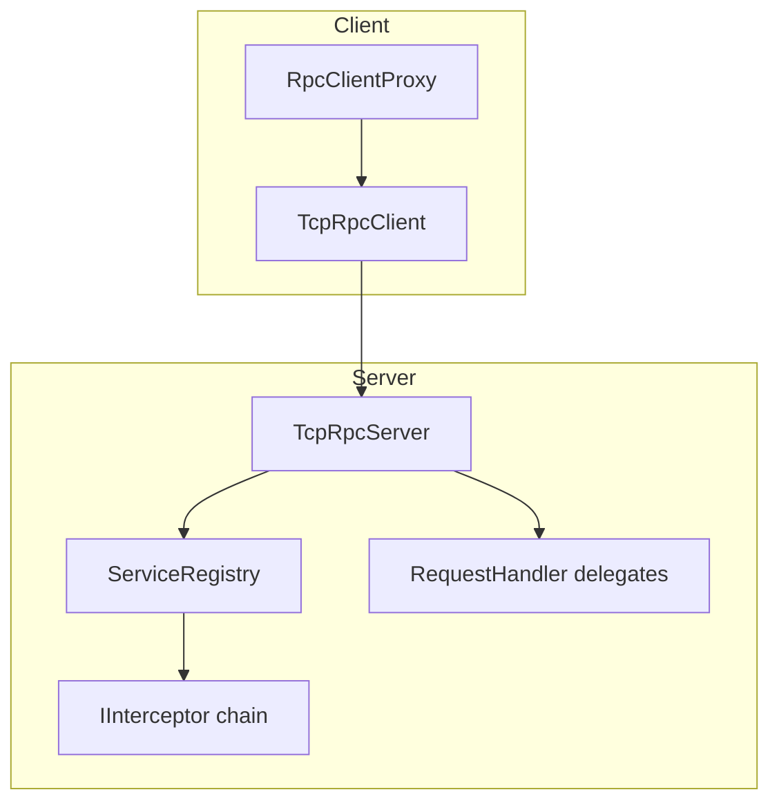
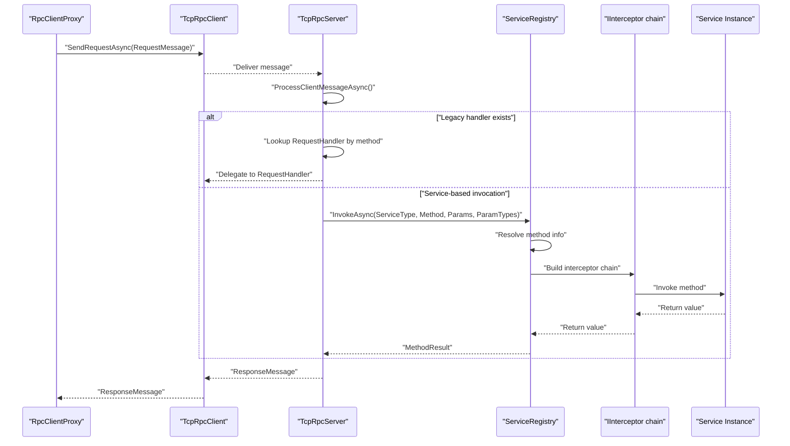
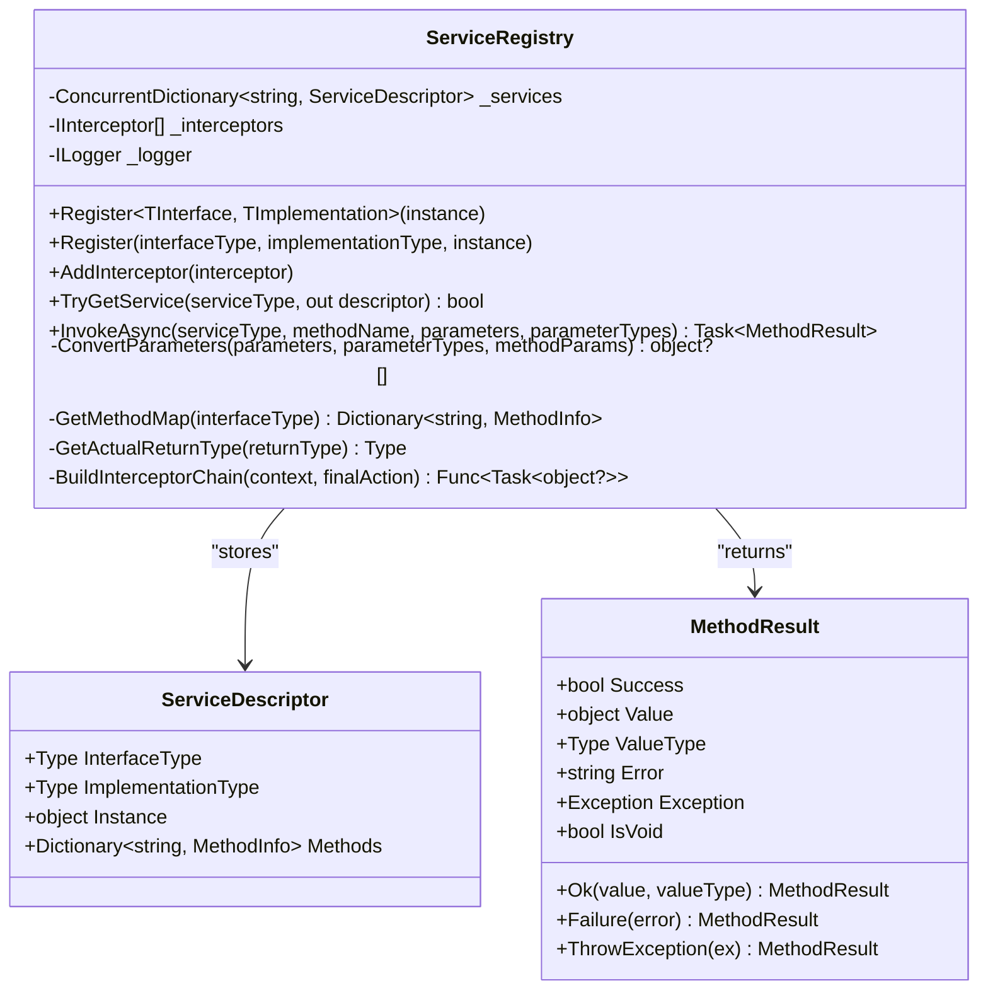
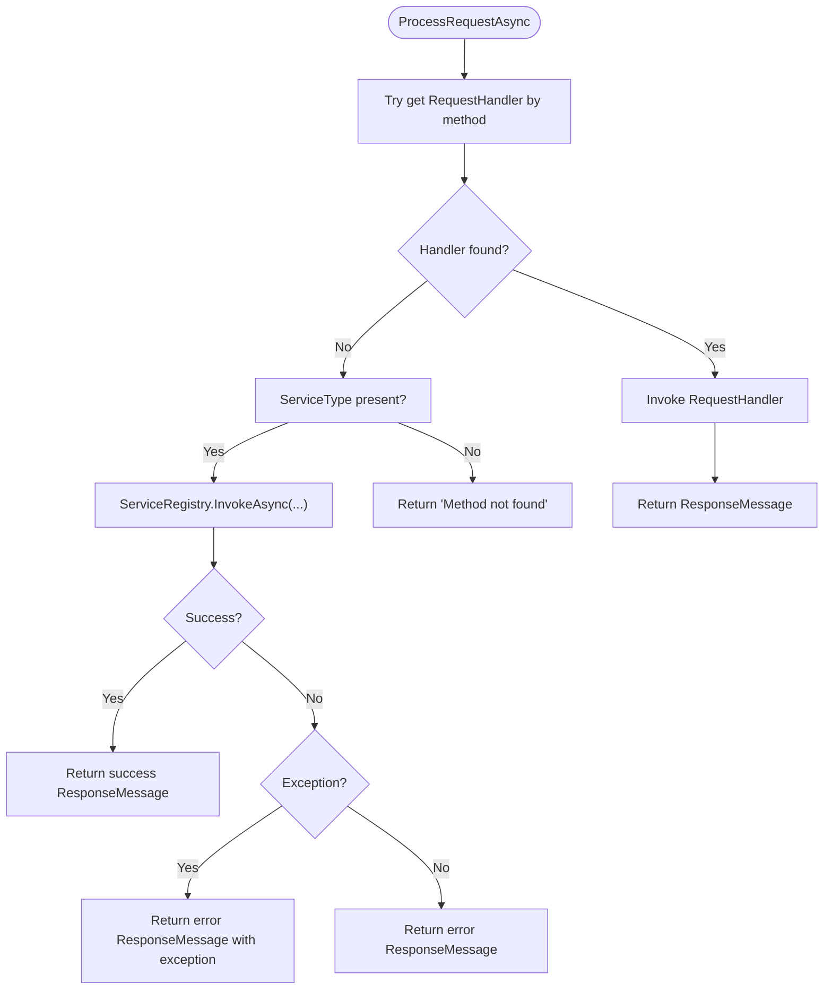
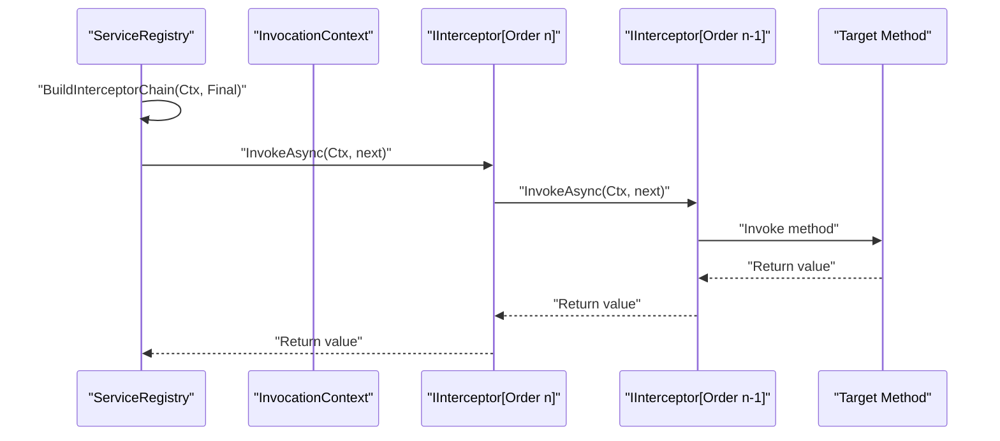
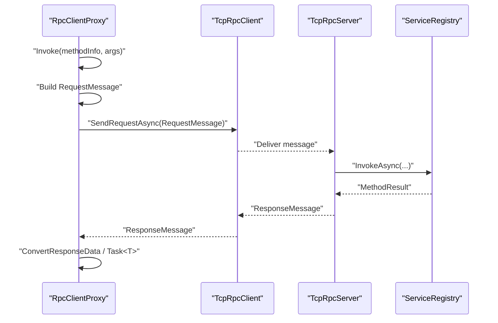
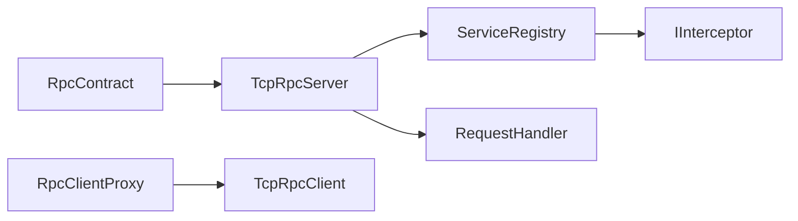

# Service Registration and Discovery

<cite>
**Referenced Files in This Document**
- [ServiceRegistry.cs](file://TcpRpc/TcpRpc/Server/ServiceRegistry.cs)
- [TcpRpcServer.cs](file://TcpRpc/TcpRpc/Server/TcpRpcServer.cs)
- [IInterceptor.cs](file://TcpRpc/TcpRpc/Server/IInterceptor.cs)
- [RequestHandler.cs](file://TcpRpc/TcpRpc/Server/RequestHandler.cs)
- [RpcServerState.cs](file://TcpRpc/TcpRpc/Server/RpcServerState.cs)
- [Program.cs](file://TcpRpc.Server/Program.cs)
- [RpcContract.cs](file://TcpRpc.Server/RpcContract.cs)
- [LoggingInterceptor.cs](file://TcpRpc.Server/LoggingInterceptor.cs)
- [RpcClientProxy.cs](file://TcpRpc/TcpRpc/Client/RpcClientProxy.cs)
- [TcpRpcClient.cs](file://TcpRpc/TcpRpc/Client/TcpRpcClient.cs)
</cite>

## Table of Contents
1. [Introduction](#introduction)
2. [Project Structure](#project-structure)
3. [Core Components](#core-components)
4. [Architecture Overview](#architecture-overview)
5. [Detailed Component Analysis](#detailed-component-analysis)
6. [Dependency Analysis](#dependency-analysis)
7. [Performance Considerations](#performance-considerations)
8. [Troubleshooting Guide](#troubleshooting-guide)
9. [Conclusion](#conclusion)

## Introduction
This document explains the service registration and discovery system used by the TCP RPC server. It covers how services are registered dynamically, how method resolution and parameter type matching work, and how the new service-based invocation integrates with the existing RequestHandler delegate pattern. It also documents the service registration APIs, service discovery mechanisms, method invocation workflows, lifecycle management, thread-safety characteristics, and error handling strategies.

## Project Structure
The service registration and discovery system spans several components:
- Server-side orchestration and message processing
- Service registry and method invocation pipeline
- Interceptor chain for cross-cutting concerns
- Client-side proxy that invokes remote services

**Diagram sources**
- [TcpRpcServer.cs:550-614](file://TcpRpc/TcpRpc/Server/TcpRpcServer.cs#L550-L614)
- [ServiceRegistry.cs:72-138](file://TcpRpc/TcpRpc/Server/ServiceRegistry.cs#L72-L138)
- [IInterceptor.cs:6-63](file://TcpRpc/TcpRpc/Server/IInterceptor.cs#L6-L63)
- [RequestHandler.cs:1-5](file://TcpRpc/TcpRpc/Server/RequestHandler.cs#L1-L5)
- [RpcClientProxy.cs:11-36](file://TcpRpc/TcpRpc/Client/RpcClientProxy.cs#L11-L36)

**Section sources**
- [TcpRpcServer.cs:15-74](file://TcpRpc/TcpRpc/Server/TcpRpcServer.cs#L15-L74)
- [ServiceRegistry.cs:10-49](file://TcpRpc/TcpRpc/Server/ServiceRegistry.cs#L10-L49)

## Core Components
- ServiceRegistry: Central registry for service descriptors, method indexing, parameter conversion, and invocation with interceptors.
- TcpRpcServer: Hosts the ServiceRegistry, exposes registration APIs, and routes incoming requests to either legacy RequestHandler delegates or the new service-based mechanism.
- IInterceptor and InvocationContext: Enable AOP-style interception around method invocations.
- RequestHandler: Legacy delegate pattern for handling specific methods by name.
- RpcClientProxy and TcpRpcClient: Client-side components that serialize requests and invoke remote services.

Key responsibilities:
- Dynamic registration via generic Register<TInterface, TImplementation> and a convenience wrapper RegisterService<TInterface, TImplementation>.
- Method discovery by interface name and method name.
- Parameter type matching and conversion.
- Asynchronous method handling and return type unwrapping.
- Interceptor chain construction and ordering.
- Graceful error propagation to clients.

**Section sources**
- [ServiceRegistry.cs:24-49](file://TcpRpc/TcpRpc/Server/ServiceRegistry.cs#L24-L49)
- [TcpRpcServer.cs:80-83](file://TcpRpc/TcpRpc/Server/TcpRpcServer.cs#L80-L83)
- [IInterceptor.cs:6-63](file://TcpRpc/TcpRpc/Server/IInterceptor.cs#L6-L63)
- [RequestHandler.cs:1-5](file://TcpRpc/TcpRpc/Server/RequestHandler.cs#L1-L5)

## Architecture Overview
The server accepts messages, checks authentication, and dispatches to either:
- A legacy RequestHandler delegate keyed by method name, or
- The ServiceRegistry for service-based invocation using interface and method names.

Service invocation resolves the service descriptor, matches the method by name, converts parameters, builds an interceptor chain, executes the method, and returns a structured result.

**Diagram sources**
- [TcpRpcServer.cs:549-614](file://TcpRpc/TcpRpc/Server/TcpRpcServer.cs#L549-L614)
- [ServiceRegistry.cs:72-138](file://TcpRpc/TcpRpc/Server/ServiceRegistry.cs#L72-L138)
- [IInterceptor.cs:16-17](file://TcpRpc/TcpRpc/Server/IInterceptor.cs#L16-L17)
- [RpcClientProxy.cs:115-126](file://TcpRpc/TcpRpc/Client/RpcClientProxy.cs#L115-L126)

## Detailed Component Analysis

### ServiceRegistry: Dynamic Registration, Method Resolution, and Invocation
- Registration APIs:
  - Generic Register<TInterface, TImplementation>(instance) registers a typed service instance under its interface type.
  - Overload Register(Type interfaceType, Type implementationType, object instance) supports runtime registration scenarios.
- Method resolution:
  - On registration, the registry caches a dictionary of method names to MethodInfo for fast lookup.
  - Case-insensitive matching is used for method names.
- Parameter type matching and conversion:
  - Converts provided parameters to expected parameter types using Convert.ChangeType when assignable or compatible.
  - Preserves nulls and handles missing parameters gracefully.
- Return type handling:
  - Unwraps Task<T> to T and Task (void) to void for consistent return type reporting.
- Invocation pipeline:
  - Builds an interceptor chain from configured IInterceptor instances ordered by Order.
  - Executes the target method via reflection and awaits Task-returning methods.
  - Wraps results in MethodResult with success/error/exception semantics.
- Thread safety:
  - Uses ConcurrentDictionary for service storage and a regular list for interceptors (sorted once per addition).
  - Access to interceptors is guarded by a lock-free sort; concurrent additions may interleave but order is preserved after sorting.

**Diagram sources**
- [ServiceRegistry.cs:10-272](file://TcpRpc/TcpRpc/Server/ServiceRegistry.cs#L10-L272)

**Section sources**
- [ServiceRegistry.cs:24-49](file://TcpRpc/TcpRpc/Server/ServiceRegistry.cs#L24-L49)
- [ServiceRegistry.cs:72-138](file://TcpRpc/TcpRpc/Server/ServiceRegistry.cs#L72-L138)
- [ServiceRegistry.cs:173-208](file://TcpRpc/TcpRpc/Server/ServiceRegistry.cs#L173-L208)
- [ServiceRegistry.cs:226-232](file://TcpRpc/TcpRpc/Server/ServiceRegistry.cs#L226-L232)
- [ServiceRegistry.cs:237-271](file://TcpRpc/TcpRpc/Server/ServiceRegistry.cs#L237-L271)

### TcpRpcServer: Registration API and Request Routing
- Registration API:
  - RegisterService<TInterface, TImplementation>(instance) delegates to ServiceRegistry.Register.
- Request routing:
  - First checks for legacy RequestHandler delegates keyed by method name.
  - Falls back to ServiceRegistry.InvokeAsync when ServiceType is present.
  - Returns structured ResponseMessage with success flag, data, type metadata, or error details.
- State management:
  - RpcServerState tracks lifecycle transitions safely.
  - Uses locks and volatile state for thread-safe operations.

**Diagram sources**
- [TcpRpcServer.cs:549-614](file://TcpRpc/TcpRpc/Server/TcpRpcServer.cs#L549-L614)

**Section sources**
- [TcpRpcServer.cs:80-83](file://TcpRpc/TcpRpc/Server/TcpRpcServer.cs#L80-L83)
- [TcpRpcServer.cs:549-614](file://TcpRpc/TcpRpc/Server/TcpRpcServer.cs#L549-L614)
- [RpcServerState.cs:3-10](file://TcpRpc/TcpRpc/Server/RpcServerState.cs#L3-L10)

### Interceptor Chain and InvocationContext
- IInterceptor defines Order and InvokeAsync(context, next) to wrap method execution.
- InvocationContext carries service type, target instance, method name, parameters, parameter types, and return type.
- ServiceRegistry.BuildInterceptorChain constructs a composed delegate that runs interceptors in order.

**Diagram sources**
- [ServiceRegistry.cs:158-171](file://TcpRpc/TcpRpc/Server/ServiceRegistry.cs#L158-L171)
- [IInterceptor.cs:6-63](file://TcpRpc/TcpRpc/Server/IInterceptor.cs#L6-L63)

**Section sources**
- [IInterceptor.cs:6-63](file://TcpRpc/TcpRpc/Server/IInterceptor.cs#L6-L63)
- [ServiceRegistry.cs:158-171](file://TcpRpc/TcpRpc/Server/ServiceRegistry.cs#L158-L171)

### Legacy RequestHandler Delegate Pattern
- RequestHandler(RequestMessage) enables registering legacy handlers keyed by method name.
- TcpRpcServer.ProcessRequestAsync checks for a matching handler before delegating to ServiceRegistry.
- This allows incremental migration from legacy handlers to the new service-based model.

**Section sources**
- [RequestHandler.cs:1-5](file://TcpRpc/TcpRpc/Server/RequestHandler.cs#L1-L5)
- [TcpRpcServer.cs:553-557](file://TcpRpc/TcpRpc/Server/TcpRpcServer.cs#L553-L557)

### Client-Side Invocation Workflow
- RpcClientProxy creates a typed proxy that serializes calls into RequestMessage with ServiceType, Method, Parameters, and ParameterTypes.
- TcpRpcClient sends the serialized payload and waits for a ResponseMessage.
- RpcClientProxy deserializes results, handles exceptions, and converts Task<T> return types.

**Diagram sources**
- [RpcClientProxy.cs:38-113](file://TcpRpc/TcpRpc/Client/RpcClientProxy.cs#L38-L113)
- [RpcClientProxy.cs:115-126](file://TcpRpc/TcpRpc/Client/RpcClientProxy.cs#L115-L126)
- [TcpRpcClient.cs:324-407](file://TcpRpc/TcpRpc/Client/TcpRpcClient.cs#L324-L407)
- [TcpRpcServer.cs:549-614](file://TcpRpc/TcpRpc/Server/TcpRpcServer.cs#L549-L614)
- [ServiceRegistry.cs:72-138](file://TcpRpc/TcpRpc/Server/ServiceRegistry.cs#L72-L138)

**Section sources**
- [RpcClientProxy.cs:11-36](file://TcpRpc/TcpRpc/Client/RpcClientProxy.cs#L11-L36)
- [RpcClientProxy.cs:38-113](file://TcpRpc/TcpRpc/Client/RpcClientProxy.cs#L38-L113)
- [RpcClientProxy.cs:115-126](file://TcpRpc/TcpRpc/Client/RpcClientProxy.cs#L115-L126)
- [TcpRpcClient.cs:324-407](file://TcpRpc/TcpRpc/Client/TcpRpcClient.cs#L324-L407)

### Example: Registering Business Services and Using Interceptors
- Server startup demonstrates registering a business service and adding a logging interceptor.
- The RpcContract service implements multiple synchronous and asynchronous methods, showcasing supported signatures.

**Section sources**
- [Program.cs:44-48](file://TcpRpc.Server/Program.cs#L44-L48)
- [RpcContract.cs:10-83](file://TcpRpc.Server/RpcContract.cs#L10-L83)
- [LoggingInterceptor.cs:8-41](file://TcpRpc.Server/LoggingInterceptor.cs#L8-L41)

## Dependency Analysis
- TcpRpcServer depends on ServiceRegistry for service-based invocation and optionally on legacy RequestHandler delegates.
- ServiceRegistry depends on IInterceptor implementations for cross-cutting concerns.
- RpcClientProxy depends on TcpRpcClient for network transport and serialization.
- RpcContract is an example service implementation registered via TcpRpcServer.RegisterService.

**Diagram sources**
- [TcpRpcServer.cs:40-83](file://TcpRpc/TcpRpc/Server/TcpRpcServer.cs#L40-L83)
- [ServiceRegistry.cs:10-49](file://TcpRpc/TcpRpc/Server/ServiceRegistry.cs#L10-L49)
- [IInterceptor.cs:6-63](file://TcpRpc/TcpRpc/Server/IInterceptor.cs#L6-L63)
- [RpcClientProxy.cs:11-36](file://TcpRpc/TcpRpc/Client/RpcClientProxy.cs#L11-L36)
- [RpcContract.cs:10-83](file://TcpRpc.Server/RpcContract.cs#L10-L83)

**Section sources**
- [TcpRpcServer.cs:40-83](file://TcpRpc/TcpRpc/Server/TcpRpcServer.cs#L40-L83)
- [ServiceRegistry.cs:10-49](file://TcpRpc/TcpRpc/Server/ServiceRegistry.cs#L10-L49)
- [IInterceptor.cs:6-63](file://TcpRpc/TcpRpc/Server/IInterceptor.cs#L6-L63)
- [RpcClientProxy.cs:11-36](file://TcpRpc/TcpRpc/Client/RpcClientProxy.cs#L11-L36)
- [RpcContract.cs:10-83](file://TcpRpc.Server/RpcContract.cs#L10-L83)

## Performance Considerations
- Service lookup:
  - ServiceRegistry stores services in a ConcurrentDictionary keyed by interface FullName, enabling O(1) average-time lookups.
  - Method resolution caches MethodInfo dictionaries per interface, minimizing reflection overhead on subsequent calls.
- Parameter conversion:
  - ConvertParameters performs minimal conversions and falls back gracefully, avoiding expensive reflection for parameter binding.
- Interceptor chain:
  - Chain composition occurs once per invocation; keep the number of interceptors reasonable to avoid deep call stacks.
- Threading:
  - ConcurrentDictionary ensures thread-safe concurrent registrations and lookups.
  - Interceptor list is sorted after insertion; consider batching registrations to minimize sorting overhead.
- Asynchronous handling:
  - Task-returning methods are awaited and unwrapped efficiently; avoid unnecessary wrapping of already-completed tasks.

[No sources needed since this section provides general guidance]

## Troubleshooting Guide
Common issues and diagnostics:
- Service not found:
  - Verify the service was registered with the correct interface FullName and that the server is running.
- Method not found:
  - Ensure the method name matches the interface definition (case-insensitive) and that the service descriptor was built from the intended interface.
- Parameter type mismatch:
  - Confirm parameterTypes align with the interface method signature; the system attempts Convert.ChangeType but may fall back to original values.
- Exceptions during invocation:
  - Inspect MethodResult.Exception and error messages; exceptions are logged and propagated to the client as RpcException.
- Legacy handler conflicts:
  - If a RequestHandler exists for a method name, it takes precedence over service-based invocation.
- Authentication and tokens:
  - Ensure clients send valid tokens when required; otherwise, requests are rejected before reaching service invocation.

**Section sources**
- [ServiceRegistry.cs:74-82](file://TcpRpc/TcpRpc/Server/ServiceRegistry.cs#L74-L82)
- [ServiceRegistry.cs:128-137](file://TcpRpc/TcpRpc/Server/ServiceRegistry.cs#L128-L137)
- [TcpRpcServer.cs:549-614](file://TcpRpc/TcpRpc/Server/TcpRpcServer.cs#L549-L614)

## Conclusion
The service registration and discovery system provides a robust, extensible foundation for RPC service invocation. It supports dynamic registration, efficient method resolution, flexible parameter conversion, and a powerful interceptor chain for cross-cutting concerns. The integration with legacy RequestHandler delegates enables gradual migration toward the new service-based approach. Proper use of the provided APIs, combined with careful error handling and performance-aware design, yields a scalable and maintainable RPC infrastructure.