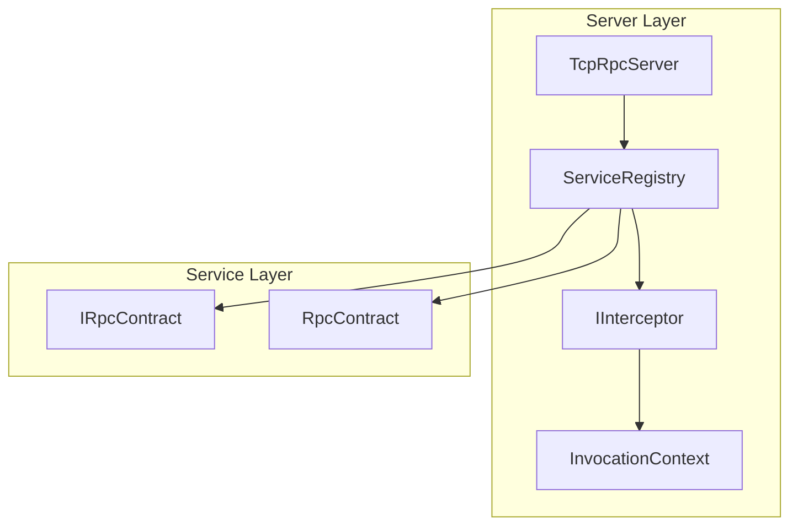
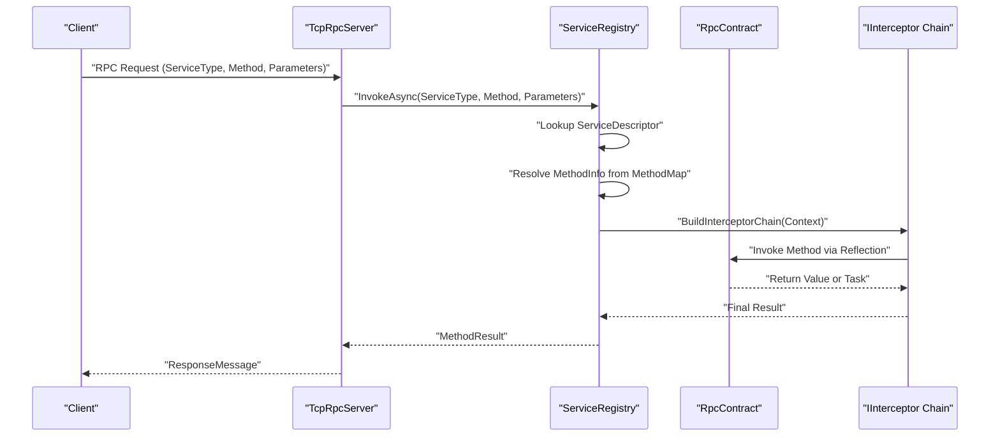
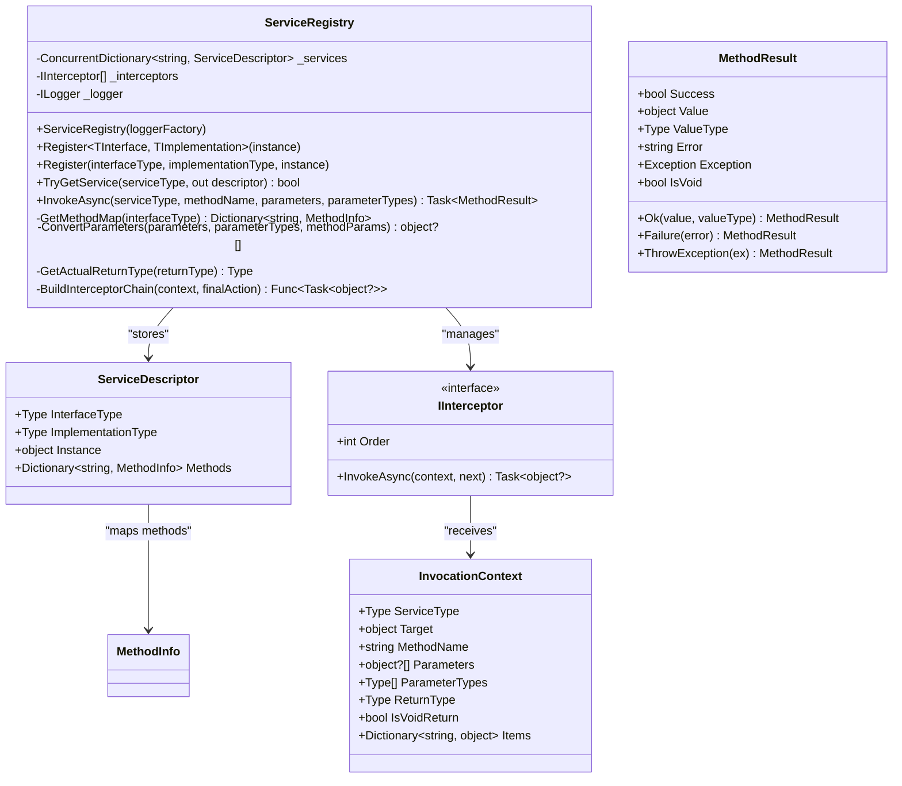
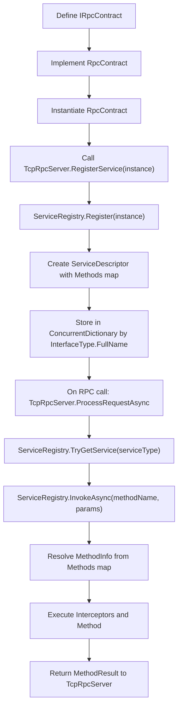
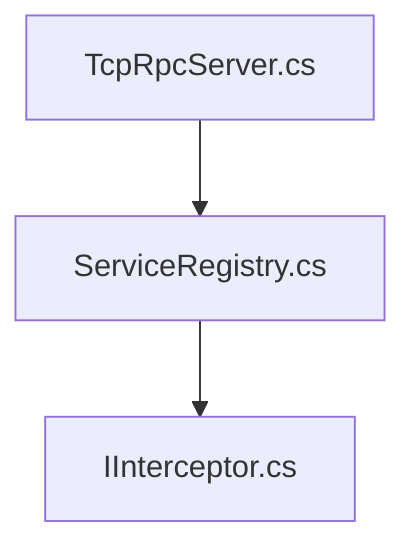

# Service Registry Core

<cite>
**Referenced Files in This Document**
- [ServiceRegistry.cs](file://TcpRpc/Server/ServiceRegistry.cs)
- [IInterceptor.cs](file://TcpRpc/Server/IInterceptor.cs)
- [TcpRpcServer.cs](file://TcpRpc/Server/TcpRpcServer.cs)
- [RpcContract.cs](file://TcpRpc.Server/RpcContract.cs)
- [IRpcContract.cs](file://TcpRpc.Contract/IRpcContract.cs)
- [Program.cs](file://TcpRpc.Server/Program.cs)
- [LoggingInterceptor.cs](file://TcpRpc.Server/LoggingInterceptor.cs)
</cite>

## Table of Contents
1. [Introduction](#introduction)
2. [Project Structure](#project-structure)
3. [Core Components](#core-components)
4. [Architecture Overview](#architecture-overview)
5. [Detailed Component Analysis](#detailed-component-analysis)
6. [Dependency Analysis](#dependency-analysis)
7. [Performance Considerations](#performance-considerations)
8. [Troubleshooting Guide](#troubleshooting-guide)
9. [Conclusion](#conclusion)

## Introduction
This document provides comprehensive documentation for the ServiceRegistry core implementation in the TcpRpc server framework. It explains the concurrent dictionary-based service storage mechanism, service registration APIs (generic and type-based), the ServiceDescriptor structure, service discovery through TryGetService, and the internal method mapping system. It also covers service lifecycle management, thread safety aspects using ConcurrentDictionary, performance considerations for service lookup operations, error handling for invalid service registrations, and the complete service registration workflow from interface definition to runtime method resolution.

## Project Structure
The ServiceRegistry resides within the TcpRpc.Server namespace and integrates with the TcpRpcServer to provide runtime method invocation capabilities. The key components include:
- ServiceRegistry: central registry for services and method dispatch
- ServiceDescriptor: encapsulates service metadata and method mapping
- IInterceptor and InvocationContext: support for AOP-style interception
- TcpRpcServer: orchestrates server lifecycle and delegates RPC calls to ServiceRegistry
- Example service implementation (RpcContract) and interface (IRpcContract) for demonstration

**Diagram sources**
- [TcpRpcServer.cs:37-83](file://TcpRpc/Server/TcpRpcServer.cs#L37-L83)
- [ServiceRegistry.cs:10-221](file://TcpRpc/Server/ServiceRegistry.cs#L10-L221)
- [IInterceptor.cs:6-63](file://TcpRpc/Server/IInterceptor.cs#L6-L63)
- [IRpcContract.cs:6-44](file://TcpRpc.Contract/IRpcContract.cs#L6-L44)
- [RpcContract.cs:10-83](file://TcpRpc.Server/RpcContract.cs#L10-L83)

**Section sources**
- [TcpRpcServer.cs:37-83](file://TcpRpc/Server/TcpRpcServer.cs#L37-L83)
- [ServiceRegistry.cs:10-221](file://TcpRpc/Server/ServiceRegistry.cs#L10-L221)
- [IInterceptor.cs:6-63](file://TcpRpc/Server/IInterceptor.cs#L6-L63)
- [IRpcContract.cs:6-44](file://TcpRpc.Contract/IRpcContract.cs#L6-L44)
- [RpcContract.cs:10-83](file://TcpRpc.Server/RpcContract.cs#L10-L83)

## Core Components
This section documents the primary building blocks of the service registry system.

- ServiceRegistry: Manages service registration, method mapping, and invocation with thread-safe operations.
- ServiceDescriptor: Holds service metadata including interface type, implementation type, instance, and method map.
- MethodResult: Encapsulates the outcome of method invocations, including success/failure, values, exceptions, and return types.
- IInterceptor and InvocationContext: Enable AOP-style interception around method calls with ordered execution.

Key responsibilities:
- Registration: Generic and type-based registration APIs populate the internal ConcurrentDictionary with ServiceDescriptor entries.
- Discovery: TryGetService retrieves descriptors by service type name.
- Invocation: InvokeAsync resolves methods, converts parameters, executes interceptors, and handles asynchronous results.
- Interception: BuildInterceptorChain composes interceptor chains for ordered execution.

**Section sources**
- [ServiceRegistry.cs:10-271](file://TcpRpc/Server/ServiceRegistry.cs#L10-L271)
- [IInterceptor.cs:6-63](file://TcpRpc/Server/IInterceptor.cs#L6-L63)

## Architecture Overview
The ServiceRegistry architecture centers on a concurrent service store and reflection-based method resolution. The TcpRpcServer delegates incoming RPC requests to ServiceRegistry, which performs method lookup and invocation through reflection, with optional interceptor chains.

**Diagram sources**
- [TcpRpcServer.cs:549-614](file://TcpRpc/Server/TcpRpcServer.cs#L549-L614)
- [ServiceRegistry.cs:72-138](file://TcpRpc/Server/ServiceRegistry.cs#L72-L138)
- [IInterceptor.cs:16-16](file://TcpRpc/Server/IInterceptor.cs#L16-L16)
- [RpcContract.cs:10-83](file://TcpRpc.Server/RpcContract.cs#L10-L83)

## Detailed Component Analysis

### ServiceRegistry
The ServiceRegistry class maintains a concurrent dictionary of services keyed by interface full name. It provides:
- Generic registration: Register<TInterface, TImplementation>(instance)
- Type-based registration: Register(Type interfaceType, Type implementationType, object instance)
- Service discovery: TryGetService(string serviceType, out ServiceDescriptor)
- Invocation pipeline: InvokeAsync(...) with parameter conversion, method resolution, and interceptor execution

Thread safety:
- Uses ConcurrentDictionary for service storage to ensure safe concurrent access.
- Interceptor list is maintained as a sorted list to preserve execution order.

Method mapping:
- On registration, builds a case-insensitive dictionary of method names to MethodInfo for fast lookup during invocation.

Error handling:
- Returns MethodResult.Failure for missing services or methods.
- Catches TargetInvocationException and wraps inner exceptions appropriately.
- Logs errors via ILogger.

Lifecycle management:
- Service instances are stored as object references; the registry does not manage disposal.
- Interceptors can be added dynamically via AddInterceptor.

**Section sources**
- [ServiceRegistry.cs:10-221](file://TcpRpc/Server/ServiceRegistry.cs#L10-L221)

#### Class Diagram

**Diagram sources**
- [ServiceRegistry.cs:10-271](file://TcpRpc/Server/ServiceRegistry.cs#L10-L271)
- [IInterceptor.cs:6-63](file://TcpRpc/Server/IInterceptor.cs#L6-L63)

### ServiceDescriptor
ServiceDescriptor encapsulates the metadata required for runtime method resolution:
- InterfaceType: The service interface type used as the registry key.
- ImplementationType: The concrete implementation type.
- Instance: The actual service instance registered.
- Methods: A dictionary mapping method names to MethodInfo for fast lookup.

Construction occurs during registration, where GetMethodMap scans the interface for methods and stores them in a case-insensitive map.

**Section sources**
- [ServiceRegistry.cs:226-232](file://TcpRpc/Server/ServiceRegistry.cs#L226-L232)
- [ServiceRegistry.cs:210-220](file://TcpRpc/Server/ServiceRegistry.cs#L210-L220)

### MethodResult
MethodResult represents the outcome of an invocation:
- Success: Indicates whether the operation succeeded.
- Value: The returned value or null on failure.
- ValueType: The actual return type (unwrapped Task<T>).
- Error: Human-readable error message for failures.
- Exception: Captured exception for thrown exceptions.
- IsVoid: True when the return type is void or Task.

Static factory methods provide convenient creation for success, failure, and exception scenarios.

**Section sources**
- [ServiceRegistry.cs:237-271](file://TcpRpc/Server/ServiceRegistry.cs#L237-L271)

### Interceptor System
The interceptor system enables cross-cutting concerns around method invocation:
- IInterceptor defines Order and InvokeAsync(context, next).
- InvocationContext carries service type, target instance, method name, parameters, parameter types, and return type.
- BuildInterceptorChain constructs a chain from last to first to preserve order.

Example logging interceptor demonstrates timing and error logging around method execution.

**Section sources**
- [IInterceptor.cs:6-63](file://TcpRpc/Server/IInterceptor.cs#L6-L63)
- [ServiceRegistry.cs:158-171](file://TcpRpc/Server/ServiceRegistry.cs#L158-L171)
- [LoggingInterceptor.cs:8-41](file://TcpRpc.Server/LoggingInterceptor.cs#L8-L41)

### Service Registration Workflow
The registration workflow spans interface definition, implementation creation, and server integration:

1. Define the service interface (IRpcContract) with various method signatures.
2. Implement the interface (RpcContract) with concrete logic.
3. Instantiate the implementation and register it via TcpRpcServer.RegisterService<TInterface, TImplementation>(instance).
4. Internally, ServiceRegistry.Register<TInterface, TImplementation>(instance) resolves types and creates a ServiceDescriptor with method mapping.
5. On invocation, TcpRpcServer.ProcessRequestAsync delegates to ServiceRegistry.InvokeAsync, which resolves the service and method, applies interceptors, and executes the method.

**Diagram sources**
- [IRpcContract.cs:6-44](file://TcpRpc.Contract/IRpcContract.cs#L6-L44)
- [RpcContract.cs:10-83](file://TcpRpc.Server/RpcContract.cs#L10-L83)
- [TcpRpcServer.cs:76-83](file://TcpRpc/Server/TcpRpcServer.cs#L76-L83)
- [ServiceRegistry.cs:24-49](file://TcpRpc/Server/ServiceRegistry.cs#L24-L49)
- [ServiceRegistry.cs:64-138](file://TcpRpc/Server/ServiceRegistry.cs#L64-L138)

**Section sources**
- [IRpcContract.cs:6-44](file://TcpRpc.Contract/IRpcContract.cs#L6-L44)
- [RpcContract.cs:10-83](file://TcpRpc.Server/RpcContract.cs#L10-L83)
- [TcpRpcServer.cs:76-83](file://TcpRpc/Server/TcpRpcServer.cs#L76-L83)
- [ServiceRegistry.cs:24-49](file://TcpRpc/Server/ServiceRegistry.cs#L24-L49)
- [ServiceRegistry.cs:64-138](file://TcpRpc/Server/ServiceRegistry.cs#L64-L138)

## Dependency Analysis
The ServiceRegistry depends on:
- System.Collections.Concurrent for thread-safe storage.
- System.Reflection for method mapping and invocation.
- Microsoft.Extensions.Logging for diagnostic logging.
- IInterceptor for AOP-style interception.

TcpRpcServer integrates ServiceRegistry as a public property and delegates RPC processing to it.

**Diagram sources**
- [ServiceRegistry.cs:1-3](file://TcpRpc/Server/ServiceRegistry.cs#L1-L3)
- [IInterceptor.cs:1-2](file://TcpRpc/Server/IInterceptor.cs#L1-L2)
- [TcpRpcServer.cs:1-8](file://TcpRpc/Server/TcpRpcServer.cs#L1-L8)

**Section sources**
- [ServiceRegistry.cs:1-3](file://TcpRpc/Server/ServiceRegistry.cs#L1-L3)
- [IInterceptor.cs:1-2](file://TcpRpc/Server/IInterceptor.cs#L1-L2)
- [TcpRpcServer.cs:1-8](file://TcpRpc/Server/TcpRpcServer.cs#L1-L8)

## Performance Considerations
- ConcurrentDictionary usage ensures O(1) average-time service lookup by type name.
- Method map construction occurs once per registration and uses a case-insensitive dictionary for O(1) method resolution.
- Reflection overhead is minimized by caching MethodInfo in the ServiceDescriptor.
- Parameter conversion attempts to convert types when possible; otherwise falls back to original values.
- Asynchronous method handling unwraps Task<T> results and handles Task without return type.
- Interceptor chain composition is linear in the number of interceptors.

Optimization opportunities:
- Consider precomputing and caching method maps for frequently accessed interfaces.
- Evaluate using dynamic method compilation for hot paths if reflection overhead becomes significant.
- Monitor interceptor count impact on latency.

**Section sources**
- [ServiceRegistry.cs:12-12](file://TcpRpc/Server/ServiceRegistry.cs#L12-L12)
- [ServiceRegistry.cs:210-220](file://TcpRpc/Server/ServiceRegistry.cs#L210-L220)
- [ServiceRegistry.cs:173-208](file://TcpRpc/Server/ServiceRegistry.cs#L173-L208)
- [ServiceRegistry.cs:143-156](file://TcpRpc/Server/ServiceRegistry.cs#L143-L156)

## Troubleshooting Guide
Common issues and resolutions:
- Service not found: Ensure the service was registered with the correct interface type name. Verify that RegisterService<TInterface, TImplementation>(instance) was called and that the interface FullName matches the serviceType used in RPC requests.
- Method not found: Confirm the method name exists on the interface and is case-insensitive. Check that the interface methods are public and non-static.
- Parameter type mismatch: The registry attempts to convert parameters; if conversion fails, pass compatible types or adjust parameterTypes in the RPC request.
- Thrown exceptions: MethodResult.Exception captures the remote exception. Inspect RemoteExceptionType and stack traces for diagnostics.
- Logging: Enable debug logs to track registration and invocation events.

Operational checks:
- Verify TcpRpcServer initialization and ServiceRegistry availability.
- Confirm interceptor ordering if interception affects behavior.
- Validate that service instances remain alive for the duration of server operation.

**Section sources**
- [ServiceRegistry.cs:74-82](file://TcpRpc/Server/ServiceRegistry.cs#L74-L82)
- [ServiceRegistry.cs:128-137](file://TcpRpc/Server/ServiceRegistry.cs#L128-L137)
- [Program.cs:40-48](file://TcpRpc.Server/Program.cs#L40-L48)

## Conclusion
The ServiceRegistry provides a robust, thread-safe foundation for service registration and runtime method invocation in the TcpRpc server. Its concurrent dictionary-based storage, reflection-driven method mapping, and interceptor pipeline enable flexible and extensible service orchestration. By following the documented registration workflow and leveraging the provided APIs, developers can efficiently register business services, manage lifecycles, and handle errors with clear diagnostics.