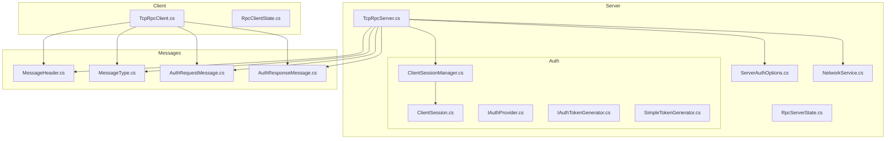
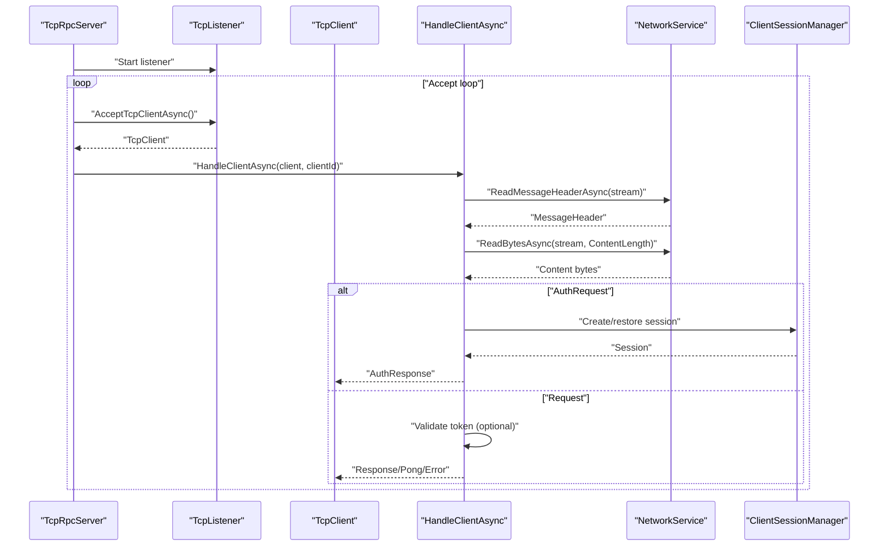
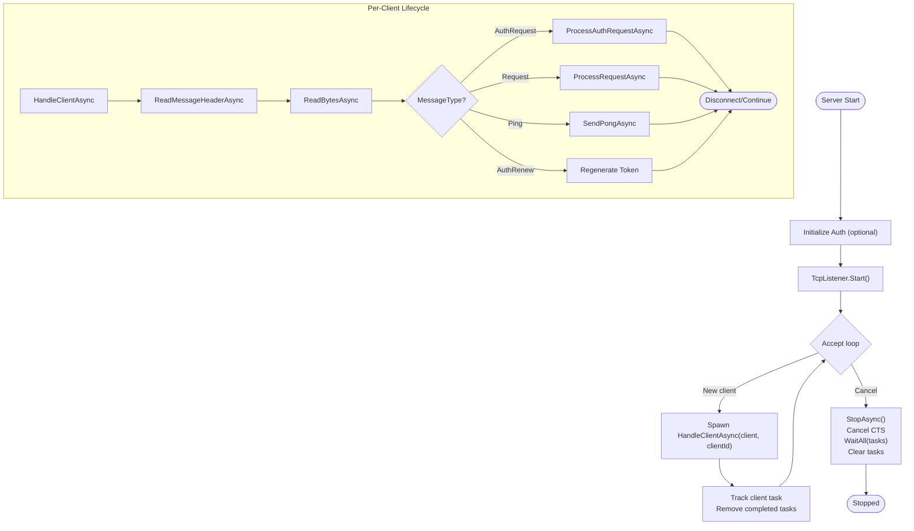
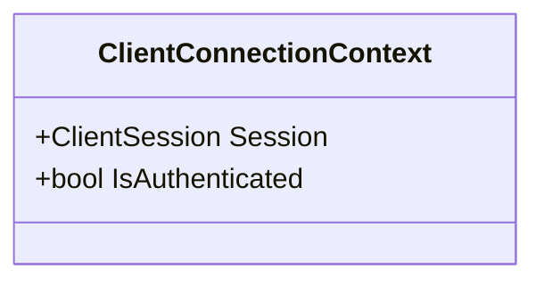
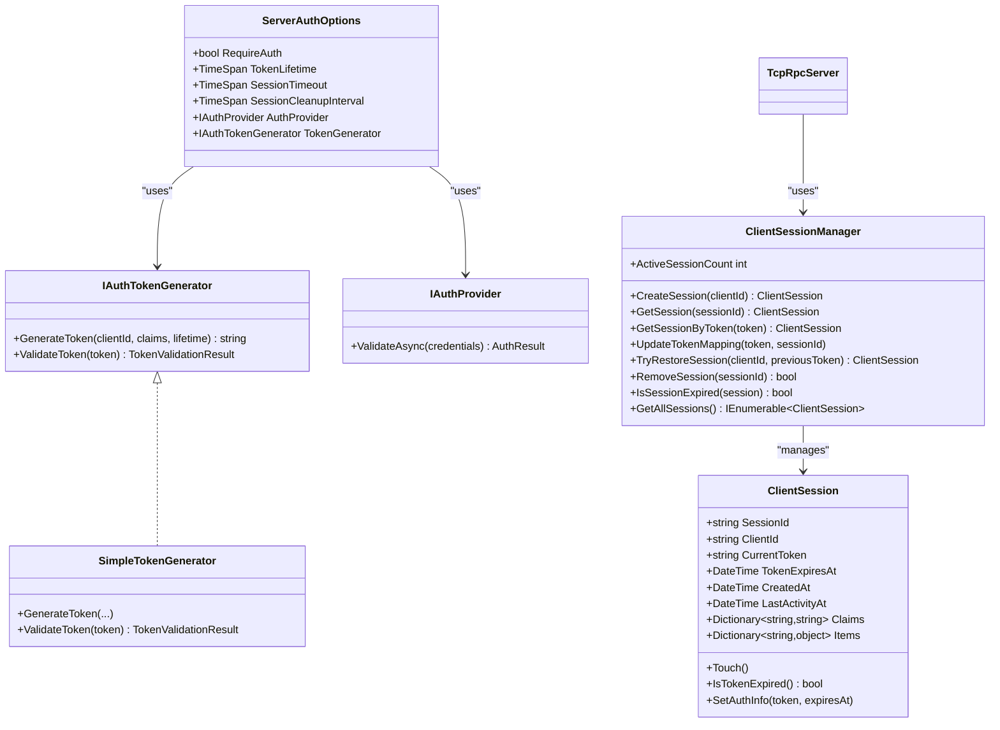
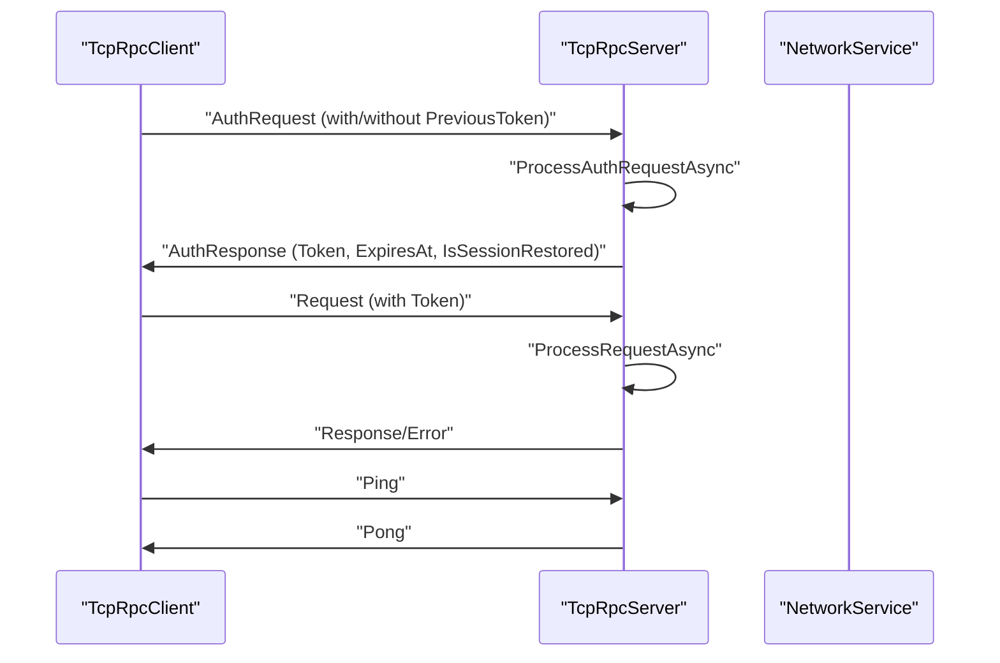
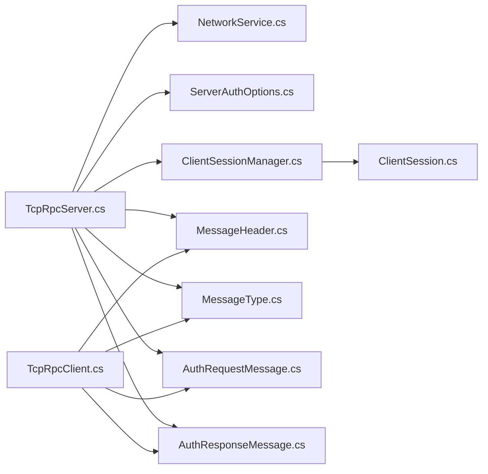

# Connection Handling and Client Management

<cite>
**Referenced Files in This Document**
- [TcpRpcServer.cs](file://TcpRpc/TcpRpc/Server/TcpRpcServer.cs)
- [ClientSession.cs](file://TcpRpc/TcpRpc/Server/Auth/ClientSession.cs)
- [ClientSessionManager.cs](file://TcpRpc/TcpRpc/Server/Auth/ClientSessionManager.cs)
- [RpcServerState.cs](file://TcpRpc/TcpRpc/Server/RpcServerState.cs)
- [NetworkService.cs](file://TcpRpc/TcpRpc/Network/NetworkService.cs)
- [ServerAuthOptions.cs](file://TcpRpc/TcpRpc/Server/ServerAuthOptions.cs)
- [IAuthProvider.cs](file://TcpRpc/TcpRpc/Server/Auth/IAuthProvider.cs)
- [IAuthTokenGenerator.cs](file://TcpRpc/TcpRpc/Server/Auth/IAuthTokenGenerator.cs)
- [SimpleTokenGenerator.cs](file://TcpRpc/TcpRpc/Server/Auth/SimpleTokenGenerator.cs)
- [MessageType.cs](file://TcpRpc/TcpRpc/Messages/MessageType.cs)
- [MessageHeader.cs](file://TcpRpc/TcpRpc/Messages/MessageHeader.cs)
- [AuthRequestMessage.cs](file://TcpRpc/TcpRpc/Messages/AuthRequestMessage.cs)
- [AuthResponseMessage.cs](file://TcpRpc/TcpRpc/Messages/AuthResponseMessage.cs)
- [TcpRpcClient.cs](file://TcpRpc/TcpRpc/Client/TcpRpcClient.cs)
- [RpcClientState.cs](file://TcpRpc/TcpRpc/Client/RpcClientState.cs)
</cite>

## Table of Contents
1. [Introduction](#introduction)
2. [Project Structure](#project-structure)
3. [Core Components](#core-components)
4. [Architecture Overview](#architecture-overview)
5. [Detailed Component Analysis](#detailed-component-analysis)
6. [Dependency Analysis](#dependency-analysis)
7. [Performance Considerations](#performance-considerations)
8. [Troubleshooting Guide](#troubleshooting-guide)
9. [Conclusion](#conclusion)

## Introduction
This document explains the TcpRpcServer connection handling and client management subsystem. It focuses on:
- How the server accepts TCP connections and spawns per-client handlers
- The HandleClientAsync method and its lifecycle management
- The ClientConnectionContext used to maintain per-client state
- The main server loop that continuously accepts connections
- Authentication and session management via ClientSession and ClientSessionManager
- Concurrency, timeouts, error recovery, and graceful disconnection

## Project Structure
The server-side connection handling resides primarily in the Server namespace, with supporting network utilities and authentication infrastructure.

**Diagram sources**
- [TcpRpcServer.cs:85-171](file://TcpRpc/TcpRpc/Server/TcpRpcServer.cs#L85-L171)
- [NetworkService.cs:10-28](file://TcpRpc/TcpRpc/Network/NetworkService.cs#L10-L28)
- [ServerAuthOptions.cs:8-39](file://TcpRpc/TcpRpc/Server/ServerAuthOptions.cs#L8-L39)
- [ClientSessionManager.cs:9-25](file://TcpRpc/TcpRpc/Server/Auth/ClientSessionManager.cs#L9-L25)
- [ClientSession.cs:6-66](file://TcpRpc/TcpRpc/Server/Auth/ClientSession.cs#L6-L66)
- [IAuthProvider.cs:32-40](file://TcpRpc/TcpRpc/Server/Auth/IAuthProvider.cs#L32-L40)
- [IAuthTokenGenerator.cs:37-54](file://TcpRpc/TcpRpc/Server/Auth/IAuthTokenGenerator.cs#L37-L54)
- [SimpleTokenGenerator.cs:11-36](file://TcpRpc/TcpRpc/Server/Auth/SimpleTokenGenerator.cs#L11-L36)
- [MessageHeader.cs:9-72](file://TcpRpc/TcpRpc/Messages/MessageHeader.cs#L9-L72)
- [MessageType.cs:3-12](file://TcpRpc/TcpRpc/Messages/MessageType.cs#L3-L12)
- [AuthRequestMessage.cs:6-27](file://TcpRpc/TcpRpc/Messages/AuthRequestMessage.cs#L6-L27)
- [AuthResponseMessage.cs:6-42](file://TcpRpc/TcpRpc/Messages/AuthResponseMessage.cs#L6-L42)
- [TcpRpcClient.cs:75-130](file://TcpRpc/TcpRpc/Client/TcpRpcClient.cs#L75-L130)

**Section sources**
- [TcpRpcServer.cs:85-171](file://TcpRpc/TcpRpc/Server/TcpRpcServer.cs#L85-L171)
- [NetworkService.cs:10-28](file://TcpRpc/TcpRpc/Network/NetworkService.cs#L10-L28)
- [ServerAuthOptions.cs:8-39](file://TcpRpc/TcpRpc/Server/ServerAuthOptions.cs#L8-L39)
- [ClientSessionManager.cs:9-25](file://TcpRpc/TcpRpc/Server/Auth/ClientSessionManager.cs#L9-L25)
- [ClientSession.cs:6-66](file://TcpRpc/TcpRpc/Server/Auth/ClientSession.cs#L6-L66)
- [IAuthProvider.cs:32-40](file://TcpRpc/TcpRpc/Server/Auth/IAuthProvider.cs#L32-L40)
- [IAuthTokenGenerator.cs:37-54](file://TcpRpc/TcpRpc/Server/Auth/IAuthTokenGenerator.cs#L37-L54)
- [SimpleTokenGenerator.cs:11-36](file://TcpRpc/TcpRpc/Server/Auth/SimpleTokenGenerator.cs#L11-L36)
- [MessageHeader.cs:9-72](file://TcpRpc/TcpRpc/Messages/MessageHeader.cs#L9-L72)
- [MessageType.cs:3-12](file://TcpRpc/TcpRpc/Messages/MessageType.cs#L3-L12)
- [AuthRequestMessage.cs:6-27](file://TcpRpc/TcpRpc/Messages/AuthRequestMessage.cs#L6-L27)
- [AuthResponseMessage.cs:6-42](file://TcpRpc/TcpRpc/Messages/AuthResponseMessage.cs#L6-L42)
- [TcpRpcClient.cs:75-130](file://TcpRpc/TcpRpc/Client/TcpRpcClient.cs#L75-L130)

## Core Components
- TcpRpcServer: Orchestrates startup, accepts connections, spawns per-client tasks, tracks active connections, and manages authentication/session lifecycle.
- ClientConnectionContext: Lightweight per-client state container holding authentication flag and optional session reference.
- ClientSession and ClientSessionManager: Manage session creation, token mapping, restoration, activity touch, and periodic cleanup.
- NetworkService: Provides streaming primitives for header and body reads/writes with defensive checks.
- ServerAuthOptions: Controls authentication enablement, token lifetime, session timeouts, and pluggable auth/token generator.
- Message types and headers: Define the wire protocol for requests, responses, auth, renew, ping/pong, and error signaling.

**Section sources**
- [TcpRpcServer.cs:226-313](file://TcpRpc/TcpRpc/Server/TcpRpcServer.cs#L226-L313)
- [TcpRpcServer.cs:374-378](file://TcpRpc/TcpRpc/Server/TcpRpcServer.cs#L374-L378)
- [ClientSession.cs:6-94](file://TcpRpc/TcpRpc/Server/Auth/ClientSession.cs#L6-L94)
- [ClientSessionManager.cs:9-187](file://TcpRpc/TcpRpc/Server/Auth/ClientSessionManager.cs#L9-L187)
- [NetworkService.cs:10-98](file://TcpRpc/TcpRpc/Network/NetworkService.cs#L10-L98)
- [ServerAuthOptions.cs:8-39](file://TcpRpc/TcpRpc/Server/ServerAuthOptions.cs#L8-L39)
- [MessageType.cs:3-12](file://TcpRpc/TcpRpc/Messages/MessageType.cs#L3-L12)
- [MessageHeader.cs:9-72](file://TcpRpc/TcpRpc/Messages/MessageHeader.cs#L9-L72)

## Architecture Overview
The server runs a continuous accept loop that spawns a dedicated async task per client. Each task handles message framing, authentication, and request processing until the client disconnects or cancellation occurs.

**Diagram sources**
- [TcpRpcServer.cs:134-146](file://TcpRpc/TcpRpc/Server/TcpRpcServer.cs#L134-L146)
- [TcpRpcServer.cs:226-313](file://TcpRpc/TcpRpc/Server/TcpRpcServer.cs#L226-L313)
- [NetworkService.cs:30-52](file://TcpRpc/TcpRpc/Network/NetworkService.cs#L30-L52)
- [ClientSessionManager.cs:30-83](file://TcpRpc/TcpRpc/Server/Auth/ClientSessionManager.cs#L30-L83)

## Detailed Component Analysis

### TcpRpcServer: Connection Accept Loop and Per-Client Handler
- Accept loop: Continuously calls AcceptTcpClientAsync inside a cancellation-aware loop. Each accepted client is assigned a monotonically increasing clientId and a task is created to handle it.
- Task lifecycle: Newly spawned client tasks are tracked in a list and periodically pruned of completed tasks. ActiveConnections property removes completed tasks before returning the count.
- HandleClientAsync:
  - Creates a ClientConnectionContext initialized with IsAuthenticated true when authentication is disabled, otherwise false.
  - Reads headers and bodies via NetworkService with defensive checks for invalid lengths.
  - Routes messages to ProcessClientMessageAsync which handles AuthRequest, Request, Ping, and AuthRenew.
  - On exceptions, logs errors but continues to process subsequent messages; finally logs disconnection.
- ReadBytesAsync: Implements safe reads with two thresholds—small buffers are read directly, large buffers are drained to avoid protocol corruption when oversized content is sent.
- ProcessClientMessageAsync:
  - AuthRequest: Delegates to ProcessAuthRequestAsync, updates context.IsAuthenticated on success.
  - Request: Enforces authentication and optional token validation, invokes service registry, updates session activity.
  - Ping: Responds with Pong.
  - AuthRenew: Regenerates token and updates session mapping.
- ProcessAuthRequestAsync:
  - Supports session restoration on reconnect using PreviousToken and ClientId.
  - Otherwise validates credentials via IAuthProvider, creates a session, generates token via IAuthTokenGenerator, and updates token-to-session mapping.
- StopAsync:
  - Stops accepting new connections, cancels all operations, waits for active client tasks with timeout, clears remaining tasks, and transitions to Stopped.

**Diagram sources**
- [TcpRpcServer.cs:85-171](file://TcpRpc/TcpRpc/Server/TcpRpcServer.cs#L85-L171)
- [TcpRpcServer.cs:134-146](file://TcpRpc/TcpRpc/Server/TcpRpcServer.cs#L134-L146)
- [TcpRpcServer.cs:226-313](file://TcpRpc/TcpRpc/Server/TcpRpcServer.cs#L226-L313)
- [TcpRpcServer.cs:380-451](file://TcpRpc/TcpRpc/Server/TcpRpcServer.cs#L380-L451)
- [TcpRpcServer.cs:453-547](file://TcpRpc/TcpRpc/Server/TcpRpcServer.cs#L453-L547)
- [TcpRpcServer.cs:549-614](file://TcpRpc/TcpRpc/Server/TcpRpcServer.cs#L549-L614)
- [TcpRpcServer.cs:669-680](file://TcpRpc/TcpRpc/Server/TcpRpcServer.cs#L669-L680)

**Section sources**
- [TcpRpcServer.cs:85-171](file://TcpRpc/TcpRpc/Server/TcpRpcServer.cs#L85-L171)
- [TcpRpcServer.cs:226-313](file://TcpRpc/TcpRpc/Server/TcpRpcServer.cs#L226-L313)
- [TcpRpcServer.cs:323-368](file://TcpRpc/TcpRpc/Server/TcpRpcServer.cs#L323-L368)
- [TcpRpcServer.cs:380-451](file://TcpRpc/TcpRpc/Server/TcpRpcServer.cs#L380-L451)
- [TcpRpcServer.cs:453-547](file://TcpRpc/TcpRpc/Server/TcpRpcServer.cs#L453-L547)
- [TcpRpcServer.cs:549-614](file://TcpRpc/TcpRpc/Server/TcpRpcServer.cs#L549-L614)
- [TcpRpcServer.cs:669-680](file://TcpRpc/TcpRpc/Server/TcpRpcServer.cs#L669-L680)

### ClientConnectionContext: Per-Client State Container
- Purpose: Holds per-connection state used across async operations.
- Fields:
  - Session: Reference to the active ClientSession (nullable).
  - IsAuthenticated: Boolean indicating whether the client is authenticated.
- Usage: Created in HandleClientAsync and passed to message processors to update authentication status and session activity.

**Diagram sources**
- [TcpRpcServer.cs:374-378](file://TcpRpc/TcpRpc/Server/TcpRpcServer.cs#L374-L378)

**Section sources**
- [TcpRpcServer.cs:232-235](file://TcpRpc/TcpRpc/Server/TcpRpcServer.cs#L232-L235)
- [TcpRpcServer.cs:374-378](file://TcpRpc/TcpRpc/Server/TcpRpcServer.cs#L374-L378)

### Authentication and Session Management
- ServerAuthOptions controls:
  - RequireAuth: Enables/disables authentication globally.
  - TokenLifetime: Expiration of generated tokens.
  - SessionTimeout and SessionCleanupInterval: Session inactivity expiration and cleanup cadence.
  - AuthProvider and TokenGenerator: Pluggable authentication and token generation.
- ClientSession:
  - Stores SessionId, ClientId, CurrentToken, TokenExpiresAt, CreatedAt, LastActivityAt, Claims, Items.
  - Provides Touch(), IsTokenExpired(), and SetAuthInfo().
- ClientSessionManager:
  - Creates sessions, maps tokens to sessions, restores sessions on reconnect, cleans up expired sessions on timer.
  - Thread-safe via ConcurrentDictionary for sessions and token-to-session mapping.
- SimpleTokenGenerator:
  - Generates and validates JWT-like tokens with HMAC signature, supports Base64Url encoding, and expiration checks.

**Diagram sources**
- [ServerAuthOptions.cs:8-39](file://TcpRpc/TcpRpc/Server/ServerAuthOptions.cs#L8-L39)
- [ClientSession.cs:6-94](file://TcpRpc/TcpRpc/Server/Auth/ClientSession.cs#L6-L94)
- [ClientSessionManager.cs:9-187](file://TcpRpc/TcpRpc/Server/Auth/ClientSessionManager.cs#L9-L187)
- [IAuthProvider.cs:32-40](file://TcpRpc/TcpRpc/Server/Auth/IAuthProvider.cs#L32-L40)
- [IAuthTokenGenerator.cs:37-54](file://TcpRpc/TcpRpc/Server/Auth/IAuthTokenGenerator.cs#L37-L54)
- [SimpleTokenGenerator.cs:11-163](file://TcpRpc/TcpRpc/Server/Auth/SimpleTokenGenerator.cs#L11-L163)
- [TcpRpcServer.cs:100-111](file://TcpRpc/TcpRpc/Server/TcpRpcServer.cs#L100-L111)

**Section sources**
- [ServerAuthOptions.cs:8-39](file://TcpRpc/TcpRpc/Server/ServerAuthOptions.cs#L8-L39)
- [ClientSession.cs:6-94](file://TcpRpc/TcpRpc/Server/Auth/ClientSession.cs#L6-L94)
- [ClientSessionManager.cs:9-187](file://TcpRpc/TcpRpc/Server/Auth/ClientSessionManager.cs#L9-L187)
- [IAuthProvider.cs:32-40](file://TcpRpc/TcpRpc/Server/Auth/IAuthProvider.cs#L32-L40)
- [IAuthTokenGenerator.cs:37-54](file://TcpRpc/TcpRpc/Server/Auth/IAuthTokenGenerator.cs#L37-L54)
- [SimpleTokenGenerator.cs:11-163](file://TcpRpc/TcpRpc/Server/Auth/SimpleTokenGenerator.cs#L11-L163)
- [TcpRpcServer.cs:100-111](file://TcpRpc/TcpRpc/Server/TcpRpcServer.cs#L100-L111)

### Protocol and Message Handling
- MessageHeader supports flags for void return, exception presence, compression, and carries an optional Token field.
- MessageType defines the wire protocol types used by both client and server.
- AuthRequestMessage and AuthResponseMessage define authentication handshake payloads.
- NetworkService enforces header size limits and provides robust read/write helpers.

**Diagram sources**
- [TcpRpcClient.cs:156-227](file://TcpRpc/TcpRpc/Client/TcpRpcClient.cs#L156-L227)
- [TcpRpcServer.cs:380-451](file://TcpRpc/TcpRpc/Server/TcpRpcServer.cs#L380-L451)
- [TcpRpcServer.cs:549-614](file://TcpRpc/TcpRpc/Server/TcpRpcServer.cs#L549-L614)
- [TcpRpcServer.cs:669-680](file://TcpRpc/TcpRpc/Server/TcpRpcServer.cs#L669-L680)
- [NetworkService.cs:10-98](file://TcpRpc/TcpRpc/Network/NetworkService.cs#L10-L98)
- [MessageHeader.cs:9-72](file://TcpRpc/TcpRpc/Messages/MessageHeader.cs#L9-L72)
- [MessageType.cs:3-12](file://TcpRpc/TcpRpc/Messages/MessageType.cs#L3-L12)
- [AuthRequestMessage.cs:6-27](file://TcpRpc/TcpRpc/Messages/AuthRequestMessage.cs#L6-L27)
- [AuthResponseMessage.cs:6-42](file://TcpRpc/TcpRpc/Messages/AuthResponseMessage.cs#L6-L42)

**Section sources**
- [MessageHeader.cs:9-72](file://TcpRpc/TcpRpc/Messages/MessageHeader.cs#L9-L72)
- [MessageType.cs:3-12](file://TcpRpc/TcpRpc/Messages/MessageType.cs#L3-L12)
- [AuthRequestMessage.cs:6-27](file://TcpRpc/TcpRpc/Messages/AuthRequestMessage.cs#L6-L27)
- [AuthResponseMessage.cs:6-42](file://TcpRpc/TcpRpc/Messages/AuthResponseMessage.cs#L6-L42)
- [NetworkService.cs:10-98](file://TcpRpc/TcpRpc/Network/NetworkService.cs#L10-L98)
- [TcpRpcClient.cs:156-227](file://TcpRpc/TcpRpc/Client/TcpRpcClient.cs#L156-L227)
- [TcpRpcServer.cs:380-451](file://TcpRpc/TcpRpc/Server/TcpRpcServer.cs#L380-L451)
- [TcpRpcServer.cs:549-614](file://TcpRpc/TcpRpc/Server/TcpRpcServer.cs#L549-L614)
- [TcpRpcServer.cs:669-680](file://TcpRpc/TcpRpc/Server/TcpRpcServer.cs#L669-L680)

## Dependency Analysis
- TcpRpcServer depends on:
  - NetworkService for transport primitives
  - ServerAuthOptions for policy and pluggable auth/token generator
  - ClientSessionManager for session lifecycle
  - Message types for protocol framing
- ClientSessionManager depends on:
  - ClientSession for state
  - Timers for periodic cleanup
- Client and server share:
  - MessageHeader and MessageType for framing
  - AuthRequestMessage and AuthResponseMessage for authentication

**Diagram sources**
- [TcpRpcServer.cs:100-111](file://TcpRpc/TcpRpc/Server/TcpRpcServer.cs#L100-L111)
- [TcpRpcServer.cs:134-146](file://TcpRpc/TcpRpc/Server/TcpRpcServer.cs#L134-L146)
- [NetworkService.cs:10-98](file://TcpRpc/TcpRpc/Network/NetworkService.cs#L10-L98)
- [ClientSessionManager.cs:9-187](file://TcpRpc/TcpRpc/Server/Auth/ClientSessionManager.cs#L9-L187)
- [ClientSession.cs:6-94](file://TcpRpc/TcpRpc/Server/Auth/ClientSession.cs#L6-L94)
- [MessageHeader.cs:9-72](file://TcpRpc/TcpRpc/Messages/MessageHeader.cs#L9-L72)
- [MessageType.cs:3-12](file://TcpRpc/TcpRpc/Messages/MessageType.cs#L3-L12)
- [AuthRequestMessage.cs:6-27](file://TcpRpc/TcpRpc/Messages/AuthRequestMessage.cs#L6-L27)
- [AuthResponseMessage.cs:6-42](file://TcpRpc/TcpRpc/Messages/AuthResponseMessage.cs#L6-L42)
- [TcpRpcClient.cs:156-227](file://TcpRpc/TcpRpc/Client/TcpRpcClient.cs#L156-L227)

**Section sources**
- [TcpRpcServer.cs:100-111](file://TcpRpc/TcpRpc/Server/TcpRpcServer.cs#L100-L111)
- [TcpRpcServer.cs:134-146](file://TcpRpc/TcpRpc/Server/TcpRpcServer.cs#L134-L146)
- [NetworkService.cs:10-98](file://TcpRpc/TcpRpc/Network/NetworkService.cs#L10-L98)
- [ClientSessionManager.cs:9-187](file://TcpRpc/TcpRpc/Server/Auth/ClientSessionManager.cs#L9-L187)
- [ClientSession.cs:6-94](file://TcpRpc/TcpRpc/Server/Auth/ClientSession.cs#L6-L94)
- [MessageHeader.cs:9-72](file://TcpRpc/TcpRpc/Messages/MessageHeader.cs#L9-L72)
- [MessageType.cs:3-12](file://TcpRpc/TcpRpc/Messages/MessageType.cs#L3-L12)
- [AuthRequestMessage.cs:6-27](file://TcpRpc/TcpRpc/Messages/AuthRequestMessage.cs#L6-L27)
- [AuthResponseMessage.cs:6-42](file://TcpRpc/TcpRpc/Messages/AuthResponseMessage.cs#L6-L42)
- [TcpRpcClient.cs:156-227](file://TcpRpc/TcpRpc/Client/TcpRpcClient.cs#L156-L227)

## Performance Considerations
- Concurrency: Each client is handled on its own task, enabling concurrent processing of multiple clients. The server prunes completed tasks to keep memory footprint reasonable.
- Backpressure: Large content is drained safely to prevent protocol corruption; oversized content triggers an error response rather than blocking the stream.
- Session cleanup: Periodic timer-based cleanup prevents memory leaks from stale sessions.
- Token validation: Fast cryptographic validation avoids heavy computation overhead.
- Timeouts: Client-side and server-side operations use cancellation tokens and timeouts to prevent indefinite waits.

[No sources needed since this section provides general guidance]

## Troubleshooting Guide
Common scenarios and remedies:
- Connection refused or rejected:
  - Verify server is running and listening on the configured port.
  - Check firewall and network connectivity.
- Authentication failures:
  - Ensure credentials are correct and IAuthProvider returns success.
  - Confirm token lifetime and expiration are appropriate.
  - Validate token signature and claims using IAuthTokenGenerator.
- Over-sized messages:
  - Server drains oversized content and responds with an error; adjust client payload sizes.
- Timeouts:
  - Client timeouts occur on authentication or request waits; increase timeout values or improve network conditions.
- Graceful shutdown:
  - Use StopAsync to cancel operations and wait for client tasks; observe timeout warnings and ensure resources are disposed.

**Section sources**
- [TcpRpcServer.cs:173-224](file://TcpRpc/TcpRpc/Server/TcpRpcServer.cs#L173-L224)
- [TcpRpcServer.cs:287-301](file://TcpRpc/TcpRpc/Server/TcpRpcServer.cs#L287-L301)
- [TcpRpcServer.cs:335-367](file://TcpRpc/TcpRpc/Server/TcpRpcServer.cs#L335-L367)
- [TcpRpcClient.cs:215-226](file://TcpRpc/TcpRpc/Client/TcpRpcClient.cs#L215-L226)
- [TcpRpcClient.cs:384-406](file://TcpRpc/TcpRpc/Client/TcpRpcClient.cs#L384-L406)

## Conclusion
TcpRpcServer provides a robust, concurrent connection handling model with clear separation of concerns:
- The accept loop and per-client tasks ensure scalable concurrency.
- ClientConnectionContext maintains minimal, focused state across async operations.
- Authentication and session management are modular and configurable via ServerAuthOptions.
- NetworkService and message types define a reliable wire protocol with defensive checks.
- Proper lifecycle management, timeouts, and cleanup ensure stability under load and during shutdown.