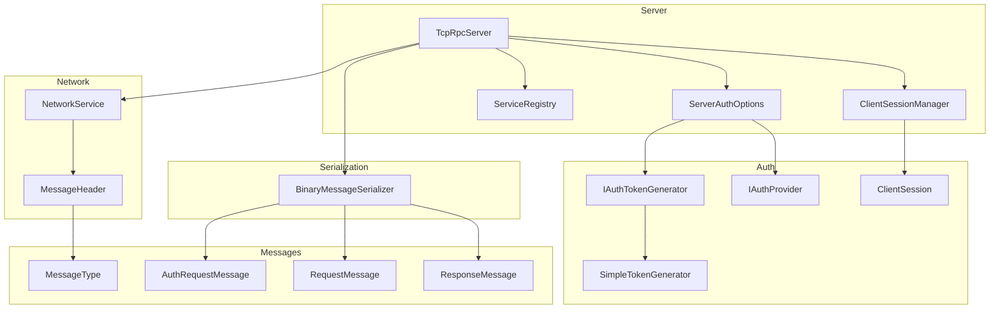
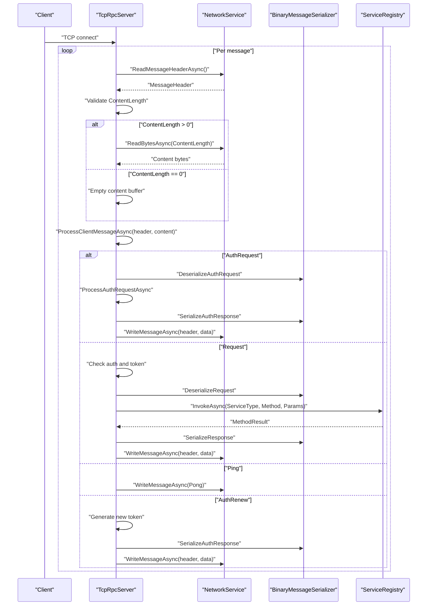
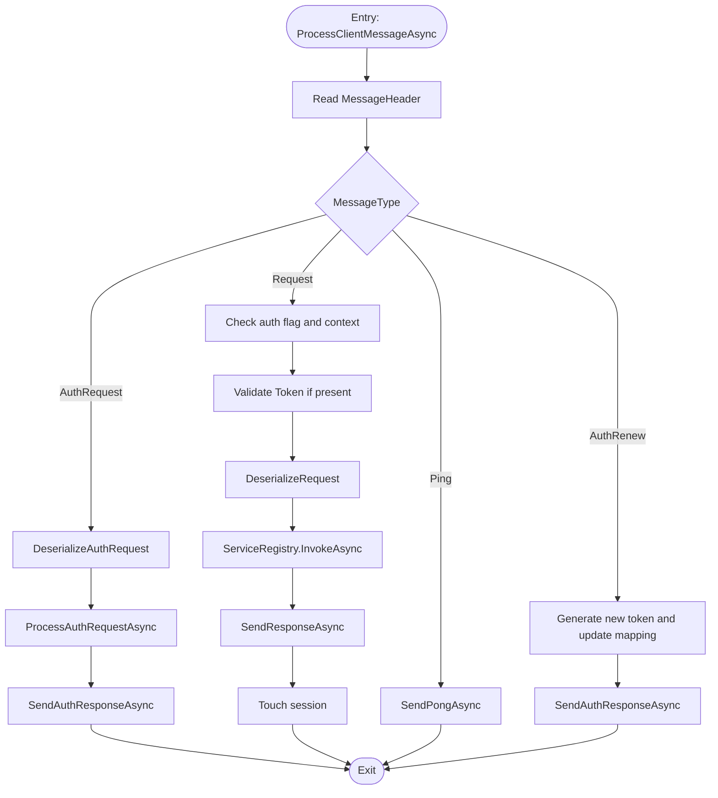
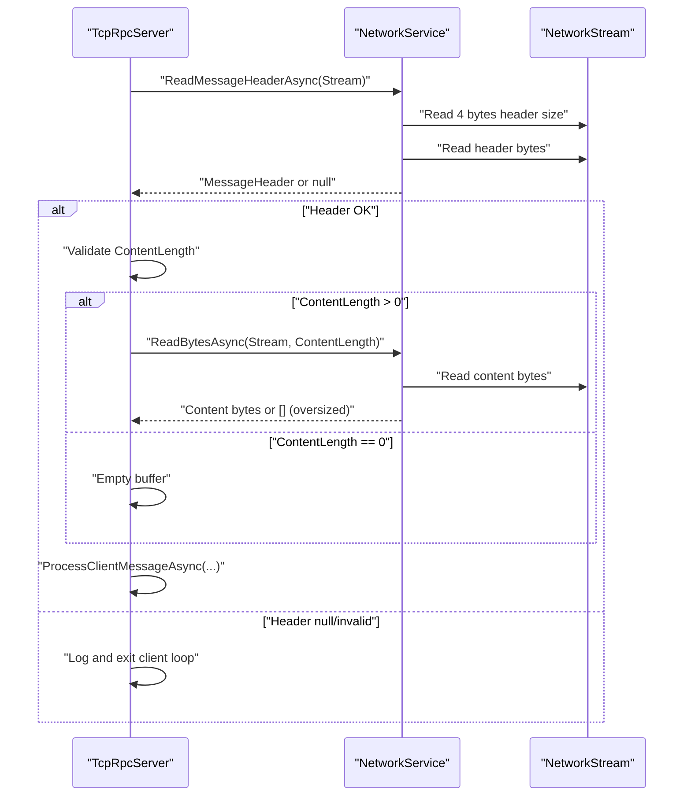
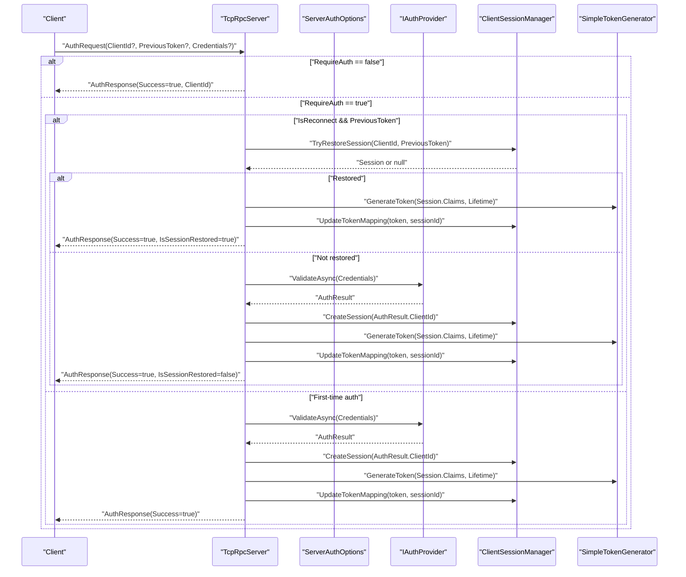
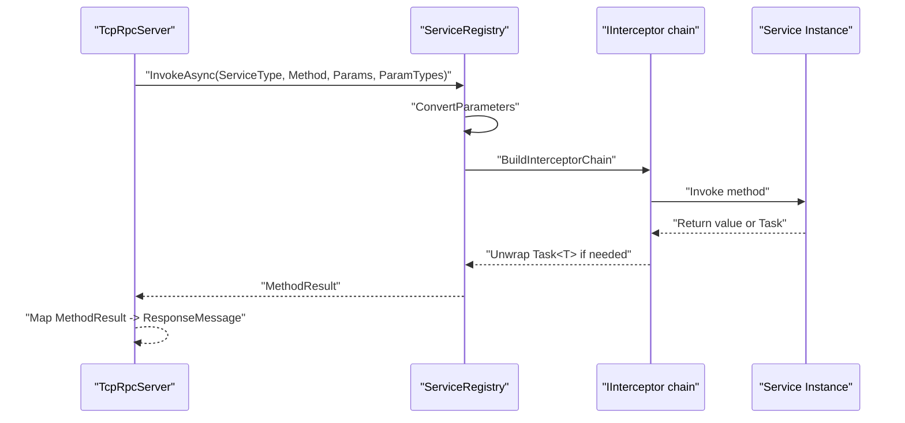
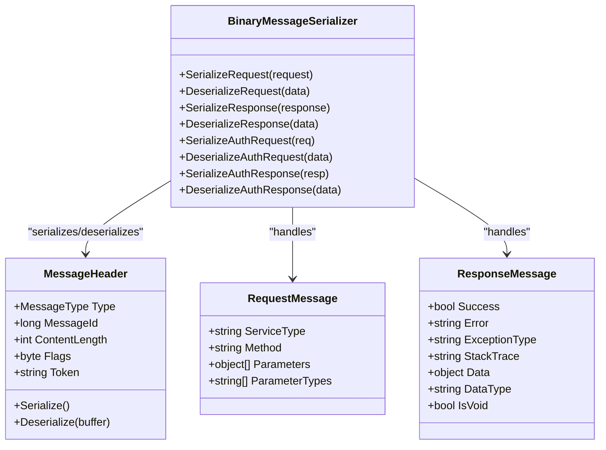
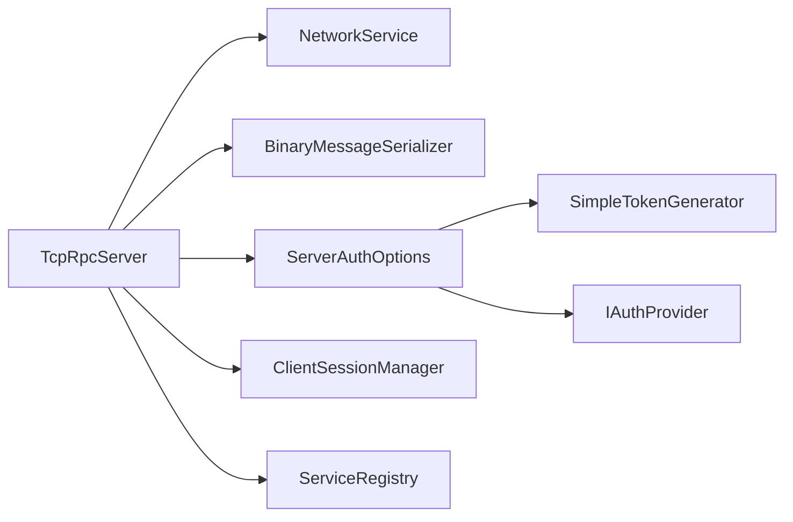

# Message Processing Pipeline

<cite>
**Referenced Files in This Document**
- [TcpRpcServer.cs](file://TcpRpc/Server/TcpRpcServer.cs)
- [NetworkService.cs](file://TcpRpc/Network/NetworkService.cs)
- [BinaryMessageSerializer.cs](file://TcpRpc/Formatter/BinaryMessageSerializer.cs)
- [MessageHeader.cs](file://TcpRpc/Message/MessageHeader.cs)
- [MessageType.cs](file://TcpRpc/Message/MessageType.cs)
- [RequestMessage.cs](file://TcpRpc/Message/RequestMessage.cs)
- [ResponseMessage.cs](file://TcpRpc/Message/ResponseMessage.cs)
- [AuthRequestMessage.cs](file://TcpRpc/Message/AuthRequestMessage.cs)
- [ServiceRegistry.cs](file://TcpRpc/Server/ServiceRegistry.cs)
- [ClientSessionManager.cs](file://TcpRpc/Server/Auth/ClientSessionManager.cs)
- [ClientSession.cs](file://TcpRpc/Server/Auth/ClientSession.cs)
- [SimpleTokenGenerator.cs](file://TcpRpc/Server/Auth/SimpleTokenGenerator.cs)
- [ServerAuthOptions.cs](file://TcpRpc/Server/ServerAuthOptions.cs)
- [IAuthProvider.cs](file://TcpRpc/Server/Auth/IAuthProvider.cs)
</cite>

## Table of Contents
1. [Introduction](#introduction)
2. [Project Structure](#project-structure)
3. [Core Components](#core-components)
4. [Architecture Overview](#architecture-overview)
5. [Detailed Component Analysis](#detailed-component-analysis)
6. [Dependency Analysis](#dependency-analysis)
7. [Performance Considerations](#performance-considerations)
8. [Troubleshooting Guide](#troubleshooting-guide)
9. [Conclusion](#conclusion)

## Introduction
This document explains the TcpRpcServer message processing pipeline with a focus on the ProcessClientMessageAsync method. It covers how incoming messages are read via NetworkService, validated, routed to appropriate handlers, processed for authentication and requests, and serialized back to the client. It also documents the authentication workflow including token validation, session restoration, and renewal, as well as the service invocation path through ServiceRegistry. Practical examples illustrate typical message flows, authentication scenarios, and service invocation patterns. Serialization/deserialization and protocol compliance checks are explained to ensure robust interoperability.

## Project Structure
The message processing pipeline spans several core areas:
- Server orchestration and per-client handling
- Network transport utilities for header and body reads/writes
- Binary serialization for cross-process compatibility
- Message models and protocol types
- Authentication subsystem with sessions and token management
- Service registry for dynamic invocation

**Diagram sources**
- [TcpRpcServer.cs:15-707](file://TcpRpc/Server/TcpRpcServer.cs#L15-L707)
- [NetworkService.cs:7-99](file://TcpRpc/Network/NetworkService.cs#L7-L99)
- [BinaryMessageSerializer.cs:11-444](file://TcpRpc/Formatter/BinaryMessageSerializer.cs#L11-L444)
- [MessageHeader.cs:9-73](file://TcpRpc/Message/MessageHeader.cs#L9-L73)
- [MessageType.cs:3-13](file://TcpRpc/Message/MessageType.cs#L3-L13)
- [RequestMessage.cs:6-18](file://TcpRpc/Message/RequestMessage.cs#L6-L18)
- [ResponseMessage.cs:6-30](file://TcpRpc/Message/ResponseMessage.cs#L6-L30)
- [AuthRequestMessage.cs:6-28](file://TcpRpc/Message/AuthRequestMessage.cs#L6-L28)
- [ServiceRegistry.cs:10-272](file://TcpRpc/Server/ServiceRegistry.cs#L10-L272)
- [ClientSessionManager.cs:9-188](file://TcpRpc/Server/Auth/ClientSessionManager.cs#L9-L188)
- [ClientSession.cs:6-95](file://TcpRpc/Server/Auth/ClientSession.cs#L6-L95)
- [SimpleTokenGenerator.cs:11-163](file://TcpRpc/Server/Auth/SimpleTokenGenerator.cs#L11-L163)
- [ServerAuthOptions.cs:8-40](file://TcpRpc/Server/ServerAuthOptions.cs#L8-L40)
- [IAuthProvider.cs:32-41](file://TcpRpc/Server/Auth/IAuthProvider.cs#L32-L41)

**Section sources**
- [TcpRpcServer.cs:15-707](file://TcpRpc/Server/TcpRpcServer.cs#L15-L707)
- [NetworkService.cs:7-99](file://TcpRpc/Network/NetworkService.cs#L7-L99)
- [BinaryMessageSerializer.cs:11-444](file://TcpRpc/Formatter/BinaryMessageSerializer.cs#L11-L444)
- [MessageHeader.cs:9-73](file://TcpRpc/Message/MessageHeader.cs#L9-L73)
- [MessageType.cs:3-13](file://TcpRpc/Message/MessageType.cs#L3-L13)
- [RequestMessage.cs:6-18](file://TcpRpc/Message/RequestMessage.cs#L6-L18)
- [ResponseMessage.cs:6-30](file://TcpRpc/Message/ResponseMessage.cs#L6-L30)
- [AuthRequestMessage.cs:6-28](file://TcpRpc/Message/AuthRequestMessage.cs#L6-L28)
- [ServiceRegistry.cs:10-272](file://TcpRpc/Server/ServiceRegistry.cs#L10-L272)
- [ClientSessionManager.cs:9-188](file://TcpRpc/Server/Auth/ClientSessionManager.cs#L9-L188)
- [ClientSession.cs:6-95](file://TcpRpc/Server/Auth/ClientSession.cs#L6-L95)
- [SimpleTokenGenerator.cs:11-163](file://TcpRpc/Server/Auth/SimpleTokenGenerator.cs#L11-L163)
- [ServerAuthOptions.cs:8-40](file://TcpRpc/Server/ServerAuthOptions.cs#L8-L40)
- [IAuthProvider.cs:32-41](file://TcpRpc/Server/Auth/IAuthProvider.cs#L32-L41)

## Core Components
- TcpRpcServer orchestrates connection acceptance, per-client message loops, and dispatches to ProcessClientMessageAsync. It manages authentication state via ClientSessionContext and enforces auth policies from ServerAuthOptions.
- NetworkService provides protocol-compliant read/write helpers for message headers and bodies, including length checks and safe buffering.
- BinaryMessageSerializer implements compact binary encoding for RequestMessage, ResponseMessage, and Auth messages with type markers and JSON fallback for complex objects.
- MessageHeader carries type, message ID, content length, flags, and optional token for extended auth support.
- ServiceRegistry resolves services and methods, converts parameters, builds interceptor chains, and invokes target methods.
- ClientSessionManager maintains sessions, token-to-session mapping, and periodic cleanup.
- SimpleTokenGenerator implements JWT-like signing and validation with Base64Url encoding and HMAC-SHA256 signatures.

**Section sources**
- [TcpRpcServer.cs:226-451](file://TcpRpc/Server/TcpRpcServer.cs#L226-L451)
- [NetworkService.cs:30-99](file://TcpRpc/Network/NetworkService.cs#L30-L99)
- [BinaryMessageSerializer.cs:30-442](file://TcpRpc/Formatter/BinaryMessageSerializer.cs#L30-L442)
- [MessageHeader.cs:41-73](file://TcpRpc/Message/MessageHeader.cs#L41-L73)
- [ServiceRegistry.cs:72-138](file://TcpRpc/Server/ServiceRegistry.cs#L72-L138)
- [ClientSessionManager.cs:27-188](file://TcpRpc/Server/Auth/ClientSessionManager.cs#L27-L188)
- [SimpleTokenGenerator.cs:38-163](file://TcpRpc/Server/Auth/SimpleTokenGenerator.cs#L38-L163)

## Architecture Overview
The server runs a continuous loop per client, reading a 4-byte little-endian header length followed by the serialized MessageHeader, then the content bytes sized by ContentLength. The server validates lengths, routes by MessageType, and responds accordingly.

**Diagram sources**
- [TcpRpcServer.cs:247-451](file://TcpRpc/Server/TcpRpcServer.cs#L247-L451)
- [NetworkService.cs:30-52](file://TcpRpc/Network/NetworkService.cs#L30-L52)
- [BinaryMessageSerializer.cs:50-442](file://TcpRpc/Formatter/BinaryMessageSerializer.cs#L50-L442)
- [ServiceRegistry.cs:72-138](file://TcpRpc/Server/ServiceRegistry.cs#L72-L138)

## Detailed Component Analysis

### ProcessClientMessageAsync: Message Routing and Dispatch
ProcessClientMessageAsync is the central dispatcher for incoming messages. It:
- Deserializes AuthRequest, Request, or reads Ping/Pong tokens from the header.
- Enforces authentication preconditions and validates tokens when present.
- Invokes ProcessAuthRequestAsync for AuthRequest, ProcessRequestAsync for Request, sends Pong for Ping, and generates renewed tokens for AuthRenew.
- Updates session activity on successful requests.

**Diagram sources**
- [TcpRpcServer.cs:380-451](file://TcpRpc/Server/TcpRpcServer.cs#L380-L451)
- [ServiceRegistry.cs:72-138](file://TcpRpc/Server/ServiceRegistry.cs#L72-L138)

**Section sources**
- [TcpRpcServer.cs:380-451](file://TcpRpc/Server/TcpRpcServer.cs#L380-L451)

### Message Reading and Protocol Compliance
NetworkService.ReadMessageHeaderAsync:
- Reads a 4-byte little-endian header size, validates it is positive and reasonable.
- Reads the serialized MessageHeader and deserializes it.
- Throws on invalid sizes to prevent malformed frames.

NetworkService.ReadBytesAsync:
- Safely reads content bytes with defensive checks.
- For large payloads (> 100KB), drains and returns empty buffer to signal oversized content.
- Returns null on EOF to indicate connection closure.

TcpRpcServer.HandleClientAsync:
- Uses NetworkService.ReadMessageHeaderAsync and ReadBytesAsync to extract header and content.
- Validates ContentLength and handles oversized content by sending an auth error response and continuing.
- Calls ProcessClientMessageAsync for each complete message.

**Diagram sources**
- [TcpRpcServer.cs:247-286](file://TcpRpc/Server/TcpRpcServer.cs#L247-L286)
- [NetworkService.cs:30-52](file://TcpRpc/Network/NetworkService.cs#L30-L52)
- [NetworkService.cs:55-99](file://TcpRpc/Network/NetworkService.cs#L55-L99)

**Section sources**
- [TcpRpcServer.cs:247-286](file://TcpRpc/Server/TcpRpcServer.cs#L247-L286)
- [NetworkService.cs:30-52](file://TcpRpc/Network/NetworkService.cs#L30-L52)
- [NetworkService.cs:55-99](file://TcpRpc/Network/NetworkService.cs#L55-L99)

### Authentication Workflow: Validation, Restoration, Renewal
ProcessAuthRequestAsync:
- If authentication is disabled, returns success with a generated ClientId.
- If reconnect with PreviousToken is requested, attempts session restoration via ClientSessionManager.TryRestoreSession.
- On failure, performs credential-based authentication via IAuthProvider.ValidateAsync.
- Creates a new session, populates claims, generates a token with SimpleTokenGenerator, updates token-to-session mapping, and sets context session.

Token Validation and Renewal:
- For Request messages, if a token is present in the header, TcpRpcServer validates it using IAuthTokenGenerator.ValidateToken.
- For AuthRenew, the server regenerates a token, updates session info, and writes an AuthResponse.

**Diagram sources**
- [TcpRpcServer.cs:453-547](file://TcpRpc/Server/TcpRpcServer.cs#L453-L547)
- [ClientSessionManager.cs:88-116](file://TcpRpc/Server/Auth/ClientSessionManager.cs#L88-L116)
- [SimpleTokenGenerator.cs:38-77](file://TcpRpc/Server/Auth/SimpleTokenGenerator.cs#L38-L77)
- [IAuthProvider.cs:32-41](file://TcpRpc/Server/Auth/IAuthProvider.cs#L32-L41)

**Section sources**
- [TcpRpcServer.cs:396-449](file://TcpRpc/Server/TcpRpcServer.cs#L396-L449)
- [TcpRpcServer.cs:453-547](file://TcpRpc/Server/TcpRpcServer.cs#L453-L547)
- [ClientSessionManager.cs:88-116](file://TcpRpc/Server/Auth/ClientSessionManager.cs#L88-L116)
- [SimpleTokenGenerator.cs:38-77](file://TcpRpc/Server/Auth/SimpleTokenGenerator.cs#L38-L77)
- [IAuthProvider.cs:32-41](file://TcpRpc/Server/Auth/IAuthProvider.cs#L32-L41)

### Request Processing Through ServiceRegistry
ProcessRequestAsync:
- First checks legacy RequestHandler registrations by Method.
- Falls back to ServiceRegistry.InvokeAsync with ServiceType, Method, Parameters, and ParameterTypes.
- Converts parameters to target method signatures and unwraps Task<T> return types.
- Builds an interceptor chain around the target invocation.
- Returns a ResponseMessage with either Data/DataType/IsVoid on success or Error/ExceptionType/StackTrace on failure.

**Diagram sources**
- [TcpRpcServer.cs:549-614](file://TcpRpc/Server/TcpRpcServer.cs#L549-L614)
- [ServiceRegistry.cs:72-138](file://TcpRpc/Server/ServiceRegistry.cs#L72-L138)

**Section sources**
- [TcpRpcServer.cs:549-614](file://TcpRpc/Server/TcpRpcServer.cs#L549-L614)
- [ServiceRegistry.cs:72-138](file://TcpRpc/Server/ServiceRegistry.cs#L72-L138)

### Serialization, Deserialization, and Protocol Compliance
BinaryMessageSerializer:
- Encodes RequestMessage with ServiceType, Method, Parameters, and ParameterTypes.
- Encodes ResponseMessage with Success/Error/ExceptionType/StackTrace/Data/DataType/IsVoid.
- Encodes Auth messages with ClientId, PreviousToken, Credentials, and AuthResponse fields.
- Uses type markers and UTF-8 strings, with JSON fallback for complex objects and assembly-qualified type names for deserialization.

Protocol compliance:
- MessageHeader includes Type, MessageId, ContentLength, Flags, and optional Token.
- NetworkService enforces header size limits and content length sanity checks.
- TcpRpcServer validates ContentLength and handles oversized content gracefully.

**Diagram sources**
- [BinaryMessageSerializer.cs:30-442](file://TcpRpc/Formatter/BinaryMessageSerializer.cs#L30-L442)
- [MessageHeader.cs:41-73](file://TcpRpc/Message/MessageHeader.cs#L41-L73)
- [RequestMessage.cs:6-18](file://TcpRpc/Message/RequestMessage.cs#L6-L18)
- [ResponseMessage.cs:6-30](file://TcpRpc/Message/ResponseMessage.cs#L6-L30)

**Section sources**
- [BinaryMessageSerializer.cs:30-442](file://TcpRpc/Formatter/BinaryMessageSerializer.cs#L30-L442)
- [MessageHeader.cs:41-73](file://TcpRpc/Message/MessageHeader.cs#L41-L73)
- [RequestMessage.cs:6-18](file://TcpRpc/Message/RequestMessage.cs#L6-L18)
- [ResponseMessage.cs:6-30](file://TcpRpc/Message/ResponseMessage.cs#L6-L30)

### Practical Examples

- Reception to Response (successful Request):
  - Client sends a Request with ServiceType, Method, Parameters, and ParameterTypes.
  - Server deserializes, authenticates if required, invokes ServiceRegistry, serializes Response, and writes Pong/Error depending on Success.

- Authentication Flow (reconnect):
  - Client sends AuthRequest with PreviousToken and ClientId.
  - Server attempts session restoration; if successful, generates a new token and returns AuthResponse with IsSessionRestored.

- Authentication Flow (first-time):
  - Client sends AuthRequest with Credentials.
  - Server validates credentials, creates a session, generates token, and returns AuthResponse.

- Ping/Pong:
  - Client sends Ping; Server responds with Pong.

- AuthRenew:
  - Client sends AuthRenew; Server generates a new token and returns AuthResponse.

**Section sources**
- [TcpRpcServer.cs:396-449](file://TcpRpc/Server/TcpRpcServer.cs#L396-L449)
- [TcpRpcServer.cs:425-427](file://TcpRpc/Server/TcpRpcServer.cs#L425-L427)
- [TcpRpcServer.cs:429-449](file://TcpRpc/Server/TcpRpcServer.cs#L429-L449)
- [ServiceRegistry.cs:72-138](file://TcpRpc/Server/ServiceRegistry.cs#L72-L138)

## Dependency Analysis
TcpRpcServer depends on:
- NetworkService for protocol framing and IO safety.
- BinaryMessageSerializer for cross-process message encoding/decoding.
- ServerAuthOptions for policy decisions (RequireAuth, TokenLifetime, SessionTimeout).
- ClientSessionManager for session lifecycle and token mapping.
- ServiceRegistry for dynamic service invocation.

**Diagram sources**
- [TcpRpcServer.cs:66-74](file://TcpRpc/Server/TcpRpcServer.cs#L66-L74)
- [ServerAuthOptions.cs:8-40](file://TcpRpc/Server/ServerAuthOptions.cs#L8-L40)
- [ClientSessionManager.cs:9-25](file://TcpRpc/Server/Auth/ClientSessionManager.cs#L9-L25)
- [ServiceRegistry.cs:10-19](file://TcpRpc/Server/ServiceRegistry.cs#L10-L19)
- [SimpleTokenGenerator.cs:11-36](file://TcpRpc/Server/Auth/SimpleTokenGenerator.cs#L11-L36)
- [IAuthProvider.cs:32-41](file://TcpRpc/Server/Auth/IAuthProvider.cs#L32-L41)

**Section sources**
- [TcpRpcServer.cs:66-74](file://TcpRpc/Server/TcpRpcServer.cs#L66-L74)
- [ServerAuthOptions.cs:8-40](file://TcpRpc/Server/ServerAuthOptions.cs#L8-L40)
- [ClientSessionManager.cs:9-25](file://TcpRpc/Server/Auth/ClientSessionManager.cs#L9-L25)
- [ServiceRegistry.cs:10-19](file://TcpRpc/Server/ServiceRegistry.cs#L10-L19)
- [SimpleTokenGenerator.cs:11-36](file://TcpRpc/Server/Auth/SimpleTokenGenerator.cs#L11-L36)
- [IAuthProvider.cs:32-41](file://TcpRpc/Server/Auth/IAuthProvider.cs#L32-L41)

## Performance Considerations
- Large payload handling: NetworkService and TcpRpcServer drop oversized content after draining to avoid corrupting subsequent messages. Prefer chunked uploads or streaming for very large payloads outside the scope of this protocol.
- Buffering: ReadBytesAsync uses fixed-size buffers for large reads to limit memory spikes.
- Session cleanup: ClientSessionManager periodically removes expired sessions to keep memory footprint bounded.
- Interceptor overhead: ServiceRegistry builds an interceptor chain; keep interceptors focused to minimize latency.

[No sources needed since this section provides general guidance]

## Troubleshooting Guide
Common issues and diagnostics:
- Invalid header size or malformed header: NetworkService throws on invalid header size; TcpRpcServer logs and exits client loop.
- Negative or excessive ContentLength: TcpRpcServer validates and returns on invalid values; oversized content triggers an auth error response and continues.
- Authentication failures: ProcessAuthRequestAsync returns AuthResponse with error; check IAuthProvider implementation and credentials.
- Token validation errors: ValidateToken returns invalid with error message; ensure token format and signature are correct and not expired.
- Service not found or method not found: ServiceRegistry.InvokeAsync returns failure; verify ServiceType and Method names match registration.
- Handler errors: ProcessRequestAsync captures exceptions and returns error response with exception metadata.

**Section sources**
- [NetworkService.cs:39-43](file://TcpRpc/Network/NetworkService.cs#L39-L43)
- [TcpRpcServer.cs:255-281](file://TcpRpc/Server/TcpRpcServer.cs#L255-L281)
- [TcpRpcServer.cs:505-512](file://TcpRpc/Server/TcpRpcServer.cs#L505-L512)
- [SimpleTokenGenerator.cs:79-137](file://TcpRpc/Server/Auth/SimpleTokenGenerator.cs#L79-L137)
- [ServiceRegistry.cs:74-82](file://TcpRpc/Server/ServiceRegistry.cs#L74-L82)
- [TcpRpcServer.cs:604-613](file://TcpRpc/Server/TcpRpcServer.cs#L604-L613)

## Conclusion
The TcpRpcServer implements a robust, protocol-compliant message processing pipeline. It safely reads and validates messages, routes them by type, enforces authentication policies, and executes service invocations with strong serialization guarantees. The design balances extensibility (interceptors, custom auth providers) with operational safety (length checks, session cleanup, graceful error handling).