# Server Lifecycle and State Management

<cite>
**Referenced Files in This Document**
- [TcpRpcServer.cs](file://TcpRpc/Server/TcpRpcServer.cs)
- [RpcServerState.cs](file://TcpRpc/Server/RpcServerState.cs)
- [ServerAuthOptions.cs](file://TcpRpc/Server/ServerAuthOptions.cs)
- [ClientSessionManager.cs](file://TcpRpc/Server/Auth/ClientSessionManager.cs)
- [ClientSession.cs](file://TcpRpc/Server/Auth/ClientSession.cs)
- [IAuthProvider.cs](file://TcpRpc/Server/Auth/IAuthProvider.cs)
- [IAuthTokenGenerator.cs](file://TcpRpc/Server/Auth/IAuthTokenGenerator.cs)
- [SimpleTokenGenerator.cs](file://TcpRpc/Server/Auth/SimpleTokenGenerator.cs)
- [NetworkService.cs](file://TcpRpc/Network/NetworkService.cs)
- [ServiceRegistry.cs](file://TcpRpc/Server/ServiceRegistry.cs)
</cite>

## Table of Contents
1. [Introduction](#introduction)
2. [Project Structure](#project-structure)
3. [Core Components](#core-components)
4. [Architecture Overview](#architecture-overview)
5. [Detailed Component Analysis](#detailed-component-analysis)
6. [Dependency Analysis](#dependency-analysis)
7. [Performance Considerations](#performance-considerations)
8. [Troubleshooting Guide](#troubleshooting-guide)
9. [Conclusion](#conclusion)

## Introduction
This document explains the lifecycle management and state transitions of the TcpRpcServer, focusing on the RpcServerState enumeration and the StartAsync/StopAsync operations. It covers port binding, listener initialization, authentication setup, cancellation token management, graceful shutdown procedures, connection termination, resource cleanup, thread-safe state transitions, and monitoring of active connections. Practical examples illustrate startup sequences, state validation checks, and proper shutdown procedures, along with error handling and fault recovery scenarios.

## Project Structure
The TcpRpcServer resides in the TcpRpc/Server namespace and orchestrates networking, authentication, and service invocation. Supporting components include authentication providers, token generators, session managers, and network utilities.

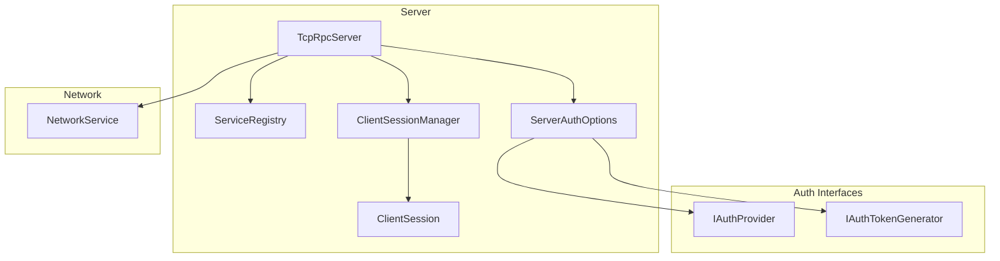

**Diagram sources**
- [TcpRpcServer.cs:15-74](file://TcpRpc/Server/TcpRpcServer.cs#L15-L74)
- [ServiceRegistry.cs:10-49](file://TcpRpc/Server/ServiceRegistry.cs#L10-L49)
- [ServerAuthOptions.cs:8-39](file://TcpRpc/Server/ServerAuthOptions.cs#L8-L39)
- [ClientSessionManager.cs:9-25](file://TcpRpc/Server/Auth/ClientSessionManager.cs#L9-L25)
- [ClientSession.cs:6-66](file://TcpRpc/Server/Auth/ClientSession.cs#L6-L66)
- [IAuthProvider.cs:32-40](file://TcpRpc/Server/Auth/IAuthProvider.cs#L32-L40)
- [IAuthTokenGenerator.cs:37-54](file://TcpRpc/Server/Auth/IAuthTokenGenerator.cs#L37-L54)
- [NetworkService.cs:7-28](file://TcpRpc/Network/NetworkService.cs#L7-L28)

**Section sources**
- [TcpRpcServer.cs:15-74](file://TcpRpc/Server/TcpRpcServer.cs#L15-L74)
- [ServiceRegistry.cs:10-49](file://TcpRpc/Server/ServiceRegistry.cs#L10-L49)
- [ServerAuthOptions.cs:8-39](file://TcpRpc/Server/ServerAuthOptions.cs#L8-L39)
- [ClientSessionManager.cs:9-25](file://TcpRpc/Server/Auth/ClientSessionManager.cs#L9-L25)
- [ClientSession.cs:6-66](file://TcpRpc/Server/Auth/ClientSession.cs#L6-L66)
- [IAuthProvider.cs:32-40](file://TcpRpc/Server/Auth/IAuthProvider.cs#L32-L40)
- [IAuthTokenGenerator.cs:37-54](file://TcpRpc/Server/Auth/IAuthTokenGenerator.cs#L37-L54)
- [NetworkService.cs:7-28](file://TcpRpc/Network/NetworkService.cs#L7-L28)

## Core Components
- RpcServerState: Defines the server’s lifecycle states.
- TcpRpcServer: Implements lifecycle management, state transitions, networking, authentication, and service invocation.
- ServerAuthOptions: Configures authentication behavior and timing.
- ClientSessionManager: Manages client sessions and token mappings with periodic cleanup.
- ClientSession: Holds per-client session metadata and activity timestamps.
- IAuthProvider/IAuthTokenGenerator: Authentication provider and token generator interfaces.
- SimpleTokenGenerator: Concrete JWT-like token generator.
- NetworkService: Provides message serialization/deserialization and stream I/O helpers.
- ServiceRegistry: Registers and invokes services with optional interceptors.

**Section sources**
- [RpcServerState.cs:3-10](file://TcpRpc/Server/RpcServerState.cs#L3-L10)
- [TcpRpcServer.cs:15-74](file://TcpRpc/Server/TcpRpcServer.cs#L15-L74)
- [ServerAuthOptions.cs:8-39](file://TcpRpc/Server/ServerAuthOptions.cs#L8-L39)
- [ClientSessionManager.cs:9-25](file://TcpRpc/Server/Auth/ClientSessionManager.cs#L9-L25)
- [ClientSession.cs:6-66](file://TcpRpc/Server/Auth/ClientSession.cs#L6-L66)
- [IAuthProvider.cs:32-40](file://TcpRpc/Server/Auth/IAuthProvider.cs#L32-L40)
- [IAuthTokenGenerator.cs:37-54](file://TcpRpc/Server/Auth/IAuthTokenGenerator.cs#L37-L54)
- [SimpleTokenGenerator.cs:11-36](file://TcpRpc/Server/Auth/SimpleTokenGenerator.cs#L11-L36)
- [NetworkService.cs:7-28](file://TcpRpc/Network/NetworkService.cs#L7-L28)
- [ServiceRegistry.cs:10-49](file://TcpRpc/Server/ServiceRegistry.cs#L10-L49)

## Architecture Overview
The TcpRpcServer manages a TcpListener, accepts client connections, and spawns per-client tasks. It supports optional authentication with session management and token validation. Requests are routed to either legacy handlers or the modern ServiceRegistry with optional interceptors.

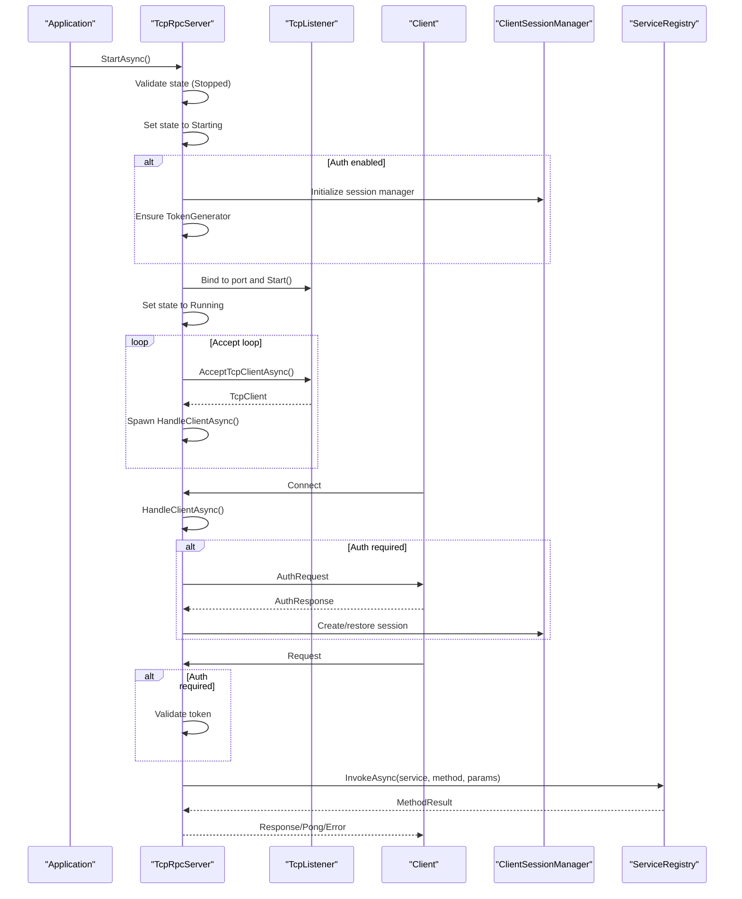

**Diagram sources**
- [TcpRpcServer.cs:85-171](file://TcpRpc/Server/TcpRpcServer.cs#L85-L171)
- [ClientSessionManager.cs:27-42](file://TcpRpc/Server/Auth/ClientSessionManager.cs#L27-L42)
- [ServiceRegistry.cs:72-138](file://TcpRpc/Server/ServiceRegistry.cs#L72-L138)

## Detailed Component Analysis

### RpcServerState Enumeration and Transitions
The server maintains a finite state machine with five states:
- Stopped: Initial state or after shutdown.
- Starting: Transitioned immediately upon a valid StartAsync call.
- Running: Accepting connections and processing requests.
- Stopping: During graceful shutdown initiated by StopAsync.
- Faulted: Set when an unhandled exception occurs during startup.

State transitions are guarded by a lock to ensure thread safety. The state field is volatile to prevent reordering issues.

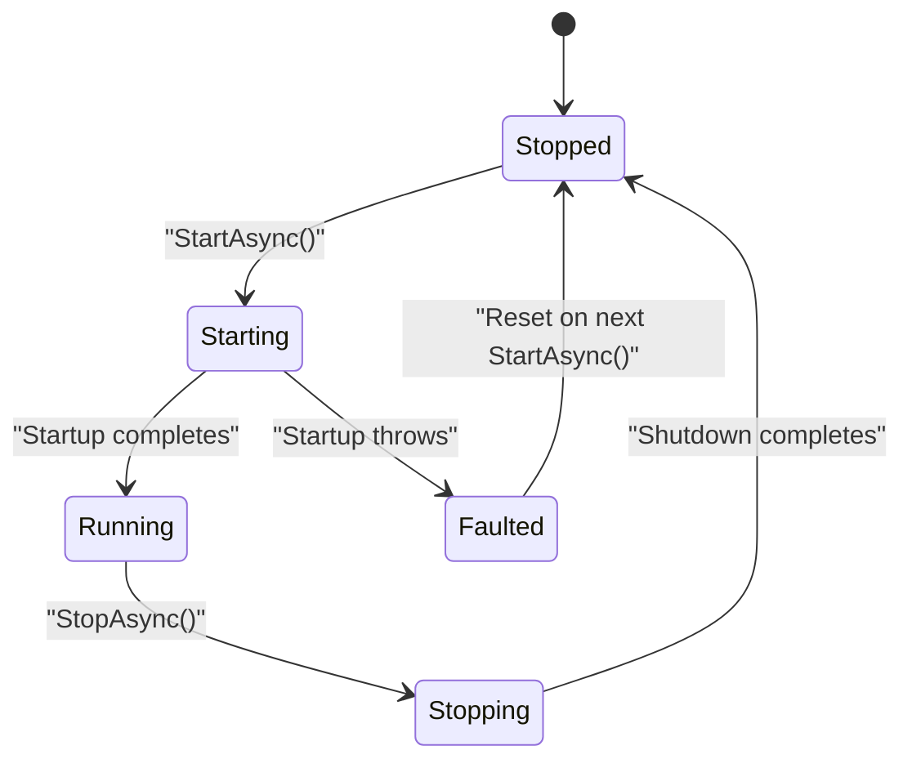

**Diagram sources**
- [RpcServerState.cs:3-10](file://TcpRpc/Server/RpcServerState.cs#L3-L10)
- [TcpRpcServer.cs:89-95](file://TcpRpc/Server/TcpRpcServer.cs#L89-L95)
- [TcpRpcServer.cs:125-128](file://TcpRpc/Server/TcpRpcServer.cs#L125-L128)
- [TcpRpcServer.cs:155-158](file://TcpRpc/Server/TcpRpcServer.cs#L155-L158)
- [TcpRpcServer.cs:177-183](file://TcpRpc/Server/TcpRpcServer.cs#L177-L183)
- [TcpRpcServer.cs:219-222](file://TcpRpc/Server/TcpRpcServer.cs#L219-L222)

**Section sources**
- [RpcServerState.cs:3-10](file://TcpRpc/Server/RpcServerState.cs#L3-L10)
- [TcpRpcServer.cs:28-29](file://TcpRpc/Server/TcpRpcServer.cs#L28-L29)
- [TcpRpcServer.cs:89-95](file://TcpRpc/Server/TcpRpcServer.cs#L89-L95)
- [TcpRpcServer.cs:125-128](file://TcpRpc/Server/TcpRpcServer.cs#L125-L128)
- [TcpRpcServer.cs:155-158](file://TcpRpc/Server/TcpRpcServer.cs#L155-L158)
- [TcpRpcServer.cs:177-183](file://TcpRpc/Server/TcpRpcServer.cs#L177-L183)
- [TcpRpcServer.cs:219-222](file://TcpRpc/Server/TcpRpcServer.cs#L219-L222)

### StartAsync: Port Binding, Listener Initialization, Authentication Setup, and Cancellation
- Precondition: Must be in Stopped state; otherwise throws an invalid operation exception.
- Sets state to Starting atomically under lock.
- Initializes authentication subsystem if enabled:
  - Creates ClientSessionManager with configured timeouts and cleanup intervals.
  - Ensures a token generator is present (defaults to SimpleTokenGenerator).
- Binds TcpListener to IPAddress.Any on the configured port and starts listening.
- Recreates CancellationTokenSource if previously canceled to support restarts.
- Sets state to Running under lock.
- Enters accept loop:
  - Accepts TcpClient asynchronously.
  - Assigns incremental client IDs and spawns HandleClientAsync.
  - Maintains a concurrent collection of client tasks, removing completed ones.
- On OperationCanceledException, normal shutdown path is taken.
- On any other exception, sets state to Faulted and rethrows.
- Finally block ensures state is Stopped if still Running.

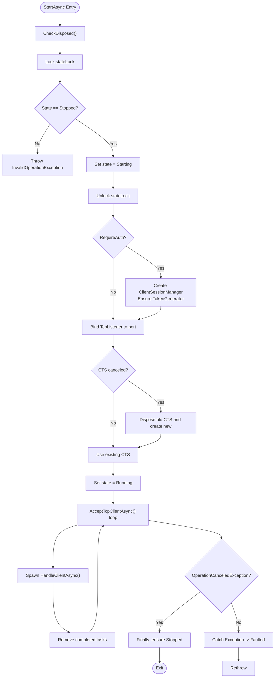

**Diagram sources**
- [TcpRpcServer.cs:85-171](file://TcpRpc/Server/TcpRpcServer.cs#L85-L171)

**Section sources**
- [TcpRpcServer.cs:85-171](file://TcpRpc/Server/TcpRpcServer.cs#L85-L171)
- [ClientSessionManager.cs:17-25](file://TcpRpc/Server/Auth/ClientSessionManager.cs#L17-L25)
- [ServerAuthOptions.cs:13-38](file://TcpRpc/Server/ServerAuthOptions.cs#L13-L38)

### StopAsync: Graceful Shutdown, Connection Termination, and Resource Cleanup
- Precondition: Must be in Running state; otherwise returns immediately.
- Sets state to Stopping under lock.
- Stops the TcpListener to cease accepting new connections.
- Cancels the CancellationTokenSource to signal all operations to abort.
- Waits for all client tasks to complete with a timeout; logs warnings on timeout.
- Clears the client task collection.
- Finally block ensures state is Stopped.

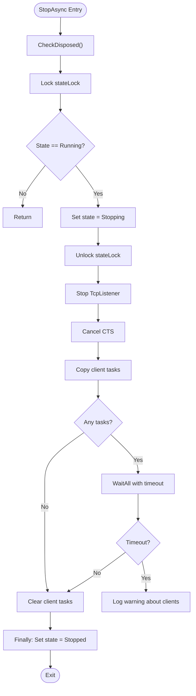

**Diagram sources**
- [TcpRpcServer.cs:173-224](file://TcpRpc/Server/TcpRpcServer.cs#L173-L224)

**Section sources**
- [TcpRpcServer.cs:173-224](file://TcpRpc/Server/TcpRpcServer.cs#L173-L224)

### State Lock Mechanism and Thread Safety
- A dedicated lock object guards state transitions and protects shared mutable state.
- The state field is volatile to ensure visibility across threads.
- Disposal uses an interlocked flag to prevent reuse after disposal.

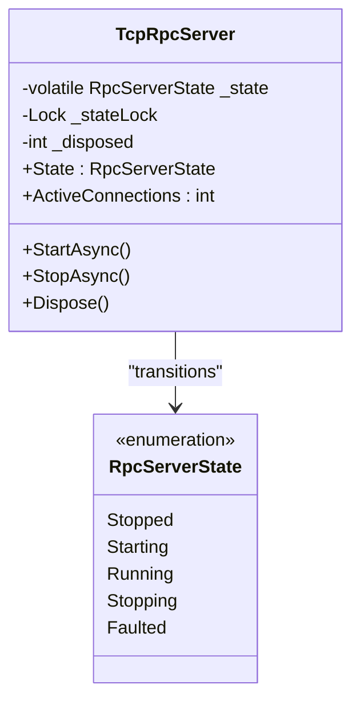

**Diagram sources**
- [TcpRpcServer.cs:28-29](file://TcpRpc/Server/TcpRpcServer.cs#L28-L29)
- [RpcServerState.cs:3-10](file://TcpRpc/Server/RpcServerState.cs#L3-L10)

**Section sources**
- [TcpRpcServer.cs:28-29](file://TcpRpc/Server/TcpRpcServer.cs#L28-L29)
- [RpcServerState.cs:3-10](file://TcpRpc/Server/RpcServerState.cs#L3-L10)

### ActiveConnections Property
- Tracks the number of currently active client tasks.
- Removes completed tasks before returning the count to keep the count accurate.
- Uses a lock around the client task list to ensure thread-safety.

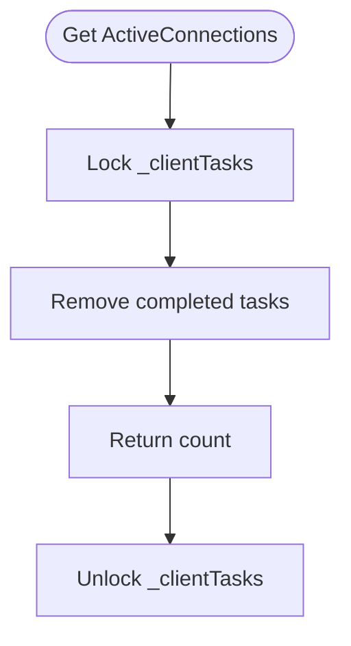

**Diagram sources**
- [TcpRpcServer.cs:49-59](file://TcpRpc/Server/TcpRpcServer.cs#L49-L59)

**Section sources**
- [TcpRpcServer.cs:49-59](file://TcpRpc/Server/TcpRpcServer.cs#L49-L59)

### Authentication and Session Management
- When authentication is enabled, TcpRpcServer initializes ClientSessionManager and ensures a token generator.
- ClientSessionManager periodically cleans up expired sessions and maintains token-to-session mappings.
- Authentication flow includes:
  - Optional session restoration for reconnect scenarios.
  - Credential validation via IAuthProvider.
  - Token generation and mapping via IAuthTokenGenerator.
  - Per-request token validation and session touch updates.

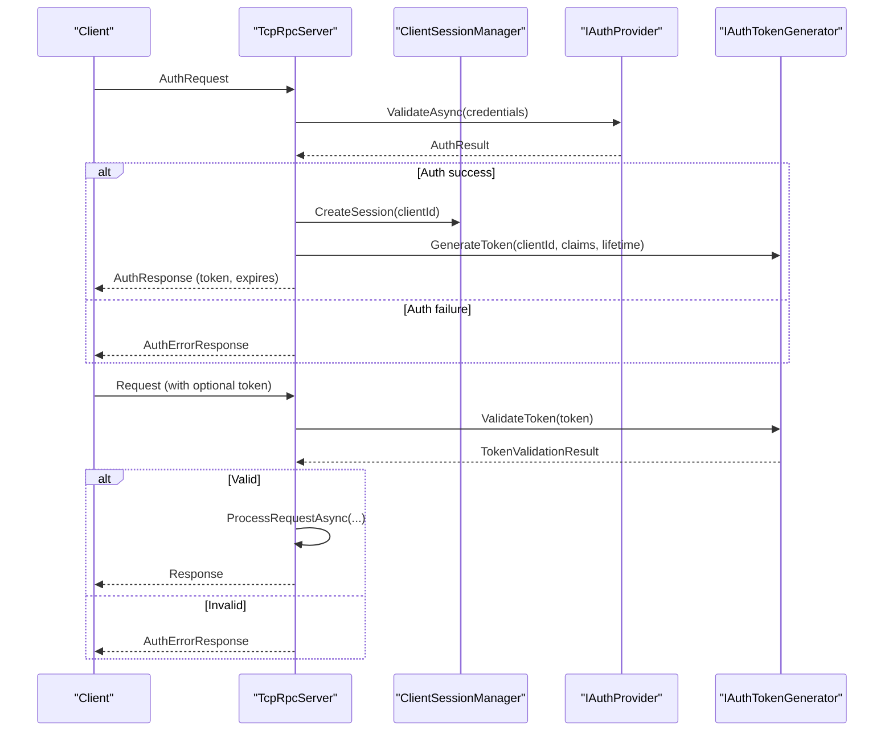

**Diagram sources**
- [TcpRpcServer.cs:453-547](file://TcpRpc/Server/TcpRpcServer.cs#L453-L547)
- [ClientSessionManager.cs:28-42](file://TcpRpc/Server/Auth/ClientSessionManager.cs#L28-L42)
- [IAuthProvider.cs:32-40](file://TcpRpc/Server/Auth/IAuthProvider.cs#L32-L40)
- [IAuthTokenGenerator.cs:37-54](file://TcpRpc/Server/Auth/IAuthTokenGenerator.cs#L37-L54)
- [SimpleTokenGenerator.cs:38-77](file://TcpRpc/Server/Auth/SimpleTokenGenerator.cs#L38-L77)

**Section sources**
- [TcpRpcServer.cs:100-111](file://TcpRpc/Server/TcpRpcServer.cs#L100-L111)
- [ClientSessionManager.cs:17-25](file://TcpRpc/Server/Auth/ClientSessionManager.cs#L17-L25)
- [ClientSessionManager.cs:88-116](file://TcpRpc/Server/Auth/ClientSessionManager.cs#L88-L116)
- [IAuthProvider.cs:32-40](file://TcpRpc/Server/Auth/IAuthProvider.cs#L32-L40)
- [IAuthTokenGenerator.cs:37-54](file://TcpRpc/Server/Auth/IAuthTokenGenerator.cs#L37-L54)
- [SimpleTokenGenerator.cs:38-77](file://TcpRpc/Server/Auth/SimpleTokenGenerator.cs#L38-L77)

### Message Processing and Network I/O
- NetworkService handles header and body serialization/deserialization with strict bounds checking.
- TcpRpcServer reads message headers, validates lengths, and reads content buffers safely.
- Large messages are handled by discarding content to avoid corrupting subsequent messages.
- Ping/Pong support and error responses are implemented.

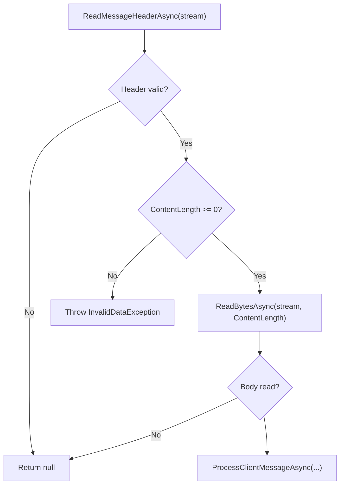

**Diagram sources**
- [NetworkService.cs:30-52](file://TcpRpc/Network/NetworkService.cs#L30-L52)
- [TcpRpcServer.cs:247-281](file://TcpRpc/Server/TcpRpcServer.cs#L247-L281)

**Section sources**
- [NetworkService.cs:30-52](file://TcpRpc/Network/NetworkService.cs#L30-L52)
- [TcpRpcServer.cs:247-281](file://TcpRpc/Server/TcpRpcServer.cs#L247-L281)

### Service Invocation Pipeline
- Supports legacy RequestHandler registration and modern ServiceRegistry-based invocation.
- ServiceRegistry builds an interceptor chain and converts parameters to target method signatures.
- Handles Task-returning methods and unwraps Task<T> results.

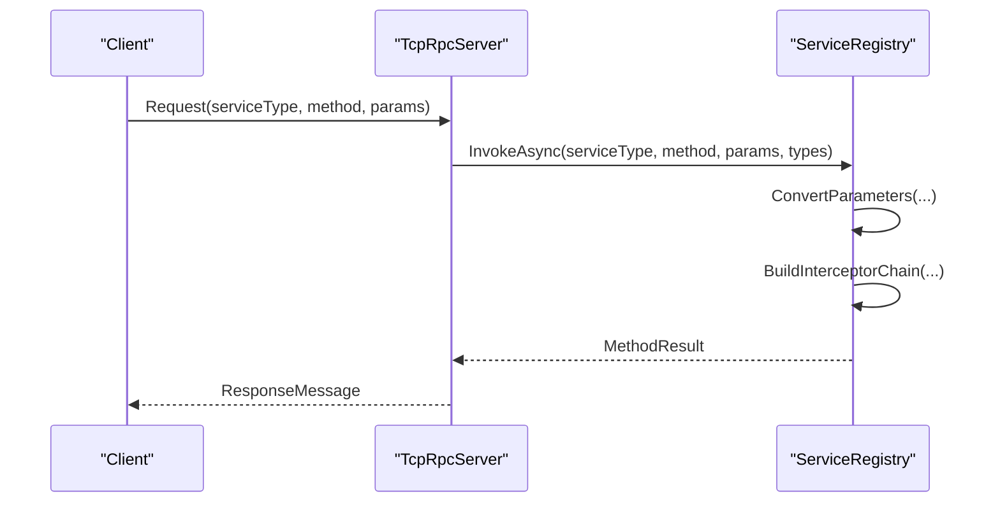

**Diagram sources**
- [TcpRpcServer.cs:549-614](file://TcpRpc/Server/TcpRpcServer.cs#L549-L614)
- [ServiceRegistry.cs:72-138](file://TcpRpc/Server/ServiceRegistry.cs#L72-L138)

**Section sources**
- [TcpRpcServer.cs:549-614](file://TcpRpc/Server/TcpRpcServer.cs#L549-L614)
- [ServiceRegistry.cs:72-138](file://TcpRpc/Server/ServiceRegistry.cs#L72-L138)

## Dependency Analysis
TcpRpcServer depends on:
- ServerAuthOptions for authentication configuration.
- ClientSessionManager for session lifecycle and cleanup.
- IAuthProvider/IAuthTokenGenerator for credential validation and token management.
- NetworkService for reliable message framing.
- ServiceRegistry for service discovery and invocation.

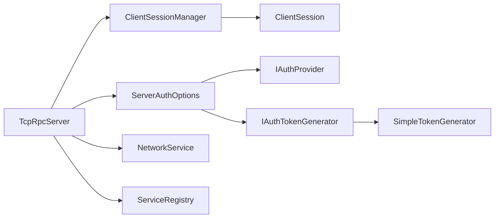

**Diagram sources**
- [TcpRpcServer.cs:34-35](file://TcpRpc/Server/TcpRpcServer.cs#L34-L35)
- [ServerAuthOptions.cs:33-38](file://TcpRpc/Server/ServerAuthOptions.cs#L33-L38)
- [ClientSessionManager.cs:9-25](file://TcpRpc/Server/Auth/ClientSessionManager.cs#L9-L25)
- [ClientSession.cs:6-66](file://TcpRpc/Server/Auth/ClientSession.cs#L6-L66)
- [NetworkService.cs:7-28](file://TcpRpc/Network/NetworkService.cs#L7-L28)
- [ServiceRegistry.cs:10-19](file://TcpRpc/Server/ServiceRegistry.cs#L10-L19)
- [IAuthProvider.cs:32-40](file://TcpRpc/Server/Auth/IAuthProvider.cs#L32-L40)
- [IAuthTokenGenerator.cs:37-54](file://TcpRpc/Server/Auth/IAuthTokenGenerator.cs#L37-L54)
- [SimpleTokenGenerator.cs:11-36](file://TcpRpc/Server/Auth/SimpleTokenGenerator.cs#L11-L36)

**Section sources**
- [TcpRpcServer.cs:34-35](file://TcpRpc/Server/TcpRpcServer.cs#L34-L35)
- [ServerAuthOptions.cs:33-38](file://TcpRpc/Server/ServerAuthOptions.cs#L33-L38)
- [ClientSessionManager.cs:9-25](file://TcpRpc/Server/Auth/ClientSessionManager.cs#L9-L25)
- [ClientSession.cs:6-66](file://TcpRpc/Server/Auth/ClientSession.cs#L6-L66)
- [NetworkService.cs:7-28](file://TcpRpc/Network/NetworkService.cs#L7-L28)
- [ServiceRegistry.cs:10-19](file://TcpRpc/Server/ServiceRegistry.cs#L10-L19)
- [IAuthProvider.cs:32-40](file://TcpRpc/Server/Auth/IAuthProvider.cs#L32-L40)
- [IAuthTokenGenerator.cs:37-54](file://TcpRpc/Server/Auth/IAuthTokenGenerator.cs#L37-L54)
- [SimpleTokenGenerator.cs:11-36](file://TcpRpc/Server/Auth/SimpleTokenGenerator.cs#L11-L36)

## Performance Considerations
- Concurrency: Client tasks are tracked in a concurrent collection; completed tasks are pruned to keep counts accurate and memory efficient.
- Backpressure: Accept loop continues until cancellation; consider tuning timeouts and logging for high-load scenarios.
- Authentication overhead: Session creation and token generation add latency; ensure token lifetimes balance security and performance.
- Network I/O: Large message handling discards content to prevent corruption; consider adjusting thresholds based on expected payload sizes.
- Cleanup: ClientSessionManager’s timer-based cleanup prevents memory leaks from stale sessions.

[No sources needed since this section provides general guidance]

## Troubleshooting Guide
Common issues and resolutions:
- Invalid state transitions:
  - Attempting StartAsync while not in Stopped raises an invalid operation exception. Ensure StopAsync completes and state reaches Stopped before restarting.
- Faulted state:
  - Exceptions during StartAsync set state to Faulted; call StartAsync again after correcting configuration.
- Graceful shutdown:
  - StopAsync cancels all operations and waits for client tasks with a timeout. Investigate slow-disconnecting clients if timeouts occur.
- Authentication failures:
  - Validate IAuthProvider implementation and token generator configuration. Confirm token expiration and claims mapping.
- Session cleanup:
  - If clients appear stuck, verify ClientSessionManager’s cleanup timer and session timeout settings.

**Section sources**
- [TcpRpcServer.cs:89-95](file://TcpRpc/Server/TcpRpcServer.cs#L89-L95)
- [TcpRpcServer.cs:155-158](file://TcpRpc/Server/TcpRpcServer.cs#L155-L158)
- [TcpRpcServer.cs:177-183](file://TcpRpc/Server/TcpRpcServer.cs#L177-L183)
- [ClientSessionManager.cs:159-179](file://TcpRpc/Server/Auth/ClientSessionManager.cs#L159-L179)

## Conclusion
TcpRpcServer implements a robust lifecycle with explicit state transitions, thread-safe state management, and comprehensive authentication and session handling. StartAsync and StopAsync provide predictable startup and shutdown semantics, while ActiveConnections offers operational visibility. Proper configuration of ServerAuthOptions and authentication components ensures secure and scalable operation.