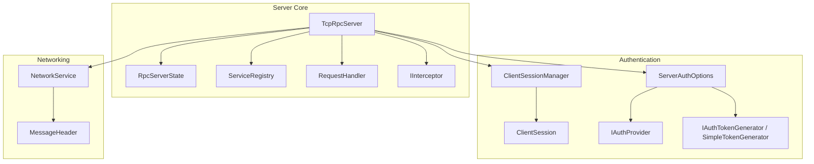
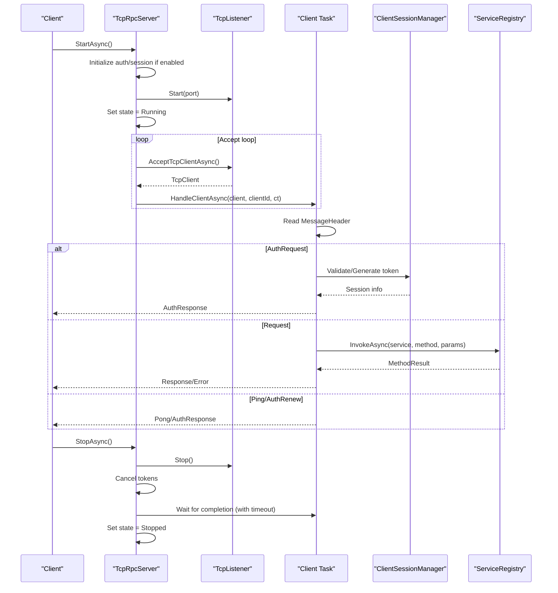
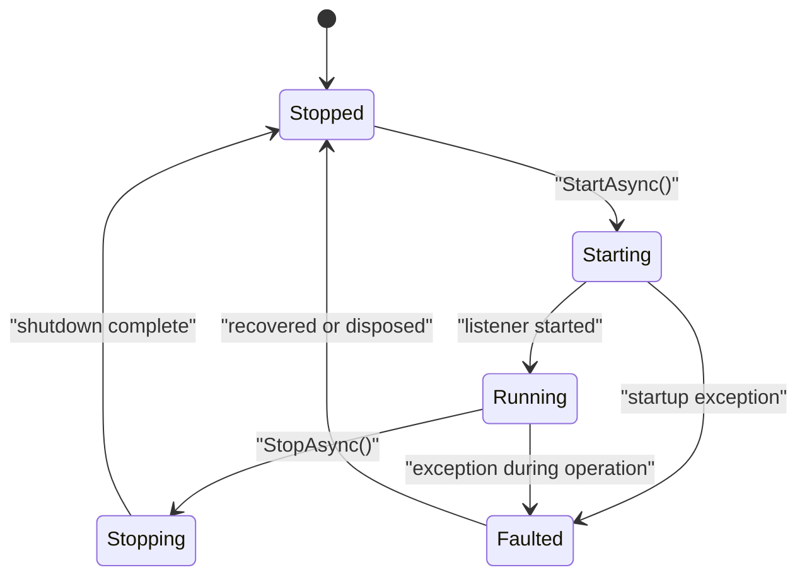
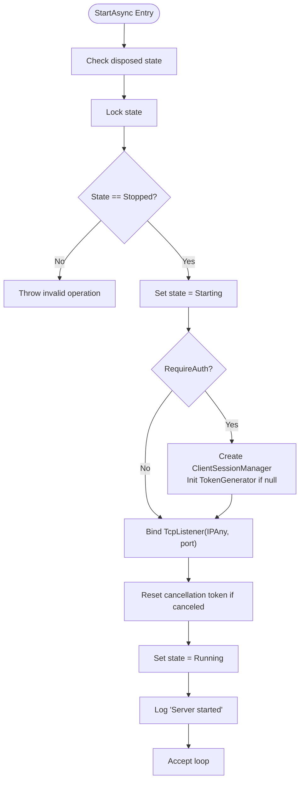
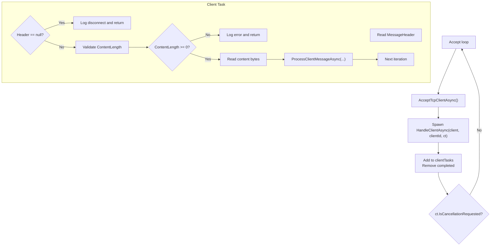
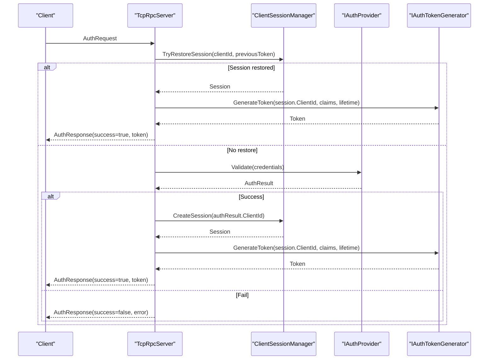
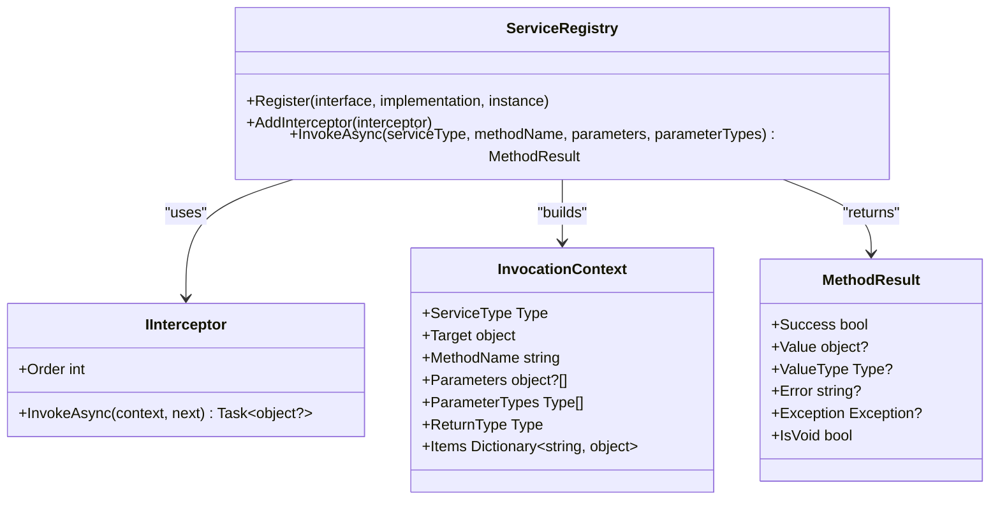
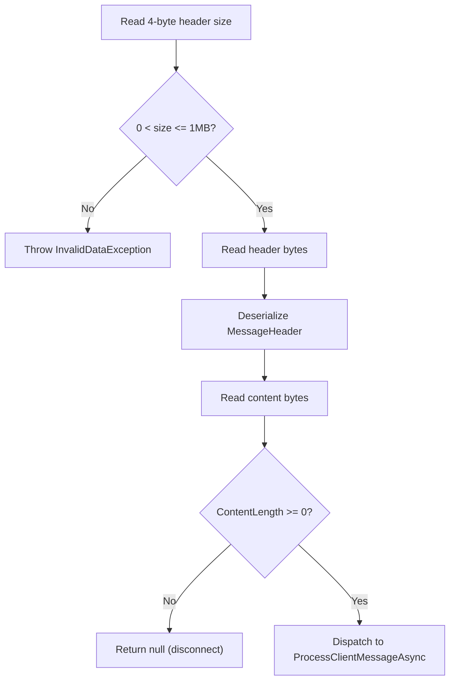
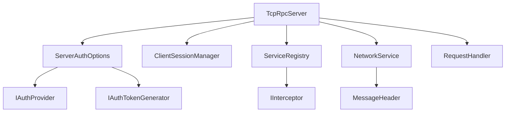

# TcpRpcServer Core Implementation

<cite>
**Referenced Files in This Document**
- [TcpRpcServer.cs](file://TcpRpc/Server/TcpRpcServer.cs)
- [RpcServerState.cs](file://TcpRpc/Server/RpcServerState.cs)
- [ClientSession.cs](file://TcpRpc/Server/Auth/ClientSession.cs)
- [ClientSessionManager.cs](file://TcpRpc/Server/Auth/ClientSessionManager.cs)
- [ServiceRegistry.cs](file://TcpRpc/Server/ServiceRegistry.cs)
- [ServerAuthOptions.cs](file://TcpRpc/Server/ServerAuthOptions.cs)
- [IInterceptor.cs](file://TcpRpc/Server/IInterceptor.cs)
- [RequestHandler.cs](file://TcpRpc/Server/RequestHandler.cs)
- [NetworkService.cs](file://TcpRpc/Network/NetworkService.cs)
- [MessageHeader.cs](file://TcpRpc/Message/MessageHeader.cs)
- [SimpleTokenGenerator.cs](file://TcpRpc/Server/Auth/SimpleTokenGenerator.cs)
- [IAuthProvider.cs](file://TcpRpc/Server/Auth/IAuthProvider.cs)
- [IAuthTokenGenerator.cs](file://TcpRpc/Server/Auth/IAuthTokenGenerator.cs)
- [TcpRpc.csproj](file://TcpRpc/TcpRpc.csproj)
</cite>

## Table of Contents
1. [Introduction](#introduction)
2. [Project Structure](#project-structure)
3. [Core Components](#core-components)
4. [Architecture Overview](#architecture-overview)
5. [Detailed Component Analysis](#detailed-component-analysis)
6. [Dependency Analysis](#dependency-analysis)
7. [Performance Considerations](#performance-considerations)
8. [Troubleshooting Guide](#troubleshooting-guide)
9. [Conclusion](#conclusion)

## Introduction
This document provides comprehensive documentation for the TcpRpcServer core implementation. It explains the server lifecycle management, including StartAsync and StopAsync methods, state transitions through the RpcServerState enumeration, and connection handling. The document covers the main server loop that accepts TCP connections, manages client tasks, and handles concurrent client connections. It also details server initialization with port binding, listener setup, and cancellation token management, along with client connection context management, connection counting, and active connection tracking. Practical examples of server startup, graceful shutdown procedures, and error handling during server operations are included, alongside threading considerations, resource cleanup, and proper disposal patterns.

## Project Structure
The TcpRpcServer resides in the TcpRpc.Server namespace and orchestrates TCP communication, authentication, and service invocation. Key components include:
- TcpRpcServer: Main server class managing lifecycle, connections, and message processing
- RpcServerState: Enumeration defining server states
- ClientSession and ClientSessionManager: Authentication and session management
- ServiceRegistry: New-style service registration and invocation
- ServerAuthOptions: Authentication configuration
- NetworkService and MessageHeader: Network protocol helpers
- IInterceptor and RequestHandler: Extension points for AOP and legacy handlers
- SimpleTokenGenerator and authentication interfaces: Token generation and validation

**Diagram sources**
- [TcpRpcServer.cs:15-74](file://TcpRpc/Server/TcpRpcServer.cs#L15-L74)
- [RpcServerState.cs:3-10](file://TcpRpc/Server/RpcServerState.cs#L3-L10)
- [ServiceRegistry.cs:10-49](file://TcpRpc/Server/ServiceRegistry.cs#L10-L49)
- [RequestHandler.cs](file://TcpRpc/Server/RequestHandler.cs#L5)
- [IInterceptor.cs:6-17](file://TcpRpc/Server/IInterceptor.cs#L6-L17)
- [ServerAuthOptions.cs:8-39](file://TcpRpc/Server/ServerAuthOptions.cs#L8-L39)
- [ClientSession.cs:6-66](file://TcpRpc/Server/Auth/ClientSession.cs#L6-L66)
- [ClientSessionManager.cs:9-25](file://TcpRpc/Server/Auth/ClientSessionManager.cs#L9-L25)
- [NetworkService.cs:7-28](file://TcpRpc/Network/NetworkService.cs#L7-L28)
- [MessageHeader.cs:9-51](file://TcpRpc/Message/MessageHeader.cs#L9-L51)
- [SimpleTokenGenerator.cs:11-36](file://TcpRpc/Server/Auth/SimpleTokenGenerator.cs#L11-L36)
- [IAuthProvider.cs:32-40](file://TcpRpc/Server/Auth/IAuthProvider.cs#L32-L40)
- [IAuthTokenGenerator.cs:37-54](file://TcpRpc/Server/Auth/IAuthTokenGenerator.cs#L37-L54)

**Section sources**
- [TcpRpc.csproj:1-17](file://TcpRpc/TcpRpc.csproj#L1-L17)

## Core Components
This section outlines the primary components and their roles in the server implementation.

- TcpRpcServer
  - Manages server lifecycle via StartAsync and StopAsync
  - Maintains state transitions using RpcServerState
  - Accepts TCP connections and spawns per-client tasks
  - Handles authentication and message routing
  - Provides ActiveConnections count and SessionManager access
  - Implements IDisposable with graceful shutdown and resource cleanup

- RpcServerState
  - Defines server states: Stopped, Starting, Running, Stopping, Faulted

- ClientSession and ClientSessionManager
  - Track client sessions, tokens, and activity timestamps
  - Support session restoration for reconnect scenarios
  - Periodic cleanup of expired sessions

- ServiceRegistry
  - Registers services and resolves method invocations
  - Supports interceptors and type conversion for parameters
  - Returns structured results for success/failure/exceptions

- ServerAuthOptions
  - Configures authentication requirements, token lifetime, session timeouts, and providers

- NetworkService and MessageHeader
  - Provide serialization/deserialization for network messages
  - Enforce header size limits and safe content reading

- IInterceptor and RequestHandler
  - Enable AOP-style interception around method calls
  - Legacy handler support for older invocation patterns

**Section sources**
- [TcpRpcServer.cs:15-74](file://TcpRpc/Server/TcpRpcServer.cs#L15-L74)
- [RpcServerState.cs:3-10](file://TcpRpc/Server/RpcServerState.cs#L3-L10)
- [ClientSession.cs:6-66](file://TcpRpc/Server/Auth/ClientSession.cs#L6-L66)
- [ClientSessionManager.cs:9-25](file://TcpRpc/Server/Auth/ClientSessionManager.cs#L9-L25)
- [ServiceRegistry.cs:10-49](file://TcpRpc/Server/ServiceRegistry.cs#L10-L49)
- [ServerAuthOptions.cs:8-39](file://TcpRpc/Server/ServerAuthOptions.cs#L8-L39)
- [NetworkService.cs:7-28](file://TcpRpc/Network/NetworkService.cs#L7-L28)
- [MessageHeader.cs:9-51](file://TcpRpc/Message/MessageHeader.cs#L9-L51)
- [IInterceptor.cs:6-17](file://TcpRpc/Server/IInterceptor.cs#L6-L17)
- [RequestHandler.cs](file://TcpRpc/Server/RequestHandler.cs#L5)

## Architecture Overview
The TcpRpcServer implements a single-threaded acceptor pattern with per-client asynchronous tasks. The server initializes networking resources, enters a continuous loop accepting connections, and delegates each client to a dedicated task. Authentication and session management are optional but integrated. Service invocation supports both legacy RequestHandler delegates and modern ServiceRegistry-based resolution with interceptors.

**Diagram sources**
- [TcpRpcServer.cs:85-171](file://TcpRpc/Server/TcpRpcServer.cs#L85-L171)
- [TcpRpcServer.cs:173-224](file://TcpRpc/Server/TcpRpcServer.cs#L173-L224)
- [TcpRpcServer.cs:226-313](file://TcpRpc/Server/TcpRpcServer.cs#L226-L313)
- [ClientSessionManager.cs:27-42](file://TcpRpc/Server/Auth/ClientSessionManager.cs#L27-L42)
- [ServiceRegistry.cs:72-138](file://TcpRpc/Server/ServiceRegistry.cs#L72-L138)

## Detailed Component Analysis

### TcpRpcServer Lifecycle and State Management
The server maintains a finite state machine controlled by RpcServerState. The lifecycle proceeds as follows:
- Initialization: Validates state, sets Starting, initializes authentication/session components if enabled, binds TcpListener, resets cancellation token, sets state to Running
- Operation: Continuously accepts connections; for each accepted client, increments a client counter and starts a client task
- Shutdown: Sets state to Stopping, stops the listener, cancels the cancellation token, waits for active client tasks with a timeout, clears tracked tasks, and sets state to Stopped
- Fault handling: Catches exceptions during startup, sets state to Faulted, and rethrows

**Diagram sources**
- [RpcServerState.cs:3-10](file://TcpRpc/Server/RpcServerState.cs#L3-L10)
- [TcpRpcServer.cs:85-171](file://TcpRpc/Server/TcpRpcServer.cs#L85-L171)
- [TcpRpcServer.cs:173-224](file://TcpRpc/Server/TcpRpcServer.cs#L173-L224)

Key implementation details:
- State transitions are guarded by a lock to prevent race conditions
- Cancellation token is recreated if previously canceled to support restart scenarios
- ActiveConnections property cleans completed tasks before returning the count

**Section sources**
- [TcpRpcServer.cs:85-171](file://TcpRpc/Server/TcpRpcServer.cs#L85-L171)
- [TcpRpcServer.cs:173-224](file://TcpRpc/Server/TcpRpcServer.cs#L173-L224)
- [RpcServerState.cs:3-10](file://TcpRpc/Server/RpcServerState.cs#L3-L10)

### Server Initialization and Listener Setup
Initialization encompasses:
- Optional authentication/session initialization when ServerAuthOptions.RequireAuth is true
- TcpListener creation bound to IPAddress.Any on the configured port
- Cancellation token source management and state update to Running
- Logging of successful startup

**Diagram sources**
- [TcpRpcServer.cs:85-131](file://TcpRpc/Server/TcpRpcServer.cs#L85-L131)

**Section sources**
- [TcpRpcServer.cs:85-131](file://TcpRpc/Server/TcpRpcServer.cs#L85-L131)
- [ServerAuthOptions.cs:8-39](file://TcpRpc/Server/ServerAuthOptions.cs#L8-L39)

### Main Server Loop and Client Task Management
The server loop performs the following steps:
- AcceptTcpClientAsync until cancellation
- Increment client counter and spawn HandleClientAsync task
- Maintain a list of client tasks, removing completed ones
- Handle OperationCanceledException as normal shutdown

Each client task manages:
- ClientConnectionContext creation with initial authentication state
- Reading MessageHeader via NetworkService
- Defensive checks for invalid content length
- Conditional content reading with special handling for large payloads
- Dispatching to ProcessClientMessageAsync for message processing
- Error logging and graceful disconnection

**Diagram sources**
- [TcpRpcServer.cs:132-146](file://TcpRpc/Server/TcpRpcServer.cs#L132-L146)
- [TcpRpcServer.cs:226-313](file://TcpRpc/Server/TcpRpcServer.cs#L226-L313)
- [NetworkService.cs:30-52](file://TcpRpc/Network/NetworkService.cs#L30-L52)

**Section sources**
- [TcpRpcServer.cs:132-146](file://TcpRpc/Server/TcpRpcServer.cs#L132-L146)
- [TcpRpcServer.cs:226-313](file://TcpRpc/Server/TcpRpcServer.cs#L226-L313)
- [NetworkService.cs:30-52](file://TcpRpc/Network/NetworkService.cs#L30-L52)

### Client Connection Context and Authentication Flow
ClientConnectionContext tracks per-connection state including authentication status and session reference. The authentication flow supports:
- Optional authentication requirement via ServerAuthOptions
- Session restoration for reconnect scenarios using previous token
- Token generation and renewal with configurable lifetime
- Claim propagation from authentication results to session

**Diagram sources**
- [TcpRpcServer.cs:380-451](file://TcpRpc/Server/TcpRpcServer.cs#L380-L451)
- [TcpRpcServer.cs:453-547](file://TcpRpc/Server/TcpRpcServer.cs#L453-L547)
- [ClientSessionManager.cs:87-116](file://TcpRpc/Server/Auth/ClientSessionManager.cs#L87-L116)
- [IAuthProvider.cs:32-40](file://TcpRpc/Server/Auth/IAuthProvider.cs#L32-L40)
- [IAuthTokenGenerator.cs:37-54](file://TcpRpc/Server/Auth/IAuthTokenGenerator.cs#L37-L54)
- [SimpleTokenGenerator.cs:79-137](file://TcpRpc/Server/Auth/SimpleTokenGenerator.cs#L79-L137)

**Section sources**
- [TcpRpcServer.cs:380-451](file://TcpRpc/Server/TcpRpcServer.cs#L380-L451)
- [TcpRpcServer.cs:453-547](file://TcpRpc/Server/TcpRpcServer.cs#L453-L547)
- [ClientSessionManager.cs:87-116](file://TcpRpc/Server/Auth/ClientSessionManager.cs#L87-L116)
- [IAuthProvider.cs:32-40](file://TcpRpc/Server/Auth/IAuthProvider.cs#L32-L40)
- [IAuthTokenGenerator.cs:37-54](file://TcpRpc/Server/Auth/IAuthTokenGenerator.cs#L37-L54)
- [SimpleTokenGenerator.cs:79-137](file://TcpRpc/Server/Auth/SimpleTokenGenerator.cs#L79-L137)

### Service Invocation and Interception
Service invocation supports two pathways:
- Legacy RequestHandler lookup by method name
- Modern ServiceRegistry-based invocation with parameter type conversion and interceptor chain

Interceptors are ordered and wrap the final action, enabling cross-cutting concerns like logging, metrics, or validation.

**Diagram sources**
- [ServiceRegistry.cs:10-49](file://TcpRpc/Server/ServiceRegistry.cs#L10-L49)
- [ServiceRegistry.cs:158-171](file://TcpRpc/Server/ServiceRegistry.cs#L158-L171)
- [IInterceptor.cs:6-17](file://TcpRpc/Server/IInterceptor.cs#L6-L17)
- [IInterceptor.cs:22-63](file://TcpRpc/Server/IInterceptor.cs#L22-L63)
- [ServiceRegistry.cs:237-271](file://TcpRpc/Server/ServiceRegistry.cs#L237-L271)

**Section sources**
- [ServiceRegistry.cs:72-138](file://TcpRpc/Server/ServiceRegistry.cs#L72-L138)
- [IInterceptor.cs:6-17](file://TcpRpc/Server/IInterceptor.cs#L6-L17)
- [IInterceptor.cs:22-63](file://TcpRpc/Server/IInterceptor.cs#L22-L63)

### Network Protocol and Message Handling
The network layer enforces a strict framing protocol:
- Header size is sent as a 4-byte little-endian integer
- Header bytes are serialized/deserialized using MessageHeader
- Content length is validated and read safely, with special handling for oversized content
- Responses are written with appropriate MessageType based on success/error

**Diagram sources**
- [NetworkService.cs:30-52](file://TcpRpc/Network/NetworkService.cs#L30-L52)
- [MessageHeader.cs:41-72](file://TcpRpc/Message/MessageHeader.cs#L41-L72)
- [TcpRpcServer.cs:246-286](file://TcpRpc/Server/TcpRpcServer.cs#L246-L286)

**Section sources**
- [NetworkService.cs:30-52](file://TcpRpc/Network/NetworkService.cs#L30-L52)
- [MessageHeader.cs:41-72](file://TcpRpc/Message/MessageHeader.cs#L41-L72)
- [TcpRpcServer.cs:246-286](file://TcpRpc/Server/TcpRpcServer.cs#L246-L286)

### Disposal and Resource Cleanup
TcpRpcServer implements IDisposable with the following pattern:
- Attempt graceful StopAsync with a timeout
- Dispose ClientSessionManager and cancellation token
- Suppress finalization to avoid double cleanup

Graceful shutdown ensures:
- Listener stopped and cancellation propagated
- Client tasks awaited with timeout to prevent indefinite blocking
- Active client tasks cleared after shutdown

**Section sources**
- [TcpRpcServer.cs:689-707](file://TcpRpc/Server/TcpRpcServer.cs#L689-L707)
- [TcpRpcServer.cs:173-224](file://TcpRpc/Server/TcpRpcServer.cs#L173-L224)

## Dependency Analysis
The TcpRpcServer coordinates several subsystems with clear boundaries:
- Authentication depends on IAuthProvider and IAuthTokenGenerator
- Session management is encapsulated in ClientSessionManager
- Service invocation uses ServiceRegistry with optional IInterceptor chain
- Networking relies on NetworkService and MessageHeader for protocol framing

**Diagram sources**
- [TcpRpcServer.cs:66-74](file://TcpRpc/Server/TcpRpcServer.cs#L66-L74)
- [ServerAuthOptions.cs:8-39](file://TcpRpc/Server/ServerAuthOptions.cs#L8-L39)
- [ClientSessionManager.cs:9-25](file://TcpRpc/Server/Auth/ClientSessionManager.cs#L9-L25)
- [ServiceRegistry.cs:10-49](file://TcpRpc/Server/ServiceRegistry.cs#L10-L49)
- [IInterceptor.cs:6-17](file://TcpRpc/Server/IInterceptor.cs#L6-L17)
- [NetworkService.cs:7-28](file://TcpRpc/Network/NetworkService.cs#L7-L28)
- [MessageHeader.cs:9-51](file://TcpRpc/Message/MessageHeader.cs#L9-L51)
- [RequestHandler.cs](file://TcpRpc/Server/RequestHandler.cs#L5)

**Section sources**
- [TcpRpcServer.cs:66-74](file://TcpRpc/Server/TcpRpcServer.cs#L66-L74)
- [ServerAuthOptions.cs:8-39](file://TcpRpc/Server/ServerAuthOptions.cs#L8-L39)
- [ClientSessionManager.cs:9-25](file://TcpRpc/Server/Auth/ClientSessionManager.cs#L9-L25)
- [ServiceRegistry.cs:10-49](file://TcpRpc/Server/ServiceRegistry.cs#L10-L49)
- [IInterceptor.cs:6-17](file://TcpRpc/Server/IInterceptor.cs#L6-L17)
- [NetworkService.cs:7-28](file://TcpRpc/Network/NetworkService.cs#L7-L28)
- [MessageHeader.cs:9-51](file://TcpRpc/Message/MessageHeader.cs#L9-L51)
- [RequestHandler.cs](file://TcpRpc/Server/RequestHandler.cs#L5)

## Performance Considerations
- Concurrency model: One acceptor thread plus per-client tasks; suitable for moderate concurrency
- Backpressure: Accept loop continues until cancellation; consider rate limiting at higher loads
- Memory: Large content handling discards oversized payloads to prevent memory pressure
- Authentication overhead: Session creation and token generation add latency; reuse sessions for reconnects
- Interceptor chain: Each interceptor adds invocation overhead; keep chains minimal and efficient
- Logging: Excessive logging can impact throughput; tune log levels appropriately

## Troubleshooting Guide
Common operational issues and resolutions:
- Startup failures
  - Symptoms: Exceptions during StartAsync
  - Causes: Port already in use, insufficient permissions, invalid configuration
  - Resolution: Verify port availability and permissions; check ServerAuthOptions; inspect logs for detailed errors

- Graceful shutdown hangs
  - Symptoms: StopAsync does not return promptly
  - Causes: Long-running client operations or blocked tasks
  - Resolution: Ensure client tasks honor cancellation tokens; adjust timeout in StopAsync; investigate client-side blocking

- Authentication failures
  - Symptoms: Repeated AuthResponse failures or invalid tokens
  - Causes: Incorrect credentials, expired tokens, mismatched ClientId during restore
  - Resolution: Validate IAuthProvider implementation; confirm token lifetime and generator configuration; check ClientSessionManager logs

- Message processing errors
  - Symptoms: Errors logged in HandleClientAsync or ProcessClientMessageAsync
  - Causes: Malformed headers, invalid content length, service invocation exceptions
  - Resolution: Inspect NetworkService Read/Write operations; verify ServiceRegistry registrations; review interceptor logic

- Session cleanup anomalies
  - Symptoms: Accumulation of expired sessions
  - Causes: Timer misconfiguration or exceptions during cleanup
  - Resolution: Confirm SessionTimeout and SessionCleanupInterval; monitor ClientSessionManager logs for cleanup errors

**Section sources**
- [TcpRpcServer.cs:153-160](file://TcpRpc/Server/TcpRpcServer.cs#L153-L160)
- [TcpRpcServer.cs:173-224](file://TcpRpc/Server/TcpRpcServer.cs#L173-L224)
- [TcpRpcServer.cs:297-301](file://TcpRpc/Server/TcpRpcServer.cs#L297-L301)
- [ClientSessionManager.cs:159-179](file://TcpRpc/Server/Auth/ClientSessionManager.cs#L159-L179)

## Conclusion
TcpRpcServer provides a robust foundation for a TCP-based RPC system with clear lifecycle management, optional authentication and session handling, and extensible service invocation through interceptors. The implementation emphasizes safety through defensive checks, cancellation-aware operations, and structured error handling. Proper configuration of ServerAuthOptions, careful resource management, and attention to logging and performance tuning will ensure reliable operation under various load conditions.