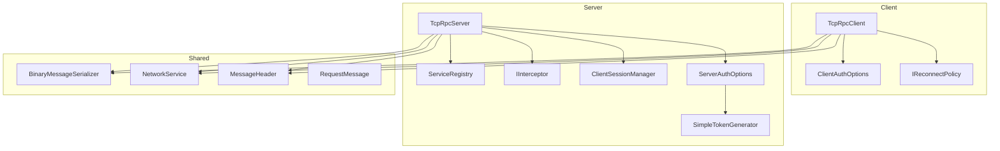
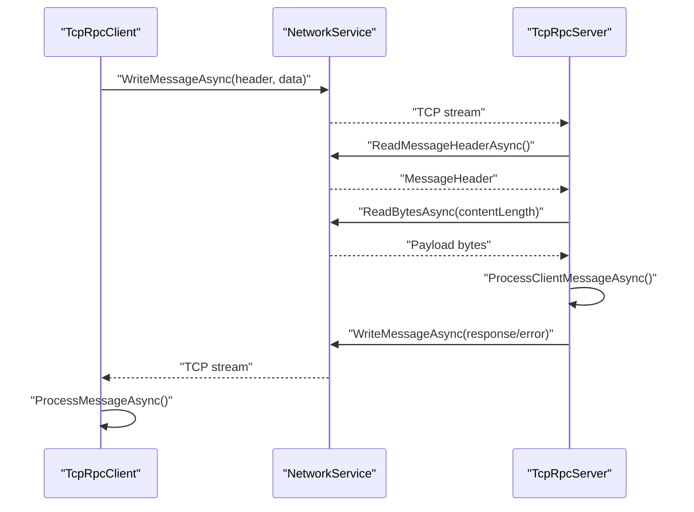
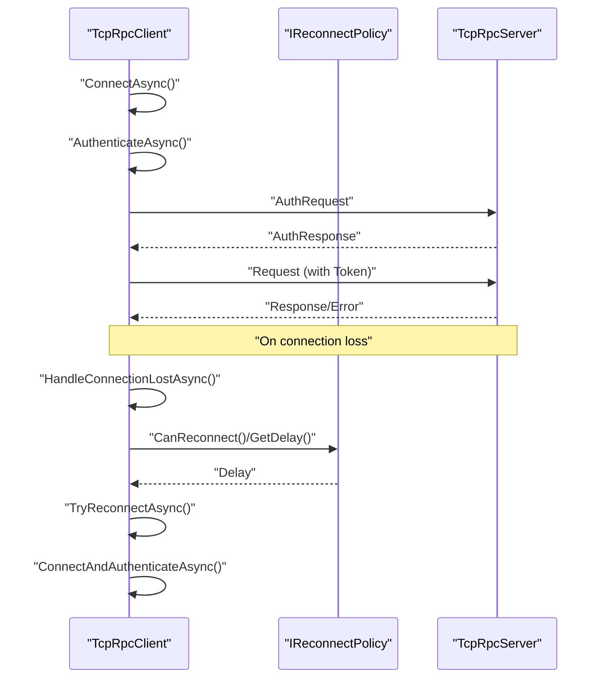
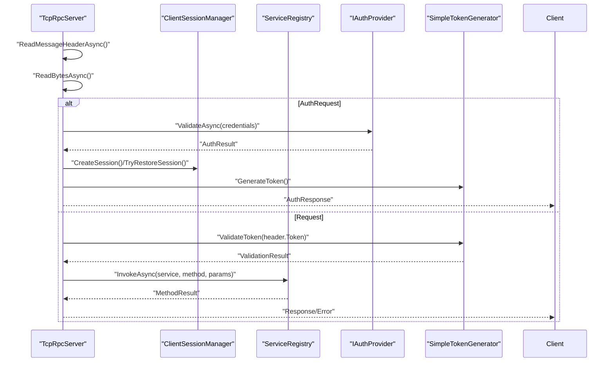
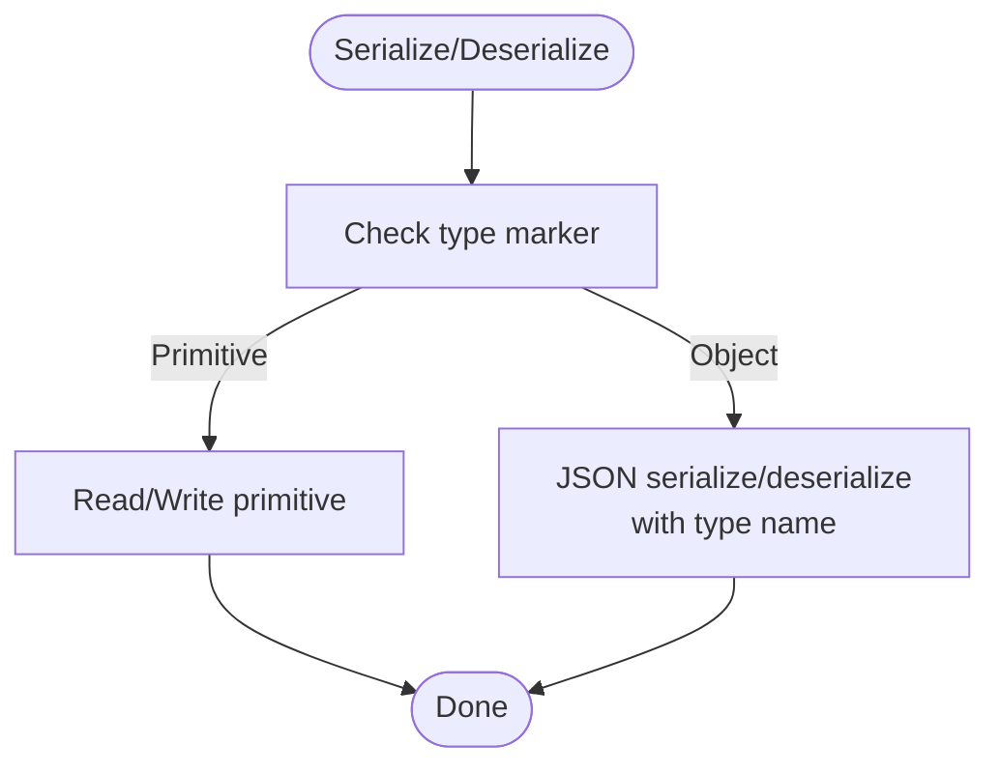
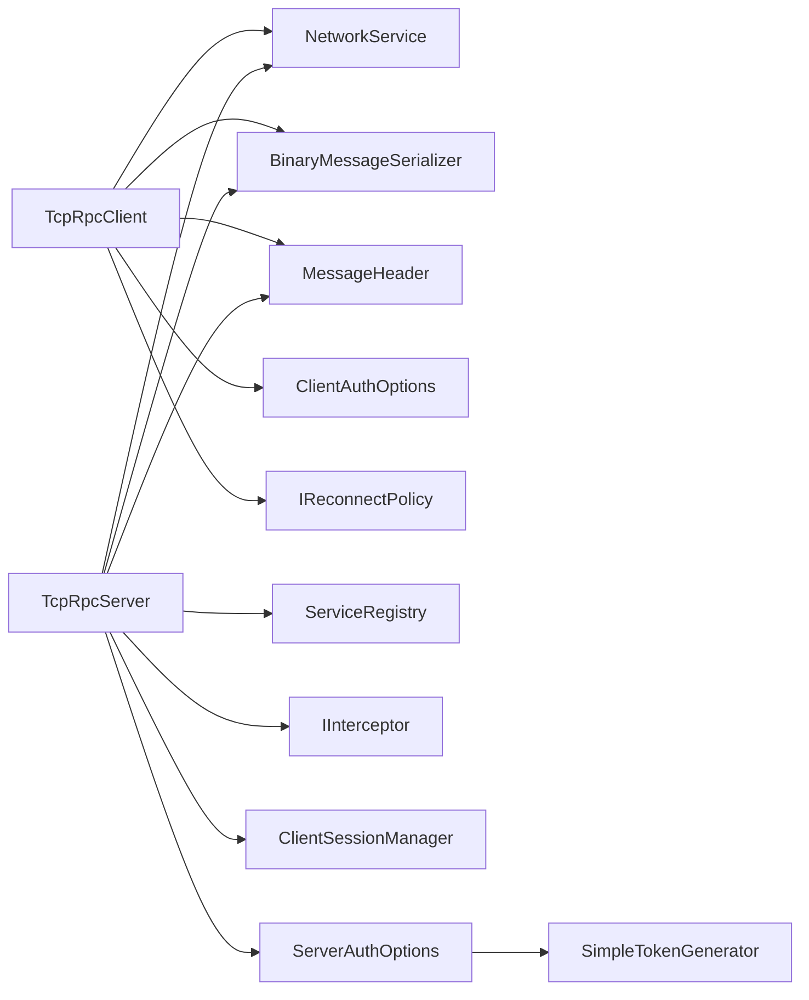

# Troubleshooting & FAQ

<cite>
**Referenced Files in This Document**
- [TcpRpcClient.cs](file://TcpRpc/TcpRpc/Client/TcpRpcClient.cs)
- [RpcException.cs](file://TcpRpc/TcpRpc/RpcException.cs)
- [TcpRpcServer.cs](file://TcpRpc/TcpRpc/Server/TcpRpcServer.cs)
- [BinaryMessageSerializer.cs](file://TcpRpc/TcpRpc/Formatter/BinaryMessageSerializer.cs)
- [NetworkService.cs](file://TcpRpc/TcpRpc/Network/NetworkService.cs)
- [MessageHeader.cs](file://TcpRpc/TcpRpc/Message/MessageHeader.cs)
- [ClientAuthOptions.cs](file://TcpRpc/TcpRpc/Client/ClientAuthOptions.cs)
- [ServerAuthOptions.cs](file://TcpRpc/TcpRpc/Server/ServerAuthOptions.cs)
- [IReconnectPolicy.cs](file://TcpRpc/TcpRpc/Client/IReconnectPolicy.cs)
- [ServiceRegistry.cs](file://TcpRpc/TcpRpc/Server/ServiceRegistry.cs)
- [IInterceptor.cs](file://TcpRpc/TcpRpc/Server/IInterceptor.cs)
- [ClientSessionManager.cs](file://TcpRpc/TcpRpc/Server/Auth/ClientSessionManager.cs)
- [SimpleTokenGenerator.cs](file://TcpRpc/TcpRpc/Server/Auth/SimpleTokenGenerator.cs)
- [RequestMessage.cs](file://TcpRpc/TcpRpc/Message/RequestMessage.cs)
</cite>

## Table of Contents
1. [Introduction](#introduction)
2. [Project Structure](#project-structure)
3. [Core Components](#core-components)
4. [Architecture Overview](#architecture-overview)
5. [Detailed Component Analysis](#detailed-component-analysis)
6. [Dependency Analysis](#dependency-analysis)
7. [Performance Considerations](#performance-considerations)
8. [Troubleshooting Guide](#troubleshooting-guide)
9. [FAQ](#faq)
10. [Monitoring, Alerting, and Operations](#monitoring-alerting-and-operations)
11. [Migration and Compatibility](#migration-and-compatibility)
12. [Conclusion](#conclusion)

## Introduction
This document provides comprehensive troubleshooting and FAQ guidance for the TcpRpc framework. It focuses on diagnosing and resolving common issues during development and production deployment, including connection problems, authentication failures, serialization errors, and performance bottlenecks. It also covers logging strategies, error handling patterns, recovery mechanisms, monitoring, alerting, and operational excellence. Guidance on migrating between versions and compatibility considerations is included to help teams maintain robust, scalable deployments.

## Project Structure
The TcpRpc project is organized into client, server, formatter, message, network, and authentication modules. The client module encapsulates connection lifecycle, authentication, request retries, and automatic reconnection. The server module manages listeners, per-client handlers, authentication, session management, and service invocation via a registry and optional interceptors. The formatter and network modules handle binary serialization and reliable message framing. Authentication is pluggable and supports token generation/validation and session restoration.

**Diagram sources**
- [TcpRpcClient.cs:10-684](file://TcpRpc/TcpRpc/Client/TcpRpcClient.cs#L10-L684)
- [TcpRpcServer.cs:15-707](file://TcpRpc/TcpRpc/Server/TcpRpcServer.cs#L15-L707)
- [BinaryMessageSerializer.cs:11-444](file://TcpRpc/TcpRpc/Formatter/BinaryMessageSerializer.cs#L11-L444)
- [NetworkService.cs:7-99](file://TcpRpc/TcpRpc/Network/NetworkService.cs#L7-L99)
- [MessageHeader.cs:9-73](file://TcpRpc/TcpRpc/Message/MessageHeader.cs#L9-L73)
- [RequestMessage.cs:6-18](file://TcpRpc/TcpRpc/Message/RequestMessage.cs#L6-L18)
- [ClientAuthOptions.cs:6-38](file://TcpRpc/TcpRpc/Client/ClientAuthOptions.cs#L6-L38)
- [ServerAuthOptions.cs:8-40](file://TcpRpc/TcpRpc/Server/ServerAuthOptions.cs#L8-L40)
- [IReconnectPolicy.cs:6-100](file://TcpRpc/TcpRpc/Client/IReconnectPolicy.cs#L6-L100)
- [ServiceRegistry.cs:10-272](file://TcpRpc/TcpRpc/Server/ServiceRegistry.cs#L10-L272)
- [IInterceptor.cs:6-64](file://TcpRpc/TcpRpc/Server/IInterceptor.cs#L6-L64)
- [ClientSessionManager.cs:9-188](file://TcpRpc/TcpRpc/Server/Auth/ClientSessionManager.cs#L9-L188)
- [SimpleTokenGenerator.cs:11-163](file://TcpRpc/TcpRpc/Server/Auth/SimpleTokenGenerator.cs#L11-L163)

**Section sources**
- [TcpRpcClient.cs:10-684](file://TcpRpc/TcpRpc/Client/TcpRpcClient.cs#L10-L684)
- [TcpRpcServer.cs:15-707](file://TcpRpc/TcpRpc/Server/TcpRpcServer.cs#L15-L707)
- [BinaryMessageSerializer.cs:11-444](file://TcpRpc/TcpRpc/Formatter/BinaryMessageSerializer.cs#L11-L444)
- [NetworkService.cs:7-99](file://TcpRpc/TcpRpc/Network/NetworkService.cs#L7-L99)
- [MessageHeader.cs:9-73](file://TcpRpc/TcpRpc/Message/MessageHeader.cs#L9-L73)
- [ClientAuthOptions.cs:6-38](file://TcpRpc/TcpRpc/Client/ClientAuthOptions.cs#L6-L38)
- [ServerAuthOptions.cs:8-40](file://TcpRpc/TcpRpc/Server/ServerAuthOptions.cs#L8-L40)
- [IReconnectPolicy.cs:6-100](file://TcpRpc/TcpRpc/Client/IReconnectPolicy.cs#L6-L100)
- [ServiceRegistry.cs:10-272](file://TcpRpc/TcpRpc/Server/ServiceRegistry.cs#L10-L272)
- [IInterceptor.cs:6-64](file://TcpRpc/TcpRpc/Server/IInterceptor.cs#L6-L64)
- [ClientSessionManager.cs:9-188](file://TcpRpc/TcpRpc/Server/Auth/ClientSessionManager.cs#L9-L188)
- [SimpleTokenGenerator.cs:11-163](file://TcpRpc/TcpRpc/Server/Auth/SimpleTokenGenerator.cs#L11-L163)

## Core Components
- TcpRpcClient: Manages connection, authentication, request sending, response handling, timeouts, ping/pong, and automatic reconnection policies.
- TcpRpcServer: Accepts connections, authenticates clients, routes requests to services, handles errors, and manages sessions.
- BinaryMessageSerializer: Provides compact binary serialization for requests, responses, and auth messages with type markers and JSON fallback for complex objects.
- NetworkService: Implements reliable message framing with header size prefix, header and body reads/writes, and defensive checks.
- MessageHeader: Encodes message type, id, length, flags, and optional token for per-message authentication.
- ClientAuthOptions and ServerAuthOptions: Configure timeouts, credentials, auto-reconnect, session lifetimes, and token generators.
- IReconnectPolicy: Pluggable exponential backoff, fixed delay, or disabled reconnection strategies.
- ServiceRegistry and IInterceptor: New-style service registration and AOP-style interception pipeline.
- ClientSessionManager and SimpleTokenGenerator: Session lifecycle, token generation/validation, and session restoration.

**Section sources**
- [TcpRpcClient.cs:10-684](file://TcpRpc/TcpRpc/Client/TcpRpcClient.cs#L10-L684)
- [TcpRpcServer.cs:15-707](file://TcpRpc/TcpRpc/Server/TcpRpcServer.cs#L15-L707)
- [BinaryMessageSerializer.cs:11-444](file://TcpRpc/TcpRpc/Formatter/BinaryMessageSerializer.cs#L11-L444)
- [NetworkService.cs:7-99](file://TcpRpc/TcpRpc/Network/NetworkService.cs#L7-L99)
- [MessageHeader.cs:9-73](file://TcpRpc/TcpRpc/Message/MessageHeader.cs#L9-L73)
- [ClientAuthOptions.cs:6-38](file://TcpRpc/TcpRpc/Client/ClientAuthOptions.cs#L6-L38)
- [ServerAuthOptions.cs:8-40](file://TcpRpc/TcpRpc/Server/ServerAuthOptions.cs#L8-L40)
- [IReconnectPolicy.cs:6-100](file://TcpRpc/TcpRpc/Client/IReconnectPolicy.cs#L6-L100)
- [ServiceRegistry.cs:10-272](file://TcpRpc/TcpRpc/Server/ServiceRegistry.cs#L10-L272)
- [IInterceptor.cs:6-64](file://TcpRpc/TcpRpc/Server/IInterceptor.cs#L6-L64)
- [ClientSessionManager.cs:9-188](file://TcpRpc/TcpRpc/Server/Auth/ClientSessionManager.cs#L9-L188)
- [SimpleTokenGenerator.cs:11-163](file://TcpRpc/TcpRpc/Server/Auth/SimpleTokenGenerator.cs#L11-L163)

## Architecture Overview
The framework uses a TCP-based binary protocol with explicit message framing. Clients send typed messages (requests, auth, ping) with a header containing type, id, length, flags, and optional token. Servers authenticate, route to services, and return either success responses or error envelopes carrying exception metadata.

**Diagram sources**
- [NetworkService.cs:10-52](file://TcpRpc/TcpRpc/Network/NetworkService.cs#L10-L52)
- [TcpRpcServer.cs:226-451](file://TcpRpc/TcpRpc/Server/TcpRpcServer.cs#L226-L451)
- [TcpRpcClient.cs:414-540](file://TcpRpc/TcpRpc/Client/TcpRpcClient.cs#L414-L540)

**Section sources**
- [NetworkService.cs:7-99](file://TcpRpc/TcpRpc/Network/NetworkService.cs#L7-L99)
- [TcpRpcServer.cs:226-451](file://TcpRpc/TcpRpc/Server/TcpRpcServer.cs#L226-L451)
- [TcpRpcClient.cs:414-540](file://TcpRpc/TcpRpc/Client/TcpRpcClient.cs#L414-L540)

## Detailed Component Analysis

### Client-Side Flow: Connection, Authentication, Requests, and Reconnection
- Connection lifecycle enforces state transitions and prevents illegal operations.
- Authentication sends credentials or restores sessions using tokens; timeouts and cancellation are supported.
- Requests carry per-message tokens; errors propagate with exception metadata.
- Automatic reconnection follows configured policies and resets counters upon success.

**Diagram sources**
- [TcpRpcClient.cs:75-269](file://TcpRpc/TcpRpc/Client/TcpRpcClient.cs#L75-L269)
- [IReconnectPolicy.cs:6-100](file://TcpRpc/TcpRpc/Client/IReconnectPolicy.cs#L6-L100)
- [TcpRpcServer.cs:380-451](file://TcpRpc/TcpRpc/Server/TcpRpcServer.cs#L380-L451)

**Section sources**
- [TcpRpcClient.cs:75-269](file://TcpRpc/TcpRpc/Client/TcpRpcClient.cs#L75-L269)
- [IReconnectPolicy.cs:6-100](file://TcpRpc/TcpRpc/Client/IReconnectPolicy.cs#L6-L100)
- [TcpRpcServer.cs:380-451](file://TcpRpc/TcpRpc/Server/TcpRpcServer.cs#L380-L451)

### Server-Side Flow: Authentication, Session Management, and Service Invocation
- Accepts clients, validates headers, reads content safely, and processes messages.
- Supports session restoration and token renewal; enforces auth when enabled.
- Invokes services via ServiceRegistry with optional interceptor chain and returns structured responses.

**Diagram sources**
- [TcpRpcServer.cs:226-680](file://TcpRpc/TcpRpc/Server/TcpRpcServer.cs#L226-L680)
- [ClientSessionManager.cs:88-116](file://TcpRpc/TcpRpc/Server/Auth/ClientSessionManager.cs#L88-L116)
- [ServiceRegistry.cs:72-138](file://TcpRpc/TcpRpc/Server/ServiceRegistry.cs#L72-L138)
- [SimpleTokenGenerator.cs:79-137](file://TcpRpc/TcpRpc/Server/Auth/SimpleTokenGenerator.cs#L79-L137)

**Section sources**
- [TcpRpcServer.cs:226-680](file://TcpRpc/TcpRpc/Server/TcpRpcServer.cs#L226-L680)
- [ClientSessionManager.cs:88-116](file://TcpRpc/TcpRpc/Server/Auth/ClientSessionManager.cs#L88-L116)
- [ServiceRegistry.cs:72-138](file://TcpRpc/TcpRpc/Server/ServiceRegistry.cs#L72-L138)
- [SimpleTokenGenerator.cs:79-137](file://TcpRpc/TcpRpc/Server/Auth/SimpleTokenGenerator.cs#L79-L137)

### Serialization and Message Integrity
- BinaryMessageSerializer encodes primitives, arrays, and complex objects with type markers and JSON fallback.
- NetworkService enforces header size limits and safe content reads; MessageHeader supports flags and optional token.

**Diagram sources**
- [BinaryMessageSerializer.cs:119-321](file://TcpRpc/TcpRpc/Formatter/BinaryMessageSerializer.cs#L119-L321)
- [NetworkService.cs:30-98](file://TcpRpc/TcpRpc/Network/NetworkService.cs#L30-L98)
- [MessageHeader.cs:41-72](file://TcpRpc/TcpRpc/Message/MessageHeader.cs#L41-L72)

**Section sources**
- [BinaryMessageSerializer.cs:119-321](file://TcpRpc/TcpRpc/Formatter/BinaryMessageSerializer.cs#L119-L321)
- [NetworkService.cs:30-98](file://TcpRpc/TcpRpc/Network/NetworkService.cs#L30-L98)
- [MessageHeader.cs:41-72](file://TcpRpc/TcpRpc/Message/MessageHeader.cs#L41-L72)

## Dependency Analysis
- Client depends on NetworkService, BinaryMessageSerializer, MessageHeader, ClientAuthOptions, and IReconnectPolicy.
- Server depends on NetworkService, BinaryMessageSerializer, MessageHeader, ServiceRegistry, IInterceptor, ClientSessionManager, and ServerAuthOptions with SimpleTokenGenerator.
- Interceptors are ordered and chained around service invocation.
- Session manager maintains token-to-session mapping and periodic cleanup.

**Diagram sources**
- [TcpRpcClient.cs:10-684](file://TcpRpc/TcpRpc/Client/TcpRpcClient.cs#L10-L684)
- [TcpRpcServer.cs:15-707](file://TcpRpc/TcpRpc/Server/TcpRpcServer.cs#L15-L707)
- [BinaryMessageSerializer.cs:11-444](file://TcpRpc/TcpRpc/Formatter/BinaryMessageSerializer.cs#L11-L444)
- [NetworkService.cs:7-99](file://TcpRpc/TcpRpc/Network/NetworkService.cs#L7-L99)
- [MessageHeader.cs:9-73](file://TcpRpc/TcpRpc/Message/MessageHeader.cs#L9-L73)
- [ServiceRegistry.cs:10-272](file://TcpRpc/TcpRpc/Server/ServiceRegistry.cs#L10-L272)
- [IInterceptor.cs:6-64](file://TcpRpc/TcpRpc/Server/IInterceptor.cs#L6-L64)
- [ClientSessionManager.cs:9-188](file://TcpRpc/TcpRpc/Server/Auth/ClientSessionManager.cs#L9-L188)
- [ServerAuthOptions.cs:8-40](file://TcpRpc/TcpRpc/Server/ServerAuthOptions.cs#L8-L40)
- [SimpleTokenGenerator.cs:11-163](file://TcpRpc/TcpRpc/Server/Auth/SimpleTokenGenerator.cs#L11-L163)

**Section sources**
- [TcpRpcClient.cs:10-684](file://TcpRpc/TcpRpc/Client/TcpRpcClient.cs#L10-L684)
- [TcpRpcServer.cs:15-707](file://TcpRpc/TcpRpc/Server/TcpRpcServer.cs#L15-L707)
- [BinaryMessageSerializer.cs:11-444](file://TcpRpc/TcpRpc/Formatter/BinaryMessageSerializer.cs#L11-L444)
- [NetworkService.cs:7-99](file://TcpRpc/TcpRpc/Network/NetworkService.cs#L7-L99)
- [MessageHeader.cs:9-73](file://TcpRpc/TcpRpc/Message/MessageHeader.cs#L9-L73)
- [ServiceRegistry.cs:10-272](file://TcpRpc/TcpRpc/Server/ServiceRegistry.cs#L10-L272)
- [IInterceptor.cs:6-64](file://TcpRpc/TcpRpc/Server/IInterceptor.cs#L6-L64)
- [ClientSessionManager.cs:9-188](file://TcpRpc/TcpRpc/Server/Auth/ClientSessionManager.cs#L9-L188)
- [ServerAuthOptions.cs:8-40](file://TcpRpc/TcpRpc/Server/ServerAuthOptions.cs#L8-L40)
- [SimpleTokenGenerator.cs:11-163](file://TcpRpc/TcpRpc/Server/Auth/SimpleTokenGenerator.cs#L11-L163)

## Performance Considerations
- Message size limits: NetworkService defends against invalid header sizes and large payloads by discarding oversized content after reading to prevent downstream corruption.
- Serialization overhead: BinaryMessageSerializer uses type markers and JSON fallback; avoid excessively large payloads and ensure parameter types match to minimize conversion costs.
- Concurrency: TcpRpcClient uses concurrent dictionaries for pending requests and locks for state transitions; ensure callers do not block the receive thread.
- Reconnection backoff: Prefer exponential backoff to reduce thundering herd on server restarts; tune MaxReconnectAttempts and delays.
- Session cleanup: Server runs periodic cleanup for expired sessions; configure SessionTimeout and SessionCleanupInterval appropriately for workload.

[No sources needed since this section provides general guidance]

## Troubleshooting Guide

### Connection Problems
Symptoms:
- ConnectAsync throws or leaves client in Disconnected/Faulted state.
- Receive loop exits early or logs operation canceled exceptions.
- Ping fails or times out.

Common causes and fixes:
- Host/port unreachable or firewall blocking: Verify connectivity and ports.
- Connect timeout exceeded: Increase ClientAuthOptions.ConnectTimeout.
- Premature cancellation: Ensure the cancellation token is not canceled externally.
- Race conditions during connect/receive: The client starts the receive task before marking Connected to avoid races.

Diagnostic steps:
- Enable debug logs for TcpRpcClient and TcpRpcServer.
- Confirm NetworkService header size and content length validations are not triggered.
- Use PingAsync to probe liveness and measure latency.

**Section sources**
- [TcpRpcClient.cs:75-130](file://TcpRpc/TcpRpc/Client/TcpRpcClient.cs#L75-L130)
- [TcpRpcClient.cs:414-475](file://TcpRpc/TcpRpc/Client/TcpRpcClient.cs#L414-L475)
- [NetworkService.cs:30-52](file://TcpRpc/TcpRpc/Network/NetworkService.cs#L30-L52)
- [TcpRpcClient.cs:599-658](file://TcpRpc/TcpRpc/Client/TcpRpcClient.cs#L599-L658)

### Authentication Failures
Symptoms:
- AuthenticateAsync throws RpcException with authentication failure message.
- Requests return Not authenticated or Invalid token errors.
- Session restore fails with warnings.

Common causes and fixes:
- Incorrect credentials: Ensure ClientAuthOptions.Credentials are correct and match IAuthProvider expectations.
- Token expired or invalid: Renew token via AuthRenew or reconnect with previous token for session restore.
- Auth provider misconfiguration: Verify ServerAuthOptions.AuthProvider and TokenGenerator setup.
- ClientId mismatch during restore: Ensure the client uses the same ClientId across reconnects.

Diagnostic steps:
- Inspect RpcException.RemoteExceptionType and RemoteStackTrace for server-side stack traces.
- Check Server logs for session creation/restoration and token validation outcomes.
- Validate token format and expiration using SimpleTokenGenerator.ValidateToken logic.

**Section sources**
- [TcpRpcClient.cs:144-227](file://TcpRpc/TcpRpc/Client/TcpRpcClient.cs#L144-L227)
- [TcpRpcServer.cs:380-451](file://TcpRpc/TcpRpc/Server/TcpRpcServer.cs#L380-L451)
- [TcpRpcServer.cs:453-547](file://TcpRpc/TcpRpc/Server/TcpRpcServer.cs#L453-L547)
- [ClientSessionManager.cs:88-116](file://TcpRpc/TcpRpc/Server/Auth/ClientSessionManager.cs#L88-L116)
- [RpcException.cs:6-36](file://TcpRpc/TcpRpc/RpcException.cs#L6-L36)
- [SimpleTokenGenerator.cs:79-137](file://TcpRpc/TcpRpc/Server/Auth/SimpleTokenGenerator.cs#L79-L137)

### Serialization Errors
Symptoms:
- Deserialization throws “Unknown type marker” or “Type not found”.
- Large payload causes server to drop content and log length warnings.
- Parameter type mismatch leads to conversion failures.

Common causes and fixes:
- Missing assembly/type name for complex objects: Ensure types are loadable on both sides.
- Payload too large: Reduce message size or adjust server-side thresholds.
- Parameter type mismatch: Align RequestMessage.ParameterTypes with actual argument types.

Diagnostic steps:
- Compare type markers and JSON fallback paths in BinaryMessageSerializer.
- Verify MessageHeader flags and content length in NetworkService.
- Log RequestMessage.ServiceType, Method, and ParameterTypes on both client and server.

**Section sources**
- [BinaryMessageSerializer.cs:316-321](file://TcpRpc/TcpRpc/Formatter/BinaryMessageSerializer.cs#L316-L321)
- [BinaryMessageSerializer.cs:308-314](file://TcpRpc/TcpRpc/Formatter/BinaryMessageSerializer.cs#L308-L314)
- [NetworkService.cs:67-82](file://TcpRpc/TcpRpc/Network/NetworkService.cs#L67-L82)
- [RequestMessage.cs:6-18](file://TcpRpc/TcpRpc/Message/RequestMessage.cs#L6-L18)
- [MessageHeader.cs:41-72](file://TcpRpc/TcpRpc/Message/MessageHeader.cs#L41-L72)

### Timeouts and Retries
Symptoms:
- SendRequestAsync throws TimeoutException.
- Requests fail due to connection errors and trigger reconnection.

Common causes and fixes:
- Request timeout too low: Increase timeoutMs in SendRequestAsync.
- Network latency or server overload: Tune timeouts and enable auto-reconnect.
- Connection errors: TcpRpcClient treats IOException/SocketException as transient and attempts reconnect.

Diagnostic steps:
- Review client logs for timeout and reconnection attempts.
- Confirm IReconnectPolicy configuration and exponential backoff behavior.
- Validate server-side processing time and service invocation metrics.

**Section sources**
- [TcpRpcClient.cs:324-407](file://TcpRpc/TcpRpc/Client/TcpRpcClient.cs#L324-L407)
- [TcpRpcClient.cs:384-400](file://TcpRpc/TcpRpc/Client/TcpRpcClient.cs#L384-L400)
- [IReconnectPolicy.cs:57-85](file://TcpRpc/TcpRpc/Client/IReconnectPolicy.cs#L57-L85)

### Memory Leaks and Resource Cleanup
Symptoms:
- Increasing memory usage over time.
- Open sockets or streams not closing.

Common causes and fixes:
- Forgetting to dispose TcpRpcClient/TcpRpcServer instances.
- Not awaiting StopAsync/DisconnectAsync properly.
- Pending request TCS not being completed or cleared.

Diagnostic steps:
- Ensure Dispose() is called and resources are released.
- Verify cancellation tokens are canceled during shutdown.
- Confirm pending collections are cleared on connection loss.

**Section sources**
- [TcpRpcClient.cs:660-684](file://TcpRpc/TcpRpc/Client/TcpRpcClient.cs#L660-L684)
- [TcpRpcServer.cs:689-707](file://TcpRpc/TcpRpc/Server/TcpRpcServer.cs#L689-L707)
- [TcpRpcServer.cs:173-224](file://TcpRpc/TcpRpc/Server/TcpRpcServer.cs#L173-L224)

### Scalability and Throughput
Symptoms:
- High latency under load.
- Many pending requests or timeouts.

Common causes and fixes:
- Too many concurrent requests without batching.
- Serialization overhead from large objects.
- Insufficient server threads or slow interceptors/services.

Diagnostic steps:
- Monitor ActiveConnections and queue depths.
- Profile serialization and deserialization paths.
- Use interceptors for throttling or circuit breaking.

**Section sources**
- [TcpRpcServer.cs:49-59](file://TcpRpc/TcpRpc/Server/TcpRpcServer.cs#L49-L59)
- [ServiceRegistry.cs:158-171](file://TcpRpc/TcpRpc/Server/ServiceRegistry.cs#L158-L171)

## FAQ

Q: How do I configure authentication?
A: On the server, set ServerAuthOptions.RequireAuth and provide an IAuthProvider and optional IAuthTokenGenerator. On the client, populate ClientAuthOptions.Credentials and optionally set ClientId for session restoration.

Q: What does RpcException represent?
A: It wraps server-side exceptions and carries RemoteExceptionType and RemoteStackTrace for accurate diagnostics.

Q: How do I handle reconnections?
A: Enable ClientAuthOptions.AutoReconnect and choose an IReconnectPolicy (fixed delay or exponential backoff). The client will attempt reconnects automatically and reset counters on success.

Q: How do I monitor active connections on the server?
A: Use TcpRpcServer.ActiveConnections property to track live client tasks.

Q: How do I renew tokens?
A: Clients can send an AuthRenew message; the server generates a new token and updates the session mapping.

Q: Why am I getting “Unknown type marker”?
A: The serializer encountered an unexpected type marker. Ensure both sides share compatible serializers and types are loadable.

Q: How do I detect if a client is authenticated?
A: Check TcpRpcClient.IsAuthenticated and TcpRpcServer.IsAuthEnabled.

Q: How do I disable authentication?
A: Set ServerAuthOptions.RequireAuth to false on the server.

Q: How do I increase message size limits?
A: Adjust server-side content handling; note the existing logic drops oversized content after reading to protect downstream.

Q: How do I add middleware-like behavior?
A: Implement IInterceptor and register via ServiceRegistry.AddInterceptor; interceptors are ordered by Order and form a chain.

**Section sources**
- [ServerAuthOptions.cs:8-40](file://TcpRpc/TcpRpc/Server/ServerAuthOptions.cs#L8-L40)
- [ClientAuthOptions.cs:6-38](file://TcpRpc/TcpRpc/Client/ClientAuthOptions.cs#L6-L38)
- [RpcException.cs:6-36](file://TcpRpc/TcpRpc/RpcException.cs#L6-L36)
- [TcpRpcClient.cs:232-269](file://TcpRpc/TcpRpc/Client/TcpRpcClient.cs#L232-L269)
- [TcpRpcServer.cs:49-59](file://TcpRpc/TcpRpc/Server/TcpRpcServer.cs#L49-L59)
- [TcpRpcServer.cs:429-449](file://TcpRpc/TcpRpc/Server/TcpRpcServer.cs#L429-L449)
- [BinaryMessageSerializer.cs:316-321](file://TcpRpc/TcpRpc/Formatter/BinaryMessageSerializer.cs#L316-L321)
- [IInterceptor.cs:6-64](file://TcpRpc/TcpRpc/Server/IInterceptor.cs#L6-L64)
- [ServiceRegistry.cs:55-59](file://TcpRpc/TcpRpc/Server/ServiceRegistry.cs#L55-L59)

## Monitoring, Alerting, and Operations
- Logging: Enable debug logs for TcpRpcClient and TcpRpcServer to capture connection events, authentication outcomes, timeouts, and errors.
- Metrics: Track ActiveConnections, number of pending requests, and reconnection attempts. Surface these via your metrics stack.
- Health checks: Use PingAsync to periodically verify liveness.
- Alerts: Alert on sustained high latencies, repeated timeouts, excessive reconnections, or authentication failures.
- Operational excellence: Rotate secrets for SimpleTokenGenerator, monitor session counts and cleanup intervals, and tune timeouts and backoff policies based on environment.

[No sources needed since this section provides general guidance]

## Migration and Compatibility
- Version updates: When upgrading, verify serializer compatibility and ensure both client and server use matching versions of BinaryMessageSerializer and MessageHeader semantics.
- Breaking changes: If MessageHeader flags or serializer format change, coordinate rollouts with rolling restarts.
- Authentication: If switching AuthProvider or TokenGenerator, update both server configuration and client credentials accordingly.
- Interceptors: If adding/removing interceptors, validate ordering and ensure backward compatibility of InvocationContext usage.

[No sources needed since this section provides general guidance]

## Conclusion
This guide consolidates practical troubleshooting, diagnostics, and operational best practices for the TcpRpc framework. By leveraging built-in logging, timeouts, reconnection policies, and structured error handling, teams can achieve resilient, observable, and scalable deployments. Regular monitoring, conservative backoff tuning, and careful authentication management are essential for production stability.